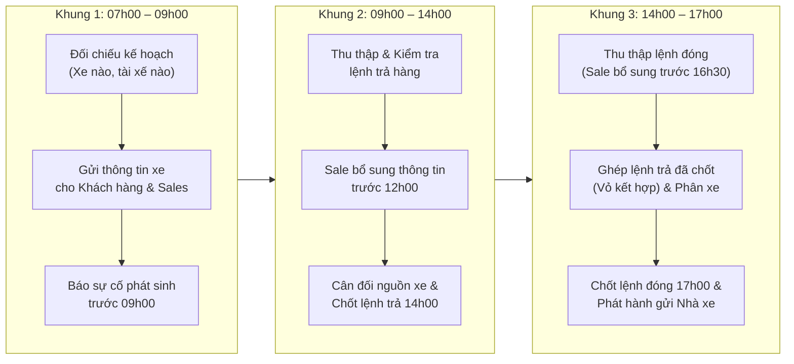
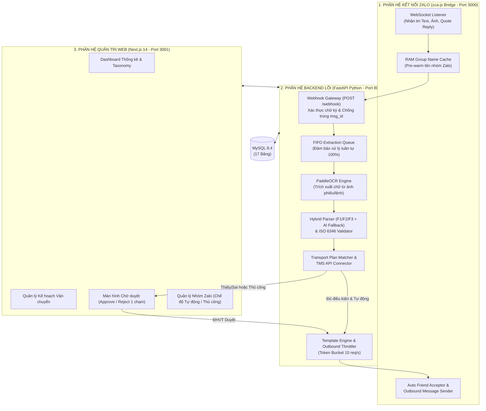

# BÁO CÁO TỔNG HỢP DỰ ÁN: HỆ THỐNG BOT ZALO OA – TỰ ĐỘNG HÓA LỌC, BÓC TÁCH & ĐỊNH TUYẾN TIN NHẮN NHÀ XE (PM TMS VSICO)

**Đơn vị**: Phòng Phân tích Nghiệp vụ & Phát triển Phần mềm – VSICO Logistics
**Dự án**: Bot Zalo OA – Chuyển Tin Nhà Xe & Tích Hợp Hệ Thống Quản Lý Vận Tải (PM TMS)
**Người lập báo cáo**: Vũ Tiến Đạt
**Ngày lập**: 09/11/2026
**Trạng thái dự án**: Đã hoàn thiện Hệ thống Lõi (Backend + Zalo Bridge + OCR + Web Dashboard) & Chuẩn hóa Tích hợp API TMS. Đang sửa lại database, phần xử lý tin nhắn raw để hiểu bối cảnh của cuộc trò chuyện. 

---

## MỤC LỤC

1. [Bối cảnh Nghiệp vụ &amp; Bài toán Thực tế tại VSICO](#1-bối-cảnh-nghiệp-vụ--bài-toán-thực-tế-tại-vsico)
2. [Đánh giá &amp; So sánh Các Phương án Kết nối Zalo (Zalo OA / GMF vs ZCA Bridge)](#2-đánh-giá--so-sánh-các-phương-án-kết-nối-zalo-zalo-oa--gmf-vs-zca-bridge)
3. [Khảo sát Dữ liệu &amp; Hệ thống Phân loại Tin nhắn (Taxonomy Bảng 1 &amp; Bảng 2)](#3-khảo-sát-dữ-liệu--hệ-thống-phân-loại-tin-nhắn-taxonomy-bảng-1--bảng-2)
4. [Kiến trúc Hệ thống Tổng thể &amp; Công nghệ Triển khai](#4-kiến-trúc-hệ-thống-tổng-thể--công-nghệ-triển-khai)
5. [Chi tiết Logic Xử lý &amp; Thuật toán Bóc tách 5 Tầng](#5-chi-tiết-logic-xử-lý--thuật-toán-bóc-tách-5-tầng)
6. [Cơ chế Định tuyến, Phê duyệt &amp; Tích hợp API PM TMS](#6-cơ-chế-định-tuyến-phê-duyệt--tích-hợp-api-pm-tms)
7. [Thiết kế Cơ sở Dữ liệu (17 Bảng Quan hệ MySQL)](#7-thiết-kế-cơ-sở-dữ-liệu-17-bảng-quan-hệ-mysql)
8. [Kết quả Kiểm thử, Đánh giá Hiệu năng &amp; Lộ trình Tiếp theo](#8-kết-quả-kiểm-thử-đánh-giá-hiệu-năng--lộ-trình-tiếp-theo)

---

## 1. BỐI CẢNH NGHIỆP VỤ & BÀI TOÁN THỰC TẾ TẠI VSICO

### 1.1. Quy trình làm việc hàng ngày của Điều hành Vận tải (ĐHVT)

Trong chuỗi vận hành container đường bộ của **VSICO**, bộ phận Điều hành Vận tải (ĐHVT) quản lý hàng chục nhóm Zalo nhà xe (khoảng 22+ nhóm nhà xe vệ tinh) và hàng trăm nhóm Zalo khách hàng theo 3 khung giờ cao điểm trong ngày:



Song song xuyên suốt từ `07h00 – 17h00`, ĐHVT phải liên tục xử lý:

- **Điều xe trong ngày**: Tiếp nhận biển số đầu kéo, rơ-moóc, tên tài xế, SĐT, số container, số chì (seal), giờ dự kiến đến kho từ các nhóm Zalo nhà xe.
- **Tìm vỏ cont & Ghép vỏ trả hàng**: Ghép các vỏ container vừa trả hàng nhập vào các lệnh đóng hàng xuất kết hợp để tối ưu chi phí vận tải.
- **Báo cáo định kỳ**: Tổng hợp báo cáo tiến độ lúc `09h00`, `12h00` và `16h00`.

### 1.2. Khi vận hành thủ công

1. **Áp lực thời gian & Quá tải thông tin**: Khung giờ `07h00 – 09h00` sáng, hàng trăm tin nhắn từ các nhà xe đổ về cùng lúc. ĐHVT phải đọc bằng mắt, đối chiếu kế hoạch, copy-paste chỉnh sửa lại câu chữ và chuyển tiếp sang từng nhóm Zalo khách hàng.
2. **Dữ liệu phi cấu trúc, biến thiên phức tạp**:
   - Tài xế/nhà xe nhắn tin gõ tắt, không dấu, dính chữ, gửi nhiều xe trong 1 tin, hoặc chụp ảnh bảng kê/phiếu giao nhận gửi vào nhóm.
   - Thay đổi liên tục: Đổi tài xế đột xuất (chỉ báo biển số không ghi số cont), gửi bổ sung số chì sau khi lấy cont, xin hủy chuyến, hoặc bấm "Trả lời" (Quote/Reply) tin nhắn cũ.
3. **Rủi ro sai sót nghiệp vụ nghiêm trọng**:
   - **Sai số Container**: Gõ nhầm 1 chữ số kiểm tra (Check Digit) dẫn đến sai lệnh nâng/hạ tại cảng, phát sinh chi phí DEM/DET.
   - **Gửi nhầm nhóm khách hàng**: Copy nhầm thông tin xe của khách A gửi vào nhóm khách B, hoặc lộ từ khóa nhạy cảm nội bộ (*"ghép vỏ"*, *"vỏ kết hợp"*).
   - **Không kiểm soát được nhà xe lạ**: Nhà xe không được phân công nhưng báo nhầm số container của đơn vị khác.

---

## 2. ĐÁNH GIÁ & SO SÁNH CÁC PHƯƠNG ÁN KẾT NỐI ZALO (ZALO OA / GMF VS ZCA BRIDGE)

Một nhiệm vụ trọng tâm của giai đoạn phân tích (BA) là khảo sát, kiểm chứng kỹ thuật, giới hạn và chi phí của các phương án thu thập và gửi tin nhắn trên nền tảng Zalo.

### 2.1. Bảng so sánh 4 phương án kỹ thuật

| Tiêu chí                                                     | 1. Zalo OA có tính năng Nhóm (GMF)                                                                                                   | 2. Nhà xe nhắn 1-1 trực tiếp vào Zalo OA                                         | 3. Zalo Bot (Zalo Bot Creator)                                    | 4. Cầu nối ZCA Bridge (`zca-js` + Webhook)                                                                   |
| :------------------------------------------------------------- | :--------------------------------------------------------------------------------------------------------------------------------------- | :------------------------------------------------------------------------------------ | :---------------------------------------------------------------- | :--------------------------------------------------------------------------------------------------------------- |
| **Cơ chế hoạt động**                                | OA tham gia nhóm GMF do OA quản lý và nhận sự kiện qua Webhook OpenAPI v3.0.                                                      | Nhà xe chat trực tiếp vào trang Zalo OA của VSICO.                               | Thêm Bot vào nhóm chat thông thường.                        | Kết nối qua WebSocket của tài khoản Zalo Điều hành viên, đẩy sự kiện sang Backend.                  |
| **Lấy tên nhóm (`group_name`) & tên người gửi** | **Chỉ lấy được** trong nhóm GMF do Doanh nghiệp khởi tạo (`GET /v2.0/oa/group/...`).                                    | Lấy được thông tin người gửi 1-1, không có ngữ cảnh nhóm.                | Không đọc được danh sách nhóm tự nhiên.                 | **Lấy được 100%** tên nhóm (`getGroupInfo`) và tên hiển thị người gửi (`dName`).          |
| **Khả năng tham gia nhóm chat hiện có**             | **Không thể** tham gia vào các nhóm Zalo cá nhân tự lập sẵn của nhà xe/tài xế. Phải tạo lại toàn bộ nhóm mới. | Không áp dụng cho mô hình nhóm nhiều điều hành viên.                       | Chỉ nhận được tin nhắn khi người dùng gõ `@tên_bot`. | **Hoạt động ngay lập tức** trên toàn bộ 22+ nhóm nhà xe và nhóm khách hàng hiện hữu.       |
| **Đọc tin nhắn tự động 100%**                      | Có (trong nhóm GMF).                                                                                                                   | Có (trong khung chat 1-1).                                                           | **Không** (Bỏ sót tin nếu nhà xe quên tag `@bot`).  | **Có 100%** (Bắt mọi tin văn bản, hình ảnh, trích dẫn reply).                                     |
| **Tác động tới thói quen của Nhà xe**             | Cao (Phải chuyển toàn bộ thành viên sang nhóm GMF mới).                                                                          | Rất cao (Mất tính minh bạch trao đổi nhóm giữa nhiều ĐHVT và nhà xe).     | Cao (Bắt buộc nhà xe phải nhớ cú pháp tag bot).            | **Bằng 0** (Nhà xe và ĐHVT giữ nguyên 100% cách làm việc hiện tại).                             |
| **Chi phí & Ràng buộc pháp lý Zalo**                | Tốn phí duy trì gói Zalo OA Doanh nghiệp, hạn mức quota gọi API & kiểm duyệt template nghiêm ngặt.                           | Tương tự Zalo OA chuẩn (giới hạn cửa sổ tương tác 48h và phí tin nhắn). | Giới hạn tính năng, không đáp ứng nghiệp vụ vận tải.  | Chi phí hạ tầng bằng 0. Tuy nhiên cần bộ **Outbound Rate Limiter** để tránh bị Zalo khóa spam. |

### 2.2. Giải pháp Kiến trúc Kết hợp (Hybrid Connector Architecture) đã lựa chọn

Để vừa **chạy thực tế ngay lập tức trên các nhóm hiện có**, vừa **sẵn sàng chuyển đổi lên Zalo OA Doanh nghiệp (GMF)** bất kỳ lúc nào mà không phải viết lại code nghiệp vụ:

1. **Nguyên tắc Cô lập Zalo Payload (Zalo Schema Isolation)**:
   - Mọi dữ liệu thô từ Zalo (`zca-js` hoặc `Zalo OA Webhook`) đều được chuyển đổi tại tầng `ingestion/normalizer.py` về một cấu trúc nội bộ duy nhất là `InboundMessage`.
   - Lõi nghiệp vụ (`domain/`, `parsing/`, `handlers/`) hoàn toàn độc lập với kênh giao tiếp.
2. **Bảo vệ Tài khoản bằng Thuật toán Token Bucket (`ZaloOutboundThrottler`)**:
   - Giới hạn tốc độ gửi ra tối đa **10 request/giây**, dung lượng đệm (Burst Capacity) **20 tokens**, tự động lùi thời gian theo hàm mũ (Exponential Backoff) nếu gặp mã lỗi `HTTP 429` và tự động chấp nhận kết bạn để tránh lỗi `ZcaApiError code: 123` (*"Không thể nhận tin nhắn từ bạn"*).

---

## 3. KHẢO SÁT DỮ LIỆU & HỆ THỐNG PHÂN LOẠI TIN NHẮN (TAXONOMY BẢNG 1 & BẢNG 2)

Qua khảo sát dữ liệu thực tế từ các nhóm nhà xe Bắc – Trung – Nam, hệ thống đã chuẩn hóa **3 định dạng đầu vào chính (F1, F2, F3)** cùng định dạng tự do, đồng thời xây dựng bộ **Taxonomy 2 bảng** để đo lường và lọc nhiễu tự động.

### 3.1. Các định dạng tin nhắn đặc trưng của Nhà xe

- **Định dạng F1 (Đặc trưng Nhà xe Miền Bắc)**: Mỗi xe một dòng, các trường ngăn cách bằng dấu gạch chéo `/`:
  ```text
  15H-067.22 / 15R-153.30 / Nguyễn Văn Tùng / 0912931783 / TGCU2203372 / chì 87127361 / Đóng hàng
  ```
- **Định dạng F2 (Đặc trưng ĐHVT Miền Nam / HCM)**: Phân dòng gạch đầu dòng có nhãn trường rõ ràng:
  ```text
  Ngày: 06/11 Đóng , Trả hàng:
  - Tên lái xe: Trần Quốc Bảo - ĐT: 0903976359
  - Số xe: 50H-049.15 / 51R-123.45
  - Số cont: VSIU7399796 - Số seal: 73957169
  - Thời gian xe đến kho: 08:00
  ```
- **Định dạng F3 (Mẫu chuẩn VSICO)**: Cấu trúc tiêu đề đầy đủ `Khách hàng:`, `Lệnh:`, `Biển số xe:`, `Điểm đóng/trả:`.
- **Định dạng Tự do & Hình ảnh (`tu_do` / `image`)**: Tin nhắn dạng bảng (`|`, `\t`), viết liền không nhãn, hoặc chụp ảnh phiếu giao nhận/bảng kê Excel gửi trực tiếp vào nhóm.

### 3.2. Hệ thống Phân loại Ngữ nghĩa Taxonomy (Bảng 1 & Bảng 2)

Mỗi tin nhắn đi qua hệ thống đều được gắn nhãn tự động trong `< 1ms` (lưu tại `extraction_runs.output_data`):

- **Bảng 1 (39 Mã thuộc tính từ `1.1` đến `1.6`)**:
  - `1.1`: Nhận diện loại lệnh & cấu trúc (`1.1.1` Lệnh đóng, `1.1.2` Lệnh trả, `1.1.8` Nhiều lệnh trong 1 tin...).
  - `1.2`: Thông tin xe & tài xế (`1.2.1` Biển đầu kéo, `1.2.3` Biển rơ-moóc, `1.2.7` Thiếu thông tin tài xế, `1.2.8` Đổi xe/tài xế...).
  - `1.3`: Container & số chì (`1.3.1` Số cont chuẩn, `1.3.2` Cont sai định dạng/checksum, `1.3.4` Chờ báo số chì sau...).
  - `1.4`: Kho, khách hàng & địa điểm.
  - `1.5`: Thời gian & tiến độ (`1.5.1` Giờ đến dự kiến, `1.5.6` Lùi giờ/đổi lịch...).
  - `1.6`: Định dạng, bố cục & ngoại lệ (`1.6.10` Trích dẫn tin nhắn cũ, `1.6.12` Tin trùng lặp, `1.6.13` Tin xã giao/rác).
- **Bảng 2 (40 Mẫu hình tin nhắn thực tế `T01` $\rightarrow$ `T40`)**:
  - Mỗi tin nhắn được gán một `primary_type` duy nhất để thống kê không trùng lặp trên Dashboard (ví dụ: `T01` Lệnh đóng chuẩn, `T02` Lệnh trả chuẩn, `T11` Sai check digit ISO 6346, `T28` Đổi xe/tài xế, `T31` Tin trích dẫn Reply, `T33` Tin không phải lệnh vận tải).

---

## 4. KIẾN TRÚC HỆ THỐNG TỔNG THỂ & CÔNG NGHỆ TRIỂN KHAI

Hệ thống được thiết kế theo mô hình **Clean Architecture (Kiến trúc phân tầng hướng tâm)**, chia thành 3 phân hệ rõ rệt:



### Đặc điểm kỹ thuật cốt lõi:

1. **Xử lý tuần tự nghiêm ngặt (FIFO Sequential Queue)**: Tin nhắn số 1 phải hoàn tất bóc tách và cập nhật trạng thái vào Database trước khi Tin nhắn số 2 được xử lý. Điều này đảm bảo các tin nhắn sửa đổi/bổ sung đến ngay sau tin gốc luôn tìm thấy dữ liệu của tin trước đó.
2. **Đọc hiểu Đa phương tiện (PaddleOCR Integration)**: Khi nhà xe gửi ảnh chụp bảng điều xe hoặc phiếu giao nhận (`chat.photo`), hệ thống tự động tải ảnh, tiền xử lý độ tương phản và chạy **PaddleOCR** để chuyển thành văn bản trước khi đưa vào bộ bóc tách `TripParser`.
3. **Chính sách Zero Mock Data trên Frontend**: Giao diện quản trị xây dựng bằng **Next.js 14 (App Router) + TypeScript + Tailwind CSS (Dark Mode)** truy vấn 100% dữ liệu thời gian thực từ REST API của Backend.

---

## 5. CHI TIẾT LOGIC XỬ LÝ & THUẬT TOÁN BÓC TÁCH 5 TẦNG

Khi một tin nhắn đi vào Worker xử lý, hệ thống thực thi tuần tự qua **Pipeline 5 tầng**:

### Tầng 1: Tiền xử lý & Tách khối Trích dẫn (`MessageSegmenter.strip_quoted_block`)

- Tách biệt phần nội dung mới người dùng vừa gõ (`new_content`) khỏi phần nội dung tin nhắn cũ được trích dẫn (`quoted_content`), đồng thời ghi nhận `quote_msg_id` để phục vụ tra cứu ngữ cảnh.

### Tầng 2: Phân đoạn Đa Xe / Đa Container (`MessageSegmenter.segment`)

- Giữ lại tiêu đề ngữ cảnh chung ở đầu tin nhắn (ví dụ: Ngày chạy, Tên kho, Tên khách hàng, Loại lệnh Đóng/Trả).
- Tách một tin nhắn chứa 5–10 xe thành từng khối văn bản độc lập, gán ngữ cảnh chung vào từng khối và quy chuẩn về **Bản ghi chuẩn (Canonical Record)** — mỗi container là 1 dòng bản ghi độc lập.

### Tầng 3: Bóc tách Thực thể Chuyên sâu (`TripParser`)

- **Biển số đầu kéo & Rơ-moóc**: Nhận diện cả biển viết liền (`15C12345`) và có dấu phân cách (`15C-123.45`), tự động tách biển đầu kéo (`C`, `H`, `K`) và biển rơ-moóc (`R`).
- **Số Container & Kích thước**: Bắt định dạng 4 chữ cái (hậu tố thiết bị `U`, `J`, `Z`) + 6 đến 7 chữ số; nhận diện kích thước `20DC`, `40HC`, `40HQ`, `20RF`, `40RF`...
- **Tên Tài xế (Thuật toán Triệt tiêu - Masking)**: Loại bỏ các thực thể đã biết (biển số, số cont, SĐT, số chì, giờ hẹn, từ khóa lệnh) khỏi câu, kết hợp nhận diện tiền tố (`TX`, `tài xế`, `lái xe`) để trích xuất chính xác họ tên tài xế mà không làm biến đổi dấu tiếng Việt gốc.
- **Fallback AI Parser**: Với các tin nhắn văn xuôi phức tạp hoặc bố cục bất thường, hệ thống tự động gọi dịch vụ AI Fallback kèm cơ chế hạ cấp an toàn (Graceful Degradation) nếu mạng ngoại tuyến.

### Tầng 4: Thẩm định Quy tắc Nghiệp vụ Lõi (`src/domain/rules.py`)

1. **Kiểm tra Check Digit Container theo chuẩn Quốc tế ISO 6346 (Modulo 11)**:
   - Quy đổi 4 chữ cái đầu sang giá trị số (từ `A=10` đến `Z=38`, bỏ qua các bội số của 11 là `11, 22, 33`).
   - Nhân 10 ký tự đầu với trọng số lũy thừa $2^i$ ($i \in [0..9]$):
     $$
     \text{Check Digit} = \left( \sum_{i=0}^{9} V_i \times 2^i \pmod{11} \right) \pmod{10}
     $$
   - Nếu chữ số thứ 11 không khớp kết quả tính toán $\rightarrow$ Gắn cờ `check_digit_valid = False`, cảnh báo `sai_check_digit_iso6346` và **tuyệt đối không tự ý sửa số cont**, giữ lại chờ xác nhận.
2. **Chuẩn hóa Số điện thoại & Bảo mật PII**:
   - Đưa mọi định dạng `+84...`, `0903.976.359` về chuẩn 10 số `0903976359` trong Database.
   - Khi xuất bản tin gửi nhóm khách hàng hoặc ghi log: Tự động che số điện thoại theo quy định bảo mật thông tin.

### Tầng 5: Quản lý Ngữ cảnh & Cập nhật Phiên bản (Context & Versioning)

- **Đổi tài xế chỉ báo biển số xe**: Khi nhà xe nhắn *"Đổi tài xế xe 51C-384.88 sang Võ Văn Tám 0918..."* (không ghi số cont), hệ thống tự động tra ngược trong lịch sử các chuyến đang chạy của nhà xe đó theo biển số `51C38488`, tìm ra container tương ứng, tăng phiên bản lên `Version 2` và kết xuất bản tin `THÔNG BÁO CẬP NHẬT`.
- **Ghép thông tin bổ sung (`SUPPLEMENT`)**: Khi chuyến xe đang ở trạng thái chờ bổ sung số chì/giờ đến, tin nhắn bổ sung tiếp theo sẽ tự động được gộp vào bản nháp trước đó để hoàn tất thông báo.

---

## 6. CƠ CHẾ ĐỊNH TUYẾN, PHÊ DUYỆT & TÍCH HỢP API PM TMS

### 6.1. Cơ chế Định tuyến theo Từng Container & Tách "Vỏ Kết Hợp"

Mục tiêu sống còn của hệ thống là **0 tin nhắn gửi nhầm khách hàng**:

1. **Ánh xạ 2 chiều**:
   - **Bảng 1 (Nhà xe)**: `group_id` nhóm Zalo gửi tin $\rightarrow$ `carrier_id` (Đơn vị vận tải). Nếu một container của Nhà xe A lại được báo từ nhóm của Nhà xe B $\rightarrow$ Phát hiện cảnh báo an ninh **`sai_nha_xe`** và chặn gửi tự động.
   - **Bảng 2 (Kho + Khách hàng + Loại lệnh)**: Tổ hợp `(forwarder_id, customer_id, warehouse_id, order_type)` $\rightarrow$ `target_group_id` (Nhóm Zalo của khách hàng). Không dùng riêng tên kho làm khóa vì một kho có thể phục vụ nhiều khách hàng khác nhau.
2. **Xử lý "Vỏ kết hợp" (`dispatch_mode = 1`)**:
   - Khi một vỏ container vừa dùng để **Trả hàng** cho Khách hàng A, sau đó dùng tiếp để **Đóng hàng** cho Khách hàng B: Hệ thống tự động tách thành **2 bản tin độc lập** định tuyến tới 2 nhóm khách hàng tương ứng, đồng thời loại bỏ hoàn toàn chữ *"kết hợp"* trong nội dung gửi khách.

### 6.2. Tích hợp Trực tiếp Hệ thống PM TMS qua REST API

Hệ thống đã chuẩn hóa luồng đồng bộ dữ liệu trực tiếp với **PM TMS**:

| STT | Endpoint API TMS                      | Mục đích sử dụng trong Bot Zalo                                                                                                                                                                                  |
| :-- | :------------------------------------ | :-------------------------------------------------------------------------------------------------------------------------------------------------------------------------------------------------------------------- |
| 1   | `POST /api/login`                   | Đăng nhập theo tài khoản Trưởng phòng Forwarder (`role_id = 1`), lấy Bearer Token (hiệu lực 24h, tự động làm mới khi nhận `401`).                                                                |
| 2   | `GET /api/carriers`                 | Đồng bộ danh mục Nhà xe đang hoạt động (`status = 1`), chuẩn hóa về `carrier_id` để ánh xạ với `group_id` nhóm Zalo nhà xe.                                                                  |
| 3   | `GET /api/warehouses`               | Đọc danh mục Kho và mảng `forwarder_relations` để lấy liên kết chuẩn `(warehouse_id, forwarder_id, customer_id)`.                                                                                      |
| 4   | `GET /api/customers/get-dropdown`   | Lấy danh sách toàn bộ khách hàng (`id, name, short_name, tax_code`) để xây dựng từ điển nhận diện tên viết tắt của khách.                                                                       |
| 5   | `GET /api/dispatch/confirmed`       | Lấy danh sách các chuyến đã gán nhà xe trong ngày (`plan_date`), đọc `dispatch_mode` (1: kết hợp, 2: hạ rỗng, 3: kéo thẳng), `return_order` và `loading_order`.                             |
| 6   | `GET /api/transport-plan/my-orders` | Lấy danh sách lệnh trong khoảng ngày (`start_date`, `end_date`) có gắn `customer_id`, nối với `return_order.id` / `loading_order.id` để xác định chính xác chủ hàng của từng container. |

### 6.3. Hai Chế độ Vận hành Linh hoạt & Phê duyệt Đa kênh

Mỗi nhóm Zalo trên hệ thống có thể cấu hình chế độ gửi (`send_mode`):

- **Chế độ Tự động (`tu_dong`)**: Nếu tin nhắn có đủ 4 trường cốt lõi (Biển số, Tài xế/SĐT, Số Cont chuẩn ISO 6346, Số Chì) và khớp Kế hoạch vận chuyển $\rightarrow$ Tự động chuyển trạng thái `processed` và phát hành thông báo sang nhóm khách hàng.
- **Chế độ Thủ công (`thu_cong`) hoặc Tin nhắn Thiếu/Cảnh báo**:
  - Tin nhắn được đưa vào trạng thái **`pending_review` (Chờ duyệt)**.
  - **Cách 1 (Duyệt trên Web Dashboard)**: ĐHVT xem chi tiết trên màn hình *"Danh sách chờ duyệt"*, chỉnh sửa trực tiếp các trường nếu cần, sau đó bấm **"Duyệt & Gửi"** hoặc **"Từ chối"**.
  - **Cách 2 (Duyệt nhanh trên điện thoại Zalo)**: ĐHVT bấm Trả lời (Quote) tin nhắn nháp của Bot ngay trên nhóm Zalo nội bộ:
    - Nhắn `ok` $\rightarrow$ Bot tự động duyệt và phát hành tin cho khách.
    - Nhắn `sửa xe 15H-067.22, sửa chì 888999` $\rightarrow$ Bot cập nhật bản nháp theo thông tin mới.
    - Nhắn `huỷ` $\rightarrow$ Bot hủy bản nháp, không gửi ra ngoài.

---

## 7. THIẾT KẾ CƠ SỞ DỮ LIỆU (17 BẢNG QUAN HỆ MYSQL)

Toàn bộ dữ liệu vận hành được lưu trữ bền vững trên hệ quản trị cơ sở dữ liệu **MySQL 8.4** (quản lý schema qua Alembic Migrations) gồm **17 bảng** chia thành 5 phân vùng:

1. **Phân vùng Danh mục & Cấu hình Đối tác (5 bảng)**:
   - `carriers` (Nhà xe), `customers` (Khách hàng), `warehouses` (Kho bãi), `zalo_groups` (Nhóm Zalo & cấu hình `send_mode`, `group_role`), `group_sender_rules` (Phân quyền người gửi trong nhóm).
2. **Phân vùng Tiếp nhận Tin nhắn & Đính kèm (2 bảng)**:
   - `zalo_messages` (Tin nhắn gốc, trạng thái `received` $\rightarrow$ `queued` $\rightarrow$ `processed` / `pending_review` / `ignored_chat`), `message_attachments` (Lưu URL ảnh/file phục vụ OCR).
3. **Phân vùng Bóc tách Thực thể & AI/OCR Audit (3 bảng)**:
   - `extraction_runs` (Lưu lịch sử chạy Parser/AI/OCR, độ trễ `latency_ms`, `confidence`, và kết quả phân loại `taxonomy`), `truck_records` (Đầu kéo, rơ-moóc, tài xế, SĐT), `container_jobs` (Từng container độc lập, kết quả kiểm tra ISO 6346, trạng thái khớp lệnh).
4. **Phân vùng Kế hoạch Vận chuyển & Đối soát TMS (2 bảng)**:
   - `transport_plans` (Kế hoạch đóng/trả đồng bộ từ TMS hoặc file import), `plan_match_history` (Lịch sử đối khớp tự động hoặc thủ công).
5. **Phân vùng Xuất bản Thông báo, Phê duyệt & Giám sát (5 bảng)**:
   - `outbound_messages` (Bản tin gửi nhóm khách hàng), `outbound_message_items` (Liên kết các container trong bản tin), `bot_replies` (Tin phản hồi lại nhóm nhà xe khi thiếu thông tin), `review_actions` (Nhật ký ĐHVT bấm Duyệt / Từ chối / Chỉnh sửa), `system_audit_logs` (Nhật ký toàn hệ thống).

*(Chi tiết từng cột, kiểu dữ liệu, khóa ngoại và sơ đồ ERD được trình bày đầy đủ trong tệp [`DATABASE_SCHEMA.md`](file:///home/datbritget/Documents/vsico_zalo_bot/DATABASE_SCHEMA.md)).*

---

## 8. KẾT QUẢ KIỂM THỬ, ĐÁNH GIÁ HIỆU NĂNG & LỘ TRÌNH TIẾP THEO

### 8.1. Kết quả Kiểm thử & Đo lường Độ chính xác (Benchmark)

Hệ thống đã vượt qua toàn bộ các bài kiểm thử tự động và đối soát thực tế:

| Hạng mục Kiểm thử                                                                |       Quy mô Kiểm thử       |          Kết quả Đạt được          |     Tỷ lệ Chính xác     |
| :----------------------------------------------------------------------------------- | :----------------------------: | :----------------------------------------: | :-------------------------: |
| **Unit & Integration Tests (Core Engine)**                                     |    51 kịch bản kiểm thử    |           **51 / 51 PASS**           |      **100.0%**      |
| **Đối soát Benchmark Thực tế (`nhaxe_messages_demo`)**                  |  57 sự kiện Webhook (60 xe)  | **57 / 57 Sự kiện (0 lỗi crash)** |      **100.0%**      |
| **Bóc tách các trường cốt lõi (Cont, Seal, Biển số, TX, SĐT, Giờ)** | 60 chuyến xe đa định dạng |       **60 / 60 khớp chuẩn**       |      **100.0%**      |
| **Phát hiện Cảnh báo An ninh (`sai_nha_xe`, `sai_check_digit`)**       | Các ca gài lỗi nghiệp vụ |     **Phát hiện & Chặn 100%**     |      **100.0%**      |

### 8.2. Giá trị thực tiễn mang lại cho VSICO

1. **Tiết kiệm 85% – 90% thời gian thao tác của ĐHVT** trong khung giờ cao điểm sáng (`07h00 – 09h00`), giải phóng nhân sự khỏi việc đọc và gõ lại từng biển số xe.
2. **Chuẩn hóa 100% chất lượng thông báo gửi Khách hàng**: Đúng biểu mẫu của bộ phận Sales, không chứa icon rối mắt, tự động ẩn thông tin nhạy cảm.
3. **Minh bạch hóa dữ liệu vận hành**: Ban lãnh đạo và Trưởng phòng ĐHVT theo dõi trực tiếp theo thời gian thực trên Dashboard về số lượng tin nhắn, tỷ lệ nhà xe báo thiếu thông tin (qua thống kê Taxonomy) và tiến độ hoàn thành kế hoạch trong ngày.

### 8.3. Lộ trình Triển khai Tiếp theo (Next Steps)
1. **LLM hiểu bối cảnh của đoạn chat**:
   - Kích hoạt đồng bộ tự động định kỳ từ 2 API `GET /api/dispatch/confirmed` và `GET /api/transport-plan/my-orders` thay thế hoàn toàn cho việc import file Excel kế hoạch vận chuyển.
2. **Giai đoạn Vận hành Pilot (Thử nghiệm song song)**:
   - Bật chế độ `send_mode = "thu_cong"` (Chờ duyệt) trong tuần đầu tiên trên toàn bộ các nhóm khách hàng để ĐHVT kiểm tra chéo với xác suất an toàn tuyệt đối 100%, sau đó chuyển dần sang `send_mode = "tu_dong"` đối với các nhà xe báo đúng chuẩn.
3. **Giai đoạn Đồng bộ Ngược lên PM TMS (Phase 2)**:
   - Khi PM TMS mở các API ghi dữ liệu (Write APIs), Bot sẽ tự động cập nhật trực tiếp biển số xe, tên tài xế, SĐT và số chì vừa bóc tách được ngược lên đơn hàng trên PM TMS.
4. **Giai đoạn Kết nối Live TMS (Từ 08/11 – 15/11/2026)**:
   - Kích hoạt đồng bộ tự động định kỳ từ 2 API `GET /api/dispatch/confirmed` và `GET /api/transport-plan/my-orders` thay thế hoàn toàn cho việc import file Excel kế hoạch vận chuyển.
