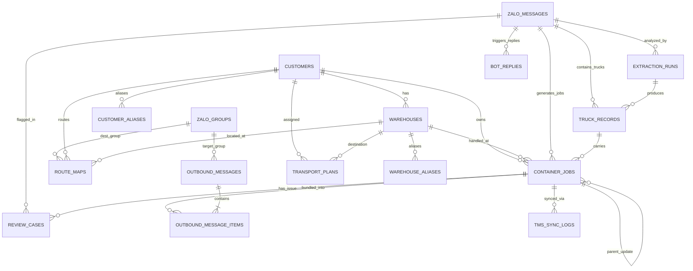
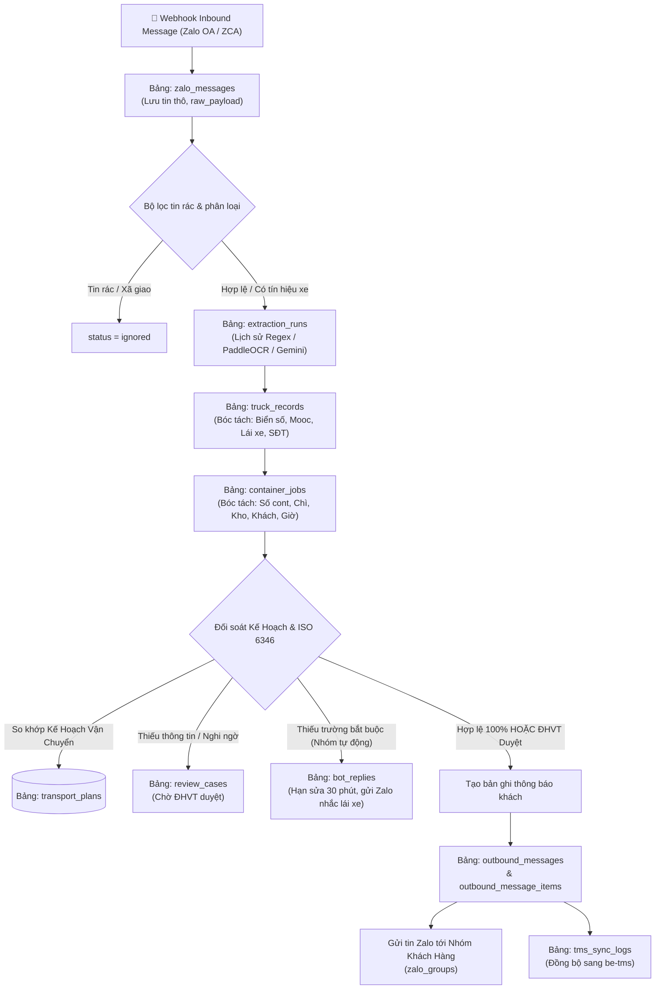
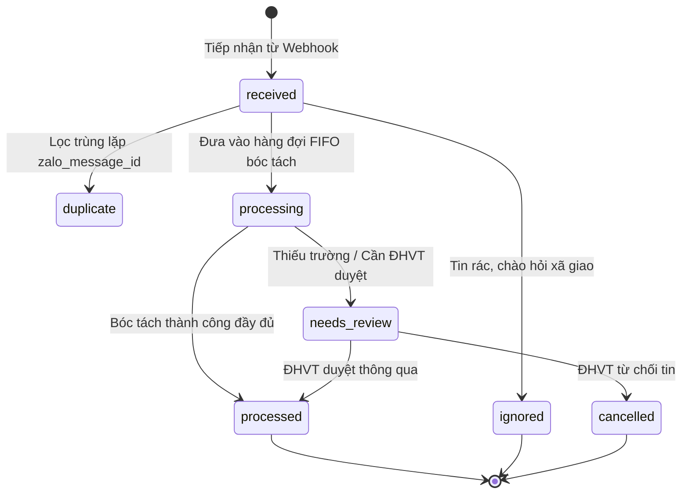
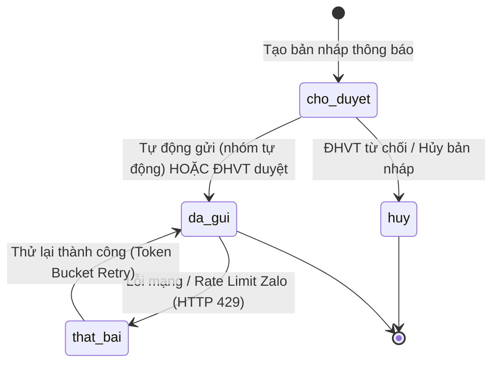

# 📊 TÀI LIỆU THIẾT KẾ CƠ SỞ DỮ LIỆU CHI TIẾT (DATABASE SCHEMA SPECIFICATION)

### Hệ Thống VSICO Zalo Bot — Quản Lý & Tự Động Hóa Điều Vận Xe Container

*Phiên bản tài liệu: 2.0 | Cập nhật: 03/11/2026*

---

## 1. Tổng Quan Kiến Trúc & 5 Nguyên Tắc Cốt Lõi

Cơ sở dữ liệu của hệ thống **VSICO Zalo Bot** được xây dựng trên nền tảng **MySQL 8.4** (sử dụng SQLAlchemy 2.0 ORM), tuân thủ nghiêm ngặt 5 nguyên tắc thiết kế cơ sở dữ liệu:

1. **Bảo Toàn Tin Nhắn Gốc (Immutability)**:
   - Tin nhắn nhận từ webhook Zalo được lưu trữ nguyên vẹn 100% tại bảng `zalo_messages`. Không có bất kỳ logic nào được phép chỉnh sửa hay ghi đè nội dung gốc.
   - Mọi phiên bóc tách (AI Gemini/PaddleOCR/Regex) được lưu lịch sử độc lập tại `extraction_runs`.
2. **Tách Biệt Đa Tầng (Message ➔ Truck ➔ Container)**:
   - Trong vận tải thực tế: 1 tin nhắn có thể chứa nhiều xe (`truck_records`), và 1 xe có thể chở 2 vỏ container 20ft (`container_jobs`). Vì vậy, hệ thống phân tách thành 3 thực thể riêng biệt với quan hệ 1-N.
3. **Mỗi Container Là Một Thực Thể Độc Lập**:
   - Từng container trong bảng `container_jobs` có vòng đời, trạng thái kiểm tra chữ số kiểm tra (check-digit ISO 6346), đối chiếu kế hoạch vận chuyển và trạng thái đồng bộ TMS hoàn toàn riêng biệt.
4. **An Toàn Tuyệt Đối Trước Khi Gửi Khách Hàng (Zero Tolerance for Wrong Group)**:
   - Mọi trường hợp nghi ngờ (thiếu thông tin, sai số kiểm tra, không khớp kho/khách) lập tức được đưa vào hàng đợi `review_cases` để Điều hành vận tải (ĐHVT) duyệt thủ công. Tuyệt đối không tự động phát hành thông báo nếu độ tin cậy chưa đạt 100%.
5. **Đồng Bộ Hai Chiều Với Phần Mềm Trung Tâm TMS**:
   - Dữ liệu danh mục Khách hàng (`customers`) và Kho (`warehouses`) là bản sao chuẩn từ phần mềm TMS; mọi kết quả bóc tách hợp lệ được đồng bộ ngược sang hệ thống TMS qua `tms_sync_logs`.

---

## 2. Sơ Đồ Quan Hệ Thực Thể (Entity-Relationship Diagram - ERD)

---

## 3. Sơ Đồ Luồng Xử Lý Dữ Liệu (Data Flow Diagram - DFD)

---

## 4. Sơ Đồ Vòng Đời Trạng Thái (State Transition Diagrams)

### 4.1. Vòng Đời Tin Nhắn (`zalo_messages.processing_status`)

### 4.2. Vòng Đời Tin Thông Báo Khách (`outbound_messages.status`)

---

---

## 7. Các Chỉ Mục (Indexes) & Tối Ưu Hóa Hiệu Năng Truy Vấn

Hệ thống được thiết kế sẵn các chỉ mục đơn và chỉ mục kết hợp (Composite Indexes) để phục vụ tra cứu tức thời dưới 10ms kể cả khi bảng đạt hàng triệu dòng:

1. **Khử trùng lặp tin nhắn tức thời**:
   - `zalo_messages.zalo_message_id (UNIQUE)`: Đảm bảo độ trễ check trùng lặp tin chỉ tốn 0.5ms.
2. **Khử trùng lặp phát hành tin gửi khách**:
   - `outbound_messages.idempotency_key (UNIQUE)`: Chống tình trạng gửi lặp 2 thông báo cùng một xe cho khách hàng.
3. **Tra cứu lịch sử bóc tách**:
   - Composite Index: `ix_extraction_runs_msg_started (message_id, started_at)`.
4. **Tra cứu ma trận định tuyến**:
   - Composite Index: `ix_route_maps_lookup (customer_id, warehouse_id, order_type, is_active)`.
5. **Tìm kiếm theo Số Container & Biển Số Xe**:
   - B-Tree Index trên: `container_jobs.container_no`, `truck_records.truck_plate`, `transport_plans.container_no`.
