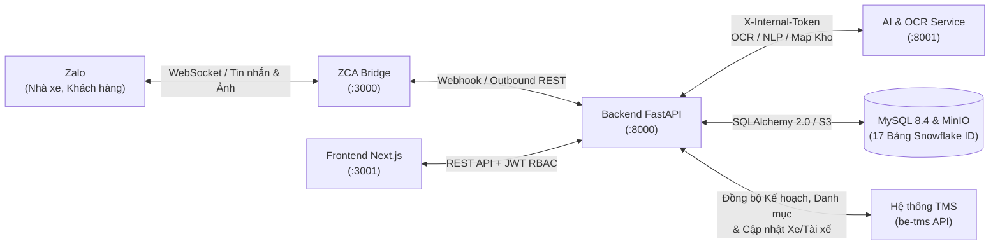

# VSICO ZALO BOT & TMS INTEGRATION ECOSYSTEM

### HỆ THỐNG TỰ ĐỘNG HÓA ĐIỀU VẬN CONTAINER ĐA KÊNH (BACKEND • FRONTEND • AI SERVICE • DATABASE • ZALO BRIDGE)

[](./backend/BACKEND.md)
[](./frontend/FRONTEND.md)
[](./ai-service/AISERVICE.md)
[](./database/DATABASE.md)
[](./zca-js/ZCA_BRIDGE.md)

---

## 1. Tổng quan Hệ sinh thái

**VSICO Zalo Bot** là nền tảng tự động hóa điều hành vận tải container toàn diện của **VSICO Logistics**, kết nối thời gian thực giữa các nhóm chat **Zalo (Nhà xe, Khách hàng, ĐHVT)**, giao diện **Web Quản trị Điều hành (ĐHVT & Admin)**, **Dịch vụ Trí tuệ Nhân tạo (AI & OCR)** và phần mềm trung tâm **TMS (`be-tms`)**.

### Kiến trúc Tổng thể:



---

## 2. Danh mục Tài liệu Chuyên biệt theo Phân hệ

Mỗi phân hệ trong Monorepo đều có tài liệu kỹ thuật định danh riêng biệt và bộ kỹ năng AI Agent tại `.agents/skills/`:

| Phân hệ | Thư mục | Tài liệu Kỹ thuật | AI Agent Skill | Mô tả Vai trò |
| :--- | :--- | :--- | :--- | :--- |
| **Backend Core** | [`backend/`](./backend) | [**`BACKEND.md`**](./backend/BACKEND.md) | [`vsico-backend`](./.agents/skills/vsico-backend/SKILL.md) | FastAPI Webhook Gateway, Parser F1/F2/F3, Queue Worker, Outbound Throttler, JWT Auth & TMS Sync |
| **Frontend Web** | [`frontend/`](./frontend) | [**`FRONTEND.md`**](./frontend/FRONTEND.md) | [`vsico-frontend`](./.agents/skills/vsico-frontend/SKILL.md) | Giao diện quản trị Next.js 14 App Router cho ĐHVT & Admin (100% Realtime API, Zero Mock Data) |
| **AI & OCR Service** | [`ai-service/`](./ai-service) | [**`AISERVICE.md`**](./ai-service/AISERVICE.md) | [`vsico-ai-service`](./.agents/skills/vsico-ai-service/SKILL.md) | Dịch vụ đọc hiểu ngữ cảnh hội thoại, bóc tách NER, PaddleOCR/Vision & Map kho GP1–GP4 |
| **Cơ sở Dữ liệu** | [`database/`](./database) | [**`DATABASE.md`**](./database/DATABASE.md) | [`vsico-database`](./.agents/skills/vsico-database/SKILL.md) | Đặc tả 17 bảng MySQL 8.4, khóa chính Snowflake ID 64-bit, khóa TMS `BigInteger` & Alembic |
| **Cầu nối Zalo** | [`zca-js/`](./zca-js) | [**`ZCA_BRIDGE.md`**](./zca-js/ZCA_BRIDGE.md) | [`vsico-infra`](./.agents/skills/vsico-infra/SKILL.md) | Bộ lắng nghe sự kiện Zalo WebSocket và máy chủ REST phát hành tin nhắn |
| **Tài liệu Thiết kế** | [`docs/`](./docs) | [**`docs/`**](./docs) | [`vsico-docs`](./.agents/skills/vsico-docs/SKILL.md) | Sơ đồ kiến trúc, đặc tả tích hợp API TMS, quy trình làm việc ĐHVT & báo cáo |
| **Quy tắc Agent** | `.` | [**`AGENTS.md`**](./AGENTS.md) | [`.agents/skills/`](./.agents/skills) | Quy tắc bất biến, chuẩn kiến trúc và hướng dẫn vận hành cho AI Agent & Developer |

---

## 3. Cấu trúc Thư mục Dự án

```text
vsico_zalo_bot/
├── .agents/skills/              # 6 bộ kỹ năng chuyên sâu cho AI Agent (Backend, Frontend, AI, DB, Infra, Docs)
├── backend/                     # Backend FastAPI + SQLAlchemy 2.0 + Alembic (tài liệu: BACKEND.md)
├── frontend/                    # Frontend Next.js 14 App Router + TypeScript (tài liệu: FRONTEND.md)
├── ai-service/                  # AI & OCR Microservice (tài liệu: AISERVICE.md)
├── database/                    # Đặc tả Schema 17 bảng & ERD (tài liệu: DATABASE.md)
├── zca-js/                      # Cầu nối Zalo Node.js ESM (tài liệu: ZCA_BRIDGE.md)
├── docs/                        # Kho tài liệu thiết kế hệ thống, API TMS & quy trình nghiệp vụ
├── docker-compose.yml           # Hạ tầng Container tập trung (MySQL 8.4 & MinIO S3 Storage)
├── .env                         # Tệp biến môi trường cục bộ duy nhất cho toàn dự án
├── .env.example                 # Tệp mẫu biến môi trường chuẩn
├── AGENTS.md                    # Quy chuẩn kiến trúc & phát triển bắt buộc
└── README.md                    # Trang tổng quan dự án (tài liệu này)
```

---

## 4. Khởi chạy Nhanh Toàn Hệ thống (Quickstart)

### Bước 1: Thiết lập biến môi trường tập trung tại thư mục gốc

```bash
cp .env.example .env
```

### Bước 2: Khởi động hạ tầng MySQL 8.4 & MinIO qua Docker Compose

```bash
docker compose up -d
```

### Bước 3: Khởi chạy Backend API & Database Migrations (Cổng `8000`)

```bash
cd backend
source .venv/bin/activate
make db-migrate
make run
```

### Bước 4: Khởi chạy Frontend Dashboard (Cổng `3001`)

```bash
cd frontend
npm install
npm run dev
```

### Bước 5: Khởi chạy Cầu nối Zalo `zca-js` (Cổng `3000`)

```bash
cd zca-js
npm install
npm start
```
