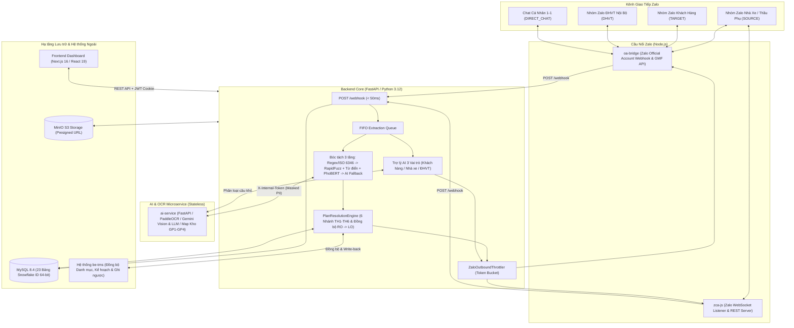

# VSICO Zalo Bot & TMS Integration (v1.0.0)

Hệ thống tự động hóa tiếp nhận, bóc tách, đối chiếu kế hoạch vận tải container đa kênh, tích hợp hai chiều với phần mềm `be-tms` và trợ lý ảo vận tải phục vụ 3 vai trò (Khách hàng, Nhà xe, Điều hành vận tải - ĐHVT).

---

## 1. Kiến trúc Tổng thể

Hệ thống được thiết kế theo kiến trúc phân tách dịch vụ (Microservices / Modular Monolith), tối ưu hóa hiệu năng xử lý tin nhắn thời gian thực, bảo mật dữ liệu cá nhân (PII Masking) và đảm bảo toàn vẹn dữ liệu qua cơ chế khóa phiên bản (Optimistic Locking):



### Các phân hệ chính

1. **[`backend/`](./backend/BACKEND.md)**: Lõi xử lý nghiệp vụ viết bằng Python 3.12+ và FastAPI theo kiến trúc Clean Architecture (`api`, `assistant`, `config`, `domain`, `handlers`, `infrastructure`, `ingestion`, `messaging`, `observability`, `outbound`, `parsing`, `validation`).
   - Tiếp nhận tin nhắn qua `POST /webhook` (< 50ms), lưu thô vào `zalo_messages` và đẩy vào hàng đợi `FIFOExtractionQueue`.
   - Bóc tách thông tin vận tải đa tầng: **Tầng 1** (Regex & kiểm tra chữ số kiểm tra container ISO 6346 Modulo 11) -> **Tầng 2** (`LocalNLPExtractor` kết hợp **PhoBERT** tách từ ghép tiếng Việt & nhận diện thực thể BIO NER, **Từ điển danh mục** `vehicles`/`drivers`/`customers`/`warehouses` và **RapidFuzz** so khớp mờ) -> **Tầng 3** (Fallback sang `ai-service` khi thiếu trường hoặc độ tự tin thấp).
   - Đối chiếu kế hoạch bằng `PlanResolutionEngine` xử lý 6 nhánh nghiệp vụ (`TH1` đến `TH6`), gom nhóm theo từng xe (`resolve_batch`), tự động kế thừa xe/tài xế nguyên tử từ lệnh trả (`RO`) sang lệnh đóng ghép vỏ (`LO`) và tự học bí danh kho (`WarehouseAlias`) khi ĐHVT duyệt ca trên Web.
   - Trợ lý ảo vận tải (`src/assistant/`) phục vụ 3 vai trò: Khách hàng, Nhà xe (có luồng xác nhận 2 bước khi cập nhật xe/tài xế) và ĐHVT (tra cứu tổng quan lệnh đóng/lệnh trả toàn hệ thống hoặc theo từng vùng miền/tỉnh thành, cảnh báo vỏ, trùng xe, tóm tắt ca ưu tiên; chặn mọi thao tác ghi/duyệt trên Zalo qua `BLOCK_WRITE`).
   - Chi tiết luồng nghiệp vụ Zalo được đặc tả tại [`backend/zalo.md`](./backend/zalo.md).
2. **[`ai-service/`](./ai-service/AISERVICE.md)**: Microservice AI & OCR độc lập, không trạng thái (Stateless), chỉ giao tiếp nội bộ với `backend` qua `X-Internal-Token`. Đảm nhiệm OCR ảnh/PDF lệnh giao nhận (PaddleOCR kết hợp Gemini Vision), bóc tách thực thể phức tạp, phân loại ý định trợ lý cho câu hỏi khó và Map địa chỉ kho đa tầng (`plan_cont` -> `habit` -> `fuzzy (RapidFuzz)` -> `vector` -> `llm`). Toàn bộ SĐT tài xế đều được che (`0903xxxx59`) trước khi gửi lên Cloud LLM.
3. **[`frontend/`](./frontend/FRONTEND.md)**: Bảng điều khiển Web Quản lý (Next.js 16 App Router, React 19, TypeScript 5, Tailwind CSS v4) dành cho ĐHVT và Admin. Hỗ trợ theo dõi kế hoạch vận chuyển, xử lý ca chờ duyệt (`/reviews`) với danh sách kế hoạch ứng viên gợi ý (`candidate_plans`), quản lý nhóm Zalo thời gian thực (`/groups`), quản lý danh mục đồng bộ từ TMS (`/master/*`), giả lập luồng tin nhắn (`/sandbox`) và quản trị người dùng (`/admin/users`).
4. **[`database/`](./database/DATABASE.md)**: Hệ quản trị cơ sở dữ liệu MySQL 8.4+ gồm **23 bảng** chia thành 4 nhóm nghiệp vụ chính, sử dụng khóa chính **Snowflake ID 64-bit (`BigInteger`)** sinh tại tầng ứng dụng và các khóa đồng bộ TMS (`BigInteger` có đánh chỉ mục).
5. **[`oa-bridge/`](./oa-bridge/OA_BRIDGE.md) & [`zca-js/`](./zca-js/ZCA_BRIDGE.md)**: Hai module cầu nối Zalo viết bằng Node.js. `oa-bridge` tích hợp Zalo Official Account (hỗ trợ nhóm GMF và chat cá nhân `direct_<user_id>`, tự động đồng bộ danh sách nhóm thực tế sang Backend); `zca-js` duy trì kết nối WebSocket thời gian thực và cung cấp REST API gửi tin nhắn.

---

## 2. Cấu trúc Thư mục Dự án

```text
vsico_zalo_bot/
├── backend/                  # FastAPI Core Backend (Clean Architecture, 23 ORM models, Pytest & Postman tests)
│   ├── BACKEND.md            # Đặc tả kỹ thuật chi tiết của phân hệ Backend
│   ├── zalo.md               # Đặc tả nghiệp vụ bóc tách, đối chiếu 6 nhánh và Trợ lý AI 3 vai trò
│   └── tests/postman/        # Bộ kịch bản kiểm thử Postman chuyên nghiệp (01 -> 15)
├── ai-service/               # Stateless AI & OCR Microservice (PaddleOCR, Gemini, RapidFuzz Warehouse Matcher)
│   └── AISERVICE.md          # Đặc tả kỹ thuật của phân hệ AI Service
├── frontend/                 # Next.js 16 Web Dashboard cho ĐHVT & Admin
│   └── FRONTEND.md           # Đặc tả kiến trúc và giao diện điều hành Frontend
├── database/                 # Thiết kế CSDL MySQL 8.4+ và sơ đồ ERD
│   └── DATABASE.md           # Đặc tả chi tiết 23 bảng dữ liệu và quy ước Snowflake ID
├── oa-bridge/                # Cầu nối Zalo Official Account (Webhook & GMF Group Sync)
│   └── OA_BRIDGE.md          # Tài liệu cấu hình và API của OA Bridge
├── zca-js/                   # Cầu nối Zalo WebSocket Listener & Outbound REST Server
│   └── ZCA_BRIDGE.md         # Tài liệu cấu hình và API của ZCA Bridge
├── docs/                     # Thư mục tài liệu quy trình nghiệp vụ và kiến trúc ban đầu
├── docker-compose.yml        # Cấu hình hạ tầng Docker (MySQL 8.4, MinIO S3 Storage)
├── .env.example              # Mẫu cấu hình biến môi trường tập trung duy nhất tại thư mục gốc
└── AGENTS.md                 # Quy chuẩn kỹ thuật và hướng dẫn phát triển cho dự án
```

---

## 3. Hướng dẫn Khởi chạy Nhanh (Quickstart)

### Bước 1: Khởi chạy Hạ tầng (MySQL 8.4 & MinIO)

```bash
cp .env.example .env
docker compose up -d
```

### Bước 2: Khởi chạy Backend & Đồng bộ Schema CSDL

```bash
cd backend
python3 -m venv .venv
source .venv/bin/activate
pip install -r requirements.txt

# Kiểm tra kết nối MySQL và cập nhật Alembic Migration (23 bảng)
python scripts/manage_db.py check
alembic upgrade head

# Chạy Backend ở cổng 8000
uvicorn src.api.app:app --host 0.0.0.0 --port 8000 --reload
```

### Bước 3: Khởi chạy AI Service (Cổng 8001)

```bash
cd ai-service
python3 -m venv .venv
source .venv/bin/activate
pip install -r requirements.txt

uvicorn app.main:app --host 0.0.0.0 --port 8001 --reload
```

### Bước 4: Khởi chạy Cầu nối Zalo (`oa-bridge` hoặc `zca-js`)

```bash
# Khởi chạy Zalo OA Bridge (Cổng 3000)
cd oa-bridge
npm install
npm start
```

### Bước 5: Khởi chạy Frontend Dashboard (Cổng 3001)

```bash
cd frontend
npm install
npm run dev
```

---

## 4. Kiểm thử Hệ thống

- **Kiểm thử tự động Backend (Unit, Integration, NLP PhoBERT + RapidFuzz & Golden Benchmark 56 mẫu)**:
  ```bash
  cd backend
  .venv/bin/pytest tests -v
  ```
- **Kiểm thử tự động AI Service**:
  ```bash
  cd ai-service
  .venv/bin/pytest -v
  ```
- **Kiểm tra Lint & Build Frontend**:
  ```bash
  cd frontend
  npm run lint
  npm run build
  ```
- **Kịch bản Kiểm thử Postman**: Xem danh mục 15 tài liệu hướng dẫn kiểm thử trên giao diện Postman tại [`backend/tests/postman/README.md`](./backend/tests/postman/README.md) (đặc biệt kịch bản tổng hợp số 15: [`15_kiem_thu_nlp_phobert_rapidfuzz_va_tro_ly_ai.md`](./backend/tests/postman/15_kiem_thu_nlp_phobert_rapidfuzz_va_tro_ly_ai.md)).
