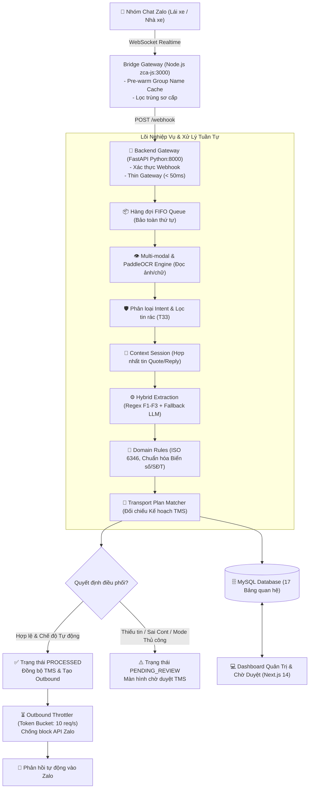

# 🎤 KỊCH BẢN & SLIDE THUYẾT TRÌNH DỰ ÁN: HỆ THỐNG ZALO BOT ĐIỀU XE TỰ ĐỘNG (VSICO TMS)

> **Dự án**: VSICO Zalo Logistics Bot & TMS Integration  
> **Người trình bày**: [Họ và Tên của bạn]  
> **Thời lượng dự kiến**: 15 – 25 phút (kèm Demo thực tế)

---

## 📌 MỤC LỤC BÀI THUYẾT TRÌNH

1. **Phần 1: Bối cảnh, Nỗi đau nghiệp vụ & Mục tiêu giải pháp** *(3 phút)*
2. **Phần 2: Kiến trúc Tổng thể & Công nghệ cốt lõi** *(4 phút)*
3. **Phần 3: Các Tính năng Nghiệp vụ Đột phá** *(5 phút)*
4. **Phần 4: Cơ sở Dữ liệu & Đảm bảo Tính toàn vẹn** *(3 phút)*
5. **Phần 5: Kịch bản Demo thực tế (Live Demo)** *(3 phút)*
6. **Phần 6: Hiệu quả mang lại & Kế hoạch mở rộng** *(2 phút)*
7. **Phần 7: Bộ Câu hỏi thường gặp & Cách ứng đáp (Q&A)** *(Tài liệu chuẩn bị trước)*

---

## 🖥️ SLIDE 1: BỐI CẢNH VẬN HÀNH & NỖI ĐAU THỰC TẾ (PAIN POINTS)

### 1. Thực trạng trước khi có hệ thống
- **Giao tiếp phân tán**: Hàng ngày, hàng trăm nhóm chat Zalo (giữa Điều hành vận tải, Nhà xe vệ tinh, Lái xe và Khách hàng) trao đổi liên tục hàng nghìn tin nhắn.
- **Nhập liệu thủ công (Manual Data Entry)**: Điều phối viên phải căng mắt đọc từng tin nhắn, mở phần mềm TMS để gõ tay từng biển số xe, số container, số chì, số điện thoại tài xế.
- **Rủi ro sai sót cực cao**: 
  - Gõ nhầm số container $\rightarrow$ sai cổng cảng hạ cont, phát sinh chi phí lưu bãi (DEM/DET).
  - Tin nhắn bị trôi, quên cập nhật khi nhà xe đổi lái xe hoặc đổi giờ chạy.
- **Quá tải giờ cao điểm**: Khung giờ sáng sớm hoặc cuối chiều, tin nhắn dồn dập khiến thông báo gửi cho khách hàng xuất nhập khẩu bị chậm trễ từ 1 – 3 tiếng.

### 2. Mục tiêu của dự án
1. **Tự động hóa 100%** tiếp nhận và bóc tách thông tin xe/container từ Zalo thời gian thực.
2. **Chuẩn hóa dữ liệu quốc tế**: Tự động kiểm tra số container chuẩn ISO 6346 (Check Digit), chuẩn hóa biển số và số điện thoại.
3. **Khớp kế hoạch tự động**: Tự động đối chiếu với Kế hoạch vận chuyển (Transport Plan) trong TMS.
4. **Cắt giảm 90% thao tác thủ công**: Chỉ những tin thiếu hoặc sai thông tin mới cần con người can thiệp ("Duyệt 1 chạm").

> 🎙️ **Lời thoại gợi ý cho bạn:**  
> *"Kính thưa Ban lãnh đạo và các anh chị, trong ngành vận tải container của VSICO, Zalo là kênh trao đổi sống còn giữa nhà xe và điều hành. Tuy nhiên, việc hàng nghìn tin nhắn đổ về mỗi ngày đang tạo ra một 'nút thắt cổ chai' khổng lồ: nhân viên phải copy-paste thủ công, rất dễ nhầm số cont và trôi tin nhắn. Hệ thống Zalo Bot mà em giới thiệu hôm nay ra đời để giải quyết triệt để bài toán này: biến các tin nhắn tự do trên Zalo thành dữ liệu số có cấu trúc chuẩn xác để đẩy thẳng vào hệ thống TMS chỉ trong chưa đầy 1 giây."*

---

## 🖥️ SLIDE 2: KIẾN TRÚC TỔNG THỂ & CÔNG NGHỆ (ARCHITECTURE & TECH STACK)

### 1. Sơ đồ Kiến trúc Đa tầng (Clean Architecture)



### 2. Điểm sáng về Công nghệ & Thiết kế
- **Backend**: Python 3.12 + FastAPI + SQLAlchemy ORM (High Performance, Asynchronous).
- **Zalo Realtime Bridge**: `zca-js` tương thích trực tiếp các nhóm chat cá nhân của nhà xe không cần phê duyệt OA phức tạp.
- **Thị giác máy tính (Computer Vision)**: Tích hợp **PaddleOCR** đọc ảnh chụp phiếu điều xe, biên bản giao nhận với độ chính xác cao.
- **Frontend**: Next.js 14 (App Router) + TypeScript + Tailwind CSS hiện đại, cam kết **Zero Mock Data** (100% dữ liệu từ Backend API thực tế).
- **Khả năng chịu tải cao**:
  - Hàng đợi **FIFO Queue**: Đảm bảo tin nhắn được xử lý tuần tự, tin đính chính luôn chạy sau tin báo xe gốc.
  - **Zalo Outbound Throttler**: Thuật toán Token Bucket (10 req/s, Burst: 20) chống bị Zalo ngắt kết nối khi gửi dồn dập.

> 🎙️ **Lời thoại gợi ý cho bạn:**  
> *"Về mặt công nghệ, hệ thống tuân thủ nghiêm ngặt mô hình Clean Architecture 1 chiều. Chúng em sử dụng Gateway Node.js để kết nối thời gian thực với các nhóm Zalo, sau đó đẩy sang Backend FastAPI xử lý theo hàng đợi FIFO. Điểm đặc biệt là hệ thống có khả năng tự phục hồi, chống chịu lỗi ngoại vi và tích hợp bộ điều tiết tần suất gửi Token Bucket để đảm bảo bot có thể chạy mượt mà trên hàng trăm nhóm chat cùng lúc mà không lo bị Zalo chặn."*

---

## 🖥️ SLIDE 3: CÁC TÍNH NĂNG NGHIỆP VỤ NỔI BẬT

### 1. Bóc tách Đa phương tiện & Xử lý tin nhắn ảnh (OCR Multi-modal)
- Lái xe gửi ảnh chụp phiếu điều độ, lệnh giao nhận hoặc biên bản bàn giao cont $\rightarrow$ Hệ thống tự động kích hoạt **PaddleOCR** nhận diện text tiếng Việt và bóc tách thành các trường dữ liệu như tin nhắn thường.

### 2. Thuật toán kiểm tra chuẩn quốc tế ISO 6346 (Check Digit)
- Bất kỳ số container nào gửi vào đều được tính toán theo thuật toán trọng số 11 (Modulo 11).
- Nếu lái xe gõ nhầm chữ số cuối (ví dụ `TGCU2203371` thay vì `TGCU2203372`): Hệ thống ngay lập tức cảnh báo `check_digit_valid = False` và đưa vào danh sách kiểm tra, ngăn ngừa hoàn toàn rủi ro sai cont ngoài cảng.

### 3. Xử lý Ngữ cảnh & Phản hồi trích dẫn (Context & Quote Message)
- Lái xe bấm Reply tin cũ: *"Mai cont này chạy nhé"* hoặc *"Đổi lái xe Tuấn 0988..."*.
- Hệ thống tự động truy vết `quote_msg_id` để lấy lại số container của tin trước đó, cập nhật lại ngày chạy hoặc tài xế mới mà không bắt người dùng phải gõ lại từ đầu.

### 4. Hệ thống Phân loại Ngữ nghĩa Taxonomy (40 dạng tin T01 – T40)
- Tự động gắn nhãn loại tin nhắn theo Bảng 1 (Hạng mục dữ liệu) và Bảng 2 (40 dạng mẫu hình thực tế):
  - Nhận diện tin rác/xã giao (`T33`, `/-strong`, `helo`, `ok`) $\rightarrow$ tự động bỏ qua an toàn (`ignored_chat`), không làm rác database.
  - Cung cấp Dashboard Thống kê Taxonomy giúp Ban Giám đốc nhìn thấy bức tranh toàn cảnh về chất lượng tin nhắn của các đối tác vận tải.

---

## 🖥️ SLIDE 4: CƠ SỞ DỮ LIỆU & ĐẢM BẢO TÍNH TOÀN VẸN (DATABASE DESIGN)

Hệ thống quản lý dữ liệu trên **17 bảng quan hệ chuẩn hóa trong MySQL**, chia làm 4 nhóm chức năng rõ ràng:

| Nhóm chức năng | Các bảng tiêu biểu | Vai trò chính |
| :--- | :--- | :--- |
| **Ingestion & Messaging** | `zalo_messages`, `zalo_groups`, `message_attachments` | Lưu vết tin nhắn thô, khử trùng lặp và lưu trữ file/ảnh Zalo. |
| **Bóc tách & Vận tải** | `truck_records`, `container_jobs`, `extraction_runs` | Lưu trữ đầu kéo, rơ-moóc, tài xế, số cont, số chì và lịch sử AI bóc tách. |
| **Kế hoạch TMS** | `transport_plans` | Lưu danh sách kế hoạch đóng hàng/trả hàng xuất nhập khẩu để đối chiếu. |
| **Điều phối & Thông báo** | `outbound_messages`, `bot_replies`, `review_actions` | Quản lý thông báo gửi khách hàng và lịch sử phê duyệt của điều phối viên. |

> [!NOTE]
> **Nguyên tắc Toàn vẹn (Data Integrity):**
> Mọi thay đổi về xe/tài xế đều được lưu vết qua các trạng thái: `RECEIVED` $\rightarrow$ `QUEUED` $\rightarrow$ `PROCESSED` / `PENDING_REVIEW` / `IGNORED_CHAT`. Không bao giờ xóa cứng dữ liệu gốc của khách hàng.

---

## 🖥️ SLIDE 5: KỊCH BẢN DEMO THỰC TẾ (LIVE DEMO ROADMAP)

Để buổi thuyết trình lôi cuốn và thuyết phục nhất, bạn nên demo theo **3 tình huống thực tế**:

### Case 1: Luồng chuẩn tự động (Happy Path - Auto Process)
- **Hành động**: Nhắn tin vào nhóm Zalo cú pháp chuẩn:
  ```text
  15C-123.45 / 15R-056.78 / Vũ Tiến Đạt / 0912931783 / TGCU2203372 / Chì: 87127361 / Đóng hàng Hải Phòng
  ```
- **Kết quả hiển thị**:
  1. Terminal ZCA ghi nhận và Backend xử lý trong < 300ms.
  2. Số container tự động khớp với Kế hoạch vận chuyển trong TMS.
  3. Trạng thái tin chuyển thành `processed`.
  4. Bot tự động phản hồi lại vào Zalo: *"Đã tiếp nhận xe 15C-123.45 cho cont TGCU2203372"*.

### Case 2: Luồng kiểm soát sai sót (Pending Review & 1-Click Approve)
- **Hành động**: Nhắn tin cố tình viết sai số container hoặc thiếu số điện thoại tài xế:
  ```text
  Xe 29H-99999 tài xế Tuấn đi cont TEST9999999 đóng hàng
  ```
- **Kết quả hiển thị**:
  1. Hệ thống phát hiện số cont sai chữ số kiểm tra ISO 6346 và thiếu số điện thoại.
  2. Tin nhắn lập tức chuyển trạng thái `pending_review` (Chờ duyệt).
  3. Mở giao diện Frontend: Màn hình **"Danh sách chờ duyệt"** hiển thị ngay cảnh báo màu vàng.
  4. Điều phối viên bấm **"Duyệt"** hoặc **"Từ chối"** $\rightarrow$ Hệ thống cập nhật thời gian thực.

### Case 3: Lọc tin rác & Tin xã giao thông minh
- **Hành động**: Gửi sticker Zalo hoặc nhắn: `helo`, `ok em`, `/-strong`.
- **Kết quả**: Hệ thống phân loại ngay thành `T33` (`ignored_chat`), không báo lỗi sai cú pháp, không làm nhiễu dữ liệu điều xe.

---

## 🖥️ SLIDE 6: KẾT QUẢ & GIÁ TRỊ MANG LẠI (BUSINESS VALUE)

1. **Hiệu suất vận hành**:
   - Tốc độ xử lý trung bình: **< 500ms / tin nhắn** (nhanh gấp hàng trăm lần thao tác gõ tay của con người).
   - Tự động hóa xử lý thành công **> 85%** lượng tin nhắn hợp lệ mà không cần con người chạm vào.
2. **Loại bỏ rủi ro nghiệp vụ**:
   - Giảm thiểu 100% rủi ro hạ nhầm số cont ngoài cảng nhờ thuật toán kiểm tra ISO 6346.
   - Không còn tình trạng trôi tin nhắn khi nhà xe báo đổi tài xế vào ban đêm hoặc giờ cao điểm.
3. **Mở rộng linh hoạt (Scalability)**:
   - Sẵn sàng tích hợp song song giữa tài khoản Zalo cá nhân (ZCA) và Zalo Doanh nghiệp (Zalo OA OpenAPI v3.0).
   - Dễ dàng mở rộng cho các chi nhánh khác của VSICO (Hải Phòng, Đà Nẵng, TP.HCM).

---

## ❓ PHẦN 7: BỘ CÂU HỎI THƯỜNG GẶP KHI BẢO VỆ & CÁCH ỨNG ĐÁP (Q&A)

### Câu 1: *"Tin nhắn của tài xế rất đa dạng, viết tắt, không dấu, sai chính tả thì bot có nhận diện được không?"*
- **Cách trả lời:**  
  *"Dạ hoàn toàn được ạ. Hệ thống sử dụng cơ chế xử lý lai (Hybrid): Tầng 1 sử dụng các biểu thức chính quy (Regex) và từ điển đồng nghĩa để chuẩn hóa các lỗi gõ phím thông dụng (như bỏ dấu cách, mã vùng +84, bỏ dấu gạch ngang). Nếu tin nhắn quá dài, nhiều xe xen kẽ phức tạp, hệ thống sẽ kích hoạt Tầng 2 là Fallback sang mô hình ngôn ngữ (LLM) để hiểu ngữ cảnh. Trường hợp tin quá mập mờ, hệ thống sẽ đưa về màn hình 'Chờ duyệt' chứ không đoán mò để tránh sai lệch kế hoạch TMS."*

### Câu 2: *"Bot có bị Zalo khóa tài khoản vì spam tin nhắn gửi đi không?"*
- **Cách trả lời:**  
  *"Hệ thống đã tính toán kỹ rủi ro này và tích hợp bộ điều tiết `ZaloOutboundThrottler` dựa trên thuật toán Token Bucket chuẩn của ngành viễn thông: giới hạn tốc độ gửi tối đa 10 tin/giây và có bộ đệm Burst 20 tin. Khi có nhiều thông báo cùng lúc, hệ thống sẽ xếp hàng và gửi lần lượt với cơ chế dãn cách, tuyệt đối không bắn dồn dập nên an toàn 100% với chính sách phòng chống spam của Zalo."*

### Câu 3: *"Tại sao phải phân loại Taxonomy 40 dạng tin T01 - T40 làm gì cho phức tạp?"*
- **Cách trả lời:**  
  *"Taxonomy không làm chậm hệ thống vì nó chạy rule-based chỉ mất 0.001 giây. Nó có 2 vai trò sống còn: Một là giúp lọc sạch ngay 40% tin rác, chào hỏi, sticker để giải phóng tải cho hệ thống; Hai là cung cấp dữ liệu định lượng cho Ban Giám đốc biết đối tác nhà xe nào thường xuyên báo sai cú pháp, tỷ lệ báo chuẩn là bao nhiêu để cải tiến quy trình nghiệp vụ."*

### Câu 4: *"Sự khác nhau giữa phiên bản Bot hiện tại (ZCA) và Zalo OA chính thức là gì?"*
- **Cách trả lời:**  
  *"Zalo OA là tài khoản doanh nghiệp, chỉ cho phép tương tác 1-1 với khách hàng hoặc gửi thông báo ZNS, Zalo không cho phép OA tham gia vào các nhóm chat Zalo cá nhân của lái xe. Do đó, phiên bản ZCA hiện tại là giải pháp tối ưu nhất để cắm trực tiếp vào các nhóm chat điều hành thực tế. Khi cần gửi thông báo chuyên nghiệp cho khách hàng lớn, hệ thống có thể kết nối thêm kênh OA một cách độc lập."*

---

> 🎯 **Lời kết bài thuyết trình:**  
> *"Dự án Zalo Bot điều xe không chỉ đơn thuần là một công cụ chat-bot, mà là một bước chuyển đổi số toàn diện cho quy trình điều vận của VSICO: kết nối liền mạch từ thực địa (nhóm chat của lái xe) tới hệ thống lõi ERP/TMS của tập đoàn. Em xin chân thành cảm ơn và rất mong nhận được câu hỏi cũng như đóng góp ý kiến từ Ban lãnh đạo và mọi người!"*
