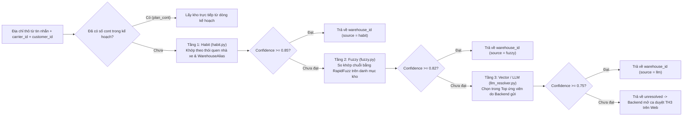

# Đặc tả Kỹ thuật Phân hệ AI & OCR Microservice (`ai-service` v1.5.0)

`ai-service` là dịch vụ trí tuệ nhân tạo và nhận dạng quang học (OCR) độc lập, **không lưu trạng thái (Stateless)**, được xây dựng bằng **Python 3.12+**, **FastAPI**, **Pydantic v2**, **PaddleOCR**, **RapidFuzz** và **Google GenAI SDK (`gemini-3.5-flash` / `gemini-3.5-flash-lite`)**.

---

## 1. Nguyên tắc Kiến trúc & Bảo mật

1. **Stateless & Không kết nối trực tiếp MySQL**: `ai-service` không truy cập cơ sở dữ liệu MySQL của hệ thống. Toàn bộ ngữ cảnh cần thiết (tin nhắn trước đó, danh sách chuyến đang mở, danh sách kho ứng viên, thói quen nhà xe) được `backend` đóng gói và truyền kèm trong từng HTTP Request.
2. **Xác thực Nội bộ (`X-Internal-Token`)**: Mọi endpoint của `ai-service` đều yêu cầu header `X-Internal-Token` khớp với biến môi trường `INTERNAL_SECRET`. Dịch vụ chỉ nhận lưu lượng từ `backend`, không mở cổng ra mạng công cộng và không giao tiếp trực tiếp với Frontend.
3. **Bảo vệ Dữ liệu Cá nhân (PII Masking)**: Số điện thoại tài xế luôn được che (`0903xxxx59`) trước khi gửi lên Cloud LLM và khôi phục sau khi nhận kết quả. Dịch vụ trả về đầy đủ `model_name`, `prompt_version` và `latency_ms` để `backend` ghi vết vào bảng `extraction_runs`.
4. **Chuẩn hóa Đầu ra (Structured Output)**: Toàn bộ phản hồi từ `ai-service` đều tuân thủ nghiêm ngặt schema Pydantic v2 (`app/schemas/`), không trả về chuỗi tự do.

---

## 2. Cấu trúc Thư mục (`ai-service/`)

```text
ai-service/
├── requirements.txt
├── app/
│   ├── main.py                       # Khởi tạo FastAPI App & Middleware kiểm tra X-Internal-Token
│   ├── core/
│   │   ├── config.py                 # Đọc cấu hình từ tệp .env gốc
│   │   └── security.py               # Xác thực X-Internal-Token & PII Masking helper
│   ├── providers/
│   │   ├── base_provider.py          # Interface trừu tượng cho các AI Provider
│   │   └── gemini_provider.py        # Triển khai Google GenAI SDK (Structured JSON Output)
│   ├── ocr/
│   │   ├── paddle_engine.py          # Nhận diện văn bản từ ảnh phiếu EIR / lệnh giao nhận bằng PaddleOCR
│   │   └── vision_fallback.py        # Fallback sang Gemini Vision khi ảnh mờ, nghiêng hoặc viết tay
│   ├── context/
│   │   └── segmenter.py              # Phân đoạn tin nhắn đa xe / đa lệnh và gom ngữ cảnh hội thoại
│   ├── extraction/
│   │   └── extractor.py              # Bóc tách thực thể vận tải phức tạp (Biển số, Rơ-moóc, Cont, Seal, Tài xế)
│   ├── warehouse/
│   │   ├── matcher.py                # Điều phối thác nước (Waterfall) Map địa chỉ kho đa tầng
│   │   ├── habit.py                  # Tầng Habit: Khớp theo thói quen lịch sử của từng nhà xe
│   │   ├── fuzzy.py                  # Tầng Fuzzy: So khớp mờ địa chỉ và bí danh kho bằng RapidFuzz
│   │   └── llm_resolver.py           # Tầng LLM: Chọn kho tối ưu từ danh sách ứng viên thu hẹp
│   ├── routers/
│   │   ├── extract.py                # POST /api/v1/extract (Phân loại ý định & Bóc tách thực thể)
│   │   ├── ocr.py                    # POST /api/v1/ocr (Nhận diện văn bản từ ảnh/PDF)
│   │   ├── warehouse.py              # POST /api/v1/match-warehouse (Map địa chỉ kho đa tầng)
│   │   └── assistant.py              # POST /api/v1/assistant-intent (Phân loại câu hỏi khó cho Trợ lý AI)
│   └── schemas/                      # Định nghĩa Pydantic v2 Request/Response Models
└── tests/                            # Bộ kiểm thử tự động Pytest (16 kịch bản)
```

---

## 3. Luồng Thác nước Map Địa chỉ Kho (`app/warehouse/`)

Khi lệnh đóng hàng chưa có số container (`LO`), hệ thống cần xác định chính xác `warehouse_id` từ địa chỉ viết tắt của nhà xe theo chiến lược thác nước dừng sớm:



---

## 4. Danh sách Endpoint Nội bộ

| Phương thức & Đường dẫn | Mục đích nghiệp vụ |
| :--- | :--- |
| `GET /health` | Kiểm tra trạng thái hoạt động của dịch vụ AI & OCR. |
| `POST /api/v1/extract` | Phân loại ý định tin nhắn nhà xe, phân đoạn đa xe và bóc tách thực thể kèm điểm tự tin (`confidence`) và bằng chứng (`evidence`). |
| `POST /api/v1/ocr` | Bóc tách văn bản và thực thể container/seal từ ảnh chụp lệnh giao nhận (EIR) hoặc phiếu cân. |
| `POST /api/v1/match-warehouse` | Đối chiếu địa chỉ kho tự do với danh sách kho ứng viên theo thác nước `habit` -> `fuzzy (RapidFuzz)` -> `llm`. |
| `POST /api/v1/assistant-intent` | Hỗ trợ `backend/src/assistant/intent_router.py` phân loại ý định và trích xuất tham số cho các câu hỏi ngôn ngữ tự nhiên phức tạp của Khách hàng, Nhà xe và ĐHVT. |

---

## 5. Khởi chạy và Kiểm thử

```bash
cd ai-service
python3 -m venv .venv
source .venv/bin/activate
pip install -r requirements.txt

# Chạy bộ kiểm thử tự động (16 passed)
.venv/bin/pytest -v

# Khởi chạy dịch vụ ở cổng 8001
uvicorn app.main:app --host 0.0.0.0 --port 8001 --reload
```
