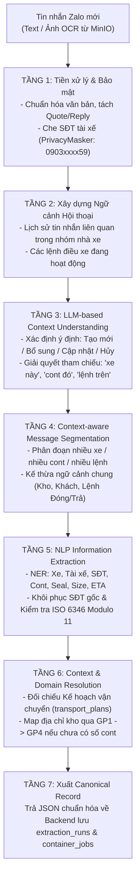

# VSICO ZALO BOT — AI & OCR MICROSERVICE (`AISERVICE.md`)

### HỆ THỐNG ĐỌC HIỂU NGỮ CẢNH HỘI THOẠI, BÓC TÁCH NLP & MAP ĐỊA CHỈ KHO THÔNG MINH

[](https://www.python.org/)
[](https://fastapi.tiangolo.com/)
[](https://ai.google.dev/)
[](#3-luồng-xử-lý-ai-7-tầng-context-aware-pipeline)
[](#4-giải-thuật-map-địa-chỉ-kho-4-tầng-gp1--gp4)

---

## 1. Tổng quan Phân hệ AI Service

Phân hệ **AI & OCR Microservice** (`ai-service/`) chịu trách nhiệm xử lý toàn bộ các tác vụ Trí tuệ nhân tạo chuyên sâu cho hệ thống **VSICO Zalo Bot**, bao gồm:

1. **Nhận diện Văn bản từ Hình ảnh (Multi-modal OCR)**: Bóc tách văn bản từ ảnh chụp lệnh điều xe, phiếu giao nhận container hoặc bảng kê viết tay do nhà xe gửi vào nhóm Zalo (kết hợp **PaddleOCR** tự host và **Gemini Vision Fallback**).
2. **Hiểu Ngữ cảnh Hội thoại (Conversation Context Understanding)**: Phân tích chuỗi hội thoại trích dẫn (`quote_msg_id`), nhận diện ý định tạo chuyến mới, bổ sung số chì/giờ hẹn, đổi xe/đổi tài xế hoặc hủy chuyến.
3. **Bóc tách Thực thể & Quan hệ (NLP Information Extraction)**: Phân đoạn tin nhắn đa xe/đa lệnh và trích xuất chính xác cặp thực thể `(Biển số đầu kéo, Rơ-moóc, Tài xế, SĐT, Số Container ISO 6346, Size, Số Seal, Giờ hẹn, Địa chỉ kho)`.
4. **Map Địa chỉ Kho Thông minh 4 Tầng (GP1 ➔ GP4)**: Giải quyết bài toán nhà xe gõ tên kho viết tắt/tự do khi dòng kế hoạch vận chuyển chưa có sẵn số container (lệnh Đóng hàng).

---

## 2. Kiến trúc Phân tầng (`ai-service/`)

```text
ai-service/
├── AISERVICE.md                     # Tài liệu kỹ thuật phân hệ AI Service (tài liệu này)
├── pyproject.toml                   # Khai báo Python 3.12 dependencies
├── app/
│   ├── core/                        # Cấu hình môi trường (đọc từ ../.env), Logging & X-Internal-Token
│   ├── providers/                   # BaseProvider, GeminiProvider, OpenAICompatibleProvider
│   ├── ocr/                         # PaddleOCR Engine & Gemini Vision Fallback (đọc file từ MinIO)
│   ├── context/                     # Quản lý ngữ cảnh hội thoại & giải quyết tham chiếu ("xe này", "cont trên")
│   ├── extraction/                  # Context-aware Segmenter, NER Extractor & Privacy SĐT Masker
│   ├── warehouse_matcher/           # Bộ đối chiếu kho 4 giải pháp: GP1 (Vector), GP2 (Habit), GP3 (ML), GP4 (LLM)
│   ├── schemas/                     # Pydantic v2 Schemas kiểm soát chặt chẽ đầu vào/đầu ra
│   ├── routers/                     # FastAPI Internal Endpoints (/api/v1/extract, /api/v1/ocr, /api/v1/match-warehouse)
│   └── main.py                      # Khởi tạo FastAPI App (Cổng mặc định: 8001)
└── tests/                           # Bộ kiểm thử đơn vị (Pytest)
```

---

## 3. Luồng Xử lý AI 7 Tầng (Context-Aware NLP Pipeline)



---

## 4. Giải thuật Map Địa chỉ Kho 4 Tầng (`GP1` ➔ `GP4`)

Khi dòng kế hoạch vận chuyển đã có sẵn `container_no` (như lệnh Trả hàng), hệ thống map trực tiếp kho từ kế hoạch (`warehouse_match_source = 'plan_cont'`). Khi kế hoạch chưa có số cont (lệnh Đóng hàng mới giao cho nhà xe `carrier_id`), `ai-service` kích hoạt thác nước 4 giải pháp:

1. **GP1 (`gp1` — Vector Similarity Search)**: Vector hóa địa chỉ nhà xe nhập (768-dim) và so khớp ngữ nghĩa trên Qdrant với lịch sử địa chỉ của các kho.
2. **GP2 (`gp2` — Carrier Habit Lookup)**: Tra cứu trực tiếp theo thói quen viết tắt của từng nhà xe (`carrier_id` + `address_normalized` ➔ `warehouse_id`).
3. **GP3 (`gp3` — Supervised Classifier)**: Mô hình phân loại học máy dự đoán `warehouse_id` dựa trên đặc trưng văn bản và nhà xe.
4. **GP4 (`gp4` — LLM Contextual Resolver)**: Sử dụng Gemini Flash phân tích địa chỉ nhập kiểu mới kết hợp danh sách các kho trong kế hoạch trong ngày của nhà xe đó.

---

## 5. Bảo mật Nội bộ (Zero-Trust Architecture)

- **Dịch vụ Nội bộ (`Internal Only`)**: `ai-service` chạy tại cổng `8001`, chỉ nhận request từ `backend/`.
- **Xác thực `X-Internal-Token`**: Mọi request gọi vào `ai-service` (trừ `/health`) bắt buộc đính kèm header `X-Internal-Token` khớp với `INTERNAL_SECRET` trong tệp `.env` gốc.
- **Bảo vệ Dữ liệu Cá nhân (PII Masking)**: Số điện thoại tài xế luôn được che trước khi gửi tới API LLM bên ngoài.

---

## 6. Cấu hình & Vận hành

`ai-service` đọc biến môi trường trực tiếp từ tệp `.env` duy nhất tại thư mục gốc (`vsico_zalo_bot/.env`):

```bash
cd ai-service
python3 -m venv .venv
source .venv/bin/activate
uvicorn app.main:app --host 0.0.0.0 --port 8001 --reload
```
