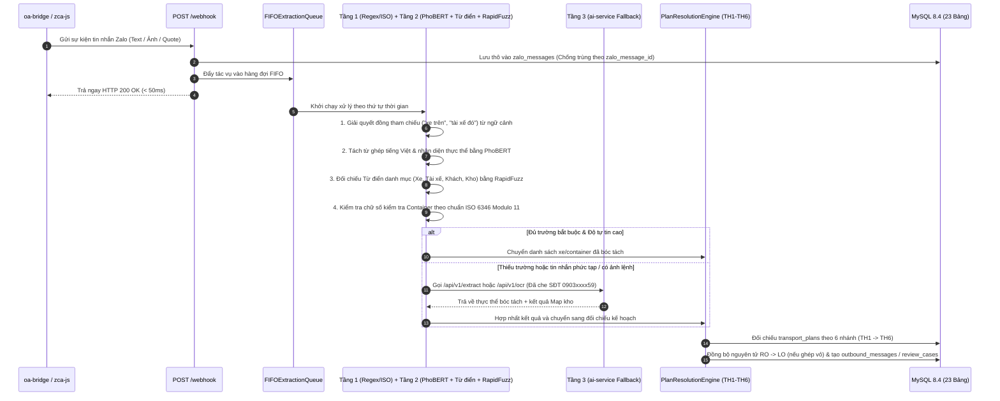

# Đặc tả Kỹ thuật Phân hệ Backend (VSICO Zalo Bot v1.0.0)

Phân hệ `backend` là lõi điều phối nghiệp vụ trung tâm của hệ thống **VSICO Zalo Bot & TMS Integration**, được xây dựng bằng **Python 3.12+**, **FastAPI**, **SQLAlchemy 2.0 ORM**, **Alembic**, **Pydantic v2** và **MySQL 8.4+**.

---

## 1. Kiến trúc Phân tầng (Clean Architecture)

Mã nguồn trong `backend/src/` tuân thủ kiến trúc phân tầng rõ ràng, tách biệt hoàn toàn quy tắc nghiệp vụ cốt lõi (`domain/`) khỏi giao thức HTTP, cơ sở dữ liệu và các dịch vụ bên ngoài (`infrastructure/`):

```text
backend/
├── alembic.ini                       # Cấu hình Alembic Migration
├── Makefile                          # Tập lệnh quản trị và khởi chạy dịch vụ
├── requirements.txt                  # Danh sách thư viện Python 3.12+
├── scripts/
│   ├── manage_db.py                  # Công cụ kiểm tra kết nối, trạng thái 23 bảng và dọn dẹp DB
│   └── seed_golden_plans.py          # Script tạo dữ liệu kế hoạch mẫu phục vụ kiểm thử
├── migrations/
│   └── versions/                     # Lịch sử phiên bản schema MySQL 8.4+
├── src/
│   ├── api/                          # Tầng HTTP Router & Pydantic DTO (Biên giao tiếp REST API)
│   │   ├── app.py                    # Khởi tạo FastAPI App, Lifespan, CORS, FIFO Worker
│   │   ├── auth.py                   # Xác thực JWT (httpOnly Cookie & Bearer), RBAC (admin/dhvt)
│   │   ├── dashboard.py              # API thống kê tổng quan vận hành
│   │   ├── events.py                 # Server-Sent Events (SSE /api/events/stream)
│   │   ├── groups.py                 # Quản lý nhóm Zalo & đồng bộ nhóm thực tế từ OA/ZCA Bridge
│   │   ├── master_data.py            # API quản lý Danh mục (Nhà xe, Khách, Kho, Xe, Tài xế, Bí danh)
│   │   ├── messages.py               # API tra cứu tin nhắn gốc, lượt bóc tách và thử lại
│   │   ├── outbound.py               # API quản lý tin nhắn gửi đi (Duyệt, Hủy, Gửi lại)
│   │   ├── plans.py                  # API Kế hoạch vận chuyển, Import CSV/Excel, Đồng bộ TMS
│   │   ├── results.py                # API tra cứu kết quả thực thi container_jobs & truck_records
│   │   ├── reviews.py                # API xử lý Ca chờ duyệt (Chọn candidate_plans, Học WarehouseAlias)
│   │   ├── sandbox.py                # API giả lập luồng tin nhắn phục vụ kiểm thử nội bộ
│   │   ├── schemas.py                # Toàn bộ Pydantic v2 Request/Response Schema
│   │   ├── users.py                  # API quản trị tài khoản nội bộ (Chỉ dành cho Admin)
│   │   └── webhook.py                # Cổng tiếp nhận POST /webhook siêu mỏng (< 50ms)
│   ├── assistant/                    # Trợ lý ảo vận tải phục vụ 3 vai trò (Khách hàng, Nhà xe, ĐHVT)
│   │   ├── context_resolver.py       # Xác định vai trò và phạm vi dữ liệu (Scope) theo nhóm/người gửi
│   │   ├── engine.py                 # Bộ điều phối hội thoại Trợ lý AI
│   │   ├── formatter.py              # Định dạng câu trả lời chuẩn nghiệp vụ Zalo
│   │   ├── intent_router.py          # Phân loại ý định (Local Regex + PhoBERT + RapidFuzz + AI Fallback)
│   │   ├── queries.py                # Truy vấn dữ liệu kế hoạch, thống kê vùng miền/tỉnh thành trong phạm vi cấp phép
│   │   ├── schemas.py                # Cấu trúc dữ liệu nội bộ của Assistant
│   │   ├── tool_registry.py          # Đăng ký công cụ theo từng vai trò (Customer, Carrier, DHVT)
│   │   ├── tools_carrier.py          # Công cụ cho Nhà xe (Xem việc, Lịch xe, Cập nhật xe 2 bước)
│   │   ├── tools_customer.py         # Công cụ cho Khách hàng (Tra cứu lịch giao nhận, Số cont, Tài xế)
│   │   └── tools_dhvt.py             # Công cụ cho ĐHVT (Tổng quan lệnh đóng/trả theo vùng/tỉnh, Cảnh báo vỏ, Chặn ghi)
│   ├── config/
│   │   └── settings.py               # Quản lý biến môi trường tập trung từ tệp .env gốc
│   ├── domain/                       # Lõi quy tắc nghiệp vụ thuần khiết (Không phụ thuộc ORM/HTTP)
│   │   ├── enums.py                  # Tập hợp Enum trạng thái toàn hệ thống
│   │   ├── errors.py                 # Ngoại lệ nghiệp vụ chuẩn hóa
│   │   ├── models.py                 # Thực thể miền (Domain Entities)
│   │   └── rules.py                  # Kiểm tra chữ số container ISO 6346 Modulo 11, chuẩn hóa biển số, SĐT, mask_phone
│   ├── handlers/                     # Tầng điều phối luồng nghiệp vụ (Use Cases / Application Services)
│   │   ├── carrier_flow_service.py   # Xử lý thông điệp từ nhóm Nhà xe, gom nháp (Debounce), hỏi thiếu trường
│   │   ├── extraction_handler.py     # Điều phối pipeline bóc tách đa tầng và gọi PlanResolutionEngine
│   │   ├── plan_resolution_engine.py # Động cơ đối chiếu kế hoạch 6 nhánh (TH1-TH6) & resolve_batch
│   │   ├── plan_sync_service.py      # Cập nhật kế hoạch nguyên tử, đồng bộ RO -> LO ghép vỏ
│   │   └── tms_plan_sync_service.py  # Kéo danh mục/kế hoạch từ TMS và ghi ngược (Write-back) có kiểm soát
│   ├── infrastructure/               # Tầng giao tiếp CSDL MySQL, MinIO, Zalo Bridge, AI Service, TMS API
│   │   ├── ai_service_client.py      # HTTP Client gọi ai-service (Header X-Internal-Token & PII Masking)
│   │   ├── database.py               # Quản lý SQLAlchemy Engine & Session
│   │   ├── fifo_queue.py             # Hàng đợi bất đồng bộ FIFOExtractionQueue
│   │   ├── minio_client.py           # Lưu trữ file đính kèm và sinh Presigned URL
│   │   ├── models.py                 # Định nghĩa 23 bảng ORM SQLAlchemy 2.0
│   │   ├── repositories.py           # Truy vấn dữ liệu nghiệp vụ
│   │   ├── snowflake.py              # Bộ sinh khóa chính Snowflake ID 64-bit (BigInteger)
│   │   ├── throttler.py              # Bộ điều tiết ZaloOutboundThrottler (Token Bucket)
│   │   ├── tms_client.py             # HTTP Client tích hợp hệ thống be-tms
│   │   └── zalo_client.py            # HTTP Client giao tiếp oa-bridge / zca-js
│   ├── ingestion/                    # Tiền xử lý, chống trùng lặp (Idempotency) tại cổng Webhook
│   ├── messaging/                    # Soạn thảo biểu mẫu thông báo F1, F2, F3 gửi nhóm Khách hàng/Nhà xe
│   ├── observability/                # Cấu hình Logging chuẩn hóa và đo lường latency
│   ├── outbound/                     # Điều phối phát hành tin nhắn ra Zalo qua Throttler
│   ├── parsing/                      # Bóc tách thông tin văn bản đa tầng
│   │   ├── extractor.py              # Tầng 1: Bóc tách tất định bằng Regex & ISO 6346
│   │   └── local_nlp_extractor.py    # Tầng 2: RapidFuzz + Từ điển danh mục + PhoBERT (Tách từ & BIO NER)
│   └── validation/                   # Kiểm tra tính đầy đủ của các trường bóc tách
└── tests/                            # Bộ kiểm thử tự động Pytest (99 kịch bản) & Tài liệu Postman (01 -> 15)
```

---

## 2. Luồng Xử lý & Bóc tách Đa tầng



### Chi tiết 3 tầng bóc tách (`src/parsing/` & `ai-service`)

1. **Tầng 1 — Quy tắc tất định (`Regex` & `ISO 6346` tại `src/parsing/extractor.py`, `src/domain/rules.py`)**:
   - Chuẩn hóa biển số đầu kéo (`29H42392`), biển số rơ-moóc (`29R04512`), số điện thoại 10 số (`0903123459`), số container 11 ký tự (`MSCU1234567`) và kiểm tra chữ số kiểm tra thứ 11 theo thuật toán **ISO 6346 Modulo 11**.
   - Hỗ trợ phát hiện lỗi gõ nhầm 1 ký tự (Levenshtein distance = 1) khi đối chiếu với danh sách số container trong kế hoạch của nhà xe.
2. **Tầng 2 — NLP Nội bộ (`RapidFuzz + Từ điển danh mục + PhoBERT` tại `src/parsing/local_nlp_extractor.py`)**:
   - **Giải quyết đồng tham chiếu (Coreference Resolution)**: Khi tin nhắn chứa các cụm chỉ định như `"xe trên"`, `"xe đấy"`, `"tài xế đó"`, `"như trên"`, hệ thống tự động kế thừa biển số xe, rơ-moóc, tên tài xế và SĐT từ tin nhắn hoặc lượt xe liền trước trong cùng nhóm.
   - **PhoBERT (`vinai/phobert-base` / Token Classification)**: Tách từ ghép tiếng Việt (ghép các âm tiết thành từ ghép có nghĩa như `Nguyễn_Văn_Hùng`, `Bắc_Ninh`, `An_Hòa`, `Quế_Võ`) và gán nhãn thực thể theo chuẩn BIO (`B-PER`/`I-PER` cho tên tài xế, `B-LOC`/`I-LOC` cho địa chỉ kho, `B-ORG`/`I-ORG` cho tên khách hàng). Hỗ trợ nạp mô hình từ đường dẫn `PHOBERT_MODEL_PATH` và tự động dùng bộ phân đoạn từ ghép + BIO tagger nội bộ khi chạy ở môi trường không có GPU.
   - **Từ điển danh mục & `RapidFuzz`**: Đối chiếu trực tiếp với 6 bảng danh mục trong CSDL (`vehicles`, `drivers`, `customers`, `customer_aliases`, `warehouses`, `warehouse_aliases`) kết hợp thuật toán `fuzz.WRatio` / `token_set_ratio` của `RapidFuzz` để tự động điền thông tin còn khuyết (ví dụ: nhà xe chỉ nhắn biển số xe hoặc tên tài xế -> tự động tra ra SĐT, CCCD từ danh mục `drivers`).
3. **Tầng 3 — AI & OCR Fallback (`ai-service`)**:
   - Chỉ kích hoạt khi tin nhắn có đính kèm hình ảnh/PDF cần OCR hoặc khi Tầng 1 + Tầng 2 chưa bóc tách đủ trường bắt buộc / không khớp được địa chỉ kho.
   - Trước khi gửi văn bản sang `ai-service`, Backend luôn gọi hàm `mask_phone()` để che số điện thoại tài xế thành dạng `0903xxxx59` và khôi phục lại sau khi nhận phản hồi.

---

## 3. Động cơ Đối chiếu Kế hoạch 6 Nhánh (`PlanResolutionEngine`)

Module `src/handlers/plan_resolution_engine.py` và `src/handlers/plan_sync_service.py` phân loại kết quả đối chiếu từng chuyến xe với bảng `transport_plans` thành 6 trường hợp rõ ràng:

| Nhánh | Mã quyết định | Điều kiện kích hoạt | Hành động của Hệ thống |
| :---: | :--- | :--- | :--- |
| **TH1** | `AUTO_MATCH_RETURN` / `AUTO_MATCH_LOADING` | Khớp duy nhất 1 dòng kế hoạch (`score >= 85`, cách biệt với ứng viên thứ 2 `>= 15` điểm), nhà xe hợp lệ, container đúng chuẩn ISO 6346. | Tự động cập nhật xe/tài xế/cont/seal vào `transport_plans`, tăng `version`, đặt `tms_sync_status = 'PENDING'`, sinh tin nhắn thông báo nhóm Khách hàng và xác nhận cho Nhà xe. |
| **TH2** | `AMBIGUOUS_LOADING` (Nhiều kế hoạch ứng viên) | Tìm thấy từ 2 dòng kế hoạch đóng hàng trở lên có cùng mức điểm cao (cùng khách hàng, kho hoặc kích cỡ cont). | Không tự động gán; mở ca duyệt `review_cases` trên Web kèm danh sách `candidate_plans` đã xếp hạng để ĐHVT chọn bằng 1 cú nhấp chuột. |
| **TH3** | `UNRESOLVED_LOADING` / `NO_PLAN_MATCH` | Không tìm thấy dòng kế hoạch phù hợp hoặc địa chỉ kho mới chưa có trong danh mục / từ điển bí danh. | Mở ca duyệt `review_cases` cho ĐHVT. Khi ĐHVT chọn kế hoạch đúng trên Web, hệ thống tự động lưu địa chỉ thô vào `warehouse_aliases` (`source = 'LEARNED'`) để tự học cho các lần sau. |
| **TH4** | `MISSING_INFO` | Đã xác định được dòng kế hoạch nhưng nhà xe gửi thiếu trường bắt buộc (VD: có số cont nhưng thiếu biển số xe hoặc SĐT tài xế). | Lưu vào bản nháp `message_drafts` (debounce) và gửi tin nhắn hỏi lại nhà xe phần thông tin còn thiếu (`bot_replies`). |
| **TH5** | `CONFLICT` / `CARRIER_MISMATCH` / `VEHICLE_NOT_IN_FLEET` | Khớp kế hoạch nhưng phát hiện mâu thuẫn: sai nhà xe được phân công, biển số không thuộc đội xe, hoặc đổi xe/tài xế khi chuyến đã khóa. | Chặn tự động cập nhật; tạo cảnh báo ưu tiên cao trong `review_cases` và gửi thông báo về nhóm Zalo ĐHVT nội bộ. |
| **TH6** | `SHELL_WARNING` (Cảnh báo vỏ container) | Lệnh đóng ghép vỏ từ lệnh trả (`linked_return_plan_id`) nhưng vỏ trả bị báo hư hỏng, quá hạn lưu bãi (DEM/DET) hoặc lệch kích cỡ (`20'` vs `40'`). | Ghi nhận cảnh báo vỏ container và tạo ca kiểm tra trên Web cho ĐHVT. |

- **Xử lý theo lô đa xe (`resolve_batch`)**: Khi một tin nhắn báo nhiều xe hoặc một xe kéo 2 container 20 feet, `resolve_batch` phân bổ độc lập các dòng kế hoạch ứng viên, đảm bảo 2 xe trong cùng tin nhắn không bị gán trùng vào một dòng kế hoạch duy nhất.
- **Đồng bộ nguyên tử Lệnh trả -> Lệnh đóng (`RO -> LO`)**: Khi một lệnh trả hàng nhập (`RO`) được cập nhật biển số xe, rơ-moóc, tên tài xế và SĐT, nếu có lệnh đóng hàng xuất (`LO`) đang liên kết ghép vỏ (`linked_return_plan_id == RO.id`) và chưa có xe riêng, hệ thống tự động kế thừa nguyên tử bộ thông tin xe/tài xế sang lệnh đóng trong cùng một giao dịch cơ sở dữ liệu.

---

## 4. Trợ lý AI Vận tải 3 Vai trò (`src/assistant/`)

Trợ lý ảo kiểm soát chặt chẽ quyền truy cập dữ liệu (Scope) ngay tại tầng truy vấn SQL (`src/assistant/queries.py`):

1. **Vai trò Khách hàng (`CUSTOMER` - Nhóm Zalo `TARGET`)**:
   - Phạm vi dữ liệu: Chỉ truy vấn được các kế hoạch thuộc `customer_id` và `warehouse_id` đã cấu hình trong bảng `route_maps` của nhóm Zalo đó.
   - Công cụ hỗ trợ: Tra cứu lịch xe giao/nhận trong ngày, tra theo số container/biển số, xem thông tin tài xế/SĐT, tóm tắt tiến độ đơn hàng và gửi yêu cầu thay đổi (tạo `review_cases` trên Web).
2. **Vai trò Nhà xe (`CARRIER` - Nhóm Zalo `SOURCE`)**:
   - Phạm vi dữ liệu: Chỉ truy vấn và thao tác trên các kế hoạch được giao cho `carrier_id` gắn với nhóm Zalo nhà xe đó.
   - Công cụ hỗ trợ: Xem danh sách việc trong ngày, kiểm tra các chuyến còn thiếu xe/tài xế/cont/seal, và cập nhật thông tin xe theo **cơ chế xác nhận 2 bước** (`carrier_propose_vehicle_update` tạo bản xem trước -> nhà xe nhắn `"Xác nhận"` -> `carrier_confirm_pending_action` mới ghi vào CSDL).
3. **Vai trò Điều hành Vận tải (`DHVT` - Nhóm Zalo `DHVT` nội bộ)**:
   - Định danh người dùng: Đối chiếu `zalo_messages.sender_id == users.zalo_user_id` (tài khoản `users` có `is_active = True`).
   - Công cụ hỗ trợ (`src/assistant/tools_dhvt.py`):
     - `dhvt_get_daily_overview`: Thống kê tổng số lệnh, **số lệnh đóng (`LO`), số lệnh trả (`RO`)**, số lệnh đã có xe/thiếu xe trên toàn hệ thống hoặc **phân tổ chi tiết theo từng vùng miền (`Miền Bắc`, `Miền Trung`, `Miền Nam`) và từng tỉnh/thành phố** (dựa trên địa chỉ kho chuẩn hóa và từ điển địa danh 63 tỉnh thành).
     - `dhvt_search_plans`, `dhvt_check_ plan_detail`: Tra cứu chi tiết mọi kế hoạch theo số cont, biển số, nhà xe, khách hàng, kho hoặc vùng/tỉnh.
     - `dhvt_get_container_warnings`: Liệt kê các cảnh báo vỏ container, ghép vỏ `RO -> LO` và lệch thông tin.
     - `dhvt_detect_duplicate_vehicles`: Phát hiện một biển số xe đang bị gán trùng cho nhiều kế hoạch hoạt động cùng khung giờ.
     - `dhvt_get_priority_digest` & `dhvt_explain_review_case`: Tóm tắt danh sách ca chờ duyệt ưu tiên cao và giải thích chi tiết lý do phát sinh ca chờ.
     - `dhvt_get_bot_performance`: Thống kê hiệu suất bóc tách tự động của Bot trong ngày.
   - **Quy tắc Bất biến (`BLOCK_WRITE`)**: Nhóm Zalo ĐHVT chỉ dùng để tra cứu và nhận thông báo. Mọi câu lệnh mang ý định duyệt ca, sửa kế hoạch, hủy chuyến hoặc quote `"ok"` / `"duyệt"` trên Zalo đều bị `intent_router.py` chặn bằng `BLOCK_WRITE` và phản hồi hướng dẫn ĐHVT thực hiện trên Web Dashboard.

---

## 5. Bảo mật, Phân quyền & Khóa Phiên bản (Optimistic Locking)

- **Xác thực & Phân quyền Web (`src/api/auth.py`)**:
  - Hỗ trợ đăng nhập qua `POST /api/auth/login` trả về JWT đồng thời thiết lập `httpOnly` cookie.
  - Phân quyền 2 cấp: `admin` (toàn quyền cấu hình hệ thống, quản lý người dùng `/api/users`, quản lý nhóm Zalo) và `dhvt` (vận hành kế hoạch, duyệt ca `/api/reviews`, quản lý danh mục, phê duyệt tin gửi đi `/api/outbound`).
- **Chống ghi đè đồng thời (`expected_version`)**:
  - Khi hai nhân viên ĐHVT cùng mở một dòng kế hoạch (`PATCH /api/plans/{id}/vehicle`) hoặc cùng xử lý một ca chờ duyệt (`POST /api/reviews/{id}/resolve`), Backend kiểm tra `expected_version`. Nếu phiên bản trong DB đã thay đổi, API trả về mã lỗi `409 Conflict` để giao diện cảnh báo và tải lại dữ liệu mới nhất.
- **Đồng bộ nhóm Zalo thực tế (`src/api/groups.py`)**:
  - Khi gọi `GET /api/groups`, Backend tự động gọi `sync_live_groups_from_bridge()` sang `oa-bridge` / `zca-js` (`GET /api/bot/groups`) để đồng bộ danh sách nhóm thực tế (bao gồm nhóm GMF và hội thoại trực tiếp `direct_<user_id>` với vai trò `DIRECT_CHAT`), tuyệt đối không dùng dữ liệu nhóm giả lập.

---

## 6. Kiểm thử & Vận hành

### Chạy bộ kiểm thử tự động Pytest

```bash
cd backend
.venv/bin/pytest tests -v
```

Bộ kiểm thử gồm **99 bài test tự động**, bao phủ toàn bộ quy tắc ISO 6346, bóc tách `PhoBERT + RapidFuzz + Từ điển danh mục`, giải quyết đồng tham chiếu, đối chiếu 6 nhánh `TH1`–`TH6`, đồng bộ nguyên tử `RO -> LO`, Trợ lý AI 3 vai trò (bao gồm thống kê lệnh đóng/lệnh trả theo vùng miền/tỉnh thành và chặn `BLOCK_WRITE`), cùng bộ **Golden Benchmark 56 tin nhắn thực tế** (đạt độ chính xác phân loại ý định 100%, tỷ lệ khớp nhầm tự động 0%).

### Tài liệu Kiểm thử Postman

Toàn bộ hướng dẫn kiểm thử qua giao diện Postman (không dùng cURL) được đặt tại [`backend/tests/postman/`](./tests/postman/README.md), từ kịch bản `01` đến kịch bản `15` ([`15_kiem_thu_nlp_phobert_rapidfuzz_va_tro_ly_ai.md`](./tests/postman/15_kiem_thu_nlp_phobert_rapidfuzz_va_tro_ly_ai.md)).
