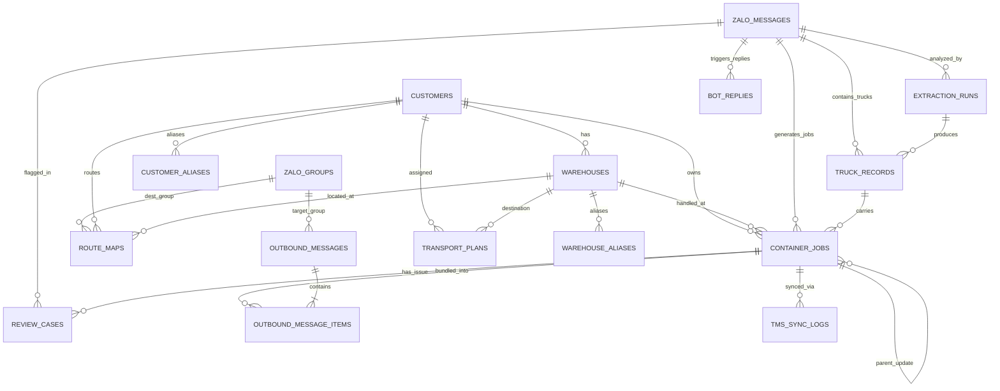
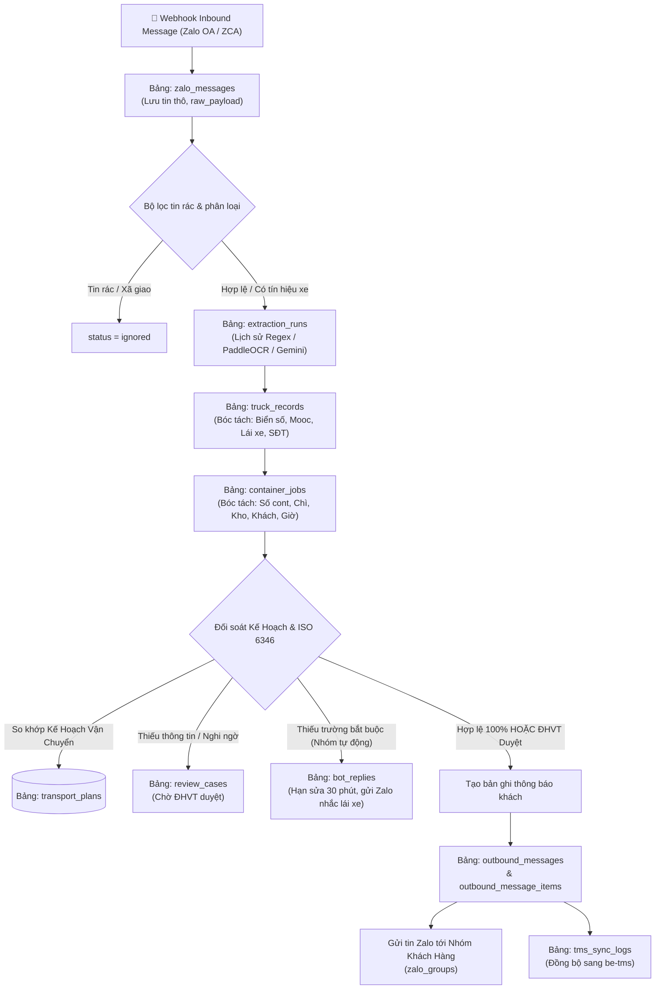
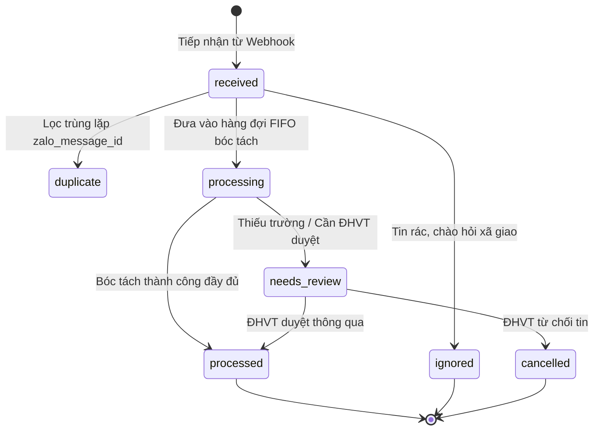
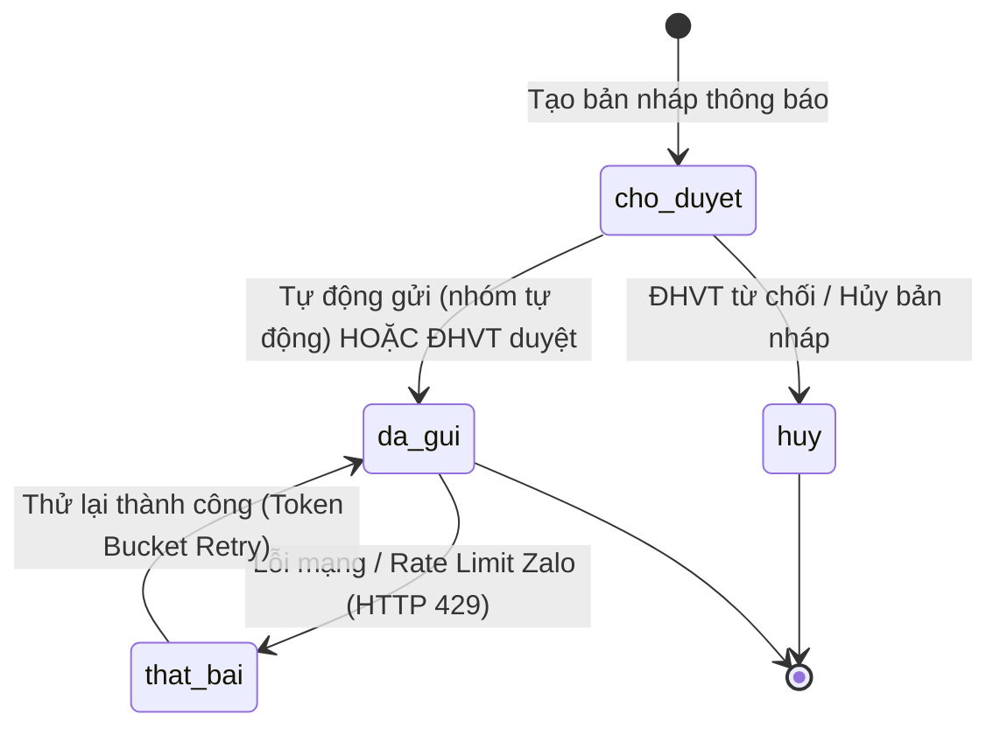

# 📊 TÀI LIỆU THIẾT KẾ CƠ SỞ DỮ LIỆU CHI TIẾT (DATABASE SCHEMA SPECIFICATION)
### Hệ Thống VSICO Zalo Bot — Quản Lý & Tự Động Hóa Điều Vận Xe Container
*Phiên bản tài liệu: 2.0 | Cập nhật: 03/11/2026*

---

## 1. Tổng Quan Kiến Trúc & 5 Nguyên Tắc Cốt Lõi

Cơ sở dữ liệu của hệ thống **VSICO Zalo Bot** được xây dựng trên nền tảng **MySQL 8.4** (sử dụng SQLAlchemy 2.0 ORM), tuân thủ nghiêm ngặt 5 nguyên tắc thiết kế cơ sở dữ liệu:

1. **Bảo Toàn Tin Nhắn Gốc (Immutability)**:
   - Tin nhắn nhận từ webhook Zalo được lưu trữ nguyên vẹn 100% tại bảng `zalo_messages`. Không có bất kỳ logic nào được phép chỉnh sửa hay ghi đè nội dung gốc.
   - Mọi phiên bóc tách (AI Gemini/PaddleOCR/Regex) được lưu lịch sử độc lập tại `extraction_runs`.
2. **Tách Biệt Đa Tầng (Message ➔ Truck ➔ Container)**:
   - Trong vận tải thực tế: 1 tin nhắn có thể chứa nhiều xe (`truck_records`), và 1 xe có thể chở 2 vỏ container 20ft (`container_jobs`). Vì vậy, hệ thống phân tách thành 3 thực thể riêng biệt với quan hệ 1-N.
3. **Mỗi Container Là Một Thực Thể Độc Lập**:
   - Từng container trong bảng `container_jobs` có vòng đời, trạng thái kiểm tra chữ số kiểm tra (check-digit ISO 6346), đối chiếu kế hoạch vận chuyển và trạng thái đồng bộ TMS hoàn toàn riêng biệt.
4. **An Toàn Tuyệt Đối Trước Khi Gửi Khách Hàng (Zero Tolerance for Wrong Group)**:
   - Mọi trường hợp nghi ngờ (thiếu thông tin, sai số kiểm tra, không khớp kho/khách) lập tức được đưa vào hàng đợi `review_cases` để Điều hành vận tải (ĐHVT) duyệt thủ công. Tuyệt đối không tự động phát hành thông báo nếu độ tin cậy chưa đạt 100%.
5. **Đồng Bộ Hai Chiều Với Phần Mềm Trung Tâm TMS**:
   - Dữ liệu danh mục Khách hàng (`customers`) và Kho (`warehouses`) là bản sao chuẩn từ phần mềm TMS; mọi kết quả bóc tách hợp lệ được đồng bộ ngược sang hệ thống TMS qua `tms_sync_logs`.

---

## 2. Sơ Đồ Quan Hệ Thực Thể (Entity-Relationship Diagram - ERD)

---

## 3. Sơ Đồ Luồng Xử Lý Dữ Liệu (Data Flow Diagram - DFD)

---

## 4. Sơ Đồ Vòng Đời Trạng Thái (State Transition Diagrams)

### 4.1. Vòng Đời Tin Nhắn (`zalo_messages.processing_status`)

### 4.2. Vòng Đời Tin Thông Báo Khách (`outbound_messages.status`)

---

## 5. Danh Mục Toàn Bộ 17 Bảng Dữ Liệu

Hệ thống quản lý tổng cộng **17 bảng dữ liệu** được phân chia theo 3 nhóm chức năng:

| STT | Tên bảng CSDL | Nhóm chức năng | Vai trò nghiệp vụ chính |
| :---: | :--- | :--- | :--- |
| 1 | `zalo_messages` | Nghiệp vụ Runtime | Lưu tin nhắn thô ban đầu nhận từ Webhook Zalo |
| 2 | `extraction_runs` | Nghiệp vụ Runtime | Nhật ký các phiên bóc tách dữ liệu (AI, Regex, OCR) |
| 3 | `truck_records` | Nghiệp vụ Runtime | Thông tin lượt xe (Đầu kéo, Rơ-mooc, Lái xe, SĐT) |
| 4 | `container_jobs` | Nghiệp vụ Runtime | Thực thể trung tâm quản lý từng công việc container |
| 5 | `review_cases` | Nghiệp vụ Runtime | Hàng đợi các ca cần Điều hành vận tải (ĐHVT) duyệt tay |
| 6 | `bot_replies` | Nghiệp vụ Runtime | Theo dõi tin Bot nhắc tài xế sửa lỗi (thời hạn 30 phút) |
| 7 | `outbound_messages` | Nghiệp vụ Runtime | Bản tin thông báo chuyến xe gửi ra nhóm Zalo khách hàng |
| 8 | `outbound_message_items` | Nghiệp vụ Runtime | Bảng liên kết N-N giữa Container và Bản tin Outbound |
| 9 | `tms_sync_logs` | Nghiệp vụ Runtime | Nhật ký gọi API đồng bộ dữ liệu sang phần mềm TMS |
| 10 | `activity_logs` | Nghiệp vụ Runtime | Nhật ký kiểm toán (Audit Trail) thao tác người dùng & hệ thống |
| 11 | `transport_plans` | Kế hoạch Vận chuyển | Kế hoạch vận chuyển hằng ngày (Import từ Excel/CSV) |
| 12 | `zalo_groups` | Danh mục & Cấu hình | Danh bạ các nhóm Zalo (Nhà xe, Khách hàng, Nhóm ĐHVT) |
| 13 | `customers` | Danh mục & Cấu hình | Danh mục khách hàng chuẩn đồng bộ từ TMS |
| 14 | `warehouses` | Danh mục & Cấu hình | Danh mục kho đóng/trả hàng đồng bộ từ TMS |
| 15 | `customer_aliases` | Danh mục & Cấu hình | Bảng từ khóa viết tắt / bí danh nhận diện khách hàng |
| 16 | `warehouse_aliases` | Danh mục & Cấu hình | Bảng từ khóa viết tắt / bí danh nhận diện kho hàng |
| 17 | `route_maps` | Danh mục & Cấu hình | Ma trận định tuyến: Khách hàng + Kho ➔ Nhóm Zalo nhận tin |

---

## 6. Đặc Tả Chi Tiết Từng Bảng & Từng Cột (Field Dictionary)

---

### BẢNG 1: `zalo_messages`
> **Ý nghĩa**: Bảng lưu trữ bất biến (Immutable Table) toàn bộ payload thô nhận từ máy chủ Zalo OA / ZCA-JS Webhook.

| Tên trường | Kiểu dữ liệu | Ràng buộc | Mặc định | Ý nghĩa & Quy tắc nghiệp vụ |
| :--- | :--- | :--- | :--- | :--- |
| `id` | `BigInteger` | **PK**, Auto Increment | | Khóa chính định danh dòng tin nội bộ hệ thống |
| `zalo_message_id` | `String(128)` | **Unique**, Not Null, **Index** | | ID tin nhắn từ máy chủ Zalo (dùng để khử trùng lặp Deduplication) |
| `group_id` | `String(128)` | Not Null, **Index** | | ID Nhóm Zalo nơi phát sinh tin nhắn (hoặc `direct_<uid>` nếu tin riêng) |
| `sender_id` | `String(128)` | Not Null, **Index** | | ID tài khoản người dùng Zalo của người gửi (tài xế, nhà xe, ĐHVT) |
| `sender_name` | `String(255)` | Nullable | `NULL` | Tên hiển thị Zalo của người gửi tại thời điểm nhận tin |
| `quote_msg_id` | `String(128)` | Nullable, **Index** | `NULL` | ID tin nhắn Zalo được trích dẫn (dùng khi ĐHVT quote duyệt "ok" hoặc sửa) |
| `message_type` | `String(32)` | Not Null | `'text'` | Loại tin nhắn: `'text'` (văn bản), `'image'` (hình ảnh lệnh điều xe) |
| `message_text` | `Text` | Nullable | `NULL` | Nội dung văn bản nguyên bản của tin nhắn (giữ nguyên ký tự `\n`, icon) |
| `raw_payload` | `JSON` | Not Null | | Toàn bộ cấu trúc JSON thô máy chủ Zalo đẩy về (để debug / audit) |
| `processing_status`| `String(32)` | Not Null, **Index** | `'received'` | Trạng thái: `received`, `processing`, `processed`, `needs_review`, `ignored`, `duplicate`, `cancelled` |
| `received_at` | `DateTime(UTC)` | Not Null | `utc_now` | Thời điểm máy chủ Bot tiếp nhận tin nhắn từ mạng |
| `zalo_sent_at` | `DateTime(UTC)` | Nullable | `NULL` | Thời điểm người dùng ấn nút gửi tin trên ứng dụng Zalo (timestamp Zalo) |
| `last_error` | `Text` | Nullable | `NULL` | Chi tiết lỗi xử lý cuối cùng (nếu gặp lỗi) |
| `created_at` | `DateTime(UTC)` | Not Null | `utc_now` | Thời gian tạo bản ghi trong cơ sở dữ liệu |

---

### BẢNG 2: `extraction_runs`
> **Ý nghĩa**: Bảng lưu lịch sử từng lượt bóc tách dữ liệu từ tin nhắn bằng AI (Gemini Flash, PaddleOCR) hoặc Rule-based Parser.

| Tên trường | Kiểu dữ liệu | Ràng buộc | Mặc định | Ý nghĩa & Quy tắc nghiệp vụ |
| :--- | :--- | :--- | :--- | :--- |
| `id` | `BigInteger` | **PK**, Auto Increment | | Khóa chính định danh phiên bóc tách |
| `message_id` | `BigInteger` | **FK** (`zalo_messages.id`), Not Null | | Liên kết tới tin nhắn gốc cần bóc tách |
| `model_name` | `String(128)` | Not Null | | Tên cơ chế bóc tách: `'regex_v1'`, `'paddleocr_v2'`, `'gemini-2.0-flash'` |
| `prompt_version` | `String(64)` | Not Null | | Phiên bản prompt hoặc cấu hình parser áp dụng (vd: `'v2.3_202610'`) |
| `input_data` | `JSON` | Not Null | | Dữ liệu đầu vào đưa vào bộ bóc tách (text hoặc link ảnh) |
| `output_data` | `JSON` | Nullable | `NULL` | Kết quả đầu ra có cấu trúc trích xuất được dạng JSON |
| `status` | `String(32)` | Not Null | | Kết quả chạy: `'success'`, `'failed'`, `'partial'` |
| `error_message` | `Text` | Nullable | `NULL` | Chi tiết lỗi nếu lượt chạy thất bại (timeout, parse error) |
| `started_at` | `DateTime(UTC)` | Not Null | `utc_now` | Thời điểm bắt đầu chạy giải thuật bóc tách |
| `finished_at` | `DateTime(UTC)` | Nullable | `NULL` | Thời điểm hoàn tất lượt chạy (dùng đo độ trễ Latency ms) |

---

### BẢNG 3: `truck_records`
> **Ý nghĩa**: Bảng thông tin xe vận chuyển được trích xuất (Biển số xe đầu kéo, Rơ-mooc, Thông tin bác tài).

| Tên trường | Kiểu dữ liệu | Ràng buộc | Mặc định | Ý nghĩa & Quy tắc nghiệp vụ |
| :--- | :--- | :--- | :--- | :--- |
| `id` | `BigInteger` | **PK**, Auto Increment | | Khóa chính lượt xe |
| `message_id` | `BigInteger` | **FK** (`zalo_messages.id`), Not Null, **Index** | | Tin nhắn sinh ra lượt xe này |
| `extraction_run_id`| `BigInteger` | **FK** (`extraction_runs.id`), Nullable | `NULL` | Phiên bóc tách sinh ra lượt xe này |
| `truck_plate` | `String(32)` | Nullable, **Index** | `NULL` | Biển số xe đầu kéo đã chuẩn hóa (VD: `15C-283.94`) |
| `trailer_plate` | `String(32)` | Nullable | `NULL` | Biển số sơ-mi rơ-mooc (VD: `15R-048.22`) |
| `driver_name` | `String(255)` | Nullable | `NULL` | Họ tên tài xế (đã chuẩn hóa Title Case, bỏ tiền tố "Lái xe", "bác") |
| `driver_phone` | `String(32)` | Nullable | `NULL` | Số điện thoại tài xế (chuẩn 10 chữ số bắt đầu bằng `0`, bảo mật mask 3 đầu 3 cuối) |
| `raw_data` | `JSON` | Nullable | `NULL` | Trích đoạn text chứa thông tin lượt xe này trước khi chuẩn hóa |
| `created_at` | `DateTime(UTC)` | Not Null | `utc_now` | Thời gian ghi nhận lượt xe |

---

### BẢNG 4: `container_jobs`
> **Ý nghĩa**: Bảng trung tâm quản lý từng Container cụ thể được bóc tách từ tin nhắn điều xe.

| Tên trường | Kiểu dữ liệu | Ràng buộc | Mặc định | Ý nghĩa & Quy tắc nghiệp vụ |
| :--- | :--- | :--- | :--- | :--- |
| `id` | `BigInteger` | **PK**, Auto Increment | | Khóa chính định danh việc container |
| `message_id` | `BigInteger` | **FK** (`zalo_messages.id`), Not Null, **Index** | | Tin nhắn gốc sinh ra container này |
| `truck_record_id` | `BigInteger` | **FK** (`truck_records.id`), Nullable, **Index** | `NULL` | Xe chịu trách nhiệm kéo container này |
| `parent_job_id` | `BigInteger` | **FK** (`container_jobs.id`), Nullable | `NULL` | Bản ghi cha nếu đây là tin cập nhật/sửa thông tin cont cũ |
| `is_update` | `Boolean` | Not Null | `False` | Cờ đánh dấu: `True` nếu là tin nhắn đổi tài xế / sửa chì của cont trước đó |
| `line_no` | `Integer` | Nullable | `NULL` | Số thứ tự dòng xe/cont trong tin nhắn nhiều dòng |
| `line_text` | `Text` | Nullable | `NULL` | Nội dung dòng văn bản cụ thể trích xuất ra container này |
| `container_no` | `String(16)` | Nullable, **Index** | `NULL` | Số Container gồm 4 chữ cái + 7 chữ số (VD: `TGCU2203372`) |
| `container_size` | `String(16)` | Nullable | `NULL` | Kích thước vỏ cont: `'20'`, `'40'`, `'45'` |
| `seal_no` | `String(64)` | Nullable | `NULL` | Số chì / seal hải quan (VD: `23338253`) |
| `order_type` | `String(16)` | Nullable | `NULL` | Loại lệnh: `'dong'` (đóng hàng/hạ bãi), `'tra'` (trả hàng/mở cont/nhập) |
| `warehouse_hint` | `String(255)` | Nullable | `NULL` | Chuỗi tên kho thô bóc tách từ tin nhắn |
| `customer_hint` | `String(255)` | Nullable | `NULL` | Chuỗi tên khách hàng thô bóc tách từ tin nhắn |
| `customer_id` | `BigInteger` | **FK** (`customers.id`), Nullable, **Index** | `NULL` | ID khách hàng chuẩn sau khi match qua bảng bí danh/kế hoạch |
| `warehouse_id` | `BigInteger` | **FK** (`warehouses.id`), Nullable, **Index** | `NULL` | ID kho chuẩn sau khi match qua bảng bí danh/kế hoạch |
| `match_method` | `String(32)` | Nullable | `NULL` | Cách thức khớp kho/khách: `'exact'`, `'alias'`, `'plan_lookup'`, `'ai_fuzzy'` |
| `ai_confidence` | `Numeric(4, 3)`| Nullable | `NULL` | Độ tin cậy nhận diện của AI (thang 0.000 đến 1.000) |
| `estimated_at` | `DateTime(UTC)` | Nullable | `NULL` | Giờ hẹn có mặt tại kho (bóc tách từ tin nhắn hoặc kế hoạch) |
| `note` | `Text` | Nullable | `NULL` | Ghi chú phát sinh của container |
| `container_check_digit_valid` | `Boolean` | Nullable | `NULL` | Kết quả thẩm định chữ số kiểm tra ISO 6346: `True`/`False` |
| `validation_status` | `String(32)` | Not Null | `'pending'` | Trạng thái thẩm định nghiệp vụ: `'valid'`, `'missing_fields'`, `'invalid_iso'` |
| `routing_status` | `String(32)` | Not Null | `'pending'` | Trạng thái tìm nhóm gửi: `'routed'`, `'needs_review'`, `'no_route'` |
| `tms_sync_status` | `String(32)` | Not Null | `'not_started'` | Trạng thái đồng bộ sang TMS: `'not_started'`, `'synced'`, `'failed'` |
| `raw_fields` | `JSON` | Nullable | `NULL` | Lưu trữ toàn bộ các trường nhận diện chi tiết |
| `created_at` | `DateTime(UTC)` | Not Null | `utc_now` | Thời gian tạo bản ghi |
| `updated_at` | `DateTime(UTC)` | Not Null | `utc_now` | Thời gian cập nhật bản ghi gần nhất |

---

### BẢNG 5: `customers`
> **Ý nghĩa**: Danh mục khách hàng chuẩn được đồng bộ định kỳ từ phần mềm quản lý vận tải trung tâm (PM TMS).

| Tên trường | Kiểu dữ liệu | Ràng buộc | Mặc định | Ý nghĩa & Quy tắc nghiệp vụ |
| :--- | :--- | :--- | :--- | :--- |
| `id` | `BigInteger` | **PK**, Auto Increment | | Khóa chính khách hàng nội bộ |
| `tms_customer_id` | `String(128)` | **Unique**, Not Null | | Mã khách hàng trên hệ thống TMS (VD: `'KH_LOGITEM'`, `'KH_DC'`) |
| `name` | `String(255)` | Not Null | | Tên đầy đủ của khách hàng (VD: `'Công ty TNHH Logitem Việt Nam'`) |
| `normalized_name` | `String(255)` | Not Null, **Index** | | Tên đã xóa dấu, viết thường, chuẩn hóa khoảng trắng để tìm kiếm |
| `is_active` | `Boolean` | Not Null | `True` | Cờ kích hoạt (`True`: Đang giao dịch; `False`: Tạm ngưng) |
| `synced_at` | `DateTime(UTC)` | Nullable | `NULL` | Thời điểm đồng bộ từ hệ thống TMS gần nhất |

---

### BẢNG 6: `warehouses`
> **Ý nghĩa**: Danh mục kho đóng/trả hàng và bãi cắm điện/hạ rỗng chuẩn từ TMS.

| Tên trường | Kiểu dữ liệu | Ràng buộc | Mặc định | Ý nghĩa & Quy tắc nghiệp vụ |
| :--- | :--- | :--- | :--- | :--- |
| `id` | `BigInteger` | **PK**, Auto Increment | | Khóa chính kho hàng |
| `tms_warehouse_id` | `String(128)` | **Unique**, Not Null | | Mã định danh kho trên phần mềm TMS |
| `customer_id` | `BigInteger` | **FK** (`customers.id`), Nullable, **Index** | `NULL` | Khách hàng sở hữu hoặc thuê kho này (nếu có) |
| `name` | `String(255)` | Not Null | | Tên chuẩn của kho (VD: `'Kho Logitem Tân Quang'`) |
| `normalized_name` | `String(255)` | Not Null, **Index** | | Tên kho chuẩn hóa không dấu dùng cho fuzzy search |
| `address` | `Text` | Nullable | `NULL` | Địa chỉ cụ thể của kho bãi |
| `latitude` | `Numeric(10, 7)`| Nullable | `NULL` | Vĩ độ tọa độ GPS của kho |
| `longitude` | `Numeric(10, 7)`| Nullable | `NULL` | Kinh độ tọa độ GPS của kho |
| `is_active` | `Boolean` | Not Null | `True` | Trạng thái kho đang hoạt động |
| `synced_at` | `DateTime(UTC)` | Nullable | `NULL` | Lần đồng bộ thông tin kho gần nhất |

---

### BẢNG 7: `customer_aliases`
> **Ý nghĩa**: Bảng từ khóa viết tắt, tên lóng, lỗi chính tả thông dụng dùng để nhận diện Khách Hàng.

| Tên trường | Kiểu dữ liệu | Ràng buộc | Mặc định | Ý nghĩa & Quy tắc nghiệp vụ |
| :--- | :--- | :--- | :--- | :--- |
| `id` | `BigInteger` | **PK**, Auto Increment | | Khóa chính bí danh khách hàng |
| `customer_id` | `BigInteger` | **FK** (`customers.id`), Not Null | | Mã khách hàng chuẩn tương ứng |
| `alias` | `String(255)` | Not Null | | Tên gọi tắt gốc (VD: `'Logitem'`, `'DC'`, `'Hải Long'`) |
| `normalized_alias` | `String(255)` | **Unique**, Not Null | | Bí danh viết thường không dấu (VD: `'logitem'`, `'dc'`) |
| `source` | `String(32)` | Not Null | `'manual'` | Nguồn tạo bí danh: `'manual'` (nhập tay), `'auto_learned'` (máy học) |
| `created_at` | `DateTime(UTC)` | Not Null | `utc_now` | Thời điểm tạo bí danh |

---

### BẢNG 8: `warehouse_aliases`
> **Ý nghĩa**: Bảng từ khóa viết tắt, tên thường gọi của Kho đóng/trả hàng.

| Tên trường | Kiểu dữ liệu | Ràng buộc | Mặc định | Ý nghĩa & Quy tắc nghiệp vụ |
| :--- | :--- | :--- | :--- | :--- |
| `id` | `BigInteger` | **PK**, Auto Increment | | Khóa chính bí danh kho |
| `warehouse_id` | `BigInteger` | **FK** (`warehouses.id`), Not Null | | Mã kho hàng chuẩn tương ứng |
| `alias` | `String(255)` | Not Null | | Tên gọi tắt (VD: `'Tân Quang'`, `'PTSC'`, `'KCN Phố Nối'`) |
| `normalized_alias` | `String(255)` | **Unique**, Not Null | | Bí danh chuẩn hóa không dấu |
| `source` | `String(32)` | Not Null | `'manual'` | Nguồn cấu hình bí danh: `'manual'` hoặc `'auto'` |
| `created_at` | `DateTime(UTC)` | Not Null | `utc_now` | Thời điểm tạo bí danh |

---

### BẢNG 9: `zalo_groups`
> **Ý nghĩa**: Bảng quản lý danh bạ nhóm Zalo, chế độ gửi tin (Tự động / Chờ duyệt) và phân quyền nhóm.

| Tên trường | Kiểu dữ liệu | Ràng buộc | Mặc định | Ý nghĩa & Quy tắc nghiệp vụ |
| :--- | :--- | :--- | :--- | :--- |
| `id` | `BigInteger` | **PK**, Auto Increment | | Khóa chính nhóm Zalo |
| `zalo_group_id` | `String(128)` | **Unique**, Not Null, **Index** | | ID nhóm trên nền tảng Zalo (VD: `'6469608867469758994'`) |
| `name` | `String(255)` | Nullable | `NULL` | Tên tiêu đề nhóm Zalo |
| `group_role` | `String(32)` | Not Null | `'source'` | Vai trò: `'source'` (Nhóm nhà xe báo về), `'destination'` (Nhóm khách hàng nhận tin), `'internal'` (Nhóm nội bộ ĐHVT) |
| `carrier_id` | `String(128)` | Nullable, **Index** | `NULL` | Mã nhà xe (nếu đây là nhóm độc quyền của một nhà xe cụ thể) |
| `carrier_name` | `String(255)` | Nullable | `NULL` | Tên hãng vận tải / nhà xe đối tác |
| `send_mode` | `String(32)` | Not Null | `'tu_dong'` | Cơ chế phát hành: `'tu_dong'` (Bắn thẳng tin sang khách), `'cho_duyet'` (Chờ ĐHVT ấn duyệt trên Web) |
| `is_test` | `Boolean` | Not Null | `False` | Cờ nhóm test thử nghiệm (cho phép dọn dẹp hàng loạt) |
| `is_active` | `Boolean` | Not Null | `True` | Cờ kích hoạt hoạt động của nhóm |
| `expires_at` | `DateTime(UTC)` | Nullable | `NULL` | Hạn hoạt động của nhóm (nếu có dự án theo mùa vụ) |
| `created_at` | `DateTime(UTC)` | Not Null | `utc_now` | Thời điểm đăng ký nhóm vào hệ thống |

---

### BẢNG 10: `route_maps`
> **Ý nghĩa**: Ma trận định tuyến thông báo tự động (Cặp Khách Hàng + Kho + Loại Lệnh ➔ Bắn vào Nhóm Zalo nào).

| Tên trường | Kiểu dữ liệu | Ràng buộc | Mặc định | Ý nghĩa & Quy tắc nghiệp vụ |
| :--- | :--- | :--- | :--- | :--- |
| `id` | `BigInteger` | **PK**, Auto Increment | | Khóa chính ma trận định tuyến |
| `customer_id` | `BigInteger` | **FK** (`customers.id`), Not Null | | Khách hàng áp dụng |
| `warehouse_id` | `BigInteger` | **FK** (`warehouses.id`), Nullable | `NULL` | Kho áp dụng (`NULL` = Áp dụng cho mọi kho của khách này) |
| `order_type` | `String(16)` | Nullable | `NULL` | Loại lệnh áp dụng: `'dong'`, `'tra'`, hoặc `NULL` (cả hai) |
| `zalo_group_id` | `BigInteger` | **FK** (`zalo_groups.id`), Not Null | | Nhóm Zalo đích tiếp nhận thông báo |
| `priority` | `Integer` | Not Null | `1` | Thứ tự ưu tiên (ưu tiên cao xử lý trước khi có nhiều rule) |
| `is_active` | `Boolean` | Not Null | `True` | Cờ kích hoạt quy tắc định tuyến |
| `created_at` | `DateTime(UTC)` | Not Null | `utc_now` | Ngày tạo quy tắc |

---

### BẢNG 11: `review_cases`
> **Ý nghĩa**: Hàng đợi các trường hợp bất thường cần nhân viên Điều Hành Vận Tải (ĐHVT) can thiệp, duyệt hoặc từ chối.

| Tên trường | Kiểu dữ liệu | Ràng buộc | Mặc định | Ý nghĩa & Quy tắc nghiệp vụ |
| :--- | :--- | :--- | :--- | :--- |
| `id` | `BigInteger` | **PK**, Auto Increment | | Khóa chính ca duyệt |
| `message_id` | `BigInteger` | **FK** (`zalo_messages.id`), Not Null, **Index** | | Tin nhắn phát sinh lỗi |
| `container_job_id` | `BigInteger` | **FK** (`container_jobs.id`), Nullable, **Index** | `NULL` | Container cụ thể gặp lỗi (nếu có) |
| `case_type` | `String(32)` | Not Null | | Phân loại lỗi: `'missing_fields'`, `'invalid_iso'`, `'unknown_carrier'`, `'group_mismatch'`, `'low_confidence'` |
| `reason` | `Text` | Not Null | | Lý do bằng tiếng Việt giải thích vì sao cần duyệt thủ công |
| `details` | `JSON` | Nullable | `NULL` | Dữ liệu chi tiết lỗi dạng JSON phục vụ hiển thị màn hình Review |
| `status` | `String(32)` | Not Null, **Index** | `'pending'` | Trạng thái ca: `'pending'` (Chờ xử lý), `'approved'` (Đã duyệt), `'rejected'` (Từ chối) |
| `assigned_to` | `String(128)` | Nullable | `NULL` | Tài khoản điều hành được phân công xử lý |
| `resolved_by` | `String(128)` | Nullable | `NULL` | Tài khoản nhân viên ĐHVT đã bấm duyệt / từ chối |
| `resolution` | `JSON` | Nullable | `NULL` | Kết quả chỉnh sửa bổ sung thông tin của ĐHVT |
| `created_at` | `DateTime(UTC)` | Not Null | `utc_now` | Thời điểm phát sinh ca nghi ngờ |
| `resolved_at` | `DateTime(UTC)` | Nullable | `NULL` | Thời điểm xử lý xong ca |

---

### BẢNG 12: `bot_replies`
> **Ý nghĩa**: Bảng theo dõi các tin nhắn cảnh báo thiếu thông tin do Bot tự động phản hồi lại lái xe/nhà xe (Kèm đồng hồ đếm ngược 30 phút sửa lỗi).

| Tên trường | Kiểu dữ liệu | Ràng buộc | Mặc định | Ý nghĩa & Quy tắc nghiệp vụ |
| :--- | :--- | :--- | :--- | :--- |
| `id` | `BigInteger` | **PK**, Auto Increment | | Khóa chính tin nhắc lỗi |
| `message_id` | `BigInteger` | **FK** (`zalo_messages.id`), Not Null, **Index** | | Tin nhắn gốc bị thiếu trường |
| `sender_id` | `String(128)` | Not Null | | ID tài khoản Zalo nhận tin nhắc lỗi |
| `zalo_msg_id` | `String(128)` | **Unique**, Nullable | `NULL` | ID tin nhắn phản hồi trên Zalo mà Bot vừa gửi |
| `reply_text` | `Text` | Not Null | | Nội dung Bot nhắn: chỉ rõ thiếu biển số, thiếu cont, sai chì,... |
| `fix_deadline` | `DateTime(UTC)` | Not Null | | Thời hạn tài xế phải phản hồi sửa tin (Mặc định = `created_at + 30 phút`) |
| `status` | `String(32)` | Not Null | `'cho_sua'` | Trạng thái: `'cho_sua'` (Chờ sửa), `'da_sua'` (Đã sửa kịp hạn), `'qua_han'` (Quá 30p chưa sửa), `'da_gui'`, `'that_bai'` |
| `sent_at` | `DateTime(UTC)` | Nullable | `NULL` | Thời điểm Bot gửi tin nhắc thành công qua Zalo |
| `created_at` | `DateTime(UTC)` | Not Null | `utc_now` | Thời điểm tạo yêu cầu sửa |

---

### BẢNG 13: `outbound_messages`
> **Ý nghĩa**: Lưu trữ các bản tin thông báo chuyến xe hoàn chỉnh gửi tới Nhóm Zalo của Khách Hàng.

| Tên trường | Kiểu dữ liệu | Ràng buộc | Mặc định | Ý nghĩa & Quy tắc nghiệp vụ |
| :--- | :--- | :--- | :--- | :--- |
| `id` | `BigInteger` | **PK**, Auto Increment | | Khóa chính tin gửi đi |
| `target_group_id` | `BigInteger` | **FK** (`zalo_groups.id`), Not Null, **Index** | | Nhóm Zalo khách hàng đích nhận tin |
| `order_type` | `String(16)` | Not Null | | Loại mẫu thông báo: `'dong'` (Đóng hàng) hoặc `'tra'` (Trả hàng) |
| `message_kind` | `String(32)` | Not Null | `'initial'` | Phân loại tin: `'initial'` (Tin báo lần đầu), `'driver_change'` (Tin đổi xe/tài xế) |
| `content` | `Text` | Not Null | | Nội dung văn bản tiếng Việt hoàn chỉnh gửi khách (render theo template) |
| `idempotency_key` | `String(128)` | **Unique**, Not Null | | Khóa chống gửi trùng lặp (Hash từ: Cont + Biển số + Loại lệnh) |
| `review_zalo_msg_id`| `String(128)` | **Unique**, Nullable | `NULL` | ID tin nhắn nháp gửi vào nhóm ĐHVT nội bộ để quote 'ok' |
| `approved_by` | `String(128)` | Nullable | `NULL` | Tên nhân viên hoặc chữ ký hệ thống đã duyệt phát hành |
| `approved_at` | `DateTime(UTC)` | Nullable | `NULL` | Thời điểm tin được phê duyệt |
| `status` | `String(32)` | Not Null, **Index** | `'cho_duyet'` | Trạng thái gửi: `'cho_duyet'`, `'da_gui'`, `'that_bai'`, `'huy'` |
| `attempt_count` | `Integer` | Not Null | `0` | Số lần đã thử gửi qua cổng Zalo Dispatcher |
| `zalo_message_id` | `String(128)` | Nullable | `NULL` | ID tin nhắn xác nhận trả về từ máy chủ Zalo sau khi gửi thành công |
| `last_error` | `Text` | Nullable | `NULL` | Chi tiết lỗi gửi tin nếu thất bại (Rate limit 429, bị chặn người lạ 123) |
| `created_at` | `DateTime(UTC)` | Not Null | `utc_now` | Thời điểm tạo bản tin |
| `sent_at` | `DateTime(UTC)` | Nullable | `NULL` | Thời điểm gửi tin thành công tới khách hàng |

---

### BẢNG 14: `outbound_message_items`
> **Ý nghĩa**: Bảng liên kết trung gian Nhiều - Nhiều (N-N) xác định một bản tin Outbound bao gồm những Container nào (hỗ trợ trường hợp 1 xe kéo 2 vỏ container 20ft được gom chung vào 1 tin gửi khách).

| Tên trường | Kiểu dữ liệu | Ràng buộc | Mặc định | Ý nghĩa & Quy tắc nghiệp vụ |
| :--- | :--- | :--- | :--- | :--- |
| `outbound_message_id` | `BigInteger` | **PK**, **FK** (`outbound_messages.id`) | | Mã bản tin gửi khách hàng |
| `container_job_id` | `BigInteger` | **PK**, **FK** (`container_jobs.id`) | | Mã công việc Container được đính kèm trong tin |

---

### BẢNG 15: `tms_sync_logs`
> **Ý nghĩa**: Nhật ký tích hợp toàn diện ghi lại mọi cuộc gọi API đồng bộ dữ liệu container đã xử lý sang phần mềm nghiệp vụ `be-tms`.

| Tên trường | Kiểu dữ liệu | Ràng buộc | Mặc định | Ý nghĩa & Quy tắc nghiệp vụ |
| :--- | :--- | :--- | :--- | :--- |
| `id` | `BigInteger` | **PK**, Auto Increment | | Khóa chính nhật ký đồng bộ |
| `container_job_id` | `BigInteger` | **FK** (`container_jobs.id`), Not Null, **Index** | | Container được đồng bộ |
| `operation` | `String(64)` | Not Null | | Tên thao tác: `'CREATE_TRIP'`, `'UPDATE_DRIVER'`, `'CANCEL_TRIP'` |
| `request_data` | `JSON` | Nullable | `NULL` | Payload gửi đi sang máy chủ TMS |
| `response_data` | `JSON` | Nullable | `NULL` | Dữ liệu phản hồi từ máy chủ TMS |
| `http_status` | `Integer` | Nullable | `NULL` | Mã phản hồi HTTP (VD: `200`, `201`, `422`, `500`) |
| `status` | `String(32)` | Not Null | | Kết quả: `'SUCCESS'`, `'FAILED'`, `'RETRYING'` |
| `error_message` | `Text` | Nullable | `NULL` | Chi tiết lỗi nếu không gọi được sang TMS |
| `created_at` | `DateTime(UTC)` | Not Null | `utc_now` | Thời gian phát sinh lệnh gọi API |

---

### BẢNG 16: `activity_logs`
> **Ý nghĩa**: Bảng Audit Trail lưu vết toàn bộ hoạt động của người dùng (ĐHVT) và tiến trình tự động của Bot phục vụ tra cứu bảo mật.

| Tên trường | Kiểu dữ liệu | Ràng buộc | Mặc định | Ý nghĩa & Quy tắc nghiệp vụ |
| :--- | :--- | :--- | :--- | :--- |
| `id` | `BigInteger` | **PK**, Auto Increment | | Khóa chính nhật ký hoạt động |
| `actor_id` | `String(128)` | Nullable, **Index** | `NULL` | ID người thao tác (Tài khoản ĐHVT hoặc `'SYSTEM_WORKER'`) |
| `action` | `String(64)` | Not Null | | Hành động: `'APPROVE_REVIEW'`, `'REJECT_MESSAGE'`, `'IMPORT_PLAN'` |
| `entity_type` | `String(64)` | Not Null | | Thực thể bị tác động: `'review_case'`, `'outbound_message'`, `'plan'` |
| `entity_id` | `String(128)` | Nullable | `NULL` | Khóa chính của thực thể bị tác động |
| `details` | `JSON` | Nullable | `NULL` | Chi tiết thay đổi trước và sau khi thực hiện thao tác |
| `created_at` | `DateTime(UTC)` | Not Null | `utc_now` | Thời điểm thực hiện hành động |

---

### BẢNG 17: `transport_plans`
> **Ý nghĩa**: Bảng dữ liệu kế hoạch vận chuyển điều vận hằng ngày được Import từ file Excel Kế hoạch điều vận hoặc tệp CSV.

| Tên trường | Kiểu dữ liệu | Ràng buộc | Mặc định | Ý nghĩa & Quy tắc nghiệp vụ |
| :--- | :--- | :--- | :--- | :--- |
| `id` | `BigInteger` | **PK**, Auto Increment | | Khóa chính bản ghi kế hoạch |
| `plan_date` | `Date` | Not Null, **Index** | | Ngày kế hoạch vận chuyển (Định dạng `YYYY-MM-DD`) |
| `stt` | `Integer` | Nullable | `NULL` | Số thứ tự dòng trong file Excel gốc |
| `route_name` | `String(255)` | Nullable | `NULL` | Tên cung đường vận chuyển (VD: `'Hải Phòng - Hưng Yên'`) |
| `cargo_io_type` | `String(16)` | Nullable | `NULL` | Phân loại xuất nhập: `'I'` (Hàng Nhập/Trả), `'X'` (Hàng Xuất/Đóng) |
| `order_type` | `String(16)` | Not Null, **Index** | | Phân loại chuẩn hóa hệ thống: `'dong'` hoặc `'tra'` |
| `container_no` | `String(16)` | Nullable, **Index** | `NULL` | Số container kế hoạch dự kiến đóng/trả |
| `seal_no` | `String(64)` | Nullable | `NULL` | Số chì niêm phong tương ứng |
| `container_size` | `String(16)` | Nullable | `NULL` | Size cont dự kiến: `'20'`, `'40'`, `'45'` |
| `cargo_weight` | `Numeric(10, 2)`| Nullable | `NULL` | Tải trọng cả vỏ container (đơn vị: Tấn) |
| `required_time` | `String(64)` | Nullable | `NULL` | Giờ yêu cầu xe có mặt tại kho (VD: `'7h'`, `'9h'`) |
| `customer_name` | `String(255)` | Nullable, **Index** | `NULL` | Tên khách hàng theo kế hoạch |
| `customer_id` | `BigInteger` | **FK** (`customers.id`), Nullable | `NULL` | ID khách hàng chuẩn (sau khi ánh xạ) |
| `warehouse_id` | `BigInteger` | **FK** (`warehouses.id`), Nullable | `NULL` | ID kho chuẩn (sau khi ánh xạ) |
| `cargo_type` | `String(255)` | Nullable | `NULL` | Loại mặt hàng vận chuyển (VD: `'Mỳ'`, `'Bột ngọt'`, `'Gạo'`) |
| `vessel_voyage` | `String(100)` | Nullable | `NULL` | Chuyến tàu vận chuyển biển (VD: `'Prosper 2633N'`) |
| `empty_depot` | `String(255)` | Nullable | `NULL` | Bãi nâng/hạ vỏ rỗng |
| `full_depot` | `String(255)` | Nullable | `NULL` | Bãi nâng/hạ hàng (VD: `'PTSC'`, `'Nam Hải'`) |
| `estimated_drop_time`| `String(64)` | Nullable | `NULL` | Giờ dự kiến hạ hàng tại bãi/kho |
| `fleet_partner` | `String(255)` | Nullable | `NULL` | Đội xe / Nhà xe được phân công chạy (VD: `'Phương Anh HP'`) |
| `planned_truck_plate`| `String(64)` | Nullable | `NULL` | Biển số xe được dự kiến điều (VD: `'29C-445.41'`) |
| `delivery_address` | `Text` | Nullable | `NULL` | Địa chỉ chi tiết điểm đóng hoặc trả hàng |
| `group_id` | `String(64)` | Nullable, **Index** | `'6469608867469758994'` | ID Nhóm Zalo nhận thông báo chuyến xe |
| `operator_staff` | `String(100)` | Nullable | `NULL` | Cán bộ điều vận/giao nhận phụ trách theo dõi |
| `notes` | `Text` | Nullable | `NULL` | Ghi chú điều hành |
| `extra_fee_notes` | `Text` | Nullable | `NULL` | Ghi chú các chi phí phát sinh (lưu kho, cắm điện, cầu đường) |
| `address` | `Text` | Nullable | `NULL` | Trường phụ tương thích ngược địa chỉ |
| `carrier_name` | `String(255)` | Nullable | `NULL` | Tên nhà xe tương thích ngược |
| `eta` | `String(64)` | Nullable | `NULL` | Giờ dự kiến đến kho tương thích ngược |
| `combine_note` | `Text` | Nullable | `NULL` | Ghi chú ghép xe tương thích ngược |
| `created_at` | `DateTime(UTC)` | Not Null | `utc_now` | Thời điểm import bản ghi vào CSDL |
| `updated_at` | `DateTime(UTC)` | Nullable | `NULL` | Thời điểm chỉnh sửa kế hoạch gần nhất |

---

## 7. Các Chỉ Mục (Indexes) & Tối Ưu Hóa Hiệu Năng Truy Vấn

Hệ thống được thiết kế sẵn các chỉ mục đơn và chỉ mục kết hợp (Composite Indexes) để phục vụ tra cứu tức thời dưới 10ms kể cả khi bảng đạt hàng triệu dòng:

1. **Khử trùng lặp tin nhắn tức thời**:
   - `zalo_messages.zalo_message_id (UNIQUE)`: Đảm bảo độ trễ check trùng lặp tin chỉ tốn 0.5ms.
2. **Khử trùng lặp phát hành tin gửi khách**:
   - `outbound_messages.idempotency_key (UNIQUE)`: Chống tình trạng gửi lặp 2 thông báo cùng một xe cho khách hàng.
3. **Tra cứu lịch sử bóc tách**:
   - Composite Index: `ix_extraction_runs_msg_started (message_id, started_at)`.
4. **Tra cứu ma trận định tuyến**:
   - Composite Index: `ix_route_maps_lookup (customer_id, warehouse_id, order_type, is_active)`.
5. **Tìm kiếm theo Số Container & Biển Số Xe**:
   - B-Tree Index trên: `container_jobs.container_no`, `truck_records.truck_plate`, `transport_plans.container_no`.
