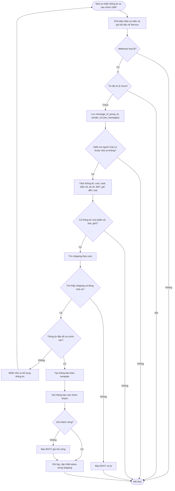
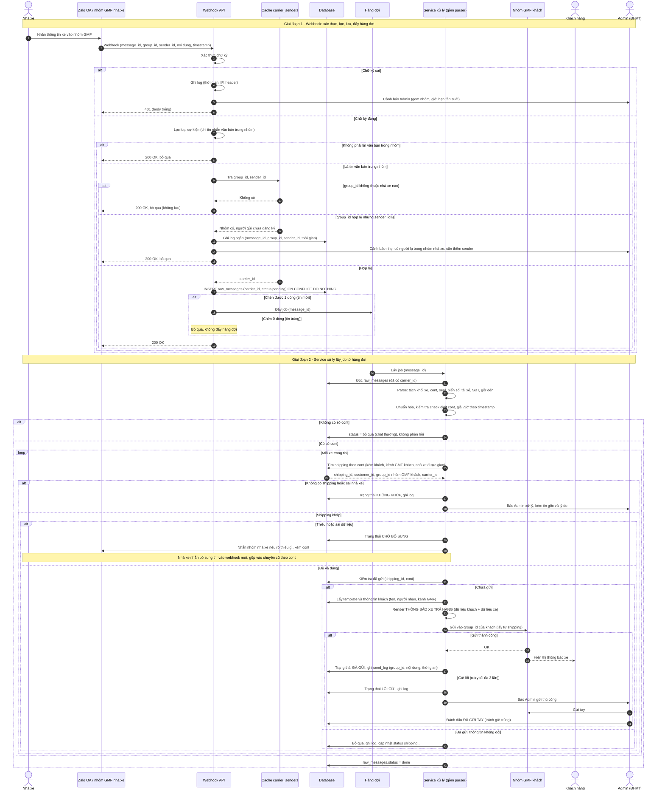
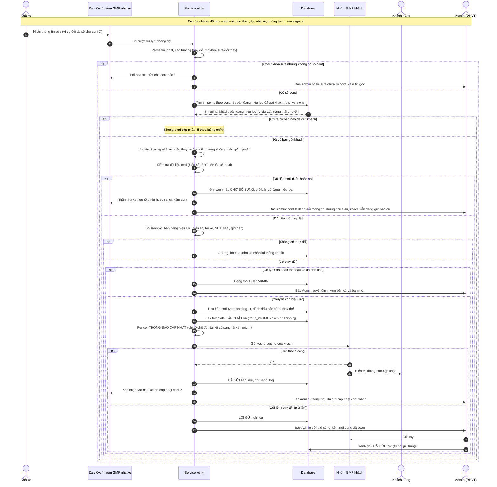
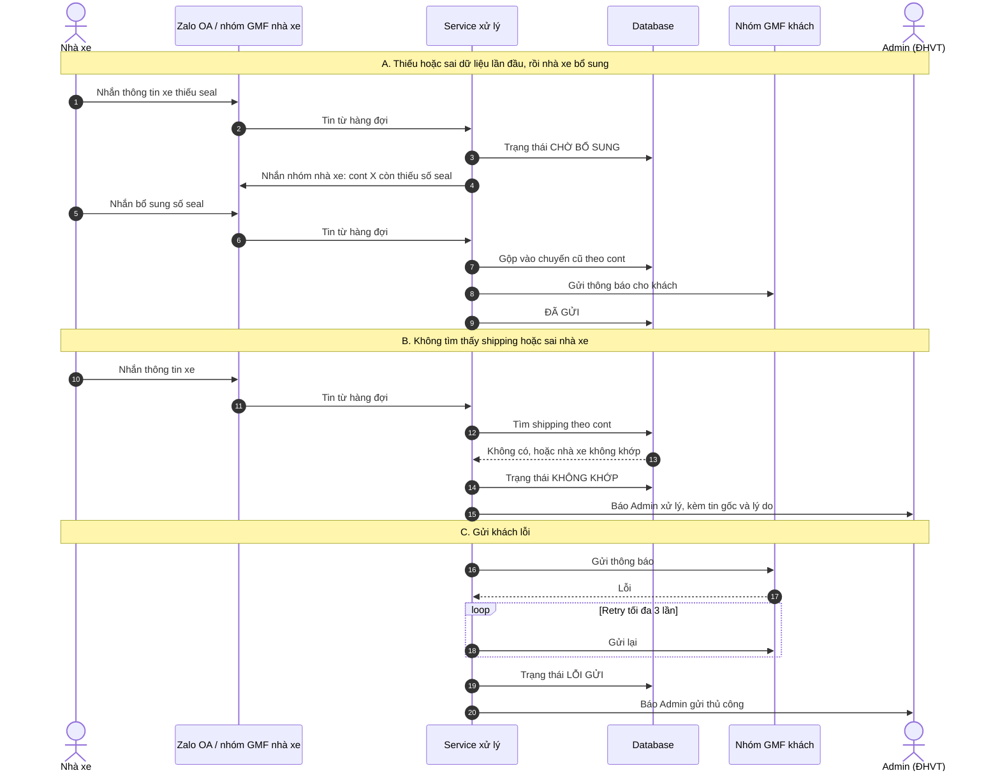

## 1. Sơ đồ luồng (flowchart)

## 2. Sơ đồ tuần tự (sequence)

### 2a. Luồng chính, thông tin đủ và gửi khách thành công

### 2b. Các nhánh ngoại lệ

## 1. Nhà xe sửa / đổi tài xế sau khi đã gửi khách

## 2. Các nhánh ngoại lệ còn lại

## 3. Quá trình lọc và xử lý
