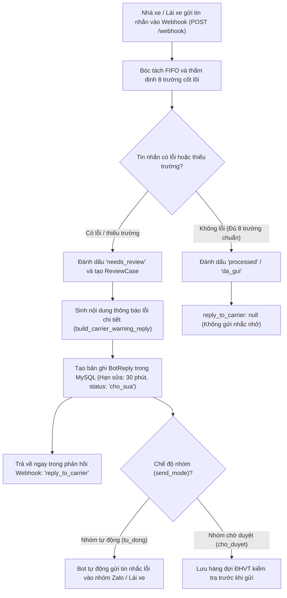

# BỘ KIỂM THỬ POSTMAN: CƠ CHẾ THÔNG BÁO LỖI VÀ NHẮC NHỞ NHÀ XE (BOT REPLY)

Tài liệu hướng dẫn kiểm thử tính năng tự động phát hiện lỗi và phản hồi cảnh báo nhà xe hoặc tài xế (`reply_to_carrier` / `BotReply`) khi tin nhắn báo xe bị thiếu hoặc sai dữ liệu theo chuẩn nghiệp vụ của VSICO.

---

## 1. Nguyên Tắc Hoạt Động Và Quy Trình Cảnh Báo Lỗi



### Quy tắc thông báo lỗi thân thiện cho Nhà xe (Cập nhật v2):
Công thức chuẩn hóa mọi phản hồi lỗi gửi nhà xe: **Vấn đề + Thông tin cần kiểm tra + Hướng xử lý**. Hệ thống tuyệt đối không hiển thị Regex, thuật toán check digit ISO 6346, mã lỗi nội bộ, chi tiết database hay suy đoán giá trị đúng trong tin nhắn gửi nhà xe (chi tiết kỹ thuật chỉ ghi vào log nội bộ và ca duyệt cho ĐHVT).

1. **5 trường bắt buộc**: Biển số xe đầu kéo, Biển số rơ-moóc, Số container (đúng chuẩn ISO 6346), Tên tài xế, SĐT tài xế (hỗ trợ đa SĐT phân tách bằng ` | `). Nếu đủ 5 trường hợp lệ, `reply_to_carrier` là `null`.
2. **Câu trả lời chuẩn hóa theo tình huống**:
   - Thiếu số container: `Anh/chị vui lòng bổ sung số container giúp hệ thống nhé.`
   - Container sai định dạng hoặc sai chữ số kiểm tra: `Số container có thể chưa chính xác. Anh/chị vui lòng kiểm tra lại nhé.`
   - Sai hoặc thiếu biển số xe đầu kéo: `Biển số xe chưa hợp lệ. Anh/chị vui lòng kiểm tra lại giúp hệ thống.`
   - Thiếu biển số rơ-moóc: `Anh/chị vui lòng bổ sung biển số rơ-moóc giúp hệ thống nhé.`
   - Thiếu thông tin tài xế: `Anh/chị bổ sung giúp hệ thống thông tin tài xế nhé.`
   - Sai số điện thoại tài xế: `Số điện thoại tài xế có thể chưa chính xác. Anh/chị vui lòng kiểm tra lại.`
   - Không xác định được chuyến cần cập nhật: `Hệ thống chưa xác định được chuyến xe cần cập nhật. Anh/chị vui lòng cung cấp thêm thông tin nhé.`
   - Nhiều lỗi cùng lúc: `Một số thông tin trong tin nhắn cần được kiểm tra lại. Anh/chị vui lòng rà soát (...) và gửi bổ sung giúp hệ thống nhé.`
   - Container hợp lệ nhưng không có trong kế hoạch: Vừa cảnh báo nhẹ nhàng về nhóm nhà xe vừa tạo ca `SHIPPING_NOT_FOUND` báo về nhóm ĐHVT kèm tên nhóm nguồn.
3. **Gom tin rời rạc 60 giây & Thời hạn bổ sung**: Với nhóm nhà xe thật, Bot tự động gom các tin rời rạc trong cửa sổ 60 giây (hỗ trợ kèm Danh thiếp Zalo) trước khi nhắc thiếu; sau khi nhắc thiếu, cấp thời hạn 30 phút (`fix_deadline`) để nhà xe bổ sung.

---

## 2. Thiết Lập Biến Môi Trường (Postman Environment)

| Biến | Giá trị đề xuất | Ý nghĩa |
| :--- | :--- | :--- |
| `baseUrl` | `http://localhost:8000` | Địa chỉ Backend FastAPI |
| `carrierGroup` | `6469608867469758994` | ID nhóm Zalo nhà xe |
| `senderId` | `6691387223255581446` | ID tài xế / người gửi tin |

---

## 3. Các Kịch Bản Kiểm Thử Chi Tiết

### Kịch Bản 01: Nhà xe gửi tin thiếu số Chì/Seal

Khi tin nhắn có đủ biển số, tài xế, SĐT, số cont, size nhưng thiếu số chì/seal: hệ thống chuyển trạng thái `processing_status = "needs_review"` và trả về thông báo nhắc nhà xe bổ sung.

- **Method**: `POST`
- **URL**: `{{baseUrl}}/webhook`
- **Headers / Bảo mật**:
  - `Content-Type: application/json`
- **Params / Body (`raw` - JSON)**:
```json
{
  "app_id": "zca_personal_bot",
  "event_name": "user_send_text",
  "group_id": "{{carrierGroup}}",
  "sender": {
    "id": "{{senderId}}",
    "name": "Lái xe Hải Long"
  },
  "message": {
    "msg_id": "postman_err_01_missing_seal",
    "text": "Lệnh đóng hàng - KH: Logitem - Điểm đóng: Kho Logitem Tân Quang - 8h\n1 xe: 15C-170.66 / Phạm Văn Huynh 0986713346 / VSIU2621051 / 40HC"
  }
}
```
- **Kết quả mong đợi**: HTTP `200 OK`
```json
{
  "ok": true,
  "status": "ENQUEUED_AND_PROCESSED_FIFO",
  "processing_status": "needs_review",
  "trucks_count": 1,
  "containers_count": 1,
  "reply_to_carrier": "[VSICO Bot] Anh/chị vui lòng kiểm tra và bổ sung lại các thông tin còn thiếu/sai sau:\n- Xe 15C-170.66: thiếu/sai số chì / seal.",
  "data": {
    "processing_status": "needs_review",
    "reply_to_carrier": "[VSICO Bot] Anh/chị vui lòng kiểm tra và bổ sung lại các thông tin còn thiếu/sai sau:\n- Xe 15C-170.66: thiếu/sai số chì / seal.",
    "customer_notifications": []
  }
}
```

---

### Kịch Bản 02: Nhà xe nhập nhầm Biển số Rơ-moóc (`15R`) thay vì Xe đầu kéo

Khi tin nhắn ghi biển rơ-moóc `15R-123.45` ở vị trí xe đầu kéo, hệ thống nhận diện đây là biển rơ-moóc và cảnh báo thiếu biển đầu kéo.

- **Method**: `POST`
- **URL**: `{{baseUrl}}/webhook`
- **Headers / Bảo mật**:
  - `Content-Type: application/json`
- **Params / Body (`raw` - JSON)**:
```json
{
  "app_id": "zca_personal_bot",
  "event_name": "user_send_text",
  "group_id": "{{carrierGroup}}",
  "sender": {
    "id": "{{senderId}}",
    "name": "Lái xe Hải Long"
  },
  "message": {
    "msg_id": "postman_err_02_trailer_plate",
    "text": "Lệnh đóng hàng - KH: Logitem - Điểm đóng: Kho Tân Quang - 8h\n1 xe: 15R-123.45 / Phạm Văn Huynh 0986713346 / VSIU2621051 / 40HC / chì 23333878"
  }
}
```
- **Kết quả mong đợi**: HTTP `200 OK`
```json
{
  "ok": true,
  "processing_status": "needs_review",
  "reply_to_carrier": "[VSICO Bot] Anh/chị vui lòng kiểm tra và bổ sung lại các thông tin còn thiếu/sai sau:\n- Xe dòng #1: thiếu biển số xe đầu kéo ('15R-123.45' là biển số rơ-moóc)."
}
```

---

### Kịch Bản 03: Số Container sai số kiểm tra ISO 6346 (Check Digit)

Container chuẩn là `VSIU2621051` (check digit `1`). Nhà xe nhập nhầm thành `VSIU2621059`. Hệ thống tính check digit ISO 6346 và thông báo kèm gợi ý số đúng.

- **Method**: `POST`
- **URL**: `{{baseUrl}}/webhook`
- **Headers / Bảo mật**:
  - `Content-Type: application/json`
- **Params / Body (`raw` - JSON)**:
```json
{
  "app_id": "zca_personal_bot",
  "event_name": "user_send_text",
  "group_id": "{{carrierGroup}}",
  "sender": {
    "id": "{{senderId}}",
    "name": "Lái xe Hải Long"
  },
  "message": {
    "msg_id": "postman_err_03_bad_iso_digit",
    "text": "Lệnh đóng hàng - KH: Logitem - Điểm đóng: Kho Tân Quang - 8h\n1 xe: 15C-170.66 / Phạm Văn Huynh 0986713346 / VSIU2621059 / 40HC / chì 23333878"
  }
}
```
- **Kết quả mong đợi**: HTTP `200 OK`
```json
{
  "ok": true,
  "processing_status": "needs_review",
  "reply_to_carrier": "[VSICO Bot] Anh/chị vui lòng kiểm tra và bổ sung lại các thông tin còn thiếu/sai sau:\n- Xe 15C-170.66: số container 'VSIU2621059' sai số kiểm tra cuối (gợi ý đúng: VSIU2621051)."
}
```

---

### Kịch Bản 04: SĐT Tài xế sai định dạng (Thiếu chữ số)

Tài xế nhập SĐT `098671334` (chỉ có 9 chữ số).

- **Method**: `POST`
- **URL**: `{{baseUrl}}/webhook`
- **Headers / Bảo mật**:
  - `Content-Type: application/json`
- **Params / Body (`raw` - JSON)**:
```json
{
  "app_id": "zca_personal_bot",
  "event_name": "user_send_text",
  "group_id": "{{carrierGroup}}",
  "sender": {
    "id": "{{senderId}}",
    "name": "Lái xe Hải Long"
  },
  "message": {
    "msg_id": "postman_err_04_invalid_phone",
    "text": "Lệnh đóng hàng - KH: Logitem - Điểm đóng: Kho Tân Quang - 8h\n1 xe: 15C-170.66 / Phạm Văn Huynh 098671334 / VSIU2621051 / 40HC / chì 23333878"
  }
}
```
- **Kết quả mong đợi**: HTTP `200 OK`
```json
{
  "ok": true,
  "processing_status": "needs_review",
  "reply_to_carrier": "[VSICO Bot] Anh/chị vui lòng kiểm tra và bổ sung lại các thông tin còn thiếu/sai sau:\n- Xe 15C-170.66: thiếu/sai số điện thoại tài xế, SĐT tài xế '098671334' không hợp lệ (cần đúng 10 chữ số bắt đầu bằng số 0)."
}
```

---

### Kịch Bản 05: Thiếu nhiều trường cùng lúc trên tin nhắn nhiều xe

Tin nhắn có 2 xe: Xe 1 thiếu size và thiếu chì; Xe 2 biển số bị cụt ký tự `15C-99`.

- **Method**: `POST`
- **URL**: `{{baseUrl}}/webhook`
- **Headers / Bảo mật**:
  - `Content-Type: application/json`
- **Params / Body (`raw` - JSON)**:
```json
{
  "app_id": "zca_personal_bot",
  "event_name": "user_send_text",
  "group_id": "{{carrierGroup}}",
  "sender": {
    "id": "{{senderId}}",
    "name": "Lái xe Hải Long"
  },
  "message": {
    "msg_id": "postman_err_05_multi_defects",
    "text": "2 xe đóng hàng Logitem Tân Quang:\n1. 15C-170.66 / Phạm Văn Huynh 0986713346 / VSIU2621051\n2. 15C-99 / Nguyễn Văn A 0903123456 / GAOU7806508 / 40HC / chì 23339832"
  }
}
```
- **Kết quả mong đợi**: HTTP `200 OK`
```json
{
  "ok": true,
  "processing_status": "needs_review",
  "reply_to_carrier": "[VSICO Bot] Anh/chị vui lòng kiểm tra và bổ sung lại các thông tin còn thiếu/sai sau:\n- Xe 15C-170.66: thiếu/sai kích thước container (size), thiếu/sai số chì / seal.\n- Xe dòng #2: thiếu/sai biển số xe, thiếu biển số xe đầu kéo."
}
```

---

### Kịch Bản 06: Tra cứu lịch sử thông báo lỗi qua API chi tiết tin nhắn

Kiểm tra tin nhắn nhắc lỗi đã được lưu vào cơ sở dữ liệu (`review_cases`, `bot_replies`) để ĐHVT theo dõi trên dashboard hay chưa.

- **Method**: `GET`
- **URL**: `{{baseUrl}}/api/messages/detail/postman_err_01_missing_seal`
- **Headers / Bảo mật**:
  - `Accept: application/json`
- **Params / Body**: Không có (Path param: `messageId = postman_err_01_missing_seal`)
- **Kết quả mong đợi**: HTTP `200 OK`
```json
{
  "ok": true,
  "status": "OK",
  "message": {
    "zalo_message_id": "postman_err_01_missing_seal",
    "processing_status": "needs_review"
  },
  "review_cases": [
    {
      "case_type": "missing_fields",
      "reason": "Thiếu hoặc sai trường: Số chì / seal",
      "status": "pending"
    }
  ],
  "bot_replies": [
    {
      "id": 1,
      "sender_id": "6691387223255581446",
      "reply_text": "[VSICO Bot] Anh/chị vui lòng kiểm tra và bổ sung lại các thông tin còn thiếu/sai sau:\n- Xe 15C-170.66: thiếu/sai số chì / seal.",
      "status": "cho_sua",
      "fix_deadline": "2026-11-02T10:00:00Z"
    }
  ]
}
```

---

### Kịch Bản 07: Tin nhắn hợp lệ 100% (Happy Path - Không có thông báo lỗi)

Khi tin nhắn đáp ứng đủ 8 trường hợp lệ: `processing_status = "processed"`, `reply_to_carrier` là `null`, và thông báo gửi khách hàng được tạo sẵn trong `customer_notifications`.

- **Method**: `POST`
- **URL**: `{{baseUrl}}/webhook`
- **Headers / Bảo mật**:
  - `Content-Type: application/json`
- **Params / Body (`raw` - JSON)**:
```json
{
  "app_id": "zca_personal_bot",
  "event_name": "user_send_text",
  "group_id": "{{carrierGroup}}",
  "sender": {
    "id": "{{senderId}}",
    "name": "Lái xe Hải Long"
  },
  "message": {
    "msg_id": "postman_ok_01_valid_all_fields",
    "text": "Lệnh đóng hàng - KH: Logitem - Điểm đóng: Kho Logitem Tân Quang - 8h\n1 xe: 15C-170.66 / Phạm Văn Huynh 0986713346 / VSIU2621051 / 40HC / chì 23333878"
  }
}
```
- **Kết quả mong đợi**: HTTP `200 OK`
```json
{
  "ok": true,
  "processing_status": "processed",
  "reply_to_carrier": null,
  "data": {
    "processing_status": "processed",
    "reply_to_carrier": null,
    "customer_notifications": [
      {
        "target_group_id": "6469608867469758994",
        "message_text": "[VSICO THÔNG BÁO XE ĐÓNG HÀNG]...\n- Xe: 15C-170.66\n- Cont: VSIU2621051 (Seal: 23333878)...",
        "cont": "VSIU2621051",
        "send_status": "SENT"
      }
    ]
  }
}
```

---

## 4. Bảng Đối Chiếu Mã Lỗi Và Câu Nhắc Nhà Xe

| Loại lỗi | Điều kiện vi phạm | Nội dung nhắc nhở trong `reply_to_carrier` |
| :--- | :--- | :--- |
| **Thiếu Chì** | Thiếu từ khóa seal / chì | `- Xe [Biển]: thiếu/sai số chì / seal.` |
| **Thiếu Size Cont** | Thiếu kích thước 20 / 40 / 45 / HC | `- Xe [Biển]: thiếu/sai kích thước container (size).` |
| **Nhầm Biển Rơ-moóc** | Biển số có chữ cái `R` (vd: `15R-123.45`) | `- Xe dòng #[N]: thiếu biển số xe đầu kéo ('...' là biển số rơ-moóc).` |
| **Sai Check Digit** | Chữ số thứ 7 của Cont không khớp ISO 6346 | `- Xe [Biển]: số container '...' sai số kiểm tra cuối (gợi ý đúng: ...).` |
| **Sai SĐT Tài xế** | SĐT không đủ 10 số hoặc không bắt đầu bằng `0` | `- Xe [Biển]: SĐT tài xế '...' không hợp lệ (cần đúng 10 chữ số bắt đầu bằng số 0).` |
| **Thiếu Lệnh Vận Chuyển** | Không xác định được đóng hay trả cont | `- Xe [Biển]: thiếu/sai loại lệnh.` |
| **Thiếu Khách Hàng** | Không có tên khách hàng trong tin hoặc kế hoạch | `- Xe [Biển]: thiếu/sai khách hàng.` |
