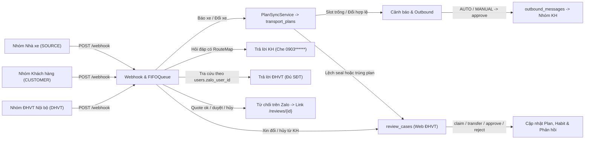

# Kiểm Thử Postman: Luồng Bot - Khách Hàng, Bot - ĐHVT và Đồng Bộ transport_plans Cục Bộ

## 1. Mục đích
Tài liệu hướng dẫn kiểm thử các phân hệ nghiệp vụ bổ sung của hệ thống VSICO Zalo Bot bằng Postman:
1. Đồng bộ `transport_plans` cục bộ (khi chưa kết nối `be-tms`): điền slot trống container (`J2`), cập nhật đổi xe/tài xế, chặn xung đột trường cố định (`PLAN_FIELD_CONFLICT`), xử lý trùng plan (`PLAN_SYNC_REQUIRED`) và kiểm soát phiên bản qua API (`expected_version`).
2. Luồng Bot - Khách hàng: phát hành tin chế độ `MANUAL` qua Web (`outbound/approve`), bỏ qua tin nhắn xác nhận ngắn (`IGNORED_CHAT`), hỏi đáp tiến độ có che 6 số cuối SĐT tài xế (`0903******`), chống dò chéo dữ liệu, leo thang khi hỏi lặp (`CUSTOMER_REPEATED_INQUIRY`) và ghi nhận yêu cầu đổi/hủy không tự sửa kế hoạch (`CUSTOMER_CHANGE_REQUEST`).
3. Luồng Bot - ĐHVT: tra cứu nội bộ trên nhóm ĐHVT theo `users.zalo_user_id` (hiển thị đầy đủ SĐT), từ chối người lạ và chặn mọi lệnh duyệt/hủy/sửa trực tiếp trên Zalo kèm đường dẫn Web.
4. Quy trình xử lý Web ĐHVT: `claim` khóa ca (`409` khi tranh chấp), `transfer`, `approve` lưu thói quen kho (`warehouse_aliases`), `reject` và quét quá hạn `/api/reviews/check-overdue`.



---

## 2. Thiết Lập Biến Môi Trường Postman (VSICO-Customer-DHVT-Env)

| Tên biến | Giá trị mẫu | Mô tả sử dụng |
| :--- | :--- | :--- |
| `baseUrl` | `http://localhost:8000` | Địa chỉ gốc của Backend FastAPI |
| `adminUsername` | `admin` | Tài khoản đăng nhập quản trị / ĐHVT |
| `adminPassword` | `123456` | Mật khẩu đăng nhập |
| `authToken` | *(tự gán sau khi login)* | JWT Bearer Token dùng cho API quản trị |
| `webhookSecret` | *(để trống hoặc khớp secret)* | Header `x-webhook-secret` nếu có cấu hình |
| `carrierGroupZaloId` | `test_group_carrier_09` | ID nhóm Zalo nhà xe dùng để test |
| `customerGroupZaloId` | `test_group_customer_09` | ID nhóm Zalo khách hàng dùng để test |
| `dhvtGroupZaloId` | `3073804738540831090` | ID nhóm ĐHVT nội bộ seed mặc định |
| `customerGroupDbId` | *(lấy từ POST /api/groups)* | Khóa chính `zalo_groups.id` của nhóm khách hàng |
| `planId` | *(lấy từ POST /api/plans)* | Khóa chính `transport_plans.id` đang test |
| `reviewId` | *(lấy từ GET /api/reviews)* | Khóa chính `review_cases.id` cần xử lý |
| `outboundId` | *(lấy từ GET /api/outbound/messages)* | Khóa chính `outbound_messages.id` chờ duyệt |

---

## 3. Các Bước Chuẩn Bị Trước Khi Chạy Test

### Bước 1: Đăng nhập lấy JWT Access Token
- **Method**: `POST`
- **URL**: `{{baseUrl}}/api/auth/login`
- **Headers / Bảo mật**:
  - `Content-Type: application/json`
- **Params / Body (raw - JSON)**:
```json
{
  "username": "{{adminUsername}}",
  "password": "{{adminPassword}}"
}
```
- **Script tab Tests (tùy chọn tự lưu token trong Postman)**:
```javascript
const json = pm.response.json();
if (json.access_token) {
    pm.environment.set("authToken", json.access_token);
}
```
- **Kết quả mong đợi**: HTTP `200 OK`, `ok = true`, trả về `access_token` và cookie `vsico_token`.

---

### Bước 2: Đăng ký Nhóm Nhà xe và Nhóm Khách hàng

#### 2.1. Đăng ký nhóm Nhà xe (SOURCE)
- **Method**: `POST`
- **URL**: `{{baseUrl}}/api/groups`
- **Headers / Bảo mật**:
  - `Content-Type: application/json`
- **Params / Body (raw - JSON)**:
```json
{
  "zalo_group_id": "test_group_carrier_09",
  "name": "Nhom Nha Xe Tuan Hung (Test 09)",
  "group_role": "SOURCE",
  "carrier_name": "Tuấn Hưng",
  "send_mode": "AUTO",
  "is_active": true,
  "is_test": true
}
```
- **Kết quả mong đợi**: HTTP `200 OK`, `ok = true`

#### 2.2. Đăng ký nhóm Khách hàng (CUSTOMER)
- **Method**: `POST`
- **URL**: `{{baseUrl}}/api/groups`
- **Headers / Bảo mật**:
  - `Content-Type: application/json`
- **Params / Body (raw - JSON)**:
```json
{
  "zalo_group_id": "test_group_customer_09",
  "name": "Nhom Khach Hang Minh Anh (Test 09)",
  "group_role": "CUSTOMER",
  "send_mode": "AUTO",
  "is_active": true,
  "is_test": true
}
```
- **Kết quả mong đợi**: HTTP `200 OK`, lưu `group.id` vào biến `customerGroupDbId`.

---

### Bước 3: Nạp Danh Mục Tham Chiếu MySQL (Nếu Chưa Nối TMS)

```sql
INSERT INTO carriers (tms_carrier_id, code, name, short_name, normalized_name, is_active)
VALUES (9001, 'TH09', 'Công ty Vận tải Tuấn Hưng', 'Tuấn Hưng', 'tuan hung', 1)
ON DUPLICATE KEY UPDATE name = VALUES(name);

INSERT INTO customers (tms_customer_id, name, normalized_name, is_active)
VALUES ('CUST-09', 'Công ty Minh Anh', 'minh anh', 1)
ON DUPLICATE KEY UPDATE name = VALUES(name);

INSERT INTO warehouses (tms_warehouse_id, customer_id, name, normalized_name, address, is_active)
SELECT 'WH-09', c.id, 'Kho Minh Anh Hải Phòng', 'kho minh anh hai phong', 'KCN Đình Vũ, Hải An, Hải Phòng', 1
FROM customers c WHERE c.tms_customer_id = 'CUST-09'
ON DUPLICATE KEY UPDATE name = VALUES(name);

INSERT INTO route_maps (customer_id, warehouse_id, order_type, zalo_group_id, priority, is_active)
SELECT c.id, NULL, NULL, zg.id, 10, 1
FROM customers c
JOIN zalo_groups zg ON zg.zalo_group_id = 'test_group_customer_09'
WHERE c.tms_customer_id = 'CUST-09';
```

---

## 4. Kịch Bản 01: Đồng Bộ Kế Hoạch transport_plans Cục Bộ

### Test 1.1: Tạo dòng Kế hoạch trống Container và Xe (Slot J2)
- **Method**: `POST`
- **URL**: `{{baseUrl}}/api/plans`
- **Headers / Bảo mật**:
  - `Content-Type: application/json`
- **Params / Body (raw - JSON)**:
```json
{
  "plan_date": "2026-11-13",
  "stt": 1,
  "route_name": "Hải Phòng - Đình Vũ",
  "cargo_io_type": "X",
  "order_type": "dong",
  "container_no": null,
  "seal_no": null,
  "container_size": "40",
  "required_time": "09:00 13/11/2026",
  "customer_name": "Công ty Minh Anh",
  "fleet_partner": "Tuấn Hưng",
  "planned_truck_plate": null,
  "delivery_address": "Kho Minh Anh Hải Phòng",
  "group_id": "test_group_customer_09"
}
```
- **Kết quả mong đợi**: HTTP `200 OK`, lưu `id` vào biến `planId`. Ban đầu `version = 1`, `tms_sync_status = "NOT_STARTED"`.

---

### Test 1.2: Nhà xe báo xe lần đầu -> Điền vào slot trống (PLAN_VEHICLE_FILLED)
- **Method**: `POST`
- **URL**: `{{baseUrl}}/webhook`
- **Headers / Bảo mật**:
  - `Content-Type: application/json`
- **Params / Body (raw - JSON)**:
```json
{
  "app_id": "zca_personal_bot",
  "event_name": "user_send_text",
  "group_id": "test_group_carrier_09",
  "sender": {
    "id": "nx_tuanhung_01",
    "name": "Điều độ Tuấn Hưng"
  },
  "message": {
    "msg_id": "test_msg_k1_fill_01",
    "text": "Đóng cont MSKU9070323 40H seal VS009911 xe 29C-445.41 mooc 29R-012.34 tài xế Nguyễn Văn Hùng 0903123459 Kho Minh Anh Hải Phòng dự kiến 09h00"
  }
}
```
- **Kết quả mong đợi**: HTTP `200 OK`, `ok = true`, `processing_status = "PROCESSED"`. Kế hoạch được điền `container_no = "MSKU9070323"`, `planned_truck_plate = "29C-445.41"`, `driver_name = "Nguyễn Văn Hùng"`, `driver_phone = "0903123459"`, `seal_no = "VS009911"`, `version = 2`, `tms_sync_status = "PENDING"`.

---

### Test 1.3: Nhà xe báo đổi xe và tài xế -> Cập nhật hợp lệ (PLAN_VEHICLE_UPDATED)
- **Method**: `POST`
- **URL**: `{{baseUrl}}/webhook`
- **Headers / Bảo mật**:
  - `Content-Type: application/json`
- **Params / Body (raw - JSON)**:
```json
{
  "app_id": "zca_personal_bot",
  "event_name": "user_send_text",
  "group_id": "test_group_carrier_09",
  "sender": {
    "id": "nx_tuanhung_01",
    "name": "Điều độ Tuấn Hưng"
  },
  "message": {
    "msg_id": "test_msg_k1_update_02",
    "text": "Đổi xe cont MSKU9070323 sang xe 15C-889.99 mooc 15R-055.66 tài xế Trần Văn Nam 0912888999"
  }
}
```
- **Kết quả mong đợi**: HTTP `200 OK`, kế hoạch cập nhật `planned_truck_plate = "15C-889.99"`, `driver_name = "Trần Văn Nam"`, `driver_phone = "0912888999"`, `version = 3`, `tms_sync_status = "PENDING"`.

---

### Test 1.4: Xung đột trường cố định (Lệch Seal) -> Chặn ghi đè và tạo ca PLAN_FIELD_CONFLICT
- **Method**: `POST`
- **URL**: `{{baseUrl}}/webhook`
- **Headers / Bảo mật**:
  - `Content-Type: application/json`
- **Params / Body (raw - JSON)**:
```json
{
  "app_id": "zca_personal_bot",
  "event_name": "user_send_text",
  "group_id": "test_group_carrier_09",
  "sender": {
    "id": "nx_tuanhung_01",
    "name": "Điều độ Tuấn Hưng"
  },
  "message": {
    "msg_id": "test_msg_k1_conflict_03",
    "text": "Đóng cont MSKU9070323 40H seal SAI999999 xe 15C-889.99 tài xế Trần Văn Nam 0912888999 Kho Minh Anh Hải Phòng"
  }
}
```
- **Kết quả mong đợi**: HTTP `200 OK`, `seal_no` gốc không bị ghi đè (giữ `"VS009911"`), hệ thống tạo ca mới kiểm tra tại `GET {{baseUrl}}/api/reviews?status=PENDING&case_type=PLAN_FIELD_CONFLICT`.

---

### Test 1.5: Duyệt chọn dòng kế hoạch khi trùng container (PLAN_SYNC_REQUIRED)
- **Method**: `POST`
- **URL**: `{{baseUrl}}/api/reviews/{{reviewId}}/approve`
- **Headers / Bảo mật**:
  - `Content-Type: application/json`
  - `Authorization: Bearer {{authToken}}`
- **Params / Body (raw - JSON)**:
```json
{
  "selected_plan_id": 123,
  "truck_plate": "29H-778.89",
  "driver_name": "Lê Văn Bình",
  "driver_phone": "0988777666",
  "save_warehouse_habit": false,
  "notify_carrier": true,
  "operator_name": "admin"
}
```
- **Kết quả mong đợi**: HTTP `200 OK`, dòng kế hoạch `123` được cập nhật thông tin xe, `version` tăng thêm 1, ca chuyển trạng thái `"APPROVED"`.

---

### Test 1.6: Điều độ viên sửa xe trực tiếp trên kế hoạch và kiểm tra 409 Conflict
- **Method**: `PATCH`
- **URL**: `{{baseUrl}}/api/plans/{{planId}}/vehicle`
- **Headers / Bảo mật**:
  - `Content-Type: application/json`
  - `Authorization: Bearer {{authToken}}`
- **Params / Body (raw - JSON)**:
```json
{
  "expected_version": 3,
  "planned_truck_plate": "15C-990.01",
  "driver_name": "Phạm Văn Đức",
  "driver_phone": "0936111222",
  "seal_no": "VS009911",
  "required_time": "10:00 13/11/2026"
}
```
- **Kết quả mong đợi**:
  - Lần gọi đầu với `expected_version = 3`: HTTP `200 OK`, `version = 4`, `tms_sync_status = "PENDING"`.
  - Lần gọi lại giữ nguyên `expected_version = 3`: HTTP `409 Conflict`.

---

## 5. Kịch Bản 02: Luồng Bot - Khách Hàng (Chiều Đi và Hỏi Đáp)

### Test 2.1: Chế độ MANUAL, duyệt và sửa nội dung tin phát hành

#### 2.1.1. Chuyển nhóm khách hàng sang chế độ MANUAL
- **Method**: `PUT`
- **URL**: `{{baseUrl}}/api/groups/{{customerGroupDbId}}/send-mode`
- **Headers / Bảo mật**:
  - `Content-Type: application/json`
- **Params / Body (raw - JSON)**:
```json
{
  "send_mode": "MANUAL"
}
```
- **Kết quả mong đợi**: HTTP `200 OK`, `send_mode = "MANUAL"`

#### 2.1.2. Lấy danh sách tin chờ duyệt
- **Method**: `GET`
- **URL**: `{{baseUrl}}/api/outbound/messages?status=PENDING_APPROVAL`
- **Headers / Bảo mật**:
  - `Accept: application/json`
- **Params / Body**: Không có
- **Kết quả mong đợi**: HTTP `200 OK`, lấy `id` của bản ghi lưu vào `outboundId`.

#### 2.1.3. Duyệt và chỉnh sửa nội dung trước khi gửi
- **Method**: `POST`
- **URL**: `{{baseUrl}}/api/outbound/messages/{{outboundId}}/approve?operator_name=admin`
- **Headers / Bảo mật**:
  - `Content-Type: application/json`
- **Params / Body (raw - JSON)**:
```json
{
  "content": "Kính gửi Quý khách Minh Anh, thông tin xe đóng cont MSKU9070323: Xe 15C-990.01, Tài xế Phạm Văn Đức (0936111222), dự kiến 10h00 có mặt tại kho.",
  "operator_name": "admin"
}
```
- **Kết quả mong đợi**: HTTP `200 OK`, nội dung tin được cập nhật theo câu chữ mới, trạng thái chuyển sang `PENDING_SEND` hoặc `SENT`.

---

### Test 2.2: Khách hàng nhắn xác nhận ngắn -> Bỏ qua im lặng (IGNORED_CHAT)
- **Method**: `POST`
- **URL**: `{{baseUrl}}/webhook`
- **Headers / Bảo mật**:
  - `Content-Type: application/json`
- **Params / Body (raw - JSON)**:
```json
{
  "app_id": "zca_personal_bot",
  "event_name": "user_send_text",
  "group_id": "test_group_customer_09",
  "sender": {
    "id": "kh_minhanh_01",
    "name": "Chị Lan (Minh Anh)"
  },
  "message": {
    "msg_id": "test_msg_kh_ack_01",
    "text": "ok em, cảm ơn bên em nhé"
  }
}
```
- **Kết quả mong đợi**: HTTP `200 OK`, `processing_status = "IGNORED_CHAT"`, `reply_to_carrier = null`.

---

### Test 2.3: Khách hàng hỏi tiến độ trong phạm vi RouteMap -> Trả lời che 6 số cuối SĐT
- **Method**: `POST`
- **URL**: `{{baseUrl}}/webhook`
- **Headers / Bảo mật**:
  - `Content-Type: application/json`
- **Params / Body (raw - JSON)**:
```json
{
  "app_id": "zca_personal_bot",
  "event_name": "user_send_text",
  "group_id": "test_group_customer_09",
  "sender": {
    "id": "kh_minhanh_01",
    "name": "Chị Lan (Minh Anh)"
  },
  "message": {
    "msg_id": "test_msg_kh_ask_valid_02",
    "text": "Em ơi kiểm tra giúp chị cont MSKU9070323 xe chạy chưa?"
  }
}
```
- **Kết quả mong đợi**: HTTP `200 OK`, câu trả lời chứa biển số `15C-990.01` và số điện thoại tài xế được che dạng `0936******`.

---

### Test 2.4: Chống dò chéo dữ liệu giữa cont không tồn tại và cont khách khác

#### 2.4.1. Hỏi container không tồn tại trong hệ thống
- **Method**: `POST`
- **URL**: `{{baseUrl}}/webhook`
- **Headers / Bảo mật**:
  - `Content-Type: application/json`
- **Params / Body (raw - JSON)**:
```json
{
  "app_id": "zca_personal_bot",
  "event_name": "user_send_text",
  "group_id": "test_group_customer_09",
  "sender": {
    "id": "kh_minhanh_01",
    "name": "Chị Lan (Minh Anh)"
  },
  "message": {
    "msg_id": "test_msg_kh_notfound_03",
    "text": "Cont ZZZU9999990 đi chưa em?"
  }
}
```

#### 2.4.2. Hỏi container thuộc khách hàng khác ngoài RouteMap
- **Method**: `POST`
- **URL**: `{{baseUrl}}/webhook`
- **Headers / Bảo mật**:
  - `Content-Type: application/json`
- **Params / Body (raw - JSON)**:
```json
{
  "app_id": "zca_personal_bot",
  "event_name": "user_send_text",
  "group_id": "test_group_customer_09",
  "sender": {
    "id": "kh_minhanh_01",
    "name": "Chị Lan (Minh Anh)"
  },
  "message": {
    "msg_id": "test_msg_kh_outscope_04",
    "text": "Cont CSNU6039817 đi chưa em?"
  }
}
```
- **Kết quả mong đợi**: Cả hai request đều trả lời cùng câu phản hồi chuẩn từ `bot_replies` mà không để lộ thông tin của khách hàng khác.

---

### Test 2.5: Khách hàng hỏi lặp lại câu chưa có thông tin -> Leo thang CUSTOMER_REPEATED_INQUIRY
- **Method**: `POST`
- **URL**: `{{baseUrl}}/webhook`
- **Headers / Bảo mật**:
  - `Content-Type: application/json`
- **Params / Body (raw - JSON)**:
```json
{
  "app_id": "zca_personal_bot",
  "event_name": "user_send_text",
  "group_id": "test_group_customer_09",
  "sender": {
    "id": "kh_minhanh_01",
    "name": "Chị Lan (Minh Anh)"
  },
  "message": {
    "msg_id": "test_msg_kh_repeat_05",
    "text": "Cont ZZZU9999990 mãi chưa thấy báo xe em ơi?"
  }
}
```
- **Kết quả mong đợi**: HTTP `200 OK`, xuất hiện ca mới trong `GET {{baseUrl}}/api/reviews?status=PENDING&case_type=CUSTOMER_REPEATED_INQUIRY`.

---

### Test 2.6: Khách hàng xin đổi giờ/kho/hủy -> Tạo CUSTOMER_CHANGE_REQUEST (Không tự sửa kế hoạch)
- **Method**: `POST`
- **URL**: `{{baseUrl}}/webhook`
- **Headers / Bảo mật**:
  - `Content-Type: application/json`
- **Params / Body (raw - JSON)**:
```json
{
  "app_id": "zca_personal_bot",
  "event_name": "user_send_text",
  "group_id": "test_group_customer_09",
  "sender": {
    "id": "kh_minhanh_01",
    "name": "Chị Lan (Minh Anh)"
  },
  "message": {
    "msg_id": "test_msg_kh_change_06",
    "text": "Em ơi cont MSKU9070323 bên chị xin dời giờ đóng hàng sang 14h chiều nhé"
  }
}
```
- **Kết quả mong đợi**: HTTP `200 OK`, tạo ca mới `CUSTOMER_CHANGE_REQUEST` trên Web ĐHVT, trường `required_time` và `version` trong `transport_plans` không tự động thay đổi.

---

## 6. Kịch Bản 03: Luồng Bot - ĐHVT (Zalo Chỉ Đọc và Cấm Duyệt Trên Zalo)

### Test 3.1: ĐHVT hợp lệ tra cứu nội bộ (Hiển thị đầy đủ SĐT)
- **Method**: `POST`
- **URL**: `{{baseUrl}}/webhook`
- **Headers / Bảo mật**:
  - `Content-Type: application/json`
- **Params / Body (raw - JSON)**:

#### 3.1.1. Tra cứu theo container
```json
{
  "app_id": "zca_personal_bot",
  "event_name": "user_send_text",
  "group_id": "3073804738540831090",
  "sender": {
    "id": "6691387223255581446",
    "name": "Quản Trị Viên ĐHVT"
  },
  "message": {
    "msg_id": "test_msg_dhvt_cont_01",
    "text": "MSKU9070323"
  }
}
```

#### 3.1.2. Tra cứu theo biển số xe
Thay `message.text` bằng `"15C-990.01"`, `message.msg_id` = `"test_msg_dhvt_plate_02"`.

#### 3.1.3. Tra cứu ca chờ duyệt
Thay `message.text` bằng `"ca chờ"`, `message.msg_id` = `"test_msg_dhvt_reviews_03"`.

#### 3.1.4. Tra cứu tổng hợp kế hoạch
Thay `message.text` bằng `"kế hoạch"`, `message.msg_id` = `"test_msg_dhvt_plan_04"`.

- **Kết quả mong đợi**: HTTP `200 OK`, các câu trả lời lưu trong `bot_replies` hiển thị đầy đủ số điện thoại 10 số không che của tài xế.

---

### Test 3.2: Người chưa gắn users.zalo_user_id gửi tra cứu -> Từ chối quyền
- **Method**: `POST`
- **URL**: `{{baseUrl}}/webhook`
- **Headers / Bảo mật**:
  - `Content-Type: application/json`
- **Params / Body (raw - JSON)**:
```json
{
  "app_id": "zca_personal_bot",
  "event_name": "user_send_text",
  "group_id": "3073804738540831090",
  "sender": {
    "id": "stranger_99999",
    "name": "Người lạ"
  },
  "message": {
    "msg_id": "test_msg_dhvt_stranger_01",
    "text": "ca chờ"
  }
}
```
- **Kết quả mong đợi**: HTTP `200 OK`, bot từ chối cung cấp dữ liệu nội bộ do người gửi chưa đăng ký tài khoản.

---

### Test 3.3: Nhân viên ĐHVT nhắn lệnh duyệt trên Zalo -> Cấm thao tác và gửi link Web
- **Method**: `POST`
- **URL**: `{{baseUrl}}/webhook`
- **Headers / Bảo mật**:
  - `Content-Type: application/json`
- **Params / Body (raw - JSON)**:
```json
{
  "app_id": "zca_personal_bot",
  "event_name": "user_send_text",
  "group_id": "3073804738540831090",
  "sender": {
    "id": "6691387223255581446",
    "name": "Quản Trị Viên ĐHVT"
  },
  "quote_msg_id": "test_msg_dhvt_alert_ref",
  "message": {
    "msg_id": "test_msg_dhvt_cmd_block_05",
    "text": "ok duyệt đi"
  }
}
```
- **Kết quả mong đợi**: HTTP `200 OK`, không thay đổi trạng thái ca hay kế hoạch, bot phản hồi từ chối thao tác trên Zalo và gửi link truy cập `/reviews`.

---

## 7. Kịch Bản 04: Xử Lý Web ĐHVT (reviews) và SLA Quá Hạn

### Test 4.1: Nhận xử lý ca (claim) và chống xung đột hai điều phối viên (409)

#### 4.1.1. ĐHVT 1 nhận xử lý ca
- **Method**: `POST`
- **URL**: `{{baseUrl}}/api/reviews/{{reviewId}}/claim`
- **Headers / Bảo mật**:
  - `Content-Type: application/json`
  - `Authorization: Bearer {{authToken}}`
- **Params / Body (raw - JSON)**:
```json
{
  "operator_name": "admin"
}
```
- **Kết quả mong đợi**: HTTP `200 OK`, `assigned_to = "admin"`

#### 4.1.2. ĐHVT 2 cố gắng nhận cùng một ca
- **Method**: `POST`
- **URL**: `{{baseUrl}}/api/reviews/{{reviewId}}/claim`
- **Headers / Bảo mật**:
  - `Content-Type: application/json`
  - `Authorization: Bearer {{authToken}}`
- **Params / Body (raw - JSON)**:
```json
{
  "operator_name": "dhvt_02"
}
```
- **Kết quả mong đợi**: HTTP `409 Conflict`

---

### Test 4.2: Chuyển ca cho điều phối viên khác (transfer)
- **Method**: `POST`
- **URL**: `{{baseUrl}}/api/reviews/{{reviewId}}/transfer`
- **Headers / Bảo mật**:
  - `Content-Type: application/json`
  - `Authorization: Bearer {{authToken}}`
- **Params / Body (raw - JSON)**:
```json
{
  "target_username": "dhvt_02",
  "reason": "Bàn giao ca chiều"
}
```
- **Kết quả mong đợi**: HTTP `200 OK`, `assigned_to = "dhvt_02"`

---

### Test 4.3: Duyệt ca bổ sung kho và lưu thói quen (warehouse_aliases)
- **Method**: `POST`
- **URL**: `{{baseUrl}}/api/reviews/{{reviewId}}/approve`
- **Headers / Bảo mật**:
  - `Content-Type: application/json`
  - `Authorization: Bearer {{authToken}}`
- **Params / Body (raw - JSON)**:
```json
{
  "warehouse_id": 1,
  "save_warehouse_habit": true,
  "notify_carrier": true,
  "operator_name": "admin"
}
```
- **Kết quả mong đợi**: HTTP `200 OK`, `status = "APPROVED"`, lưu bản ghi thói quen mới vào bảng `warehouse_aliases` với `source = "human_review"`.

---

### Test 4.4: Duyệt ca hủy chuyến (CANCEL_REQUEST) với mẫu hủy chuẩn
- **Method**: `POST`
- **URL**: `{{baseUrl}}/api/reviews/{{reviewId}}/approve`
- **Headers / Bảo mật**:
  - `Content-Type: application/json`
  - `Authorization: Bearer {{authToken}}`
- **Params / Body (raw - JSON)**:
```json
{
  "cancel_reason": "Nhà xe báo sự cố kỹ thuật xe",
  "notify_carrier": true,
  "operator_name": "admin"
}
```
- **Kết quả mong đợi**: HTTP `200 OK`, ca chuyển sang `APPROVED`, tự động sinh thông báo hủy gửi nhóm khách theo mẫu chuẩn.

---

### Test 4.5: Từ chối ca (reject)
- **Method**: `POST`
- **URL**: `{{baseUrl}}/api/reviews/{{reviewId}}/reject`
- **Headers / Bảo mật**:
  - `Content-Type: application/json`
  - `Authorization: Bearer {{authToken}}`
- **Params / Body (raw - JSON)**:
```json
{
  "reason": "Số container sai định dạng, đề nghị nhà xe báo lại",
  "operator_name": "admin"
}
```
- **Kết quả mong đợi**: HTTP `200 OK`, `status = "REJECTED"`, các tin `outbound_messages` đang chờ chuyển sang `CANCELLED`.

---

### Test 4.6: Quét quá hạn SLA thủ công (POST /api/reviews/check-overdue)
- **Method**: `POST`
- **URL**: `{{baseUrl}}/api/reviews/check-overdue?is_test_msg=true`
- **Headers / Bảo mật**:
  - `Accept: application/json`
- **Params / Body**: Không có
- **Kết quả mong đợi**: HTTP `200 OK`
```json
{
  "ok": true,
  "overdue_carrier_replies": 0,
  "reminded_review_cases": 1,
  "reminded_pending_outbounds": 0,
  "admin_escalations": 0
}
```

---

## 8. Truy Vấn MySQL Đối Soát & Bảng Mã Lỗi HTTP

### 8.1. Truy vấn MySQL đối soát

```sql
-- 1. Kiem tra dong bo ke hoach va phien ban
SELECT id, container_no, seal_no, planned_truck_plate, driver_name, driver_phone, version, tms_sync_status
FROM transport_plans
ORDER BY id DESC LIMIT 10;

-- 2. Kiem tra hang doi ca duyet DHVT
SELECT id, case_type, status, assigned_to, resolved_by, reason, created_at
FROM review_cases
ORDER BY id DESC LIMIT 15;

-- 3. Kiem tra tin phat hanh sang nhom khach hang
SELECT id, target_group_id, status, send_mode, approved_by, retry_count, LEFT(content, 120) AS preview
FROM outbound_messages
ORDER BY id DESC LIMIT 15;

-- 4. Kiem tra phan hoi hoi dap va che SDT
SELECT id, message_id, group_id, reply_type, LEFT(reply_text, 150) AS reply_preview, created_at
FROM bot_replies
ORDER BY id DESC LIMIT 15;

-- 5. Kiem tra thoi quen kho vua luu
SELECT id, warehouse_id, raw_text, source, hit_count FROM warehouse_aliases ORDER BY id DESC LIMIT 10;
```

### 8.2. Bảng mã lỗi HTTP thường gặp

| Mã HTTP | Ý nghĩa nghiệp vụ | Nguyên nhân & Cách xử lý |
| :--- | :--- | :--- |
| `400 Bad Request` | Tham số gửi lên không đúng định dạng | Kiểm tra giá trị Enum và JSON payload |
| `401 Unauthorized` | Thiếu hoặc sai JWT Token / Webhook Secret | Đăng nhập lại lấy `authToken` hoặc kiểm tra header |
| `404 Not Found` | Không tìm thấy ID tài nguyên | Kiểm tra lại `plan_id`, `review_id`, `outbound_id` |
| `409 Conflict` | Xung đột phiên bản hoặc ca duyệt đã bị nhận | Kiểm tra `expected_version` hoặc phân công ca bằng `transfer` |
| `422 Unprocessable Entity` | Sai schema dữ liệu Pydantic | Kiểm tra lại các trường bắt buộc trong Body |
