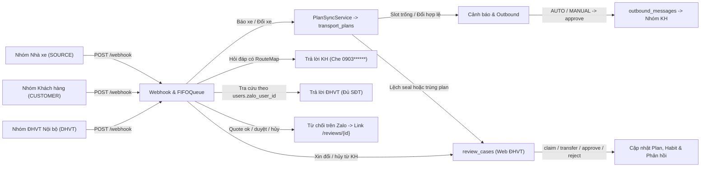

# Kịch bản Kiểm thử Postman & cURL: Luồng Bot <-> Khách hàng, Bot <-> ĐHVT & Đồng bộ `transport_plans` Cục bộ

Tài liệu này hướng dẫn kiểm thử toàn trình ba phân hệ nghiệp vụ bổ sung của hệ thống **VSICO Zalo Bot** thông qua **Postman** và **cURL**:
1. **Đồng bộ `transport_plans` cục bộ (khi chưa kết nối `be-tms`)**: điền slot trống container (`J2`), cập nhật đổi xe/tài xế hợp lệ, chặn ghi đè xung đột trường cố định (`PLAN_FIELD_CONFLICT`), chọn dòng kế hoạch khi trùng (`PLAN_SYNC_REQUIRED`) và chỉnh sửa trực tiếp trên API có kiểm soát phiên bản (`expected_version`).
2. **Luồng Bot <-> Khách hàng**: phát hành tin chế độ `MANUAL` qua Web (`outbound/approve`), bỏ qua tin xác nhận ngắn (`IGNORED_CHAT`), hỏi đáp tiến độ giới hạn theo `RouteMap` kèm che 6 số cuối SĐT tài xế (`0903******`), chống dò chéo dữ liệu, leo thang khi hỏi lặp (`CUSTOMER_REPEATED_INQUIRY`) và ghi nhận yêu cầu đổi/hủy không tự sửa kế hoạch (`CUSTOMER_CHANGE_REQUEST`).
3. **Luồng Bot <-> ĐHVT (Zalo chỉ đọc & Cấm duyệt trên Zalo)**: tra cứu nội bộ trên nhóm ĐHVT theo `users.zalo_user_id` (hiển thị đầy đủ SĐT), từ chối người chưa gắn `zalo_user_id` và chặn mọi lệnh duyệt/hủy/sửa trực tiếp trên Zalo kèm liên kết mở ca trên Web.
4. **Quy trình xử lý Web ĐHVT & Quá hạn SLA**: `claim` khóa ca (`409` khi tranh chấp), `transfer`, `approve` lưu thói quen kho (`warehouse_aliases`) và mẫu hủy chuyến, `reject`, và quét quá hạn `/api/reviews/check-overdue`.



---

## 1. Phạm vi Endpoint & Điều kiện Tiên quyết

| STT | Phân hệ | Endpoint chính | Mục đích kiểm thử |
| :--- | :--- | :--- | :--- |
| 1 | Xác thực | `POST /api/auth/login`, `GET /api/auth/me` | Lấy JWT token phục vụ API yêu cầu đăng nhập |
| 2 | Nhóm Zalo | `POST /api/groups`, `PUT /api/groups/{group_id}/send-mode` | Tạo nhóm `SOURCE`, `CUSTOMER`, `DHVT` và chuyển `AUTO`/`MANUAL` |
| 3 | Kế hoạch | `POST /api/plans`, `GET /api/plans/{plan_id}`, `PATCH /api/plans/{plan_id}/vehicle` | Tạo plan test, theo dõi `version`, `tms_sync_status` và khóa lạc quan `409` |
| 4 | Webhook | `POST /webhook` | Giả lập tin nhắn Zalo từ nhà xe, khách hàng và nhân viên ĐHVT |
| 5 | Outbound | `GET /api/outbound/messages`, `POST /api/outbound/messages/{id}/approve`, `/cancel` | Duyệt phát hành, sửa nội dung tin báo xe gửi nhóm khách |
| 6 | Ca rà soát | `GET /api/reviews`, `claim`, `transfer`, `approve`, `reject`, `check-overdue` | Khóa ca, chuyển ca, lưu `warehouse_aliases`, mẫu hủy và SLA quá hạn |

### Yêu cầu trước khi chạy

* Dịch vụ **MySQL 8.4** và **Backend FastAPI** (`http://localhost:8000`) đang hoạt động.
* Khi Backend khởi động (`seed_initial_users`), hệ thống tự tạo sẵn:
  * Nhóm ĐHVT mặc định: `id = 3073804738540831090`, `zalo_group_id = "3073804738540831090"`, `group_role = "DHVT"`.
  * Tài khoản quản trị mặc định: `username = "admin"`, mật khẩu `"123456"`, `zalo_user_id = "6691387223255581446"`, `zalo_info_id = 3073804738540831090`.
* Các nhóm thử nghiệm nên đặt tiền tố `test_` ở `zalo_group_id` (hoặc đặt `is_test: true`) để `WebhookIngestor` tự động đánh dấu `is_test = True`, tránh bắn tin thật qua Zalo trong quá trình kiểm thử.

---

## 2. Thiết lập Biến Môi trường & Dữ liệu Khởi tạo

### 2.1. Biến Môi trường Postman (`VSICO-Customer-DHVT-Env`)

| Biến (Variable) | Giá trị khởi tạo | Mô tả sử dụng |
| :--- | :--- | :--- |
| `baseUrl` | `http://localhost:8000` | Địa chỉ gốc của Backend FastAPI |
| `adminUsername` | `admin` | Tài khoản đăng nhập quản trị / ĐHVT |
| `adminPassword` | `123456` | Mật khẩu đăng nhập |
| `authToken` | *(tự gán sau khi login)* | JWT Bearer Token dùng cho `PATCH /api/plans/{id}/vehicle` |
| `webhookSecret` | *(để trống hoặc khớp `ZALO_SECRET_KEY`)* | Giá trị header `x-webhook-secret` nếu `.env` có cấu hình |
| `carrierGroupZaloId` | `test_group_carrier_09` | ID nhóm Zalo nhà xe dùng để kiểm thử |
| `customerGroupZaloId` | `test_group_customer_09` | ID nhóm Zalo khách hàng dùng để kiểm thử |
| `dhvtGroupZaloId` | `3073804738540831090` | ID nhóm ĐHVT nội bộ được seed mặc định |
| `customerGroupDbId` | *(lấy từ `POST /api/groups`)* | Khóa chính `zalo_groups.id` của nhóm khách hàng |
| `planId` | *(lấy từ `POST /api/plans`)* | Khóa chính `transport_plans.id` đang kiểm thử |
| `reviewId` | *(lấy từ `GET /api/reviews`)* | Khóa chính `review_cases.id` cần xử lý |
| `outboundId` | *(lấy từ `GET /api/outbound/messages`)* | Khóa chính `outbound_messages.id` chờ duyệt |

### 2.2. Bước 1 — Đăng nhập lấy JWT Access Token

**Request**: `POST {{baseUrl}}/api/auth/login`

```bash
curl -s -X POST "http://localhost:8000/api/auth/login" \
  -H "Content-Type: application/json" \
  -d '{
    "username": "admin",
    "password": "123456"
  }'
```

**Kết quả mong đợi (`200 OK`)**:

* `ok = true`, trả về `access_token` và thiết lập cookie `vsico_token`.
* Trong Postman tab **Tests**, có thể tự động lưu token:

```javascript
const json = pm.response.json();
if (json.access_token) {
    pm.environment.set("authToken", json.access_token);
}
```

### 2.3. Bước 2 — Đăng ký Nhóm Nhà xe (`SOURCE`) và Nhóm Khách hàng (`CUSTOMER`)

**Request A — Tạo nhóm Nhà xe**: `POST {{baseUrl}}/api/groups`

```bash
curl -s -X POST "http://localhost:8000/api/groups" \
  -H "Content-Type: application/json" \
  -d '{
    "zalo_group_id": "test_group_carrier_09",
    "name": "Nhom Nha Xe Tuan Hung (Test 09)",
    "group_role": "SOURCE",
    "carrier_name": "Tuấn Hưng",
    "send_mode": "AUTO",
    "is_active": true,
    "is_test": true
  }'
```

**Request B — Tạo nhóm Khách hàng**: `POST {{baseUrl}}/api/groups`

```bash
curl -s -X POST "http://localhost:8000/api/groups" \
  -H "Content-Type: application/json" \
  -d '{
    "zalo_group_id": "test_group_customer_09",
    "name": "Nhom Khach Hang Minh Anh (Test 09)",
    "group_role": "CUSTOMER",
    "send_mode": "AUTO",
    "is_active": true,
    "is_test": true
  }'
```

Ghi lại `group.id` từ Response của Request B vào biến `customerGroupDbId`.

### 2.4. Bước 3 — Nạp Danh mục Tham chiếu & `route_maps` trong MySQL

Do chưa kết nối đồng bộ từ `be-tms`, các danh mục `carriers`, `customers`, `warehouses` và quy tắc `route_maps` được chuẩn bị trực tiếp trong MySQL để kiểm thử định tuyến và phạm vi hỏi đáp khách hàng:

```sql
INSERT INTO carriers (tms_carrier_id, code, name, short_name, normalized_name, is_active)
VALUES (9001, 'TH09', 'Công ty Vận tải Tuấn Hưng', 'Tuấn Hưng', 'tuan hung', 1)
ON DUPLICATE KEY UPDATE name = VALUES(name);

INSERT INTO customers (tms_customer_id, name, normalized_name, is_active)
VALUES ('CUST-09', 'Công ty Minh Anh', 'minh anh', 1)
ON DUPLICATE KEY UPDATE name = VALUES(name);

INSERT INTO warehouses (tms_warehouse_id, customer_id, name, normalized_name, address, is_active)
SELECT 'WH-09', c.id, 'Kho Minh Anh Hải Phòng', 'kho minh anh hai phong', 'KCN Đình Vũ, Hải An, Hải Phòng', 1
FROM customers c WHERE c.tms_customer_id = 'CUST-09'
ON DUPLICATE KEY UPDATE name = VALUES(name);

INSERT INTO route_maps (customer_id, warehouse_id, order_type, zalo_group_id, priority, is_active)
SELECT
    c.id,
    NULL,
    NULL,
    zg.id,
    10,
    1
FROM customers c
JOIN zalo_groups zg ON zg.zalo_group_id = 'test_group_customer_09'
WHERE c.tms_customer_id = 'CUST-09';
```

Cập nhật liên kết `carrier_id` cho nhóm nhà xe (nếu muốn khớp trực tiếp theo `carrier_id`):

```sql
UPDATE zalo_groups zg
JOIN carriers ca ON ca.code = 'TH09'
SET zg.carrier_id = CAST(ca.id AS CHAR),
    zg.carrier_name = ca.name
WHERE zg.zalo_group_id = 'test_group_carrier_09';
```

---

## 3. Kịch bản 01 — Đồng bộ Kế hoạch `transport_plans` Cục bộ (Chưa nối TMS)

Kịch bản này kiểm chứng các quy tắc Mục II.1.1 & S -> C1: điền slot trống (`J2`), cập nhật đổi xe/tài xế hợp lệ, chặn xung đột trường cố định, xử lý nhiều dòng kế hoạch trùng và cập nhật trực tiếp qua Web API.

### Test 1.1: Tạo dòng Kế hoạch Đang trống Container & Thông tin Xe (Slot `J2`)

**Request**: `POST {{baseUrl}}/api/plans`

```bash
curl -s -X POST "http://localhost:8000/api/plans" \
  -H "Content-Type: application/json" \
  -d '{
    "plan_date": "2026-11-13",
    "stt": 1,
    "route_name": "Hải Phòng - Đình Vũ",
    "cargo_io_type": "X",
    "order_type": "dong",
    "container_no": null,
    "seal_no": null,
    "container_size": "40",
    "required_time": "09:00 13/11/2026",
    "customer_name": "Công ty Minh Anh",
    "fleet_partner": "Tuấn Hưng",
    "planned_truck_plate": null,
    "delivery_address": "Kho Minh Anh Hải Phòng",
    "group_id": "test_group_customer_09"
  }'
```

Lưu `id` trả về vào biến `planId`, sau đó liên kết khóa ngoại tham chiếu trong MySQL để khớp `RouteMap` và `Carrier`:

```sql
UPDATE transport_plans tp
JOIN customers c ON c.tms_customer_id = 'CUST-09'
JOIN warehouses w ON w.tms_warehouse_id = 'WH-09'
JOIN carriers ca ON ca.code = 'TH09'
SET tp.customer_id = c.id,
    tp.warehouse_id = w.id,
    tp.carrier_id = ca.id
WHERE tp.id = <planId>;
```

**Kiểm tra ban đầu**: `version = 1`, `tms_sync_status = "NOT_STARTED"`, `container_no = NULL`, `planned_truck_plate = NULL`.

### Test 1.2: Nhà xe Báo xe Lần đầu -> Tự động Điền vào Slot Trống (`PLAN_VEHICLE_FILLED`)

Gửi tin nhắn có số container chuẩn ISO 6346 (`MSKU9070323`), đầy đủ xe, rơ-moóc, tài xế, SĐT, seal, kho và giờ dự kiến:

**Request**: `POST {{baseUrl}}/webhook`

```bash
curl -s -X POST "http://localhost:8000/webhook" \
  -H "Content-Type: application/json" \
  -d '{
    "app_id": "zca_personal_bot",
    "event_name": "user_send_text",
    "group_id": "test_group_carrier_09",
    "sender": {
      "id": "nx_tuanhung_01",
      "name": "Điều độ Tuấn Hưng"
    },
    "message": {
      "msg_id": "test_msg_k1_fill_01",
      "text": "Đóng cont MSKU9070323 40H seal VS009911 xe 29C-445.41 mooc 29R-012.34 tài xế Nguyễn Văn Hùng 0903123459 Kho Minh Anh Hải Phòng dự kiến 09h00"
    }
  }'
```

**Kết quả mong đợi (`200 OK`)**:

* `ok = true`, `processing_status = "PROCESSED"`.
* Truy vấn `GET {{baseUrl}}/api/plans/{{planId}}` hoặc kiểm tra MySQL:
  * `container_no = "MSKU9070323"`, `seal_no = "VS009911"`, `planned_truck_plate = "29C-445.41"`, `driver_name = "Nguyễn Văn Hùng"`, `driver_phone = "0903123459"`.
  * `version` tăng từ `1` lên `2`, `tms_sync_status = "PENDING"`.
  * Bảng `activity_logs` phát sinh bản ghi `action = "PLAN_VEHICLE_FILLED"`.

### Test 1.3: Nhà xe Báo Đổi Xe & Tài xế -> Cập nhật Hợp lệ (`PLAN_VEHICLE_UPDATED`)

**Request**: `POST {{baseUrl}}/webhook`

```bash
curl -s -X POST "http://localhost:8000/webhook" \
  -H "Content-Type: application/json" \
  -d '{
    "app_id": "zca_personal_bot",
    "event_name": "user_send_text",
    "group_id": "test_group_carrier_09",
    "sender": {
      "id": "nx_tuanhung_01",
      "name": "Điều độ Tuấn Hưng"
    },
    "message": {
      "msg_id": "test_msg_k1_update_02",
      "text": "Đổi xe cont MSKU9070323 sang xe 15C-889.99 mooc 15R-055.66 tài xế Trần Văn Nam 0912888999"
    }
  }'
```

**Kết quả mong đợi**:

* `transport_plans` cập nhật `planned_truck_plate = "15C-889.99"`, `driver_name = "Trần Văn Nam"`, `driver_phone = "0912888999"`.
* `version` tăng từ `2` lên `3`, `tms_sync_status = "PENDING"`.
* Bảng `activity_logs` phát sinh bản ghi `action = "PLAN_VEHICLE_UPDATED"` kèm dấu vết `cũ -> mới`.

### Test 1.4: Xung đột Trường Cố định -> Chặn Ghi Đè & Tạo Ca `PLAN_FIELD_CONFLICT`

Kế hoạch hiện tại đã có `seal_no = "VS009911"` và `order_type = "dong"`. Nhà xe báo lại cùng số container nhưng lệch số chì:

**Request**: `POST {{baseUrl}}/webhook`

```bash
curl -s -X POST "http://localhost:8000/webhook" \
  -H "Content-Type: application/json" \
  -d '{
    "app_id": "zca_personal_bot",
    "event_name": "user_send_text",
    "group_id": "test_group_carrier_09",
    "sender": {
      "id": "nx_tuanhung_01",
      "name": "Điều độ Tuấn Hưng"
    },
    "message": {
      "msg_id": "test_msg_k1_conflict_03",
      "text": "Đóng cont MSKU9070323 40H seal SAI999999 xe 15C-889.99 tài xế Trần Văn Nam 0912888999 Kho Minh Anh Hải Phòng"
    }
  }'
```

**Kết quả mong đợi**:

* `transport_plans.seal_no` **không bị ghi đè**, vẫn giữ `"VS009911"`.
* `GET {{baseUrl}}/api/reviews?status=PENDING&case_type=PLAN_FIELD_CONFLICT` trả về ca chờ ĐHVT xử lý trên Web.

### Test 1.5: Nhiều dòng Plan Trùng Container -> `PLAN_SYNC_REQUIRED` & Duyệt Chọn `selected_plan_id`

1. Tạo thêm 1 dòng `transport_plans` thứ hai có cùng `container_no = "CSNU6039817"` qua `POST /api/plans` (hai bản ghi cùng cont `CSNU6039817`, gán cùng `carrier_id` trong MySQL nếu kiểm thử theo nhà xe).
2. Gửi báo xe cont `CSNU6039817` vào `POST /webhook`.
3. Kiểm tra `GET {{baseUrl}}/api/reviews?status=PENDING&case_type=PLAN_SYNC_REQUIRED` lấy `reviewId` và danh sách `candidate_plan_ids` trong `details`.
4. ĐHVT duyệt chọn đích danh 1 dòng kế hoạch qua Web:

**Request**: `POST {{baseUrl}}/api/reviews/{{reviewId}}/approve`

```bash
curl -s -X POST "http://localhost:8000/api/reviews/{{reviewId}}/approve" \
  -H "Content-Type: application/json" \
  -d '{
    "selected_plan_id": 123,
    "truck_plate": "29H-778.89",
    "driver_name": "Lê Văn Bình",
    "driver_phone": "0988777666",
    "save_warehouse_habit": false,
    "notify_carrier": true,
    "operator_name": "admin"
  }'
```

**Kết quả mong đợi**: Dòng kế hoạch `123` được cập nhật thông tin xe/tài xế, `version` tăng thêm 1, `review_cases.status` chuyển sang `"APPROVED"`.

### Test 1.6: Điều độ viên Sửa xe Trực tiếp trên Kế hoạch & Kiểm tra `409 Conflict`

Gọi API chỉnh sửa xe trực tiếp (bắt buộc truyền `Authorization: Bearer {{authToken}}` và `expected_version` hiện tại của plan):

**Request**: `PATCH {{baseUrl}}/api/plans/{{planId}}/vehicle`

```bash
curl -s -X PATCH "http://localhost:8000/api/plans/{{planId}}/vehicle" \
  -H "Content-Type: application/json" \
  -H "Authorization: Bearer {{authToken}}" \
  -d '{
    "expected_version": 3,
    "planned_truck_plate": "15C-990.01",
    "driver_name": "Phạm Văn Đức",
    "driver_phone": "0936111222",
    "seal_no": "VS009911",
    "required_time": "10:00 13/11/2026"
  }'
```

* Lần gọi đầu với `expected_version = 3` trả về `200 OK`, `version` tăng thành `4`, `tms_sync_status = "PENDING"`.
* Gọi lại lần hai giữ nguyên `expected_version = 3` phải trả về **`409 Conflict`** để bảo vệ khỏi ghi đè đồng thời.

---

## 4. Kịch bản 02 — Luồng Bot <-> Khách hàng (Chiều đi & Hỏi đáp Giới hạn)

### Test 2.1: Chế độ `MANUAL` -> Giữ tin `PENDING_APPROVAL` & ĐHVT Duyệt Sửa Nội dung

1. Lấy `customerGroupDbId` từ `GET {{baseUrl}}/api/groups`, chuyển nhóm khách sang chế độ `MANUAL`:

```bash
curl -s -X PUT "http://localhost:8000/api/groups/{{customerGroupDbId}}/send-mode" \
  -H "Content-Type: application/json" \
  -d '{
    "send_mode": "MANUAL"
  }'
```

2. Gửi một tin báo xe hợp lệ từ nhóm nhà xe (`MSKU9070323` hoặc `TCNU1234565` đã cấu hình qua `RouteMap` tới `test_group_customer_09`).
3. Kiểm tra danh sách tin chờ duyệt chiều đi:

```bash
curl -s -X GET "http://localhost:8000/api/outbound/messages?status=PENDING_APPROVAL"
```

4. Ghi nhận `outboundId`, ĐHVT chỉnh sửa lại câu chữ lịch sự trước khi phát hành ra nhóm khách:

```bash
curl -s -X POST "http://localhost:8000/api/outbound/messages/{{outboundId}}/approve?operator_name=admin" \
  -H "Content-Type: application/json" \
  -d '{
    "content": "Kính gửi Quý khách Minh Anh, thông tin xe đóng cont MSKU9070323: Xe 15C-990.01, Tài xế Phạm Văn Đức (0936111222), dự kiến 10h00 có mặt tại kho.",
    "operator_name": "admin"
  }'
```

**Kết quả mong đợi (`200 OK`)**: `outbound_messages.content` được lưu theo nội dung đã chỉnh, trạng thái chuyển khỏi `PENDING_APPROVAL` sang `PENDING_SEND` hoặc `SENT`. Sau kiểm thử này có thể chuyển nhóm khách về `AUTO` nếu cần.

### Test 2.2: Khách hàng Nhắn Xác nhận / Cảm ơn Ngắn -> Bỏ qua Im lặng (`IGNORED_CHAT`)

**Request**: `POST {{baseUrl}}/webhook`

```bash
curl -s -X POST "http://localhost:8000/webhook" \
  -H "Content-Type: application/json" \
  -d '{
    "app_id": "zca_personal_bot",
    "event_name": "user_send_text",
    "group_id": "test_group_customer_09",
    "sender": {
      "id": "kh_minhanh_01",
      "name": "Chị Lan (Minh Anh)"
    },
    "message": {
      "msg_id": "test_msg_kh_ack_01",
      "text": "ok em, cảm ơn bên em nhé"
    }
  }'
```

**Kết quả mong đợi**: `processing_status = "IGNORED_CHAT"`, `reply_to_carrier = null` (Bot im lặng, không phản hồi thừa).

### Test 2.3: Khách hàng Hỏi Tiến độ trong Phạm vi `RouteMap` -> Trả lời & Che 6 Số cuối SĐT

**Request**: `POST {{baseUrl}}/webhook`

```bash
curl -s -X POST "http://localhost:8000/webhook" \
  -H "Content-Type: application/json" \
  -d '{
    "app_id": "zca_personal_bot",
    "event_name": "user_send_text",
    "group_id": "test_group_customer_09",
    "sender": {
      "id": "kh_minhanh_01",
      "name": "Chị Lan (Minh Anh)"
    },
    "message": {
      "msg_id": "test_msg_kh_ask_valid_02",
      "text": "Em ơi kiểm tra giúp chị cont MSKU9070323 xe chạy chưa?"
    }
  }'
```

**Kết quả mong đợi**:

* Trong `bot_replies` (hoặc trường phản hồi trả về): chứa biển số xe (`15C-990.01`), tên tài xế, trạng thái kế hoạch/container.
* SĐT tài xế bắt buộc được che dạng **`0936******`** (giữ 4 số đầu, che 6 số cuối), không hiển thị SĐT đầy đủ cho nhóm khách hàng.

### Test 2.4: Chống Dò Chéo — Cont Không Tồn tại vs Cont Của Khách khác Trả về Câu Giống hệt Nhau

Gửi 2 request hỏi tại nhóm `test_group_customer_09`:
1. Request A hỏi cont không tồn tại trong hệ thống: `"Cont ZZZU9999990 đi chưa em?"` (`msg_id: "test_msg_kh_notfound_03"`).
2. Request B hỏi một container đang tồn tại trong DB nhưng thuộc khách hàng khác / không thuộc `RouteMap` của `test_group_customer_09` (`msg_id: "test_msg_kh_outscope_04"`).

**Kết quả mong đợi**: Cả 2 trường hợp đều trả về cùng một câu phản hồi chuẩn từ bảng `bot_replies` (không tiết lộ tên khách khác, biển số hay bất kỳ dấu hiệu nhận biết cont có tồn tại ở khách khác hay không).

### Test 2.5: Khách hàng Hỏi Lặp Lại Câu Chưa Có Thông tin -> Leo thang `CUSTOMER_REPEATED_INQUIRY`

Gửi lại thêm 1 hoặc 2 tin nhắn hỏi tiếp chính container chưa khớp trong nhóm `test_group_customer_09` (`msg_id: "test_msg_kh_repeat_05"`):

```bash
curl -s -X POST "http://localhost:8000/webhook" \
  -H "Content-Type: application/json" \
  -d '{
    "app_id": "zca_personal_bot",
    "event_name": "user_send_text",
    "group_id": "test_group_customer_09",
    "sender": {
      "id": "kh_minhanh_01",
      "name": "Chị Lan (Minh Anh)"
    },
    "message": {
      "msg_id": "test_msg_kh_repeat_05",
      "text": "Cont ZZZU9999990 mãi chưa thấy báo xe em ơi?"
    }
  }'
```

**Kết quả mong đợi**: Kiểm tra `GET {{baseUrl}}/api/reviews?status=PENDING&case_type=CUSTOMER_REPEATED_INQUIRY` xuất hiện ca cảnh báo ĐHVT kèm cảnh báo nội bộ cho nhóm ĐHVT.

### Test 2.6: Khách hàng Đề xuất Đổi giờ / Đổi kho / Hủy -> Tạo `CUSTOMER_CHANGE_REQUEST` (Không Tự Sửa Plan)

**Request**: `POST {{baseUrl}}/webhook`

```bash
curl -s -X POST "http://localhost:8000/webhook" \
  -H "Content-Type: application/json" \
  -d '{
    "app_id": "zca_personal_bot",
    "event_name": "user_send_text",
    "group_id": "test_group_customer_09",
    "sender": {
      "id": "kh_minhanh_01",
      "name": "Chị Lan (Minh Anh)"
    },
    "message": {
      "msg_id": "test_msg_kh_change_06",
      "text": "Em ơi cont MSKU9070323 bên chị xin dời giờ đóng hàng sang 14h chiều nhé"
    }
  }'
```

**Kết quả mong đợi**:

* Bot phản hồi trong `bot_replies` xác nhận đã ghi nhận yêu cầu và chuyển điều phối viên xử lý.
* `GET {{baseUrl}}/api/reviews?status=PENDING&case_type=CUSTOMER_CHANGE_REQUEST` có ca mới với `priority` cao.
* Bảng `activity_logs` ghi `action = "CUSTOMER_CHANGE_REQUEST_LOGGED"`.
* **Kiểm tra quan trọng**: Giá trị `required_time` và `version` trong `transport_plans` cho cont `MSKU9070323` **không tự động thay đổi** cho tới khi ĐHVT xác nhận xử lý.

---

## 5. Kịch bản 03 — Luồng Bot <-> ĐHVT (Zalo Chỉ đọc & Cấm Duyệt trên Zalo)

Nhóm ĐHVT nội bộ được nhận diện thông qua `zalo_groups.group_role = "DHVT"` (mặc định có `3073804738540831090`), người gửi được đối chiếu qua `users.zalo_user_id` (tài khoản `admin` mặc định gắn `"6691387223255581446"`).

### Test 3.1: ĐHVT Hợp lệ Tra cứu Nội bộ (Hiển thị Đầy đủ SĐT)

Thực hiện lần lượt 4 truy vấn tại nhóm `3073804738540831090` với `sender.id = "6691387223255581446"`:

1. **Tra cứu theo số container**:

```bash
curl -s -X POST "http://localhost:8000/webhook" \
  -H "Content-Type: application/json" \
  -d '{
    "app_id": "zca_personal_bot",
    "event_name": "user_send_text",
    "group_id": "3073804738540831090",
    "sender": {
      "id": "6691387223255581446",
      "name": "Quản Trị Viên ĐHVT"
    },
    "message": {
      "msg_id": "test_msg_dhvt_cont_01",
      "text": "MSKU9070323"
    }
  }'
```

2. **Tra cứu theo biển số xe**: thay `text` bằng `"15C-990.01"` (`msg_id: "test_msg_dhvt_plate_02"`).
3. **Tra cứu danh sách ca chờ duyệt**: thay `text` bằng `"ca chờ"` (`msg_id: "test_msg_dhvt_reviews_03"`).
4. **Tra cứu tổng hợp kế hoạch**: thay `text` bằng `"kế hoạch"` (`msg_id: "test_msg_dhvt_plan_04"`).

**Kết quả mong đợi**:

* Toàn bộ câu trả lời lưu trong `bot_replies` cho các tin nhắn trên đều **hiển thị đầy đủ SĐT tài xế (10 số không che)**.
* Lệnh `"ca chờ"` liệt kê các `review_cases` đang ở trạng thái `PENDING`; lệnh `"kế hoạch"` thống kê kế hoạch theo `plan_date`.

### Test 3.2: Người chưa Gắn `users.zalo_user_id` Gửi Tra cứu -> Từ chối Quyền

**Request**: `POST {{baseUrl}}/webhook` với `group_id = "3073804738540831090"`, `sender.id = "stranger_99999"`, `text = "ca chờ"`.

**Kết quả mong đợi**: Bot từ chối cung cấp dữ liệu nội bộ do `sender_id` không khớp với bất kỳ bản ghi `users` đang hoạt động nào.

### Test 3.3: Nhân viên ĐHVT Nhắn / Quote Lệnh Duyệt trên Zalo -> Cấm Thao tác & Gửi Link Web

**Request**: `POST {{baseUrl}}/webhook`

```bash
curl -s -X POST "http://localhost:8000/webhook" \
  -H "Content-Type: application/json" \
  -d '{
    "app_id": "zca_personal_bot",
    "event_name": "user_send_text",
    "group_id": "3073804738540831090",
    "sender": {
      "id": "6691387223255581446",
      "name": "Quản Trị Viên ĐHVT"
    },
    "quote_msg_id": "test_msg_dhvt_alert_ref",
    "message": {
      "msg_id": "test_msg_dhvt_cmd_block_05",
      "text": "ok duyệt đi"
    }
  }'
```

Thử thêm các biến thể `"duyệt"`, `"hủy"`, `"sửa biển số 29C-11111"`.

**Kết quả mong đợi**:

* Trạng thái của toàn bộ `review_cases`, `outbound_messages` và `transport_plans` **không thay đổi**.
* Bot trả lời hướng dẫn từ chối thao tác qua Zalo và đính kèm đường dẫn Web `/reviews` (hoặc `/reviews/{id}` nếu xác định được ca từ tin được quote).

---

## 6. Kịch bản 04 — Xử lý Web ĐHVT (`reviews`) & Kiểm tra Quá hạn SLA

### Test 4.1: Nhận xử lý Ca (`claim`) & Bảo vệ Xung đột Hai Điều phối viên (`409`)

1. Lấy một `reviewId` đang `PENDING` từ `GET {{baseUrl}}/api/reviews?status=PENDING`.
2. ĐHVT 1 (`admin`) nhận xử lý:

```bash
curl -s -X POST "http://localhost:8000/api/reviews/{{reviewId}}/claim" \
  -H "Content-Type: application/json" \
  -d '{
    "operator_name": "admin"
  }'
```

**Kết quả**: `200 OK`, `assigned_to = "admin"`.

3. ĐHVT 2 (`dhvt_02`) cố gắng nhận cùng ca đó:

```bash
curl -s -X POST "http://localhost:8000/api/reviews/{{reviewId}}/claim" \
  -H "Content-Type: application/json" \
  -d '{
    "operator_name": "dhvt_02"
  }'
```

**Kết quả**: **`409 Conflict`**, không ghi đè `assigned_to`.

### Test 4.2: Chuyển Ca cho Điều phối viên Khác (`transfer`)

```bash
curl -s -X POST "http://localhost:8000/api/reviews/{{reviewId}}/transfer" \
  -H "Content-Type: application/json" \
  -d '{
    "target_username": "dhvt_02",
    "reason": "Bàn giao ca chiều"
  }'
```

**Kết quả mong đợi (`200 OK`)**: `assigned_to` chuyển sang `"dhvt_02"`.

### Test 4.3: Duyệt Ca Bổ sung Kho & Lưu Thói quen (`warehouse_aliases`)

Khi duyệt một ca thiếu hoặc chưa rõ kho (`UNRESOLVED_WAREHOUSE` hoặc `MANUAL_REVIEW`), truyền `warehouse_id` và `save_warehouse_habit: true`:

```bash
curl -s -X POST "http://localhost:8000/api/reviews/{{reviewId}}/approve" \
  -H "Content-Type: application/json" \
  -d '{
    "warehouse_id": 1,
    "save_warehouse_habit": true,
    "notify_carrier": true,
    "operator_name": "admin"
  }'
```

*(Thay `warehouse_id` bằng `id` thực tế trong bảng `warehouses` vừa nạp ở Bước 3).*

**Kết quả mong đợi**:

* `review_cases.status = "APPROVED"`.
* Nếu tin nhắn gốc có `warehouse_hint`, bảng `warehouse_aliases` tự động thêm hoặc cập nhật bản ghi với `source = "human_review"` để các chuyến sau nhận diện ở tầng Habit.

### Test 4.4: Duyệt Ca Hủy chuyến (`CANCEL_REQUEST`) với Mẫu Hủy Chuẩn

1. Nhà xe gửi tin nhắn hủy chuyến tại nhóm `test_group_carrier_09` (ví dụ: `"Hủy chuyến cont MSKU9070323 xe 15C-990.01"`), hệ thống tạo ca `CANCEL_REQUEST`.
2. ĐHVT duyệt xác nhận hủy kèm lý do:

```bash
curl -s -X POST "http://localhost:8000/api/reviews/{{reviewId}}/approve" \
  -H "Content-Type: application/json" \
  -d '{
    "cancel_reason": "Nhà xe báo sự cố kỹ thuật xe",
    "notify_carrier": true,
    "operator_name": "admin"
  }'
```

**Kết quả mong đợi**: Sinh thông báo hủy ra nhóm khách theo mẫu chuẩn (kèm lý do hủy), cập nhật trạng thái kế hoạch liên quan và đánh dấu ca `APPROVED`.

### Test 4.5: Từ chối Ca (`reject`)

```bash
curl -s -X POST "http://localhost:8000/api/reviews/{{reviewId}}/reject" \
  -H "Content-Type: application/json" \
  -d '{
    "reason": "Số container sai định dạng, đề nghị nhà xe báo lại",
    "operator_name": "admin"
  }'
```

**Kết quả mong đợi**: `review_cases.status = "REJECTED"`, hủy các `outbound_messages` đang chờ gắn với container đó (chuyển sang `CANCELLED`) và phản hồi lý do cho nhà xe.

### Test 4.6: Quét Quá hạn SLA Thủ công (`/api/reviews/check-overdue`)

**Request**: `POST {{baseUrl}}/api/reviews/check-overdue?is_test_msg=true`

```bash
curl -s -X POST "http://localhost:8000/api/reviews/check-overdue?is_test_msg=true"
```

*(Có thể lùi `created_at` trong DB của một `review_cases` hoặc `outbound_messages` đang chờ quá ngưỡng phút SLA để thấy biến đếm tăng > 0).*

**Kết quả mong đợi (`200 OK`)**:

```json
{
  "ok": true,
  "overdue_carrier_replies": 0,
  "reminded_review_cases": 1,
  "reminded_pending_outbounds": 0,
  "admin_escalations": 0
}
```

---

## 7. Truy vấn MySQL Đối soát & Bảng Mã lỗi HTTP

### 7.1. Truy vấn Đối soát Nhanh trong MySQL

```sql
-- 1. Kiểm tra đồng bộ kế hoạch và lịch sử phiên bản
SELECT id, container_no, seal_no, planned_truck_plate, driver_name, driver_phone, version, tms_sync_status
FROM transport_plans
ORDER BY id DESC LIMIT 10;

-- 2. Kiểm tra hàng đợi ca duyệt ĐHVT
SELECT id, case_type, status, assigned_to, resolved_by, reason, created_at
FROM review_cases
ORDER BY id DESC LIMIT 15;

-- 3. Kiểm tra tin phát hành sang nhóm khách hàng
SELECT id, target_group_id, status, send_mode, approved_by, retry_count, LEFT(content, 120) AS preview
FROM outbound_messages
ORDER BY id DESC LIMIT 15;

-- 4. Kiểm tra phản hồi hỏi đáp Khách hàng / ĐHVT và che SĐT
SELECT id, message_id, group_id, reply_type, LEFT(reply_text, 150) AS reply_preview, created_at
FROM bot_replies
ORDER BY id DESC LIMIT 15;

-- 5. Kiểm tra thói quen kho vừa học và nhật ký thay đổi kế hoạch
SELECT id, warehouse_id, raw_text, source, hit_count FROM warehouse_aliases ORDER BY id DESC LIMIT 10;
SELECT id, action, entity_type, entity_id, details, created_at FROM activity_logs ORDER BY id DESC LIMIT 15;
```

### 7.2. Bảng Mã lỗi HTTP Thường gặp

| Mã HTTP | Ý nghĩa nghiệp vụ trong kịch bản | Nguyên nhân & Cách xử lý |
| :--- | :--- | :--- |
| `400 Bad Request` | Sai tham số gửi lên (`send_mode` khác `AUTO`/`MANUAL`, dữ liệu không hợp lệ) | Kiểm tra lại giá trị Enum và JSON payload |
| `401 Unauthorized` | Thiếu JWT Token (`PATCH /api/plans/{id}/vehicle`) hoặc sai `x-webhook-secret` | Gọi `POST /api/auth/login` lấy lại `authToken` hoặc kiểm tra `.env` |
| `404 Not Found` | Không tìm thấy `plan_id`, `review_id`, `outbound_id` hoặc `group_id` | Gọi endpoint `GET` danh sách để lấy ID hợp lệ |
| `409 Conflict` | Xung đột phiên bản (`expected_version`) hoặc ca duyệt đã bị ĐHVT khác `claim` | Tải lại bản ghi mới nhất trước khi cập nhật hoặc dùng `transfer` |

---

## 8. Danh mục Nghiệm thu Toàn trình

* [ ] Đã kiểm tra điền slot `J2` trên `transport_plans` (`version` 1 -> 2, `tms_sync_status = "PENDING"`, log `PLAN_VEHICLE_FILLED`).
* [ ] Đã kiểm tra đổi xe/tài xế cập nhật `transport_plans` (`PLAN_VEHICLE_UPDATED`), xung đột trường cố định tạo `PLAN_FIELD_CONFLICT` không ghi đè dữ liệu gốc.
* [ ] Đã kiểm tra khóa lạc quan `409 Conflict` trên `PATCH /api/plans/{plan_id}/vehicle`.
* [ ] Đã kiểm tra nhóm khách chế độ `MANUAL` giữ outbound ở `PENDING_APPROVAL` và duyệt sửa nội dung thành công qua `POST /api/outbound/messages/{id}/approve`.
* [ ] Đã kiểm tra Bot nhóm khách bỏ qua `"ok em"`, trả lời đúng phạm vi `RouteMap` có che `0903******`, trả lời giống nhau giữa không tồn tại và ngoài phạm vi, leo thang `CUSTOMER_REPEATED_INQUIRY` và tạo `CUSTOMER_CHANGE_REQUEST` không tự sửa plan.
* [ ] Đã kiểm tra nhóm ĐHVT tra cứu đầy đủ SĐT theo `users.zalo_user_id`, từ chối người lạ và từ chối mọi lệnh duyệt/hủy/sửa trên Zalo kèm link `/reviews`.
* [ ] Đã kiểm tra vòng đời Web Review (`claim` -> `409` tranh chấp -> `transfer` -> `approve` lưu `warehouse_aliases` -> `reject`) và quét quá hạn `/api/reviews/check-overdue`.
