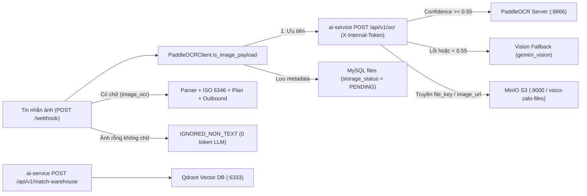

# Kịch bản Kiểm thử Postman & cURL: OCR, Lưu trữ MinIO, Bảng `files`, Sandbox & Qdrant

Tài liệu này hướng dẫn kiểm thử chuyên sâu toàn bộ chuỗi tiếp nhận và nhận diện hình ảnh, lưu trữ đối tượng và tìm kiếm ngữ nghĩa trong hệ thống **VSICO Zalo Bot**:
1. **Máy chủ PaddleOCR tự host (Cổng `8866`)**: Kiểm tra sức khỏe model, API chuẩn PaddleHub (`/predict/ocr_system`) và API REST đơn giản (`/ocr`).
2. **AI & OCR Microservice (`ai-service` Cổng `8001`)**: Kiểm tra bảo mật `X-Internal-Token`, ưu tiên PaddleOCR (`avg_confidence >= 0.55`), cơ chế fallback Multimodal Vision (`gemini_vision`), đọc ảnh từ `image_base64`, `image_url` và `file_key` trên MinIO.
3. **MinIO S3 Storage (`9000` / `9001`) & Bảng `files`**: Kiểm tra bucket `vsico-zalo-files`, upload/tạo Presigned URL trên MinIO, kiểm tra ghi metadata `files` khi gọi `POST /webhook` và đối chiếu trạng thái hiện hành.
4. **Backend Webhook Ảnh (`POST /webhook`) & Sandbox Dry-Run (`POST /api/sandbox/simulate`)**: Xử lý tin nhắn ảnh Zalo (`image_base64`, `image_url`, `attachments`, `content.hdUrl`), ghép chú thích + văn bản OCR, bỏ qua ảnh không chữ (`IGNORED_NON_TEXT`), và kiểm thử không lưu DB trên Sandbox.
5. **Qdrant Vector DB (Cổng `6333`) & Map kho (`/api/v1/match-warehouse`)**: Tạo collection 768 chiều, upsert/search vector mẫu và kiểm tra API map kho trên `ai-service`.



---

## 1. Phạm vi Dịch vụ & Lưu ý Hiện trạng MinIO

### 1.1. Danh sách Dịch vụ Liên quan

| STT | Dịch vụ | Cổng | Đường dẫn kiểm tra chính | Vai trò |
| :--- | :--- | :---: | :--- | :--- |
| 1 | Backend FastAPI | `8000` | `POST /webhook`, `POST /api/sandbox/simulate`, `GET /api/messages/detail/{id}` | Tiếp nhận ảnh Zalo, điều phối OCR, lưu metadata `files` |
| 2 | AI & OCR Microservice | `8001` | `GET /health`, `POST /api/v1/ocr`, `POST /api/v1/match-warehouse` | Điều phối PaddleOCR -> Vision fallback, nạp ảnh từ MinIO |
| 3 | PaddleOCR Server | `8866` | `GET /health`, `POST /predict/ocr_system`, `POST /ocr` | Nhận diện chữ tiếng Việt từ ảnh base64 |
| 4 | MinIO S3 API & Console | `9000` / `9001` | `GET /minio/health/live`, Console `:9001` | Lưu trữ đối tượng ảnh trên bucket `vsico-zalo-files` |
| 5 | Qdrant Vector DB | `6333` | `GET /healthz`, `/collections/{name}/points/search` | Lưu và tìm kiếm vector địa chỉ kho 768 chiều |

### 1.2. Ghi chú Hiện trạng Lưu trữ MinIO trong Backend

* Khi tiếp nhận tin nhắn ảnh qua `POST /webhook`, `CarrierFlowService.record_image_file_metadata` tạo bản ghi mới trong bảng `files` với `file_key` (`zalo_img_{message_id}_{sha12}`), `bucket` (`vsico-zalo-files`), `object_key` (`inbound/{group_id}/{message_id}.jpg`), `sha256`, `size_bytes`, `source_type = "ZALO_IMAGE"`, `storage_status = "PENDING"` và `meta.ocr`.
* Ở phiên bản mã nguồn hiện tại, Backend **chưa triển khai** worker tự động upload byte ảnh từ Backend lên MinIO (để chuyển `PENDING -> STORED`) và **chưa cung cấp** endpoint REST `/api/files/*` hay endpoint sinh Presigned URL trực tiếp qua HTTP API của Backend.
* Do đó, việc kiểm thử upload file, tạo Presigned URL và đọc ảnh theo `file_key` từ MinIO trong tài liệu này thực hiện trực tiếp qua MinIO (`:9000` / `:9001`, `mc` hoặc thư viện `minio` trong `backend/.venv`), kết hợp kiểm tra nạp ảnh qua `ai-service` (`POST /api/v1/ocr`) và đối chiếu bảng `files` trong MySQL.

---

## 2. Biến Môi trường Postman, Kiểm tra Hạ tầng & Chuẩn bị Ảnh Mẫu

### 2.1. Biến Môi trường Postman (`VSICO-OCR-MinIO-Env`)

| Biến (Variable) | Giá trị mặc định (Local) | Mô tả |
| :--- | :--- | :--- |
| `baseUrl` | `http://localhost:8000` | Địa chỉ Backend FastAPI |
| `aiUrl` | `http://localhost:8001` | Địa chỉ AI & OCR Microservice |
| `paddleOcrUrl` | `http://localhost:8866` | Địa chỉ PaddleOCR Server cục bộ |
| `minioApiUrl` | `http://localhost:9000` | Địa chỉ MinIO S3 API |
| `qdrantUrl` | `http://localhost:6333` | Địa chỉ Qdrant Vector DB |
| `internalToken` | `vsico_internal_zero_trust_secret_2026` | Khớp `INTERNAL_SECRET` trong `.env` |
| `minioBucket` | `vsico-zalo-files` | Tên bucket mặc định |
| `presignedImageUrl` | *(gán từ bước MinIO)* | URL tạm có chữ ký đọc ảnh từ MinIO |

### 2.2. Kiểm tra Sức khỏe 5 Dịch vụ Trước khi Chạy Test

Khởi động hạ tầng từ thư mục gốc dự án:

```bash
docker compose up -d mysql minio minio-init qdrant paddleocr
```

Kiểm tra nhanh trạng thái từng cổng:

```bash
curl -i http://localhost:9000/minio/health/live
curl -s http://localhost:8866/health
curl -s http://localhost:8001/health
curl -s http://localhost:6333/healthz
curl -s http://localhost:8000/api/health
```

**Kết quả mong đợi**:
* MinIO `/minio/health/live`: trả `200 OK`.
* PaddleOCR `/health`: trả `status = "UP"` và `model_loaded = true` (nếu thiếu thư viện `paddleocr`, trả `status = "UNAVAILABLE"`, `model_loaded = false`).
* AI Service `/health`: trả `status = "UP"`, kèm `paddle_ocr_url` và `qdrant_url`.
* Qdrant `/healthz`: trả `healthz check passed`.
* Backend `/api/health`: trả `ok = true`, `database = "mysql_connected"`.

### 2.3. Tạo Ảnh Điều xe Mẫu Có Chữ (`sample_dispatch.png`) & Base64

Để kiểm thử OCR thực tế (ảnh có chữ rõ nét thay vì ảnh 1x1 pixel rỗng), tạo nhanh một ảnh PNG chứa lệnh điều xe hợp lệ bằng `Pillow`:

```bash
cd backend
.venv/bin/python -c '
import base64
from PIL import Image, ImageDraw
img = Image.new("RGB", (900, 260), color=(255, 255, 255))
draw = ImageDraw.Draw(img)
lines = [
    "LENH DIEU XE VAN TAI CONTAINER",
    "Khach hang: Cong ty Minh Anh",
    "Dong cont MSKU9070323 40H seal VS009911",
    "Xe 29C-445.41 mooc 29R-012.34",
    "Tai xe Nguyen Van Hung 0903123459",
    "Kho Minh Anh Hai Phong - Du kien 09h00",
]
for idx, line in enumerate(lines):
    draw.text((24, 24 + idx * 34), line, fill=(0, 0, 0))
img.save("/tmp/sample_dispatch.png")
b64 = base64.b64encode(open("/tmp/sample_dispatch.png", "rb").read()).decode("ascii")
open("/tmp/sample_dispatch.b64", "w").write(b64)
print("Saved /tmp/sample_dispatch.png, base64 len =", len(b64))
'
```

*(Với ảnh rỗng dùng kiểm tra case `IGNORED_NON_TEXT`, sử dụng chuỗi PNG 1x1 pixel: `iVBORw0KGgoAAAANSUhEUgAAAAEAAAABCAYAAAAfFcSJAAAADUlEQVR42mNk+M9QDwADhgGAWjR9awAAAABJRU5ErkJggg==`.)*

---

## 3. Kịch bản 01 — Kiểm thử Máy chủ PaddleOCR Cục bộ (Cổng `8866`)

### Test 1.1: Chuẩn PaddleHub Serving (`POST /predict/ocr_system`)

**Request**: `POST {{paddleOcrUrl}}/predict/ocr_system`

```bash
B64=$(cat /tmp/sample_dispatch.b64)
curl -s -X POST "http://localhost:8866/predict/ocr_system" \
  -H "Content-Type: application/json" \
  -d "{\"images\": [\"$B64\"]}"
```

**Kết quả mong đợi (`200 OK`)**:

```json
{
  "msg": "success",
  "results": [
    [
      {
        "confidence": 0.96,
        "text": "LENH DIEU XE VAN TAI CONTAINER",
        "text_region": [[24, 24], [320, 24], [320, 42], [24, 42]]
      }
    ]
  ],
  "status": "000"
}
```

### Test 1.2: Endpoint REST Đơn giản (`POST /ocr`)

**Request**: `POST {{paddleOcrUrl}}/ocr`

```bash
B64=$(cat /tmp/sample_dispatch.b64)
curl -s -X POST "http://localhost:8866/ocr" \
  -H "Content-Type: application/json" \
  -d "{\"image_base64\": \"$B64\", \"lang\": \"vi\"}"
```

**Kết quả mong đợi (`200 OK`)**: Trả về `ok = true`, `text` (các dòng nối bằng `\n`), `confidence`, `lines_count`, `lines`.

### Test 1.3: Kiểm tra Trường hợp Lỗi (`400` / `503`)

* Gửi `{ "images": [] }` vào `POST /predict/ocr_system` -> trả `400 Bad Request` (`"Không tìm thấy chuỗi base64 ảnh trong payload."`).
* Khi container/process PaddleOCR chưa nạp thư viện `paddleocr` (`ocr_engine is None`) -> trả `503 Service Unavailable`.

---

## 4. Kịch bản 02 — Kiểm thử AI & OCR Microservice (`POST /api/v1/ocr`, Cổng `8001`)

### Test 2.1: Bảo mật Nội bộ Zero-Trust (`X-Internal-Token`)

1. Gửi thiếu header `X-Internal-Token`:

```bash
curl -i -X POST "http://localhost:8001/api/v1/ocr" \
  -H "Content-Type: application/json" \
  -d '{"image_base64": "aGVsbG8=", "lang": "vi"}'
```

**Kết quả mong đợi**: `422 Unprocessable Entity`.

2. Gửi sai giá trị `X-Internal-Token`:

```bash
curl -i -X POST "http://localhost:8001/api/v1/ocr" \
  -H "Content-Type: application/json" \
  -H "X-Internal-Token: wrong_secret" \
  -d '{"image_base64": "aGVsbG8=", "lang": "vi"}'
```

**Kết quả mong đợi**: `401 Unauthorized`.

### Test 2.2: OCR bằng `image_base64` (hoặc Data URI) -> Ưu tiên `paddleocr`

**Request**: `POST {{aiUrl}}/api/v1/ocr`

```bash
B64=$(cat /tmp/sample_dispatch.b64)
curl -s -X POST "http://localhost:8001/api/v1/ocr" \
  -H "Content-Type: application/json" \
  -H "X-Internal-Token: vsico_internal_zero_trust_secret_2026" \
  -d "{\"image_base64\": \"data:image/png;base64,$B64\", \"lang\": \"vi\"}"
```

**Kết quả mong đợi (`200 OK`)**:
* Khi PaddleOCR hoạt động và đạt `avg_confidence >= 0.55`: trả `"engine": "paddleocr"`, `"has_text": true`, cùng `text`, `confidence`, `lines`.
* Toàn bộ hộp chữ cùng hàng ngang đã được `PaddleOCREngine._group_boxes_into_lines` gom theo trục Y và lọc bỏ nhiễu giao diện (`zalo`, `gửi`, mốc giờ `HH:MM`).

### Test 2.3: Kiểm tra Cơ chế Fallback sang Multimodal Vision (`gemini_vision`)

Để kiểm chứng tự động chuyển sang Vision LLM khi PaddleOCR không khả dụng hoặc ảnh mờ dưới ngưỡng `0.55`:
1. Tạm dừng container `paddleocr` (`docker compose stop paddleocr`) hoặc trỏ `PADDLE_OCR_URL` về cổng không lắng nghe, đảm bảo `AI_API_KEY` trong `.env` hợp lệ.
2. Gửi lại request Test 2.2 tới `POST http://localhost:8001/api/v1/ocr`.

**Kết quả mong đợi (`200 OK`)**:
* `engine` chuyển sang `"gemini_vision"` (hoặc `{provider_name}_vision`).
* `has_text = true`, đọc được nội dung chữ trong `/tmp/sample_dispatch.png`.

### Test 2.4: OCR với Ảnh Rỗng Không Có Chữ

```bash
curl -s -X POST "http://localhost:8001/api/v1/ocr" \
  -H "Content-Type: application/json" \
  -H "X-Internal-Token: vsico_internal_zero_trust_secret_2026" \
  -d '{
    "image_base64": "iVBORw0KGgoAAAANSUhEUgAAAAEAAAABCAYAAAAfFcSJAAAADUlEQVR42mNk+M9QDwADhgGAWjR9awAAAABJRU5ErkJggg==",
    "lang": "vi"
  }'
```

**Kết quả mong đợi**: `has_text = false`, `text = ""`.

---

## 5. Kịch bản 03 — Kiểm thử MinIO Storage (`9000`/`9001`), Presigned URL & `file_key`

### Test 3.1: Kiểm tra Bucket trên MinIO Console & CLI `mc`

* **Giao diện Web MinIO Console**: Truy cập `http://localhost:9001`, đăng nhập bằng `MINIO_ROOT_USER` / `MINIO_ROOT_PASSWORD` trong `.env`, kiểm tra bucket `vsico-zalo-files` đã được tạo bởi `minio-init`.
* **Kiểm tra qua Docker `mc` hoặc client**:

```bash
docker run --rm --network vsico_zalo_bot_vsico_network minio/mc:latest \
  ls local/ 2>/dev/null || echo "Kiểm tra trực tiếp bằng Python minio SDK bên dưới"
```

### Test 3.2: Upload Ảnh Mẫu lên MinIO, Sinh Presigned GET URL & Nạp qua `POST /api/v1/ocr`

Sử dụng thư viện `minio` đã cài sẵn trong `backend/.venv` để upload `/tmp/sample_dispatch.png` vào `inbound/test_group_ocr/sample_dispatch.png` và sinh Presigned URL (hết hạn sau 3600 giây):

```bash
cd backend
.venv/bin/python -c '
import os
from datetime import timedelta
from dotenv import load_dotenv
from minio import Minio

load_dotenv("../.env")
client = Minio(
    os.getenv("MINIO_ENDPOINT", "127.0.0.1:9000"),
    access_key=os.getenv("MINIO_ROOT_USER", "minioadmin"),
    secret_key=os.getenv("MINIO_ROOT_PASSWORD", "minioadmin123"),
    secure=os.getenv("MINIO_SECURE", "false").lower() == "true",
)
bucket = os.getenv("MINIO_BUCKET_NAME", "vsico-zalo-files")
if not client.bucket_exists(bucket):
    client.make_bucket(bucket)

obj_key = "inbound/test_group_ocr/sample_dispatch.png"
client.fput_object(bucket, obj_key, "/tmp/sample_dispatch.png", content_type="image/png")
presigned_url = client.presigned_get_object(bucket, obj_key, expires=timedelta(seconds=3600))
print("Uploaded:", f"{bucket}/{obj_key}")
print("PRESIGNED_URL=", presigned_url)
'
```

Kiểm tra tải ảnh qua `curl` (trước khi hết hạn):

```bash
curl -I "<PRESIGNED_URL>"
```

**Kết quả mong đợi**: `HTTP/1.1 200 OK`, `Content-Type: image/png`.

Sau đó truyền `PRESIGNED_URL` vào `image_url` của `ai-service` (`POST /api/v1/ocr`):

```bash
curl -s -X POST "http://localhost:8001/api/v1/ocr" \
  -H "Content-Type: application/json" \
  -H "X-Internal-Token: vsico_internal_zero_trust_secret_2026" \
  -d '{
    "image_url": "<PRESIGNED_URL>",
    "lang": "vi"
  }'
```

**Kết quả mong đợi (`200 OK`)**: `ai-service` tải ảnh thành công từ MinIO theo Presigned URL, `has_text = true`, trích xuất đúng dòng văn bản trên ảnh.

### Test 3.3: Nạp Ảnh qua Tham số `file_key` trên `ai-service`

Theo `ai-service/app/ocr/image_loader.py`, khi truyền `file_key` (không truyền `image_url`), `ai-service` dựng URL:
`{http|https}://{MINIO_ENDPOINT}/{MINIO_BUCKET_NAME}/{file_key}`

```bash
curl -s -X POST "http://localhost:8001/api/v1/ocr" \
  -H "Content-Type: application/json" \
  -H "X-Internal-Token: vsico_internal_zero_trust_secret_2026" \
  -d '{
    "file_key": "inbound/test_group_ocr/sample_dispatch.png",
    "lang": "vi"
  }'
```

* **Lưu ý cấu hình quyền đọc**: Bucket mặc định của MinIO ở chế độ private, nên gọi GET trực tiếp `{MINIO_ENDPOINT}/{bucket}/{file_key}` không có chữ ký sẽ bị `403 Forbidden` trừ khi cấu hình bucket policy `download` cho môi trường local dev; trong vận hành an toàn nên ưu tiên truyền `image_url` là **Presigned URL** như Test 3.2.

---

## 6. Kịch bản 04 — Luồng Tin nhắn Ảnh qua Backend Webhook (`POST /webhook`) & Bảng `files`

### Test 4.1: Gửi Ảnh dạng `image_base64` kèm Placeholder `"[ảnh]"`

**Request**: `POST {{baseUrl}}/webhook`

```bash
B64=$(cat /tmp/sample_dispatch.b64)
curl -s -X POST "http://localhost:8000/webhook" \
  -H "Content-Type: application/json; charset=utf-8" \
  -d "{
    \"app_id\": \"zca_personal_bot\",
    \"event_name\": \"user_send_image\",
    \"group_id\": \"test_group_ocr_10\",
    \"sender\": {
      \"id\": \"test_driver_ocr_10\",
      \"name\": \"Tài xế Tuấn Hưng\"
    },
    \"message\": {
      \"msg_id\": \"test_msg_ocr_b64_01\",
      \"text\": \"[ảnh]\"
    },
    \"image_base64\": \"$B64\"
  }"
```

**Kết quả mong đợi (`200 OK`)**:
* `ok = true`.
* `PaddleOCRClient.is_image_payload` nhận diện tin nhắn ảnh, gọi `ai-service` `/api/v1/ocr` (hoặc fallback cục bộ), thay thế placeholder `"[ảnh]"` bằng nội dung OCR bóc tách được và cập nhật `zalo_messages.message_type = "image_ocr"`.
* Bóc tách `trucks` (`29C-445.41`, `29R-012.34`, `Nguyễn Văn Hung`, `0903123459`) và `containers` (`MSKU9070323`, `40`, `VS009911`).
* Ghi nhận 1 bản ghi mới trong bảng `files` gắn `message_id`.

### Test 4.2: Gửi Ảnh dạng `image_url` (Presigned URL từ MinIO) & Cấu trúc ZCA `content.hdUrl`

1. **Dạng `image_url` trực tiếp**:

```bash
curl -s -X POST "http://localhost:8000/webhook" \
  -H "Content-Type: application/json; charset=utf-8" \
  -d '{
    "app_id": "zca_personal_bot",
    "event_name": "user_send_image",
    "group_id": "test_group_ocr_10",
    "sender": {
      "id": "test_driver_ocr_10",
      "name": "Tài xế Tuấn Hưng"
    },
    "message": {
      "msg_id": "test_msg_ocr_url_02",
      "text": "[hình ảnh]"
    },
    "image_url": "<PRESIGNED_URL>"
  }'
```

2. **Dạng sự kiện lồng ZCA (`attachments` hoặc `raw_payload.content.hdUrl`)**:

```bash
curl -s -X POST "http://localhost:8000/webhook" \
  -H "Content-Type: application/json; charset=utf-8" \
  -d '{
    "app_id": "zca_personal_bot",
    "event_name": "user_send_image",
    "group_id": "test_group_ocr_10",
    "sender": {
      "id": "test_driver_ocr_10",
      "name": "Tài xế Tuấn Hưng"
    },
    "message": {
      "msg_id": "test_msg_ocr_zca_03",
      "text": ""
    },
    "attachments": [
      {
        "type": "image",
        "url": "<PRESIGNED_URL>"
      }
    ]
  }'
```

**Kết quả mong đợi**: Với `image_url`, cột `files.source_url` lưu URL nguồn ảnh (tối đa 1000 ký tự), khác với trường hợp `image_base64` (`source_url = NULL` để tránh lưu chuỗi base64 khổng lồ vào cột URL).

### Test 4.3: Ảnh Kèm Chú thích Văn bản Bổ sung -> Ghép `caption + ocr_text`

Gửi ảnh điều xe kèm đoạn text chưa có biển số/container (`"Em gửi ảnh lệnh đóng sáng nay ạ"`, `msg_id: "test_msg_ocr_caption_04"`).

**Kết quả mong đợi**: Vì đoạn text không chứa biển số hay container (`has_shipping_info = False`), `ExtractionHandler` vẫn kích hoạt OCR, sau đó ghép `caption + "\n" + ocr_text` vào `zalo_messages.message_text` và bóc tách đầy đủ thông tin.

### Test 4.4: Ảnh Không Chữ (Icon / Ảnh Rỗng 1x1 Pixel) -> `IGNORED_NON_TEXT`

```bash
curl -s -X POST "http://localhost:8000/webhook" \
  -H "Content-Type: application/json; charset=utf-8" \
  -d '{
    "app_id": "zca_personal_bot",
    "event_name": "user_send_image",
    "group_id": "test_group_ocr_10",
    "sender": {
      "id": "test_driver_ocr_10",
      "name": "Tài xế Tuấn Hưng"
    },
    "message": {
      "msg_id": "test_msg_ocr_nontext_05",
      "text": "[ảnh]"
    },
    "image_base64": "iVBORw0KGgoAAAANSUhEUgAAAAEAAAABCAYAAAAfFcSJAAAADUlEQVR42mNk+M9QDwADhgGAWjR9awAAAABJRU5ErkJggg=="
  }'
```

**Kết quả mong đợi**: `processing_status = "IGNORED_NON_TEXT"`, không sinh `extraction_runs` gọi LLM (tiết kiệm 0 token).

### Test 4.5: Kiểm tra API Chi tiết Tin nhắn (`GET /api/messages/detail/{message_id}`)

```bash
curl -s -X GET "http://localhost:8000/api/messages/detail/test_msg_ocr_b64_01"
```

**Kết quả mong đợi**: Xem được `message_type = "image_ocr"`, trường `raw_payload.ocr_result` (`provider`, `confidence`, `boxes_count`, `extracted_length`), `extraction_runs`, `trucks` và `containers`.

---

## 7. Kịch bản 05 — Kiểm thử OCR trên Sandbox Dry-Run (`POST /api/sandbox/simulate`)

Sandbox dùng để kiểm chứng chuỗi `OCR -> Gatekeeper -> Rule Parser -> Bối cảnh/Plan` mà **tuyệt đối không ghi dữ liệu vào MySQL**.

### Test 5.1: Mô phỏng Ảnh Có Chữ với `allow_ai_fallback = false`

**Request**: `POST {{baseUrl}}/api/sandbox/simulate`

```bash
B64=$(cat /tmp/sample_dispatch.b64)
curl -s -X POST "http://localhost:8000/api/sandbox/simulate" \
  -H "Content-Type: application/json; charset=utf-8" \
  -d "{
    \"text\": \"[ảnh]\",
    \"image_base64\": \"data:image/png;base64,$B64\",
    \"allow_ai_fallback\": false
  }"
```

**Kết quả mong đợi (`200 OK`)**:
* `ok = true`, `persisted = false`.
* Đối tượng `ocr`: `triggered = true`, `has_text = true`, `confidence > 0`, `extracted_text` chứa nội dung ảnh, `lines_count > 0`.
* `records` hiển thị container/biển số đã bóc tách; số lượng bản ghi trong `zalo_messages` và `files` của MySQL **không đổi**.

### Test 5.2: Mô phỏng Ảnh Rỗng trên Sandbox -> `IGNORED_NON_TEXT`

```bash
curl -s -X POST "http://localhost:8000/api/sandbox/simulate" \
  -H "Content-Type: application/json; charset=utf-8" \
  -d '{
    "text": "[ảnh]",
    "image_base64": "iVBORw0KGgoAAAANSUhEUgAAAAEAAAABCAYAAAAfFcSJAAAADUlEQVR42mNk+M9QDwADhgGAWjR9awAAAABJRU5ErkJggg==",
    "allow_ai_fallback": false
  }'
```

**Kết quả mong đợi (`200 OK`)**: `persisted = false`, `processing_status = "IGNORED_NON_TEXT"`, `ai_executed = false`, `model_name = "ocr-gatekeeper"`.

### Test 5.3: Gửi Thiếu Cả `text` lẫn `image_base64`

```bash
curl -i -X POST "http://localhost:8000/api/sandbox/simulate" \
  -H "Content-Type: application/json" \
  -d '{"text": "", "image_base64": null}'
```

**Kết quả mong đợi**: `422 Unprocessable Entity`.

---

## 8. Kịch bản 06 — Kiểm thử Qdrant Vector DB (`6333`) & Map Kho Nhiều tầng

### Test 6.1: Khởi tạo Collection 768 Chiều, Nạp Điểm Vector & Tìm kiếm trên Qdrant

1. Kiểm tra danh sách collection hiện có:

```bash
curl -s "http://localhost:6333/collections"
```

2. Tạo collection `vsico_warehouse_addresses` (768 chiều, Cosine):

```bash
curl -s -X PUT "http://localhost:6333/collections/vsico_warehouse_addresses" \
  -H "Content-Type: application/json" \
  -d '{
    "vectors": {
      "size": 768,
      "distance": "Cosine"
    }
  }'
```

3. Upsert 1 vector mẫu 768 chiều bằng Python và gọi `/points/search`:

```bash
python3 -c '
import json, urllib.request
vec = [0.01] * 768
upsert_body = {
    "points": [{
        "id": 9001,
        "vector": vec,
        "payload": {"warehouse_id": 1, "customer_id": 10, "warehouse_name": "Kho Minh Anh Hai Phong"}
    }]
}
req = urllib.request.Request(
    "http://localhost:6333/collections/vsico_warehouse_addresses/points?wait=true",
    data=json.dumps(upsert_body).encode(),
    headers={"Content-Type": "application/json"},
    method="PUT",
)
print("Upsert:", urllib.request.urlopen(req).read().decode())

search_body = {"vector": vec, "limit": 3, "with_payload": True}
req2 = urllib.request.Request(
    "http://localhost:6333/collections/vsico_warehouse_addresses/points/search",
    data=json.dumps(search_body).encode(),
    headers={"Content-Type": "application/json"},
    method="POST",
)
print("Search:", urllib.request.urlopen(req2).read().decode())
'
```

**Kết quả mong đợi**: `Upsert` trả `"status": "ok"`; `Search` trả về điểm `id = 9001` với `score` tiệm cận `1.0` và đúng payload `warehouse_id = 1`.

### Test 6.2: Kiểm thử Endpoint Map Kho (`/api/v1/match-warehouse`, Cổng `8001`)

```bash
curl -s -X POST "http://localhost:8001/api/v1/match-warehouse" \
  -H "Content-Type: application/json; charset=utf-8" \
  -H "X-Internal-Token: vsico_internal_zero_trust_secret_2026" \
  -d '{
    "raw_address": "Kho Minh Anh Hai Phong",
    "carrier_id": 1,
    "customer_id": 10,
    "candidate_warehouses": [
      {"id": 1, "customer_id": 10, "name": "Kho Minh Anh Hải Phòng", "address": "KCN Đình Vũ, Hải Phòng"},
      {"id": 2, "customer_id": 10, "name": "Kho Bắc Ninh", "address": "KCN Tiên Sơn, Bắc Ninh"}
    ]
  }'
```

**Kết quả mong đợi (`200 OK`)**: `matched = true`, `warehouse_id = 1`, `source` phản ánh tầng khớp đầu tiên (`habit` / `fuzzy` / `llm`). Lưu ý: trong `ai-service/app/warehouse/matcher.py` hiện tại, hàm `match_by_vector` chưa nhận tham số `query_vector` sinh tự động từ text nên tầng Vector (`GP3`) chỉ kích hoạt khi truyền embedding 768 chiều.

---

## 9. Kiểm thử Tự động (Pytest) & Truy vấn Đối soát MySQL

### 9.1. Truy vấn Bảng `files` & Kết quả OCR trong MySQL

```sql
-- 1. Kiểm tra metadata ảnh Zalo và thông số OCR ghi trong bảng files
SELECT id, file_key, bucket, object_key, mime_type, size_bytes, sha256,
       source_type, source_url, storage_status, meta, created_at
FROM files
ORDER BY id DESC
LIMIT 15;

-- 2. Đối chiếu tin nhắn đã chuyển sang image_ocr và kết quả raw_payload.ocr_result
SELECT id, zalo_message_id, group_id, message_type, processing_status,
       LEFT(message_text, 150) AS ocr_text_preview,
       JSON_EXTRACT(raw_payload, '$.ocr_result') AS ocr_result
FROM zalo_messages
WHERE message_type IN ('image', 'image_ocr') OR zalo_message_id LIKE 'test_msg_ocr_%'
ORDER BY id DESC
LIMIT 15;
```

### 9.2. Chạy Kiểm thử Tự động Pytest (OCR & Sandbox)

Từ thư mục `ai-service`:

```bash
cd ai-service
.venv/bin/pytest tests/test_ocr_service.py tests/test_extract_and_warehouse.py tests/test_privacy_masker.py -v
```

Từ thư mục `backend`:

```bash
cd backend
.venv/bin/pytest tests/test_sandbox.py tests/test_carrier_flow_e2e.py -v
```

---

## 10. Danh mục Nghiệm thu

* [ ] Đã kiểm tra healthcheck 5 dịch vụ: MinIO (`9000`), PaddleOCR (`8866`), AI Service (`8001`), Qdrant (`6333`), Backend (`8000`).
* [ ] Đã kiểm tra PaddleOCR (`8866`) với `/predict/ocr_system` và `/ocr` trên ảnh có chữ.
* [ ] Đã kiểm tra `ai-service` `/api/v1/ocr`: xác thực `X-Internal-Token` (`422`/`401`), `paddleocr`, fallback Vision LLM và ảnh rỗng.
* [ ] Đã kiểm tra MinIO bucket `vsico-zalo-files`, upload ảnh mẫu, tạo Presigned GET URL và truyền qua `image_url` cho `/api/v1/ocr` và `/webhook`.
* [ ] Đã kiểm tra bảng `files` trong MySQL (`file_key`, `bucket`, `object_key`, `sha256`, `storage_status = "PENDING"`, `meta.ocr`) và `IGNORED_NON_TEXT` đối với ảnh không chữ.
* [ ] Đã kiểm tra Sandbox OCR (`POST /api/sandbox/simulate`) trả về kết quả bóc tách đầy đủ mà không ghi MySQL.
* [ ] Đã kiểm tra Qdrant (`6333`) tạo collection 768 chiều, upsert/search vector mẫu và endpoint `/api/v1/match-warehouse`.
