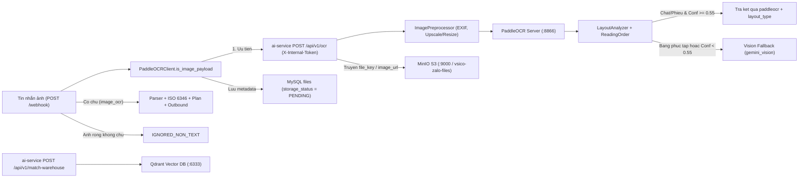

# Kiểm Thử Postman: OCR, Lưu Trữ MinIO, Bảng files, Sandbox và Qdrant

## 1. Mục đích
Tài liệu hướng dẫn kiểm thử các endpoint liên quan đến chuỗi tiếp nhận hình ảnh, nhận diện ký tự quang học (OCR), lưu trữ đối tượng MinIO và tìm kiếm ngữ nghĩa Qdrant bằng Postman.



---

## 2. Biến Môi Trường Postman (VSICO-OCR-MinIO-Env)

| Tên biến | Giá trị mẫu | Mô tả |
| :--- | :--- | :--- |
| `baseUrl` | `http://localhost:8000` | Địa chỉ Backend FastAPI |
| `oaUrl` | `http://localhost:3000` | Địa chỉ Cầu nối Zalo Official Account (`oa-bridge`) hoặc ZCA Bridge |
| `aiUrl` | `http://localhost:8001` | Địa chỉ AI & OCR Microservice |
| `paddleOcrUrl` | `http://localhost:8866` | Địa chỉ PaddleOCR Server |
| `minioApiUrl` | `http://localhost:9000` | Địa chỉ MinIO S3 API |
| `qdrantUrl` | `http://localhost:6333` | Địa chỉ Qdrant Vector DB |
| `webhookSecret` | `<ZALO_SECRET_KEY_TRONG_FILE_ENV>` | Khóa bí mật Webhook gửi qua header `X-Webhook-Secret` |
| `internalToken` | `<INTERNAL_SECRET_TRONG_FILE_ENV>` | Token xác thực nội bộ qua header `X-Internal-Token` |
| `minioBucket` | `vsico-zalo-files` | Tên bucket lưu trữ mặc định |
| `fileId` | `<SNOWFLAKE_ID_FILE>` | Snowflake ID bản ghi `files` sau khi upload |
| `fileKey` | `<FILE_KEY_TRA_VE>` | Mã `file_key` định danh tệp (ví dụ `doc_...`) |
| `objectKey` | `<OBJECT_KEY_TREN_MINIO>` | Đường dẫn đối tượng thực tế trên bucket MinIO |
| `presignedImageUrl` | `<URL_PRESIGNED_MINIO>` | URL tạm có chữ ký đọc/tải ảnh từ MinIO |

---

## 3. Kiểm Tra Sức Khỏe Các Dịch Vụ (Health Check)

### 3.1. Kiểm tra MinIO S3 API
- **Method**: `GET`
- **URL**: `{{minioApiUrl}}/minio/health/live`
- **Headers / Bảo mật**: `Accept: */*`
- **Params / Body**: Không có
- **Kết quả mong đợi**: HTTP `200 OK`

### 3.2. Kiểm tra PaddleOCR Server
- **Method**: `GET`
- **URL**: `{{paddleOcrUrl}}/health`
- **Headers / Bảo mật**: `Accept: application/json`
- **Params / Body**: Không có
- **Kết quả mong đợi**: HTTP `200 OK`
```json
{
  "status": "UP",
  "engine": "paddleocr",
  "model_loaded": true,
  "lang": "vi"
}
```

### 3.3. Kiểm tra AI & OCR Microservice
- **Method**: `GET`
- **URL**: `{{aiUrl}}/health`
- **Headers / Bảo mật**: `Accept: application/json`
- **Params / Body**: Không có
- **Kết quả mong đợi**: HTTP `200 OK`
```json
{
  "status": "UP",
  "paddle_ocr_url": "http://paddleocr:8866",
  "qdrant_url": "http://qdrant:6333"
}
```

### 3.4. Kiểm tra Qdrant Vector DB
- **Method**: `GET`
- **URL**: `{{qdrantUrl}}/healthz`
- **Headers / Bảo mật**: `Accept: text/plain`
- **Params / Body**: Không có
- **Kết quả mong đợi**: HTTP `200 OK`, text phản hồi: `healthz check passed`

### 3.5. Kiểm tra Backend FastAPI
- **Method**: `GET`
- **URL**: `{{baseUrl}}/api/health`
- **Headers / Bảo mật**: `Accept: application/json`
- **Params / Body**: Không có
- **Kết quả mong đợi**: HTTP `200 OK`
```json
{
  "ok": true,
  "database": "mysql_connected"
}
```

---

## 4. Kịch Bản 01: Kiểm Thử Máy Chủ PaddleOCR (Cổng 8866)

### Test 1.1: Chuẩn PaddleHub Serving (POST /predict/ocr_system)
- **Method**: `POST`
- **URL**: `{{paddleOcrUrl}}/predict/ocr_system`
- **Headers / Bảo mật**:
  - `Content-Type: application/json`
  - `X-API-Key: <OCR_API_KEY>` *(nếu server có cấu hình)*
- **Params / Body (raw - JSON)**:
```json
{
  "images": [
    "<CHUOI_BASE64_ANH>"
  ]
}
```
- **Kết quả mong đợi**: HTTP `200 OK`
```json
{
  "msg": "success",
  "results": [
    [
      {
        "confidence": 0.96,
        "text": "LENH DIEU XE VAN TAI CONTAINER",
        "text_region": [[24, 24], [320, 24], [320, 42], [24, 42]]
      }
    ]
  ],
  "errors": [],
  "status": "000"
}
```

---

### Test 1.2: Endpoint REST Đơn giản (POST /ocr)
- **Method**: `POST`
- **URL**: `{{paddleOcrUrl}}/ocr`
- **Headers / Bảo mật**:
  - `Content-Type: application/json`
- **Params / Body (raw - JSON)**:
```json
{
  "image_base64": "<CHUOI_BASE64_ANH>"
}
```
- **Kết quả mong đợi**: HTTP `200 OK`
```json
{
  "engine": "paddleocr",
  "text": "LENH DIEU XE VAN TAI CONTAINER\nKhach hang: Cong ty Minh Anh\nDong cont MSKU9070323 40H seal VS009911\nXe 29C-445.41 mooc 29R-012.34\nTai xe Nguyen Van Hung 0903123459",
  "confidence": 0.96,
  "lines": [
    {
      "text": "LENH DIEU XE VAN TAI CONTAINER",
      "confidence": 0.96,
      "box": [[24, 24], [320, 24], [320, 42], [24, 42]]
    }
  ],
  "has_text": true,
  "layout_type": "unknown",
  "preprocessing_applied": ["pad_border"],
  "error": null
}
```

---

### Test 1.3: Kiểm tra các trường hợp lỗi PaddleOCR
- **Mảng ảnh rỗng**: `POST {{paddleOcrUrl}}/predict/ocr_system` với body `{"images": []}` -> HTTP `400 Bad Request` (`Không có ảnh base64 trong payload.`).
- **Base64 hỏng**: Gửi chuỗi base64 không hợp lệ -> HTTP `400 Bad Request`.
- **Sai API Key**: Thiếu hoặc sai header `X-API-Key` khi server bật xác thực -> HTTP `401 Unauthorized`.
- **Dung lượng vượt giới hạn**: Base64 vượt quá 14.000.000 ký tự -> HTTP `413 Payload Too Large`.
- **Model chưa nạp**: Khi model chưa sẵn sàng -> HTTP `503 Service Unavailable`.

---

## 5. Kịch Bản 02: Kiểm Thử AI & OCR Microservice (Cổng 8001)

### Test 2.1: Xác thực bảo mật nội bộ Zero-Trust (X-Internal-Token)

#### 2.1.1. Thiếu header X-Internal-Token
- **Method**: `POST`
- **URL**: `{{aiUrl}}/api/v1/ocr`
- **Headers / Bảo mật**:
  - `Content-Type: application/json`
- **Params / Body (raw - JSON)**:
```json
{
  "image_base64": "aGVsbG8=",
  "lang": "vi"
}
```
- **Kết quả mong đợi**: HTTP `422 Unprocessable Entity`

#### 2.1.2. Sai header X-Internal-Token
- **Method**: `POST`
- **URL**: `{{aiUrl}}/api/v1/ocr`
- **Headers / Bảo mật**:
  - `Content-Type: application/json`
  - `X-Internal-Token: wrong_secret`
- **Params / Body (raw - JSON)**:
```json
{
  "image_base64": "aGVsbG8=",
  "lang": "vi"
}
```
- **Kết quả mong đợi**: HTTP `401 Unauthorized`

---

### Test 2.2: OCR bằng image_base64 (Ưu tiên PaddleOCR)
- **Method**: `POST`
- **URL**: `{{aiUrl}}/api/v1/ocr`
- **Headers / Bảo mật**:
  - `Content-Type: application/json`
  - `X-Internal-Token: {{internalToken}}`
- **Params / Body (raw - JSON)**:
```json
{
  "image_base64": "data:image/png;base64,<CHUOI_BASE64_ANH>",
  "lang": "vi"
}
```
- **Kết quả mong đợi**: HTTP `200 OK`
```json
{
  "engine": "paddleocr",
  "text": "LENH DIEU XE VAN TAI CONTAINER\nKhach hang: Cong ty Minh Anh\nDong cont MSKU9070323 40H seal VS009911\nXe 29C-445.41 mooc 29R-012.34\nTai xe Nguyen Van Hung 0903123459",
  "confidence": 0.96,
  "lines": [
    {
      "text": "LENH DIEU XE VAN TAI CONTAINER",
      "confidence": 0.96,
      "box": [[24, 24], [320, 24], [320, 42], [24, 42]]
    }
  ],
  "has_text": true,
  "layout_type": "slip",
  "preprocessing_applied": ["unchanged"]
}
```

---

### Test 2.3: Multimodal Vision fallback (gemini_vision)
- **Method**: `POST`
- **URL**: `{{aiUrl}}/api/v1/ocr`
- **Headers / Bảo mật**:
  - `Content-Type: application/json`
  - `X-Internal-Token: {{internalToken}}`
- **Params / Body (raw - JSON)**:
```json
{
  "image_base64": "<CHUOI_BASE64_ANH>",
  "lang": "vi",
  "force_vision": true
}
```
- **Kết quả mong đợi**: HTTP `200 OK`
```json
{
  "engine": "gemini_vision",
  "has_text": true,
  "layout_type": "table",
  "text": "LENH DIEU XE VAN TAI CONTAINER...",
  "confidence": 0.92,
  "preprocessing_applied": ["unchanged"]
}
```

---

### Test 2.4: OCR với ảnh rỗng không có chữ
- **Method**: `POST`
- **URL**: `{{aiUrl}}/api/v1/ocr`
- **Headers / Bảo mật**:
  - `Content-Type: application/json`
  - `X-Internal-Token: {{internalToken}}`
- **Params / Body (raw - JSON)**:
```json
{
  "image_base64": "iVBORw0KGgoAAAANSUhEUgAAAAEAAAABCAYAAAAfFcSJAAAADUlEQVR42mNk+M9QDwADhgGAWjR9awAAAABJRU5ErkJggg==",
  "lang": "vi"
}
```
- **Kết quả mong đợi**: HTTP `200 OK`
```json
{
  "engine": "paddleocr",
  "has_text": false,
  "text": "",
  "confidence": 0.0,
  "lines": [],
  "layout_type": "unknown"
}
```

---

## 6. Kịch Bản 03: Quản Lý Tệp Tin, MinIO Storage, Presigned URL và Xóa Linh Hoạt

### Test 3.0: Kiểm tra sức khỏe kết nối MinIO và thống kê bảng files
- **Method**: `GET`
- **URL**: `{{baseUrl}}/api/files/health`
- **Headers / Bảo mật**: `Accept: application/json`
- **Params / Body**: Không có
- **Kết quả mong đợi**: HTTP `200 OK`
```json
{
  "ok": true,
  "minio": {
    "connected": true,
    "endpoint": "127.0.0.1:9000",
    "secure": false,
    "bucket": "vsico-zalo-files",
    "bucket_exists": true
  },
  "database_files": {
    "total": 1,
    "by_status": {
      "STORED": 1
    }
  }
}
```

---

### Test 3.1: Upload tệp lên MinIO và lưu metadata vào MySQL
- **Method**: `POST`
- **URL**: `{{baseUrl}}/api/files/upload`
- **Headers / Bảo mật**:
  - `Accept: application/json`
  - `Authorization: Bearer {{accessToken}}` *(tùy chọn, nếu gửi sẽ ghi nhận `actor_id` vào `activity_logs`)*
- **Params / Body (`form-data`)**:
  - `file`: Chọn tệp ảnh hoặc tài liệu từ máy (`Type = File`)
  - `source_type`: `MANUAL_UPLOAD` *(hoặc `ZALO_IMAGE` | `EXCEL_PLAN` | `DOCUMENT`)*
  - `group_name`: `Đội xe Tuấn Hưng` *(thư mục nhóm trong bucket `vsico-zalo-files`; tùy chọn)*
  - `sender_name`: `Phạm Tiến Hưng` *(tên người gửi đặt ở đầu tên tệp; tùy chọn)*
  - `note`: `Kiem thu upload va quan ly metadata MinIO`
  - `expires_seconds`: `3600`
- **Kết quả mong đợi**: HTTP `201 Created`
```json
{
  "ok": true,
  "message": "Tải tệp lên MinIO và lưu metadata MySQL thành công.",
  "file": {
    "id": "295104281942819840",
    "file_key": "doc_295104281942819840_a1b2c3d4e5f6",
    "bucket": "vsico-zalo-files",
    "object_key": "Doi_xe_Tuan_Hung/Pham_Tien_Hung-sample_dispatch-20261115_142308.png",
    "original_name": "sample_dispatch.png",
    "mime_type": "image/png",
    "size_bytes": 18420,
    "sha256": "a1b2c3d4e5f6...",
    "source_type": "MANUAL_UPLOAD",
    "storage_status": "STORED",
    "minio_exists": true,
    "presigned_url": "http://127.0.0.1:9000/vsico-zalo-files/Doi_xe_Tuan_Hung/Pham_Tien_Hung-sample_dispatch-20261115_142308.png?X-Amz-Algorithm=...",
    "presigned_expires_in": 3600
  }
}
```
- **Thao tác Postman (Tests script)**: Lưu `file.id` vào `{{fileId}}`, `file.file_key` vào `{{fileKey}}`, `file.object_key` vào `{{objectKey}}`, và `file.presigned_url` vào `{{presignedImageUrl}}`.

---

### Test 3.2: Truy vấn danh sách tệp phân trang và tìm kiếm
- **Method**: `GET`
- **URL**: `{{baseUrl}}/api/files?page=1&page_size=20&storage_status=STORED&search={{fileKey}}&include_presigned_url=true`
- **Headers / Bảo mật**: `Accept: application/json`
- **Params / Body**: Không có
- **Kết quả mong đợi**: HTTP `200 OK`, trả về `total >= 1` và danh sách `items` chứa tệp vừa upload.

---

### Test 3.3: Lấy thông tin chi tiết tệp và đối soát trực tiếp trên MinIO
- **Method**: `GET`
- **URL**: `{{baseUrl}}/api/files/{{fileKey}}?verify_minio=true&include_url=true` *(có thể thay `{{fileKey}}` bằng `{{fileId}}`)*
- **Headers / Bảo mật**: `Accept: application/json`
- **Params / Body**: Không có
- **Kết quả mong đợi**: HTTP `200 OK`
```json
{
  "ok": true,
  "file": {
    "id": "295104281942819840",
    "file_key": "doc_295104281942819840_a1b2c3d4e5f6",
    "bucket": "vsico-zalo-files",
    "object_key": "uploads/postman/2026/11/295104281942819840_sample_dispatch.png",
    "storage_status": "STORED",
    "minio_exists": true,
    "presigned_url": "http://127.0.0.1:9000/vsico-zalo-files/uploads/postman/...?X-Amz-Algorithm=...",
    "presigned_expires_in": 3600
  },
  "minio_stat": {
    "exists": true,
    "bucket": "vsico-zalo-files",
    "object_key": "uploads/postman/2026/11/295104281942819840_sample_dispatch.png",
    "size_bytes": 18420,
    "content_type": "image/png"
  }
}
```

---

### Test 3.4: Lấy object_key và xin cấp mới Presigned URL tạm thời
- **Method**: `GET`
- **URL**: `{{baseUrl}}/api/files/{{fileKey}}/url?expires_seconds=1800`
- **Headers / Bảo mật**: `Accept: application/json`
- **Params / Body**: Không có
- **Kết quả mong đợi**: HTTP `200 OK`
```json
{
  "ok": true,
  "id": "295104281942819840",
  "file_key": "doc_295104281942819840_a1b2c3d4e5f6",
  "bucket": "vsico-zalo-files",
  "object_key": "uploads/postman/2026/11/295104281942819840_sample_dispatch.png",
  "presigned_url": "http://127.0.0.1:9000/vsico-zalo-files/uploads/postman/...?X-Amz-Expires=1800...",
  "expires_in_seconds": 1800
}
```

---

### Test 3.5: Đọc ảnh trực tiếp qua Presigned URL từ MinIO
- **Method**: `GET`
- **URL**: `{{presignedImageUrl}}`
- **Headers / Bảo mật**: Không có
- **Params / Body**: Không có
- **Kết quả mong đợi**: HTTP `200 OK`, `Content-Type: image/png` (hiển thị/tải được đúng tệp vừa upload).

---

### Test 3.6: Chạy OCR từ tệp đã lưu trên MinIO (qua Backend `file_key` hoặc trực tiếp AI Service)

#### 3.6.1. OCR trực tiếp qua Backend bằng `file_key` hoặc Snowflake `id` (Khuyến nghị)
- **Method**: `POST`
- **URL**: `{{baseUrl}}/api/files/{{fileKey}}/ocr` *(có thể thay `{{fileKey}}` bằng `{{fileId}}`)*
- **Headers / Bảo mật**:
  - `Content-Type: application/json`
- **Params / Body (raw - JSON)**:
```json
{
  "lang": "vi",
  "force_vision": false,
  "save_meta": true
}
```
- **Kết quả mong đợi**: HTTP `200 OK`
  - Backend tự tra cứu bản ghi `files` trong MySQL, đọc tệp từ MinIO rồi gửi sang `ai-service` và lưu tóm tắt vào `files.meta.ocr` + `activity_logs` (`FILE_OCR_RUN`).
  - Trường `ocr` trả đúng format chuẩn `OCRResponse` (`engine`, `text`, `confidence`, `lines`, `has_text`, `layout_type`, `preprocessing_applied`, `error`).
  - Muốn ép dùng Gemini Vision, đổi `"force_vision": true`.

#### 3.6.2. OCR trực tiếp trên AI Service bằng Presigned URL hoặc `object_key`
- **Method**: `POST`
- **URL**: `{{aiUrl}}/api/v1/ocr`
- **Headers / Bảo mật**:
  - `Content-Type: application/json`
  - `X-Internal-Token: {{internalToken}}`
- **Params / Body (raw - JSON - dùng Presigned URL)**:
```json
{
  "image_url": "{{presignedImageUrl}}",
  "lang": "vi"
}
```
- **Hoặc Body (raw - JSON - dùng `file_key` là `object_key` thực tế trên MinIO)**:
```json
{
  "file_key": "{{objectKey}}",
  "lang": "vi"
}
```
- **Kết quả mong đợi**: HTTP `200 OK`, `has_text = true` (AI Service tự ký AWS SigV4 để đọc được cả bucket private trên MinIO khi truyền đúng `object_key` vào `file_key`).
- *(Lưu ý: `ai-service` không kết nối MySQL nên không tự tra được mã `doc_...`; nếu muốn truyền mã `doc_...`, hãy dùng endpoint Backend ở mục **3.6.1**).*

---

### Test 3.7: Kiểm thử xóa tệp theo 3 phạm vi (MinIO, MySQL, Cả hai)

#### 3.7.1. Xóa chỉ đối tượng trên MinIO (`scope=minio`)
- **Method**: `DELETE`
- **URL**: `{{baseUrl}}/api/files/{{fileKey}}?scope=minio`
- **Headers / Bảo mật**: `Accept: application/json`
- **Kết quả mong đợi**: HTTP `200 OK`
```json
{
  "ok": true,
  "scope": "minio",
  "soft_delete": false,
  "id": "295104281942819840",
  "file_key": "doc_295104281942819840_a1b2c3d4e5f6",
  "bucket": "vsico-zalo-files",
  "object_key": "uploads/postman/2026/11/295104281942819840_sample_dispatch.png",
  "deleted_from_minio": true,
  "deleted_from_mysql": false,
  "storage_status": "DELETED",
  "message": "Đã xóa đối tượng trên MinIO S3 và đánh dấu DELETED trong MySQL."
}
```
- **Đối soát sau xóa**: Gọi `GET {{baseUrl}}/api/files/{{fileKey}}/url` trả về `404`; gọi `GET {{baseUrl}}/api/files/{{fileKey}}` thấy `minio_exists: false` và `storage_status: "DELETED"`.

#### 3.7.2. Xóa chỉ metadata trên MySQL (`scope=mysql`)
*(Thực hiện lại Test 3.1 để lấy `fileKey` mới trước khi chạy bước này).*
- **Method**: `DELETE`
- **URL**: `{{baseUrl}}/api/files/{{fileKey}}?scope=mysql`
- **Headers / Bảo mật**: `Accept: application/json`
- **Kết quả mong đợi**: HTTP `200 OK` (`deleted_from_mysql: true`, `deleted_from_minio: false`).
- **Đối soát sau xóa**: Bản ghi bị xóa khỏi bảng `files` trên MySQL (`GET {{baseUrl}}/api/files/{{fileKey}}` trả `404`), nhưng mở `{{presignedImageUrl}}` đã lưu trước đó hoặc kiểm tra MinIO Console (:9001) vẫn thấy đối tượng tồn tại trên MinIO.

#### 3.7.3. Xóa sạch cả MinIO và MySQL (`scope=both`)
*(Thực hiện lại Test 3.1 để lấy `fileKey` mới trước khi chạy bước này).*
- **Method**: `DELETE`
- **URL**: `{{baseUrl}}/api/files/{{fileKey}}?scope=both`
- **Headers / Bảo mật**: `Accept: application/json`
- **Kết quả mong đợi**: HTTP `200 OK` (`deleted_from_minio: true`, `deleted_from_mysql: true`).
- **Đối soát sau xóa**: Cả MySQL (`GET {{baseUrl}}/api/files/{{fileKey}}` trả `404`) lẫn MinIO (`GET {{presignedImageUrl}}` trả `404 NoSuchKey`) đều đã xóa sạch; bảng `activity_logs` lưu vết `FILE_UPLOADED` và `FILE_DELETED`.
- *(Nếu muốn xóa mềm ở bước 3.7.2 hoặc 3.7.3 để giữ dòng lịch sử trong MySQL, thêm `&soft_delete=true`)*

---

## 7. Kịch Bản 04: Luồng Tin Nhắn Ảnh Qua Webhook (Zalo OA & ZCA) và Bảng files

> **Lưu ý xác thực Webhook**: Khi `.env` đặt `ZALO_SECRET_KEY` khác rỗng, mọi request gọi trực tiếp `POST {{baseUrl}}/webhook` bắt buộc phải gửi kèm header `X-Webhook-Secret: {{webhookSecret}}`, nếu thiếu sẽ trả về HTTP `401 Invalid X-Webhook-Secret`. Khi đi qua cầu nối `oa-bridge` (`POST {{oaUrl}}/webhook/zalo-oa`), bridge tự động đính kèm header này khi forward sang Backend.

### Test 4.1: Gửi ảnh dạng image_base64 (ZCA) kèm placeholder "[ảnh]"
- **Method**: `POST`
- **URL**: `{{baseUrl}}/webhook`
- **Headers / Bảo mật**:
  - `Content-Type: application/json; charset=utf-8`
  - `X-Webhook-Secret: {{webhookSecret}}`
- **Params / Body (raw - JSON)**:
```json
{
  "app_id": "zca_personal_bot",
  "event_name": "user_send_image",
  "group_id": "test_group_ocr_10",
  "sender": {
    "id": "test_driver_ocr_10",
    "name": "Tài xế Tuấn Hưng"
  },
  "message": {
    "msg_id": "test_msg_ocr_b64_01",
    "text": "[ảnh]"
  },
  "image_base64": "<CHUOI_BASE64_ANH>"
}
```
- **Kết quả mong đợi**: HTTP `200 OK`
```json
{
  "ok": true,
  "processing_status": "PROCESSED",
  "message_type": "image_ocr"
}
```
- Ghi nhận bản ghi mới trong bảng `files` với `storage_status = "PENDING"`, bóc tách xe `29C-445.41` và container `MSKU9070323`.

---

### Test 4.2: Gửi ảnh dạng image_url và attachments (ZCA & Zalo OA)

#### 4.2.1. Gửi qua trường image_url trực tiếp (ZCA hoặc OA đã chuẩn hóa)
- **Method**: `POST`
- **URL**: `{{baseUrl}}/webhook`
- **Headers / Bảo mật**:
  - `Content-Type: application/json; charset=utf-8`
  - `X-Webhook-Secret: {{webhookSecret}}`
- **Params / Body (raw - JSON)**:
```json
{
  "app_id": "zca_personal_bot",
  "event_name": "user_send_image",
  "group_id": "test_group_ocr_10",
  "sender": {
    "id": "test_driver_ocr_10",
    "name": "Tài xế Tuấn Hưng"
  },
  "message": {
    "msg_id": "test_msg_ocr_url_02",
    "text": "[hình ảnh]"
  },
  "image_url": "{{presignedImageUrl}}"
}
```
- **Kết quả mong đợi**: HTTP `200 OK`, cột `files.source_url` lưu đúng URL nguồn ảnh.

#### 4.2.2. Gửi qua cấu trúc attachments của ZCA
- **Method**: `POST`
- **URL**: `{{baseUrl}}/webhook`
- **Headers / Bảo mật**:
  - `Content-Type: application/json; charset=utf-8`
  - `X-Webhook-Secret: {{webhookSecret}}`
- **Params / Body (raw - JSON)**:
```json
{
  "app_id": "zca_personal_bot",
  "event_name": "user_send_image",
  "group_id": "test_group_ocr_10",
  "sender": {
    "id": "test_driver_ocr_10",
    "name": "Tài xế Tuấn Hưng"
  },
  "message": {
    "msg_id": "test_msg_ocr_zca_03",
    "text": ""
  },
  "attachments": [
    {
      "type": "image",
      "url": "{{presignedImageUrl}}"
    }
  ]
}
```
- **Kết quả mong đợi**: HTTP `200 OK`

#### 4.2.3. Gửi sự kiện ảnh Zalo OA qua `oa-bridge` (`POST /webhook/zalo-oa`)
- **Method**: `POST`
- **URL**: `{{oaUrl}}/webhook/zalo-oa`
- **Headers / Bảo mật**:
  - `Content-Type: application/json; charset=utf-8`
  - `X-ZEvent-Signature: <chuoi_chu_ky_sha256>` *(bắt buộc nếu `ZALO_OA_VERIFY_SIGNATURE=true`; tính bằng `sha256(app_id + rawBody + timestamp + ZALO_OA_SECRET_KEY)`)*
- **Params / Body (raw - JSON)**:
```json
{
  "app_id": "<ZALO_OA_APP_ID>",
  "event_name": "user_send_image",
  "sender": {
    "id": "test_driver_oa_01"
  },
  "recipient": {
    "group_id": "test_group_ocr_10"
  },
  "message": {
    "msg_id": "test_msg_ocr_oa_01",
    "attachments": [
      {
        "type": "image",
        "payload": {
          "thumbnail": "{{presignedImageUrl}}",
          "url": "{{presignedImageUrl}}"
        }
      }
    ]
  },
  "timestamp": "1763180000000"
}
```
- **Kết quả mong đợi**: HTTP `200 OK` (`{"ok": true}`), `oa-bridge` tự động trích xuất `attachments[0].payload.url` thành `image_url`, đính kèm header `X-Webhook-Secret` và forward sang `POST {{baseUrl}}/webhook`.

#### 4.2.4. Gửi sự kiện ảnh Zalo OA trực tiếp vào Backend (`POST /webhook`)
*(Dùng khi kiểm thử thẳng Backend không bật `oa-bridge` hoặc muốn bỏ qua bước ký `X-ZEvent-Signature` của Zalo OA).*
- **Method**: `POST`
- **URL**: `{{baseUrl}}/webhook`
- **Headers / Bảo mật**:
  - `Content-Type: application/json; charset=utf-8`
  - `X-Webhook-Secret: {{webhookSecret}}`
- **Params / Body (raw - JSON)**:
```json
{
  "app_id": "zalo_oa_bot",
  "event_name": "user_send_image",
  "group_id": "test_group_ocr_10",
  "sender": {
    "id": "test_driver_oa_02",
    "name": "Tài xế OA"
  },
  "message": {
    "msg_id": "test_msg_ocr_oa_direct_02",
    "text": "",
    "attachments": [
      {
        "type": "image",
        "payload": {
          "url": "{{presignedImageUrl}}"
        }
      }
    ]
  },
  "image_url": "{{presignedImageUrl}}"
}
```
- **Kết quả mong đợi**: HTTP `200 OK`

---

### Test 4.3: Ảnh kèm chú thích văn bản bổ sung (Ghép caption + ocr_text)
- **Method**: `POST`
- **URL**: `{{baseUrl}}/webhook`
- **Headers / Bảo mật**:
  - `Content-Type: application/json; charset=utf-8`
  - `X-Webhook-Secret: {{webhookSecret}}`
- **Params / Body (raw - JSON)**:
```json
{
  "app_id": "zalo_oa_bot",
  "event_name": "user_send_image",
  "group_id": "test_group_ocr_10",
  "sender": {
    "id": "test_driver_ocr_10",
    "name": "Tài xế Tuấn Hưng"
  },
  "message": {
    "msg_id": "test_msg_ocr_caption_04",
    "text": "Em gửi ảnh lệnh đóng sáng nay ạ"
  },
  "image_url": "{{presignedImageUrl}}"
}
```
- **Kết quả mong đợi**: HTTP `200 OK`, hệ thống ghép caption và văn bản OCR thành nội dung hoàn chỉnh để bóc tách.

---

### Test 4.4: Ảnh không chữ (Icon hoặc ảnh rỗng 1x1 pixel) -> IGNORED_NON_TEXT
- **Method**: `POST`
- **URL**: `{{baseUrl}}/webhook`
- **Headers / Bảo mật**:
  - `Content-Type: application/json; charset=utf-8`
  - `X-Webhook-Secret: {{webhookSecret}}`
- **Params / Body (raw - JSON)**:
```json
{
  "app_id": "zalo_oa_bot",
  "event_name": "user_send_image",
  "group_id": "test_group_ocr_10",
  "sender": {
    "id": "test_driver_ocr_10",
    "name": "Tài xế Tuấn Hưng"
  },
  "message": {
    "msg_id": "test_msg_ocr_nontext_05",
    "text": "[ảnh]"
  },
  "image_base64": "iVBORw0KGgoAAAANSUhEUgAAAAEAAAABCAYAAAAfFcSJAAAADUlEQVR42mNk+M9QDwADhgGAWjR9awAAAABJRU5ErkJggg=="
}
```
- **Kết quả mong đợi**: HTTP `200 OK`
```json
{
  "ok": true,
  "processing_status": "IGNORED_NON_TEXT"
}
```

---

### Test 4.5: Truy vấn chi tiết tin nhắn ảnh đã xử lý
- **Method**: `GET`
- **URL**: `{{baseUrl}}/api/messages/detail/test_msg_ocr_b64_01`
- **Headers / Bảo mật**:
  - `Accept: application/json`
- **Params / Body**: Không có
- **Kết quả mong đợi**: HTTP `200 OK`, `message_type = "image_ocr"`, đối tượng `raw_payload.ocr_result` chứa `provider`, `confidence`, `boxes_count`.

---

## 8. Kịch Bản 05: Kiểm Thử OCR Trên Sandbox Dry-Run (Không Ghi DB)

### Test 5.1: Mô phỏng ảnh có chữ với allow_ai_fallback = false
- **Method**: `POST`
- **URL**: `{{baseUrl}}/api/sandbox/simulate`
- **Headers / Bảo mật**:
  - `Content-Type: application/json; charset=utf-8`
- **Params / Body (raw - JSON)**:
```json
{
  "text": "[ảnh]",
  "image_base64": "data:image/png;base64,<CHUOI_BASE64_ANH>",
  "allow_ai_fallback": false
}
```
- **Kết quả mong đợi**: HTTP `200 OK`
```json
{
  "ok": true,
  "persisted": false,
  "ocr": {
    "triggered": true,
    "has_text": true,
    "confidence": 0.96,
    "extracted_text": "LENH DIEU XE VAN TAI CONTAINER...",
    "lines_count": 6
  },
  "records": [
    {
      "truck_plate": "29C-445.41",
      "container_no": "MSKU9070323"
    }
  ]
}
```

---

### Test 5.2: Mô phỏng ảnh rỗng trên Sandbox -> IGNORED_NON_TEXT
- **Method**: `POST`
- **URL**: `{{baseUrl}}/api/sandbox/simulate`
- **Headers / Bảo mật**:
  - `Content-Type: application/json; charset=utf-8`
- **Params / Body (raw - JSON)**:
```json
{
  "text": "[ảnh]",
  "image_base64": "iVBORw0KGgoAAAANSUhEUgAAAAEAAAABCAYAAAAfFcSJAAAADUlEQVR42mNk+M9QDwADhgGAWjR9awAAAABJRU5ErkJggg==",
  "allow_ai_fallback": false
}
```
- **Kết quả mong đợi**: HTTP `200 OK`
```json
{
  "ok": true,
  "persisted": false,
  "processing_status": "IGNORED_NON_TEXT",
  "ai_executed": false,
  "model_name": "ocr-gatekeeper"
}
```

---

### Test 5.3: Gửi thiếu cả text lẫn image_base64
- **Method**: `POST`
- **URL**: `{{baseUrl}}/api/sandbox/simulate`
- **Headers / Bảo mật**:
  - `Content-Type: application/json`
- **Params / Body (raw - JSON)**:
```json
{
  "text": "",
  "image_base64": null
}
```
- **Kết quả mong đợi**: HTTP `422 Unprocessable Entity`

---

## 9. Kịch Bản 06: Kiểm Thử Qdrant Vector DB và Map Kho Nhiều Tầng

### Test 6.0: Kiểm tra danh sách collection Qdrant
- **Method**: `GET`
- **URL**: `{{qdrantUrl}}/collections`
- **Headers / Bảo mật**:
  - `Accept: application/json`
- **Params / Body**: Không có
- **Kết quả mong đợi**: HTTP `200 OK`, mảng `result.collections`.

---

### Test 6.1: Khởi tạo Collection 768 Chiều trên Qdrant
- **Method**: `PUT`
- **URL**: `{{qdrantUrl}}/collections/vsico_warehouse_addresses`
- **Headers / Bảo mật**:
  - `Content-Type: application/json`
- **Params / Body (raw - JSON)**:
```json
{
  "vectors": {
    "size": 768,
    "distance": "Cosine"
  }
}
```
- **Kết quả mong đợi**: HTTP `200 OK`
```json
{
  "result": true,
  "status": "ok",
  "time": 0.05
}
```

---

### Test 6.2: Nạp điểm Vector (Upsert Point)
- **Method**: `PUT`
- **URL**: `{{qdrantUrl}}/collections/vsico_warehouse_addresses/points?wait=true`
- **Headers / Bảo mật**:
  - `Content-Type: application/json`
- **Pre-request Script (Postman -> Scripts -> Pre-request)** *(tự sinh đủ mảng 768 số float để tránh lỗi `expected dim: 768, got 5`)*:
```javascript
pm.variables.set("vec768", JSON.stringify(Array(768).fill(0.01)));
```
- **Params / Body (raw - JSON)**:
```json
{
  "points": [
    {
      "id": 9001,
      "vector": {{vec768}},
      "payload": {
        "warehouse_id": 1,
        "customer_id": 10,
        "warehouse_name": "Kho Minh Anh Hải Phòng"
      }
    }
  ]
}
```
- **Kết quả mong đợi**: HTTP `200 OK`
```json
{
  "result": {
    "operation_id": 0,
    "status": "completed"
  },
  "status": "ok"
}
```

---

### Test 6.3: Tìm kiếm điểm Vector (Vector Search)
- **Method**: `POST`
- **URL**: `{{qdrantUrl}}/collections/vsico_warehouse_addresses/points/search`
- **Headers / Bảo mật**:
  - `Content-Type: application/json`
- **Pre-request Script (Postman -> Scripts -> Pre-request)**:
```javascript
pm.variables.set("vec768", JSON.stringify(Array(768).fill(0.01)));
```
- **Params / Body (raw - JSON)**:
```json
{
  "vector": {{vec768}},
  "limit": 3,
  "with_payload": true
}
```
- **Kết quả mong đợi**: HTTP `200 OK`, trả về điểm có `id = 9001` với `score` tiệm cận `1.0`.
```json
{
  "result": [
    {
      "id": 9001,
      "version": 0,
      "score": 1.0,
      "payload": {
        "warehouse_id": 1,
        "customer_id": 10,
        "warehouse_name": "Kho Minh Anh Hải Phòng"
      }
    }
  ],
  "status": "ok"
}
```

---

### Test 6.4: Kiểm thử Map Kho nhiều tầng trên AI Service (POST /api/v1/match-warehouse)
- **Method**: `POST`
- **URL**: `{{aiUrl}}/api/v1/match-warehouse`
- **Headers / Bảo mật**:
  - `Content-Type: application/json; charset=utf-8`
  - `X-Internal-Token: {{internalToken}}`
- **Params / Body (raw - JSON)**:
```json
{
  "raw_address": "Kho Minh Anh Hai Phong",
  "carrier_id": 1,
  "customer_id": 10,
  "candidate_warehouses": [
    {
      "id": 1,
      "customer_id": 10,
      "name": "Kho Minh Anh Hải Phòng",
      "address": "KCN Đình Vũ, Hải Phòng"
    },
    {
      "id": 2,
      "customer_id": 10,
      "name": "Kho Bắc Ninh",
      "address": "KCN Tiên Sơn, Bắc Ninh"
    }
  ]
}
```
- **Kết quả mong đợi**: HTTP `200 OK`
```json
{
  "matched": true,
  "warehouse_id": 1,
  "warehouse_name": "Kho Minh Anh Hải Phòng",
  "confidence": 0.95,
  "source": "fuzzy"
}
```

---

## 10. Truy Vấn MySQL Đối Soát

```sql
-- 1. Kiem tra metadata anh Zalo va thong so OCR trong bang files
SELECT id, file_key, bucket, object_key, mime_type, size_bytes, sha256,
       source_type, source_url, storage_status, meta, created_at
FROM files
ORDER BY id DESC
LIMIT 15;

-- 2. Doi chieu tin nhan da chuyen sang image_ocr va ket qua ocr_result
SELECT id, zalo_message_id, group_id, message_type, processing_status,
       LEFT(message_text, 150) AS ocr_text_preview,
       JSON_EXTRACT(raw_payload, '$.ocr_result') AS ocr_result
FROM zalo_messages
WHERE message_type IN ('image', 'image_ocr') OR zalo_message_id LIKE 'test_msg_ocr_%'
ORDER BY id DESC
LIMIT 15;

-- 3. Kiểm tra nhật ký quản lý tệp (upload / xóa MinIO / xóa MySQL / xóa cả hai)
SELECT id, actor_id, action, entity_type, entity_id, details, created_at
FROM activity_logs
WHERE entity_type = 'file'
ORDER BY id DESC
LIMIT 15;
```
