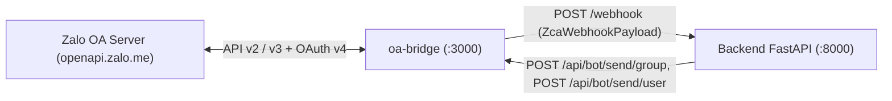

# Kiểm Thử Postman: Cầu Nối Zalo Official Account (oa-bridge)

## 1. Mục đích
Tài liệu hướng dẫn kiểm thử các API của cầu nối Zalo Official Account (`oa-bridge`) phục vụ tương tác hai chiều với lõi Backend VSICO qua Postman (nhóm chat GMF, chat 1-1, người theo dõi và webhook).



---

## 2. Biến Môi Trường Postman (VSICO-OA-Bridge-Env)

| Tên biến | Giá trị mẫu | Mô tả |
| :--- | :--- | :--- |
| `oaUrl` | `http://localhost:3000` | Địa chỉ máy chủ `oa-bridge` |
| `groupId` | `gmf_group_01` | Mã nhóm GMF hoặc hội thoại direct |
| `userId` | `oa_user_01` | Mã người dùng OA |

---

## 3. Danh Mục Yêu Cầu Kiểm Thử Postman

### Kịch Bản 1: Kiểm tra trạng thái và kết nối Zalo OA
- **Method**: `GET`
- **URL**: `{{oaUrl}}/api/bot/status` *(hoặc `{{oaUrl}}/health`, `{{oaUrl}}/api/oa/test-connection`)*
- **Headers / Bảo mật**:
  - `Accept: application/json`
- **Params / Body**: Không có
- **Kết quả mong đợi**: HTTP `200 OK`
```json
{
  "ok": true,
  "bridge": "oa-bridge",
  "oa_info": {
    "oa_id": "2165428700360434674",
    "name": "VSICO Logistics",
    "is_verified": true,
    "package_name": "Premium"
  }
}
```

---

### Kịch Bản 2: Lấy danh sách nhóm GMF và hội thoại
- **Method**: `GET`
- **URL**: `{{oaUrl}}/api/bot/groups?count=20&offset=0`
- **Headers / Bảo mật**:
  - `Accept: application/json`
- **Params / Query**:
  - `count`: `20`
  - `offset`: `0`
  - `includeDirect`: `false` *(tùy chọn, chỉ lấy nhóm GMF, bỏ qua hội thoại 1-1)*
- **Kết quả mong đợi**: HTTP `200 OK`
```json
{
  "ok": true,
  "total": 5,
  "groupIds": ["gmf_group_01", "gmf_group_02"],
  "groups": [
    {
      "group_id": "gmf_group_01",
      "name": "Nhom Dieu Van VSICO",
      "type": "gmf",
      "total_member": 12,
      "status": 1
    }
  ]
}
```

---

### Kịch Bản 3: Lấy chi tiết nhóm GMF và danh sách thành viên
- **Method**: `GET`
- **URL**: `{{oaUrl}}/api/bot/groups/{{groupId}}/info`
- **Headers / Bảo mật**:
  - `Accept: application/json`
- **Params / Body**: Không có
- **Kết quả mong đợi**: HTTP `200 OK`
```json
{
  "ok": true,
  "type": "gmf",
  "group": {
    "group_id": "gmf_group_01",
    "group_info": {
      "name": "Nhom Dieu Van VSICO",
      "total_member": 12
    }
  },
  "members": [
    {
      "user_id": "oa_user_01",
      "display_name": "Nguyen Van A"
    }
  ]
}
```

---

### Kịch Bản 3b: Lấy danh sách thành viên phân trang theo Group ID
- **Method**: `GET`
- **URL**: `{{oaUrl}}/api/bot/groups/{{groupId}}/members?offset=0&count=50`
- **Headers / Bảo mật**:
  - `Accept: application/json`
- **Params / Query**:
  - `offset`: `0`
  - `count`: `50`
- **Kết quả mong đợi**: HTTP `200 OK`
```json
{
  "ok": true,
  "groupId": "gmf_group_01",
  "type": "gmf",
  "total": 12,
  "offset": 0,
  "count": 50,
  "members": [
    {
      "user_id": "oa_user_01",
      "display_name": "Nguyen Van A",
      "avatar": "https://..."
    }
  ]
}
```

---

### Kịch Bản 4: Lấy danh sách người theo dõi OA
- **Method**: `GET`
- **URL**: `{{oaUrl}}/api/bot/users?count=50&offset=0`
- **Headers / Bảo mật**:
  - `Accept: application/json`
- **Params / Query**:
  - `count`: `50`
  - `offset`: `0`
- **Kết quả mong đợi**: HTTP `200 OK`
```json
{
  "ok": true,
  "total": 20,
  "userIds": ["oa_user_01", "oa_user_02"],
  "users": [
    {
      "user_id": "oa_user_01",
      "display_name": "Nguyen Van A"
    }
  ]
}
```

---

### Kịch Bản 5: Lấy hồ sơ chi tiết một người dùng OA
- **Method**: `GET`
- **URL**: `{{oaUrl}}/api/bot/users/{{userId}}`
- **Headers / Bảo mật**:
  - `Accept: application/json`
- **Params / Body**: Không có
- **Kết quả mong đợi**: HTTP `200 OK`
```json
{
  "ok": true,
  "user": {
    "user_id": "oa_user_01",
    "display_name": "Nguyen Van A",
    "avatar": "https://...",
    "user_gender": 1
  }
}
```

---

### Kịch Bản 6: Lấy tất cả tin nhắn trong nhóm
- **Method**: `GET`
- **URL**: `{{oaUrl}}/api/bot/groups/{{groupId}}/messages?count=20&offset=0`
- **Headers / Bảo mật**:
  - `Accept: application/json`
- **Params / Query**:
  - `count`: `20`
  - `offset`: `0`
- **Kết quả mong đợi**: HTTP `200 OK`
```json
{
  "ok": true,
  "messages": [
    {
      "msg_id": "msg_001",
      "src": 1,
      "from_id": "oa_user_01",
      "message": "Bao xe 29C-445.41",
      "timestamp": "1731470000000"
    }
  ]
}
```

---

### Kịch Bản 7: Lọc tin nhắn của một user trong nhóm
- **Method**: `GET`
- **URL**: `{{oaUrl}}/api/bot/groups/{{groupId}}/users/{{userId}}/messages?count=20&offset=0`
- **Headers / Bảo mật**:
  - `Accept: application/json`
- **Params / Query**:
  - `count`: `20`
  - `offset`: `0`
- **Kết quả mong đợi**: HTTP `200 OK`
```json
{
  "ok": true,
  "messages": [
    {
      "msg_id": "msg_001",
      "from_id": "oa_user_01",
      "message": "Bao xe 29C-445.41",
      "timestamp": "1731470000000"
    }
  ]
}
```

---

### Kịch Bản 8: Gửi tin nhắn trực tiếp tới userId
- **Method**: `POST`
- **URL**: `{{oaUrl}}/api/bot/send/user`
- **Headers / Bảo mật**:
  - `Content-Type: application/json; charset=utf-8`
- **Params / Body (raw - JSON)**:
```json
{
  "userId": "{{userId}}",
  "message": "VSICO OA Bridge: Kiem tra gui tin nhan 1-1 thanh cong."
}
```
- **Kết quả mong đợi**: HTTP `200 OK`
```json
{
  "ok": true,
  "result": {
    "message": {
      "msgId": "oa_msg_id_12345"
    }
  }
}
```

---

### Kịch Bản 9: Gửi tin nhắn vào nhóm GMF
- **Method**: `POST`
- **URL**: `{{oaUrl}}/api/bot/send/group`
- **Headers / Bảo mật**:
  - `Content-Type: application/json; charset=utf-8`
- **Params / Body (raw - JSON)**:
```json
{
  "groupId": "{{groupId}}",
  "message": "VSICO OA Bridge: Kiem tra gui tin nhan nhom GMF thanh cong."
}
```
- **Kết quả mong đợi**: HTTP `200 OK`
```json
{
  "ok": true,
  "result": {
    "message": {
      "msgId": "oa_msg_id_67890"
    }
  }
}
```

---

### Kịch Bản 10: Quản lý bộ nhớ đệm Realtime

#### 10.1. Lấy tin nhắn nhận qua Webhook gần nhất
- **Method**: `GET`
- **URL**: `{{oaUrl}}/api/bot/realtime/messages?limit=20`
- **Headers / Bảo mật**:
  - `Accept: application/json`
- **Params / Query**:
  - `limit`: `20`
- **Kết quả mong đợi**: HTTP `200 OK`
```json
{
  "ok": true,
  "count": 1,
  "messages": [
    {
      "msg_id": "test_oa_msg_001",
      "sender_id": "oa_user_01",
      "group_id": "gmf_group_01",
      "message": "Xe 29C-445.41 cont MSKU9070323 tai xe Hung 0903123459"
    }
  ]
}
```

#### 10.2. Xóa bộ nhớ đệm Realtime
- **Method**: `POST`
- **URL**: `{{oaUrl}}/api/bot/realtime/clear`
- **Headers / Bảo mật**:
  - `Content-Type: application/json`
- **Params / Body**: Không có
- **Kết quả mong đợi**: HTTP `200 OK`
```json
{
  "ok": true,
  "cleared": true
}
```

---

### Kịch Bản 11: Mô phỏng Webhook Zalo OA (Forward sang Backend)
- **Method**: `POST`
- **URL**: `{{oaUrl}}/webhook/zalo-oa`
- **Headers / Bảo mật**:
  - `Content-Type: application/json; charset=utf-8`
  - `X-ZEvent-Signature: <chuoi_chu_ky_sha256>` *(nếu ZALO_OA_VERIFY_SIGNATURE=true)*
- **Params / Body (raw - JSON)**:
```json
{
  "app_id": "2165428700360434674",
  "event_name": "user_send_text",
  "sender": {
    "id": "{{userId}}"
  },
  "recipient": {
    "group_id": "{{groupId}}"
  },
  "message": {
    "msg_id": "test_oa_msg_001",
    "text": "Xe 29C-445.41 cont MSKU9070323 tai xe Hung 0903123459"
  },
  "timestamp": "1731470000000"
}
```
- **Kết quả mong đợi**: HTTP `200 OK`, `oa-bridge` phản hồi thành công và tự động chuyển tiếp dữ liệu tới `POST http://localhost:8000/webhook`.
```json
{
  "ok": true
}
```
