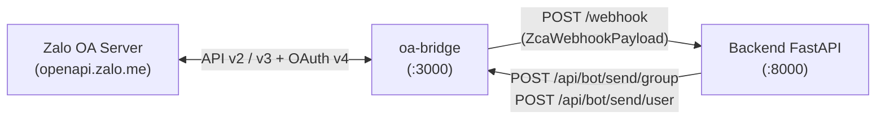

# PHẦN 11: BỘ KIỂM THỬ POSTMAN & CURL — CẦU NỐI ZALO OFFICIAL ACCOUNT (`oa-bridge`)

### HỆ THỐNG VSICO ZALO BOT (`oa-bridge` HTTP Server - Port 3000)

Tài liệu này hướng dẫn kiểm thử toàn bộ các API của cầu nối **Zalo Official Account (`oa-bridge`)** tương thích với lõi Backend VSICO (bao gồm nhóm chat **GMF**, chat **1-1**, quản lý người theo dõi và tiếp nhận **Webhook Zalo OA**):

1. **Kiểm tra sức khỏe & kết nối Zalo OA** (`GET /health`, `GET /api/bot/status`, `GET /api/oa/test-connection`).
2. **Quản lý nhóm GMF & hội thoại** (`GET /api/bot/groups`, `GET /api/bot/groups/:groupId/info`, `GET /api/bot/groups/:groupId/members`).
3. **Quản lý người theo dõi OA** (`GET /api/bot/users`, `GET /api/bot/users/:userId`).
4. **Truy vấn lịch sử tin nhắn** (`GET /api/bot/groups/:groupId/messages`, `GET /api/bot/groups/:groupId/users/:userId/messages`).
5. **Gửi tin nhắn Outbound** (`POST /api/bot/send/user`, `POST /api/bot/send/group`).
6. **Bộ nhớ đệm Realtime & Webhook OA** (`GET /api/bot/realtime/messages`, `POST /api/bot/realtime/clear`, `POST /webhook/zalo-oa`).



---

## 1. Khởi Động Máy Chủ `oa-bridge`

Lưu ý tắt `zca-js` nếu đang chạy cùng cổng `3000` (hoặc cấu hình `OA_BRIDGE_PORT` riêng trong `.env`).

1. Kiểm tra kết nối nhanh tới Zalo OA từ CLI:

```bash
cd oa-bridge
npm run test-oa
```

2. Khởi động máy chủ HTTP `oa-bridge`:

```bash
cd oa-bridge
npm start
```

---

## 2. Thiết Lập Biến Môi Trường Postman (`VSICO-OA-Bridge-Env`)

| Biến (Variable) | Giá trị mặc định (Local) | Mô tả |
| :--- | :--- | :--- |
| `oaUrl` | `http://localhost:3000` | Địa chỉ máy chủ `oa-bridge` |
| `groupId` | `<group_id_gmf_hoac_direct_user>` | Mã nhóm GMF (lấy từ bước `GET /api/bot/groups`) |
| `userId` | `<oa_user_id>` | Mã người dùng OA (lấy từ `GET /api/bot/users` hoặc `info` nhóm) |

Header chung cho các request `POST`: `Content-Type: application/json; charset=utf-8`.

---

## 3. Danh Mục Chi Tiết Các Kịch Bản Kiểm Thử

### Kịch Bản 1: Kiểm Tra Trạng Thái & Kết Nối Zalo OA (`check health`)

* **Method**: `GET`
* **URL**: `{{oaUrl}}/api/bot/status` (hoặc `{{oaUrl}}/health`, `{{oaUrl}}/api/oa/test-connection`)
* **cURL**:

```bash
curl -s "http://localhost:3000/api/bot/status"
```

* **Kết quả mong đợi (`200 OK`)**: `ok = true`, `bridge = "oa-bridge"`, `oa_info` trả về `oa_id`, `name`, `is_verified = true`, `package_name`.

---

### Kịch Bản 2: Lấy Danh Sách Nhóm GMF & Hội Thoại (`get all group id`)

* **Method**: `GET`
* **URL**: `{{oaUrl}}/api/bot/groups?count=20&offset=0`
* **Ghi chú**: Truyền thêm `includeDirect=false` nếu chỉ muốn lấy nhóm GMF, bỏ qua hội thoại 1-1.
* **cURL**:

```bash
curl -s "http://localhost:3000/api/bot/groups?count=20&offset=0"
```

* **Kết quả mong đợi (`200 OK`)**: Trả về `ok = true`, `total`, mảng `groupIds` và danh sách `groups` (gồm `group_id`, `name`, `type = "gmf"` hoặc `"oa_direct"`, `total_member`, `status`).

---

### Kịch Bản 3: Lấy Chi Tiết Nhóm GMF & Thành Viên (`get detail group`)

* **Method**: `GET`
* **URL**: `{{oaUrl}}/api/bot/groups/{{groupId}}/info`
* **cURL**:

```bash
curl -s "http://localhost:3000/api/bot/groups/<groupId>/info"
```

* **Kết quả mong đợi (`200 OK`)**: Trả về `ok = true`, `type = "gmf"`, đối tượng `group` và danh sách `members` trong nhóm. (Nếu `groupId` dạng `direct_<userId>` sẽ trả về hồ sơ người dùng đó). Nếu Zalo OA chưa cấp quyền API `listmember`, response vẫn trả `group` kèm `membersError` và `totalMembers` lấy từ `group.group_info.total_member`.

---

### Kịch Bản 3b: Lấy Danh Sách Thành Viên Theo Group ID (`get members by group id`)

* **Method**: `GET`
* **URL**: `{{oaUrl}}/api/bot/groups/{{groupId}}/members?offset=0&count=50`
* **Query Params**:
  * `offset`: vị trí bắt đầu (mặc định `0`).
  * `count`: số lượng thành viên mỗi trang (từ `1` đến `50`, mặc định `50`).
* **cURL**:

```bash
curl -s "http://localhost:3000/api/bot/groups/<groupId>/members?offset=0&count=50"
```

* **Kết quả mong đợi (`200 OK`)**: Trả về `ok = true`, `groupId`, `type = "gmf"`, `total`, `offset`, `count` và mảng `members` chứa chi tiết từng thành viên trong nhóm. (Nếu `groupId` dạng `direct_<userId>` sẽ trả về `members` gồm 1 phần tử hồ sơ user đó).
* **Lưu ý lỗi phân quyền (`502 Bad Gateway`)**: Nếu Zalo OA trả `{"ok": false, "error": "App has not registed this api"}`, cần vào Zalo Developers Portal bật/đăng ký quyền API GMF `v3.0/oa/group/listmember` cho App & OA.

---

### Kịch Bản 4: Lấy Danh Sách Người Theo Dõi OA (`get all user`)

* **Method**: `GET`
* **URL**: `{{oaUrl}}/api/bot/users?count=50&offset=0`
* **cURL**:

```bash
curl -s "http://localhost:3000/api/bot/users?count=50&offset=0"
```

* **Kết quả mong đợi (`200 OK`)**: Trả về `ok = true`, `total`, `userIds` và `users` (danh sách người dùng đang quan tâm OA).

---

### Kịch Bản 5: Lấy Hồ Sơ Chi Tiết Một Người Dùng OA

* **Method**: `GET`
* **URL**: `{{oaUrl}}/api/bot/users/{{userId}}`
* **cURL**:

```bash
curl -s "http://localhost:3000/api/bot/users/<userId>"
```

* **Kết quả mong đợi (`200 OK`)**: Trả về `ok = true` và đối tượng `user` (`user_id`, `display_name`, `avatar`, ...).

---

### Kịch Bản 6: Lấy Tất Cả Tin Nhắn Trong Nhóm (`get all message in group id`)

* **Method**: `GET`
* **URL**: `{{oaUrl}}/api/bot/groups/{{groupId}}/messages?count=20&offset=0`
* **cURL**:

```bash
curl -s "http://localhost:3000/api/bot/groups/<groupId>/messages?count=20&offset=0"
```

* **Kết quả mong đợi (`200 OK`)**: Trả về `ok = true`, `messages` chứa các tin nhắn gần nhất trong nhóm GMF (hoặc hội thoại 1-1). Nếu API lịch sử bị giới hạn sẽ fallback sang `realtimeFallback`.

---

### Kịch Bản 7: Lọc Tin Nhắn Của Một User Trong Nhóm (`message by user in group id`)

* **Method**: `GET`
* **URL**: `{{oaUrl}}/api/bot/groups/{{groupId}}/users/{{userId}}/messages?count=20&offset=0`
* **cURL**:

```bash
curl -s "http://localhost:3000/api/bot/groups/<groupId>/users/<userId>/messages?count=20&offset=0"
```

* **Kết quả mong đợi (`200 OK`)**: Trả về `ok = true`, `messages` chỉ gồm các tin nhắn có `from_id` / `sender_id` khớp `userId`.

---

### Kịch Bản 8: Gửi Tin Nhắn Trực Tiếp Tới `userId` (`send user id`)

* **Method**: `POST`
* **URL**: `{{oaUrl}}/api/bot/send/user`
* **Body (JSON)**:

```json
{
  "userId": "<userId>",
  "message": "VSICO OA Bridge: Kiem tra gui tin nhan 1-1 thanh cong."
}
```

* **cURL**:

```bash
curl -s -X POST "http://localhost:3000/api/bot/send/user" \
  -H "Content-Type: application/json; charset=utf-8" \
  -d '{
    "userId": "<userId>",
    "message": "VSICO OA Bridge: Kiem tra gui tin nhan 1-1 thanh cong."
  }'
```

* **Kết quả mong đợi (`200 OK`)**: `ok = true`, `result.message.msgId` trả về mã tin nhắn từ Zalo OA.

---

### Kịch Bản 9: Gửi Tin Nhắn Vào Nhóm GMF (`send group id`)

* **Method**: `POST`
* **URL**: `{{oaUrl}}/api/bot/send/group`
* **Body (JSON)**:

```json
{
  "groupId": "<groupId>",
  "message": "VSICO OA Bridge: Kiem tra gui tin nhan nhom GMF thanh cong."
}
```

* **cURL**:

```bash
curl -s -X POST "http://localhost:3000/api/bot/send/group" \
  -H "Content-Type: application/json; charset=utf-8" \
  -d '{
    "groupId": "<groupId>",
    "message": "VSICO OA Bridge: Kiem tra gui tin nhan nhom GMF thanh cong."
  }'
```

* **Kết quả mong đợi (`200 OK`)**: `ok = true`, `result.message.msgId` trả về mã tin nhắn đã gửi vào nhóm GMF (hoặc gửi 1-1 nếu `groupId` dạng `direct_<userId>`).

---

### Kịch Bản 10: Kiểm Tra & Dọn Bộ Nhớ Đệm Realtime

* **Lấy tin nhắn vừa nhận qua Webhook**:

```bash
curl -s "http://localhost:3000/api/bot/realtime/messages?limit=20"
```

* **Xóa bộ nhớ đệm Realtime**:

```bash
curl -s -X POST "http://localhost:3000/api/bot/realtime/clear"
```

---

### Kịch Bản 11: Mô Phỏng Webhook Zalo OA (`POST /webhook/zalo-oa`)

Khi kiểm thử nội bộ tại máy chưa mở HTTPS tunnel, tạm đặt `ZALO_OA_VERIFY_SIGNATURE=false` trong `.env` và khởi động Backend ở cổng `8000`, sau đó gửi sự kiện mẫu:

```bash
curl -s -X POST "http://localhost:3000/webhook/zalo-oa" \
  -H "Content-Type: application/json; charset=utf-8" \
  -d '{
    "app_id": "2165428700360434674",
    "event_name": "user_send_text",
    "sender": { "id": "<userId>" },
    "recipient": { "group_id": "<groupId>" },
    "message": {
      "msg_id": "test_oa_msg_001",
      "text": "Xe 29C-445.41 cont MSKU9070323 tai xe Hung 0903123459"
    },
    "timestamp": "1731470000000"
  }'
```

* **Kết quả mong đợi**: `oa-bridge` trả `200 OK` (`{"ok": true}`), lưu vào cache `/api/bot/realtime/messages` và forward thành công sang `POST http://localhost:8000/webhook`.
* **Lưu ý**: Bật lại `ZALO_OA_VERIFY_SIGNATURE=true` và điền `ZALO_OA_SECRET_KEY` trước khi chạy thật với Zalo Developers.

---

## 4. Danh Mục Nghiệm Thu

* [ ] Đã kiểm tra `npm run test-oa` và `GET /api/bot/status` trả về `ok = true` với đúng `oa_id`.
* [ ] Đã kiểm tra `GET /api/bot/groups`, `GET /api/bot/groups/:groupId/info` và `GET /api/bot/groups/:groupId/members` lấy chi tiết nhóm GMF & thành viên.
* [ ] Đã kiểm tra `GET /api/bot/users` và `GET /api/bot/groups/:groupId/messages`.
* [ ] Đã kiểm tra `POST /api/bot/send/user` và `POST /api/bot/send/group` gửi tin nhắn thành công ra Zalo thật.
* [ ] Đã kiểm tra `POST /webhook/zalo-oa` forward tin nhắn sang Backend `POST /webhook`.
