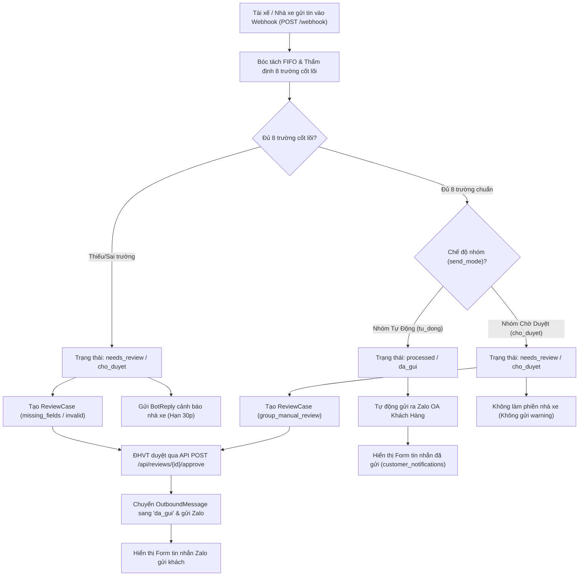

# 🚀 TÀI LIỆU KIỂM THỬ POSTMAN & CURL: QUY TRÌNH DUYỆT ĐHVT, CHẾ ĐỘ NHÓM VÀ HIỂN THỊ FORM GỬI ZALO

Tài liệu này cung cấp bộ kịch bản kiểm thử toàn diện thông qua **Postman** và **cURL** cho tính năng:
1. **Gửi tin nhắn bóc tách**: Kiểm tra thẩm định 8 trường cốt lõi (*Khách hàng, Lệnh, Xe, Tài xế, SĐT, Cont, Size, Chì*).
2. **Chế độ phát hành của Nhóm (`send_mode`)**:
   - `tu_dong`: Tin chuẩn $\rightarrow$ Tự động gửi thẳng ra nhóm Zalo khách hàng (*Không cần ĐHVT duyệt*).
   - `cho_duyet`: Kể cả tin nhắn chuẩn 100% $\rightarrow$ Vẫn chuyển vào danh sách chờ duyệt để Điều độ vận tải (ĐHVT) duyệt trước.
3. **Thao tác Phê duyệt của ĐHVT**: Gọi API Duyệt $\rightarrow$ Kích hoạt gửi tin ra Zalo.
4. **Hiển thị Form tin nhắn kết quả gửi đi**: Xem trực tiếp mẫu form điều xe chuẩn gửi cho khách hàng và tin cảnh báo nhắc lỗi nhà xe.

---

## 🗺️ Sơ đồ Luồng Nghiệp Vụ (Workflow Diagram)



---

## ⚙️ Cấu hình Môi trường Postman (Environment Variables)

| Tên biến | Giá trị mẫu | Mô tả |
|---|---|---|
| `baseUrl` | `http://localhost:8000` | Địa chỉ Backend FastAPI TMS VSICO |
| `carrierGroupId` | `grp_postman_carrier_01` | Nhóm Zalo nhà xe gửi tin báo |
| `destGroupId` | `6469608867469758994` | Nhóm Zalo nhận tin thông báo khách hàng |
| `operatorName` | `NguyenVanBao_DVDH` | Tên Điều độ viên thực hiện phê duyệt |

---

## 📋 Danh sách API Endpoint Sử Dụng Trong Quy Trình

| STT | Phương thức | Đường dẫn API | Mục đích |
|---|---|---|---|
| 1 | `GET` | `/api/groups` | Kiểm tra và lấy danh sách nhóm Zalo kèm `send_mode` |
| 2 | `PUT` | `/api/groups/{id}/send-mode` | Chuyển đổi trạng thái nhóm (`tu_dong` $\leftrightarrow$ `cho_duyet`) |
| 3 | `POST` | `/webhook` | Tiếp nhận tin nhắn nhà xe, bóc tách FIFO và phân luồng |
| 4 | `GET` | `/api/reviews?status=pending` | Tra cứu danh sách các ca đang chờ ĐHVT duyệt |
| 5 | `POST` | `/api/reviews/{id}/approve` | ĐHVT phê duyệt ca rà soát $\rightarrow$ Tự động phát hành tin ra Zalo |
| 6 | `GET` | `/api/outbound/messages/{id}` | Lấy chi tiết bản ghi kết quả gửi tin và Form tin nhắn Zalo |
| 7 | `GET` | `/api/messages/detail/{id}` | Lấy chi tiết toàn trình tin nhắn gốc và các thông báo sinh ra |

---

## 🧪 KỊCH BẢN 1: NHÓM TỰ ĐỘNG (`tu_dong`) — TIN NHẮN CHUẨN GỬI THẲNG ZALO

> [!NOTE]
> Trong kịch bản này, nhóm đích/nguồn đang ở chế độ **Tự động**. Nhà xe gửi tin nhắn có đầy đủ 8 trường cốt lõi. Hệ thống tự động thẩm định hợp lệ, tự động gửi tin ra Zalo khách hàng mà **không cần ĐHVT can thiệp**.

### Bước 1.1: Đảm bảo nhóm ở chế độ Tự động (`send_mode = 'tu_dong'`)

- **Method**: `PUT`
- **URL**: `{{baseUrl}}/api/groups/1/send-mode` (hoặc ID nhóm kiểm thử của bạn)
- **Headers**:
  ```http
  Content-Type: application/json
  ```
- **Body (JSON)**:
  ```json
  {
    "send_mode": "tu_dong"
  }
  ```

#### cURL Lệnh mẫu:
```bash
curl -X PUT "http://localhost:8000/api/groups/1/send-mode" \
  -H "Content-Type: application/json" \
  -d '{"send_mode": "tu_dong"}'
```

#### Phản hồi mẫu (200 OK):
```json
{
  "ok": true,
  "message": "Đã chuyển trạng thái nhóm 'Nhóm Khách Hàng VSICO' sang 'Tự động'.",
  "group_id": 1,
  "zalo_group_id": "6469608867469758994",
  "send_mode": "tu_dong",
  "send_mode_label": "Tự động"
}
```

---

### Bước 1.2: Nhà xe gửi tin nhắn chuẩn 8 trường vào Webhook

- **Method**: `POST`
- **URL**: `{{baseUrl}}/webhook`
- **Headers**:
  ```http
  Content-Type: application/json; charset=utf-8
  ```
- **Body (JSON)**:
  ```json
  {
    "app_id": "zca_personal_bot",
    "event_name": "user_send_text",
    "group_id": "6469608867469758994",
    "sender": {
      "id": "driver_haiphong_01",
      "name": "Lái xe Vũ Tiến Đạt"
    },
    "timestamp": "1791798030000",
    "message": {
      "msg_id": "postman_auto_valid_001",
      "text": "Lệnh đóng hàng - KH: Logitem - Điểm đóng: Kho Logitem Tân Quang - 8h\n1 xe: 15C-878.99 / Vũ Tiến Đạt / 0903976359 / VSIU7399796 / 40HC / chì 73957169"
    }
  }
  ```

#### cURL Lệnh mẫu:
```bash
curl -X POST "http://localhost:8000/webhook" \
  -H "Content-Type: application/json" \
  -d '{
    "app_id": "zca_personal_bot",
    "event_name": "user_send_text",
    "group_id": "6469608867469758994",
    "sender": {"id": "driver_haiphong_01", "name": "Lái xe Vũ Tiến Đạt"},
    "timestamp": "1791798030000",
    "message": {
      "msg_id": "postman_auto_valid_001",
      "text": "Lệnh đóng hàng - KH: Logitem - Điểm đóng: Kho Logitem Tân Quang - 8h\n1 xe: 15C-878.99 / Vũ Tiến Đạt / 0903976359 / VSIU7399796 / 40HC / chì 73957169"
    }
  }'
```

#### Phản hồi mẫu (200 OK — Tự động gửi ngay):
```json
{
  "ok": true,
  "status": "ENQUEUED_AND_PROCESSED_FIFO",
  "record_id": 105,
  "zalo_message_id": "postman_auto_valid_001",
  "processing_status": "processed",
  "trucks_count": 1,
  "containers_count": 1,
  "data": {
    "id": 105,
    "action": "PROCESSED_FIFO",
    "processing_status": "processed",
    "total_vehicles": 1,
    "reply_to_carrier": null,
    "customer_notifications": [
      {
        "target_group_id": "6469608867469758994",
        "message_text": "VSICO - THÔNG BÁO XE ĐÓNG HÀNG\nKhách hàng: Logitem\n\n- Số cont: VSIU7399796 (40)\n- Số chì: 73957169\n- Biển số xe: 15C-878.99\n- Lái xe: Vũ Tiến Đạt - SĐT: 0903976359\n- Điểm đóng: Kho Logitem Tân Quang\n- Giờ đến dự kiến: 8h\n",
        "cont": "VSIU7399796",
        "shipping_id": "SHP-001"
      }
    ]
  }
}
```

### 📱 FORM KẾT QUẢ HIỂN THỊ GỬI VÀO NHÓM ZALO KHÁCH HÀNG:
```text
VSICO - THÔNG BÁO XE ĐÓNG HÀNG
Khách hàng: Logitem

- Số cont: VSIU7399796 (40)
- Số chì: 73957169
- Biển số xe: 15C-878.99
- Lái xe: Vũ Tiến Đạt - SĐT: 0903976359
- Điểm đóng: Kho Logitem Tân Quang
- Giờ đến dự kiến: 8h
```

#### Postman Test Script tự động kiểm tra:
```javascript
pm.test("Trạng thái xử lý phải là processed (Tự động thành công)", function () {
    pm.response.to.have.status(200);
    const json = pm.response.json();
    pm.expect(json.processing_status).to.eql("processed");
    pm.expect(json.data.customer_notifications.length).to.be.above(0);
    pm.expect(json.data.reply_to_carrier).to.be.null;
    
    // Lưu lại ID tin nhắn
    pm.environment.set("lastMessageId", json.record_id);
    
    // Kiểm tra nội dung Form gửi Zalo
    const formText = json.data.customer_notifications[0].message_text;
    pm.expect(formText).to.include("THÔNG BÁO XE ĐÓNG HÀNG");
    pm.expect(formText).to.include("VSIU7399796");
    pm.expect(formText).to.include("0903976359");
});
```

---

## 🧪 KỊCH BẢN 2: NHÓM CHỜ DUYỆT (`cho_duyet`) — TIN CHUẨN VẪN PHẢI CHỜ ĐHVT DUYỆT RỒI MỚI GỬI ZALO

> [!IMPORTANT]
> Đây là yêu cầu trọng tâm: Khi nhóm ở chế độ **`cho_duyet`**, kể cả tin nhắn của nhà xe có **thỏa mãn 100% đầy đủ 8 trường cốt lõi**, hệ thống **VẪN KHÔNG TỰ ĐỘNG GỬI** mà bắt buộc đưa vào danh sách chờ duyệt. Sau khi ĐHVT bấm Duyệt, tin mới gửi ra Zalo và hiển thị Form kết quả.

### Bước 2.1: Chuyển nhóm sang chế độ Chờ duyệt (`send_mode = 'cho_duyet'`)

- **Method**: `PUT`
- **URL**: `{{baseUrl}}/api/groups/1/send-mode`
- **Body (JSON)**:
  ```json
  {
    "send_mode": "cho_duyet"
  }
  ```

#### cURL Lệnh mẫu:
```bash
curl -X PUT "http://localhost:8000/api/groups/1/send-mode" \
  -H "Content-Type: application/json" \
  -d '{"send_mode": "cho_duyet"}'
```

#### Phản hồi mẫu (200 OK):
```json
{
  "ok": true,
  "message": "Đã chuyển trạng thái nhóm 'Nhóm Khách Hàng VSICO' sang 'Chờ duyệt'.",
  "group_id": 1,
  "zalo_group_id": "6469608867469758994",
  "send_mode": "cho_duyet",
  "send_mode_label": "Chờ duyệt"
}
```

---

### Bước 2.2: Nhà xe gửi tin nhắn chuẩn 100% vào Webhook

- **Method**: `POST`
- **URL**: `{{baseUrl}}/webhook`
- **Body (JSON)**:
  ```json
  {
    "app_id": "zca_personal_bot",
    "event_name": "user_send_text",
    "group_id": "6469608867469758994",
    "sender": {
      "id": "driver_nam_02",
      "name": "Lái xe Lê Hoàng Nam"
    },
    "timestamp": "1791798040000",
    "message": {
      "msg_id": "postman_manual_valid_002",
      "text": "Lệnh trả hàng - KH: Logitem - Điểm trả: Depot Tân Vũ\n1 xe: 29C-556.88 / Lê Hoàng Nam / 0988112233 / MSCU5285725 / 20DC / chì 52851122"
    }
  }
  ```

#### cURL Lệnh mẫu:
```bash
curl -X POST "http://localhost:8000/webhook" \
  -H "Content-Type: application/json" \
  -d '{
    "app_id": "zca_personal_bot",
    "event_name": "user_send_text",
    "group_id": "6469608867469758994",
    "sender": {"id": "driver_nam_02", "name": "Lái xe Lê Hoàng Nam"},
    "timestamp": "1791798040000",
    "message": {
      "msg_id": "postman_manual_valid_002",
      "text": "Lệnh trả hàng - KH: Logitem - Điểm trả: Depot Tân Vũ\n1 xe: 29C-556.88 / Lê Hoàng Nam / 0988112233 / MSCU5285725 / 20DC / chì 52851122"
    }
  }'
```

#### Phản hồi mẫu (200 OK — Đưa vào Chờ duyệt, KHÔNG gửi khách ngay):
```json
{
  "ok": true,
  "status": "ENQUEUED_AND_PROCESSED_FIFO",
  "record_id": 106,
  "zalo_message_id": "postman_manual_valid_002",
  "processing_status": "needs_review",
  "trucks_count": 1,
  "containers_count": 1,
  "data": {
    "id": 106,
    "action": "PROCESSED_FIFO",
    "processing_status": "needs_review",
    "total_vehicles": 1,
    "reply_to_carrier": null,
    "customer_notifications": []
  }
}
```

> [!TIP]
> Lưu ý ở phản hồi trên:
> - `processing_status` là `"needs_review"`.
> - `customer_notifications` là mảng rỗng `[]` (chưa gửi ra Zalo khách).
> - `reply_to_carrier` là `null` (không làm phiền tài xế vì dữ liệu đã chuẩn).

---

### Bước 2.3: ĐHVT tra cứu danh sách các ca chờ duyệt (`GET /api/reviews`)

- **Method**: `GET`
- **URL**: `{{baseUrl}}/api/reviews?status=pending&limit=5`

#### cURL Lệnh mẫu:
```bash
curl -X GET "http://localhost:8000/api/reviews?status=pending&limit=5" \
  -H "Accept: application/json"
```

#### Phản hồi mẫu (200 OK):
```json
{
  "ok": true,
  "status": "OK",
  "total": 1,
  "reviews": [
    {
      "id": 48,
      "message_id": 106,
      "container_job_id": 112,
      "case_type": "group_manual_review",
      "reason": "Nhóm 'Nhóm Khách Hàng VSICO' ở chế độ Chờ duyệt (Cần ĐHVT duyệt trước khi gửi khách)",
      "status": "pending",
      "details": {
        "container_no": "MSCU5285725",
        "truck_plate": "29C-556.88",
        "driver_name": "Lê Hoàng Nam",
        "driver_phone": "0988112233",
        "seal_no": "52851122",
        "order_type": "tra"
      }
    }
  ]
}
```

---

### Bước 2.4: ĐHVT Phê duyệt ca rà soát (`POST /api/reviews/{id}/approve`)

- **Method**: `POST`
- **URL**: `{{baseUrl}}/api/reviews/48/approve` (thay `48` bằng ID ca vừa lấy được)
- **Headers**:
  ```http
  Accept: application/json
  ```

#### cURL Lệnh mẫu:
```bash
curl -X POST "http://localhost:8000/api/reviews/48/approve" \
  -H "Accept: application/json"
```

#### Phản hồi mẫu (200 OK):
```json
{
  "ok": true,
  "status": "APPROVED",
  "review_id": 48,
  "message": "Đã phê duyệt thành công ca rà soát ID=48."
}
```

---

### Bước 2.5: Kiểm tra và Hiển thị Form tin nhắn Zalo đã phát hành (`GET /api/outbound/messages`)

- **Method**: `GET`
- **URL**: `{{baseUrl}}/api/outbound/messages?status=da_gui&limit=1`

#### cURL Lệnh mẫu:
```bash
curl -X GET "http://localhost:8000/api/outbound/messages?status=da_gui&limit=1" \
  -H "Accept: application/json"
```

#### Phản hồi mẫu (200 OK — Hiển thị Form gửi Zalo thành công):
```json
{
  "ok": true,
  "total": 1,
  "messages": [
    {
      "id": 85,
      "target_group_id": 1,
      "target_group_name": "Nhóm Khách Hàng VSICO",
      "order_type": "tra",
      "message_kind": "initial",
      "content": "VSICO - THÔNG BÁO XE TRẢ HÀNG\nKhách hàng: Logitem\n\n- Số cont: MSCU5285725 (20)\n- Số chì: 52851122\n- Biển số xe: 29C-556.88\n- Lái xe: Lê Hoàng Nam - SĐT: 0988112233\n- Điểm trả: Depot Tân Vũ\n- Giờ đến dự kiến: Chưa có\n",
      "status": "da_gui",
      "approved_by": "admin_reviewer",
      "approved_at": "2026-10-30T09:45:10",
      "sent_at": "2026-10-30T09:45:10",
      "zalo_message_id": "zalo_oa_approved_4d9f1a8c2b7e",
      "containers": [
        {
          "container_no": "MSCU5285725",
          "container_size": "20",
          "truck_plate": "29C-556.88",
          "driver_name": "Lê Hoàng Nam",
          "driver_phone": "0988112233",
          "seal_no": "52851122"
        }
      ]
    }
  ]
}
```

### 📱 FORM KẾT QUẢ GỬI VÀO NHÓM ZALO KHÁCH HÀNG SAU KHI ĐHVT DUYỆT:
```text
VSICO - THÔNG BÁO XE TRẢ HÀNG
Khách hàng: Logitem

- Số cont: MSCU5285725 (20)
- Số chì: 52851122
- Biển số xe: 29C-556.88
- Lái xe: Lê Hoàng Nam - SĐT: 0988112233
- Điểm trả: Depot Tân Vũ
- Giờ đến dự kiến: Chưa có
```

---

## 🧪 KỊCH BẢN 3: TIN THIẾU SỐ CHÌ — CẢNH BÁO NHÀ XE & ĐỢI ĐHVT XỬ LÝ

> [!NOTE]
> Khi tin nhắn thiếu trường cốt lõi (ví dụ: thiếu số chì), dù nhóm đang ở chế độ **Tự động** hay **Chờ duyệt**, hệ thống vẫn phát hiện lỗi, tạo bản ghi `ReviewCase` và tự động gửi Form cảnh báo phản hồi cho nhà xe sửa đổi trong 30 phút.

### Bước 3.1: Gửi tin nhắn THIẾU SỐ CHÌ

- **Method**: `POST`
- **URL**: `{{baseUrl}}/webhook`
- **Body (JSON)**:
  ```json
  {
    "app_id": "zca_personal_bot",
    "event_name": "user_send_text",
    "group_id": "6469608867469758994",
    "sender": {
      "id": "driver_an_03",
      "name": "Tài xế Trần Văn An"
    },
    "timestamp": "1791798050000",
    "message": {
      "msg_id": "postman_missing_seal_003",
      "text": "Lệnh đóng hàng - KH: Logitem - Điểm đóng: Kho Logitem Tân Quang\n1 xe: 15C-444.55 / Trần Văn An / 0988654321 / VSIU2621051 / 40HC"
    }
  }
  ```

#### cURL Lệnh mẫu:
```bash
curl -X POST "http://localhost:8000/webhook" \
  -H "Content-Type: application/json" \
  -d '{
    "app_id": "zca_personal_bot",
    "event_name": "user_send_text",
    "group_id": "6469608867469758994",
    "sender": {"id": "driver_an_03", "name": "Tài xế Trần Văn An"},
    "timestamp": "1791798050000",
    "message": {
      "msg_id": "postman_missing_seal_003",
      "text": "Lệnh đóng hàng - KH: Logitem - Điểm đóng: Kho Logitem Tân Quang\n1 xe: 15C-444.55 / Trần Văn An / 0988654321 / VSIU2621051 / 40HC"
    }
  }'
```

#### Phản hồi mẫu (200 OK — Kèm Form nhắc lỗi nhà xe):
```json
{
  "ok": true,
  "status": "ENQUEUED_AND_PROCESSED_FIFO",
  "record_id": 107,
  "zalo_message_id": "postman_missing_seal_003",
  "processing_status": "needs_review",
  "trucks_count": 1,
  "containers_count": 1,
  "data": {
    "id": 107,
    "action": "PROCESSED_FIFO",
    "processing_status": "needs_review",
    "total_vehicles": 1,
    "customer_notifications": [],
    "reply_to_carrier": "[VSICO Bot] Anh/chị vui lòng kiểm tra và bổ sung lại các thông tin còn thiếu/sai sau:\n- Xe dòng #1: thiếu/sai số chì.\n(Hạn bổ sung thông tin trong vòng 30 phút để bot kịp thời thông báo tới khách hàng)"
  }
}
```

### 📱 FORM TIN NHẮN PHẢN HỒI NHÀ XE:
```text
[VSICO Bot] Anh/chị vui lòng kiểm tra và bổ sung lại các thông tin còn thiếu/sai sau:
- Xe dòng #1: thiếu/sai số chì.
(Hạn bổ sung thông tin trong vòng 30 phút để bot kịp thời thông báo tới khách hàng)
```

---

## 🧪 KỊCH BẢN 4: ĐỔI LÁI XE / SỐ XE $\rightarrow$ HỆ THỐNG TỰ ĐỘNG SINH FORM CẬP NHẬT

> [!TIP]
> Khi cont đã được báo trước đó nhưng nhà xe gửi lại với thay đổi lái xe hoặc số xe, hệ thống phát hiện đây là tin nhắn **CẬP NHẬT (Update)** và sinh Form cập nhật trực quan chỉ rõ thông tin cũ $\rightarrow$ thông tin mới.

### Bước 4.1: Gửi tin nhắn đổi lái xe cho cont `VSIU7399796`

- **Method**: `POST`
- **URL**: `{{baseUrl}}/webhook`
- **Body (JSON)**:
  ```json
  {
    "app_id": "zca_personal_bot",
    "event_name": "user_send_text",
    "group_id": "6469608867469758994",
    "sender": {
      "id": "driver_haiphong_01",
      "name": "Điều vận nhà xe"
    },
    "timestamp": "1791798060000",
    "message": {
      "msg_id": "postman_update_driver_004",
      "text": "Đổi tài xế: Lệnh đóng hàng - KH: Logitem - Điểm đóng: Kho Logitem Tân Quang\n1 xe: 15C-878.99 / Hoàng Văn Bảo đt: 0912888999 / VSIU7399796 / 40HC / chì 73957169"
    }
  }
  ```

#### cURL Lệnh mẫu:
```bash
curl -X POST "http://localhost:8000/webhook" \
  -H "Content-Type: application/json" \
  -d '{
    "app_id": "zca_personal_bot",
    "event_name": "user_send_text",
    "group_id": "6469608867469758994",
    "sender": {"id": "driver_haiphong_01", "name": "Điều vận nhà xe"},
    "timestamp": "1791798060000",
    "message": {
      "msg_id": "postman_update_driver_004",
      "text": "Đổi tài xế: Lệnh đóng hàng - KH: Logitem - Điểm đóng: Kho Logitem Tân Quang\n1 xe: 15C-878.99 / Hoàng Văn Bảo đt: 0912888999 / VSIU7399796 / 40HC / chì 73957169"
    }
  }'
```

### 📱 FORM KẾT QUẢ GỬI RA ZALO CẬP NHẬT THAY ĐỔI XE / TÀI XẾ:
```text
VSICO - CẬP NHẬT THÔNG TIN XE ĐÓNG HÀNG
Khách hàng: Logitem

Kính gửi Quý khách hàng, VSICO xin thông báo cập nhật điều chỉnh thông tin xe vận chuyển như sau:
- Lái xe: Vũ Tiến Đạt -> Hoàng Văn Bảo
- SĐT: 0903976359 -> 0912888999

Thông tin chi tiết chuyến xe sau cập nhật:
- Số cont: VSIU7399796 (40)
- Số chì: 73957169
- Biển số xe: 15C-878.99
- Lái xe: Hoàng Văn Bảo - SĐT: 0912888999
- Điểm đóng: Kho Logitem Tân Quang
- Giờ đến dự kiến: Chưa có
```

---

## 📊 Bảng Đối Chiếu Quy Tắc Thẩm Định & Hành Động Của Hệ Thống

| Trường hợp | Kiểm tra 8 trường | Trạng thái Nhóm (`send_mode`) | Hành động Hệ Thống | Phản hồi Webhook | Gửi ra Zalo OA |
|---|---|---|---|---|---|
| **1. Tin chuẩn vào nhóm Tự động** | Đủ 100% | `tu_dong` | Tự động duyệt | `processing_status = 'processed'`, `customer_notifications` có 1 form | Gửi ngay lập tức |
| **2. Tin chuẩn vào nhóm Chờ duyệt** | Đủ 100% | `cho_duyet` | Tạo `ReviewCase` loại `group_manual_review` | `processing_status = 'needs_review'`, `customer_notifications = []`, không gửi bot reply | Tạm dừng, chờ ĐHVT bấm Approve |
| **3. Tin thiếu/sai trường cốt lõi** | Thiếu cont/chì/xe... | Bất kỳ | Tạo `ReviewCase` loại `missing_fields` + cảnh báo | `processing_status = 'needs_review'`, `reply_to_carrier` có form nhắc lỗi | Chờ nhà xe sửa hoặc ĐHVT xử lý |
| **4. ĐHVT bấm Duyệt qua API** | Đã sửa hoặc chấp nhận | Bất kỳ | Cập nhật `ReviewCase` $\rightarrow$ `approved`, `OutboundMessage` $\rightarrow$ `da_gui` | API trả về `"status": "APPROVED"` | Gửi ngay ra Zalo OA |
