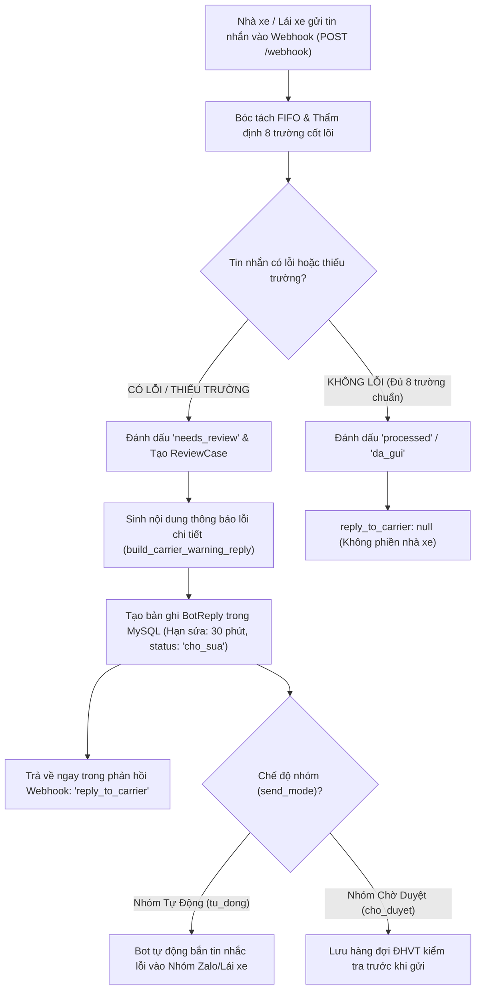

# 📢 TÀI LIỆU KIỂM THỬ POSTMAN & CURL: CƠ CHẾ THÔNG BÁO LỖI VÀ NHẮC NHỞ NHÀ XE (BOT REPLY)

Tài liệu này hướng dẫn chi tiết cách kiểm thử tính năng **Tự động phát hiện lỗi và phản hồi cảnh báo nhà xe/tài xế (`reply_to_carrier` / `BotReply`)** khi tin nhắn báo xe gửi đến bị thiếu hoặc sai dữ liệu theo chuẩn nghiệp vụ của VSICO.

---

## 🗺️ 1. Nguyên Tắc Hoạt Động & Quy Trình Cảnh Báo Lỗi



### Quy tắc thông báo lỗi:
1. **Chỉ nhắc khi có lỗi thực tế**: Nếu tin nhắn đầy đủ 8 trường chuẩn (*Khách hàng, Lệnh, Xe, Tài xế, SĐT, Cont, Size, Chì*), `reply_to_carrier` sẽ là `null`.
2. **Liệt kê cụ thể từng lỗi**:
   - Thiếu chì: `thiếu/sai số chì / seal`.
   - Thiếu kích thước cont: `thiếu/sai kích thước container (size)`.
   - Nhầm biển số moóc: `thiếu biển số xe đầu kéo ('15R-...' là biển số rơ-moóc)`.
   - Sai số kiểm tra ISO 6346: `số container sai số kiểm tra cuối (gợi ý đúng: VSIU...)`.
   - Sai SĐT: `SĐT tài xế không hợp lệ (cần đúng 10 chữ số bắt đầu bằng số 0)`.
3. **Thời hạn bổ sung**: Hệ thống cấp thời hạn 30 phút (`fix_deadline`) để nhà xe gửi tin bổ sung trước khi ĐHVT xử lý thủ công.

---

## ⚙️ 2. Biến Môi Trường Postman (Environment Variables)

| Tên biến | Giá trị đề xuất | Ý nghĩa |
|---|---|---|
| `baseUrl` | `http://localhost:8000` | Địa chỉ Backend TMS VSICO |
| `carrierGroup` | `6469608867469758994` | ID nhóm Zalo nhà xe |
| `senderId` | `6691387223255581446` | ID tài xế / người gửi tin |

---

## 🧪 3. Các Kịch Bản Kiểm Thử Chi Tiết

### 3.1. Kịch bản 1: Nhà xe gửi tin thiếu số Chì/Seal

Khi tin nhắn có đủ biển số, tài xế, SĐT, số cont, size nhưng **quên ghi số chì/seal**:
* Hệ thống chuyển trạng thái `processing_status = "needs_review"`.
* Trả về thông báo nhắc nhà xe bổ sung số chì.

#### 📡 Request cURL:
```bash
curl -X POST "http://localhost:8000/webhook" \
  -H "Content-Type: application/json" \
  -d '{
    "app_id": "zca_personal_bot",
    "event_name": "user_send_text",
    "group_id": "6469608867469758994",
    "sender": {
      "id": "6691387223255581446",
      "name": "Lái xe Hải Long"
    },
    "message": {
      "msg_id": "postman_err_01_missing_seal",
      "text": "Lệnh đóng hàng - KH: Logitem - Điểm đóng: Kho Logitem Tân Quang - 8h\n1 xe: 15C-170.66 / Phạm Văn Huynh 0986713346 / VSIU2621051 / 40HC"
    }
  }'
```

#### 📥 Phản hồi mong đợi (HTTP 200 OK):
```json
{
  "ok": true,
  "status": "ENQUEUED_AND_PROCESSED_FIFO",
  "processing_status": "needs_review",
  "trucks_count": 1,
  "containers_count": 1,
  "reply_to_carrier": "[VSICO Bot] Anh/chị vui lòng kiểm tra và bổ sung lại các thông tin còn thiếu/sai sau:\n- Xe 15C-170.66: thiếu/sai số chì / seal.",
  "data": {
    "processing_status": "needs_review",
    "reply_to_carrier": "[VSICO Bot] Anh/chị vui lòng kiểm tra và bổ sung lại các thông tin còn thiếu/sai sau:\n- Xe 15C-170.66: thiếu/sai số chì / seal.",
    "customer_notifications": []
  }
}
```

---

### 3.2. Kịch bản 2: Nhà xe nhập nhầm Biển số Rơ-moóc (`15R`) thay vì Xe đầu kéo

Khi tin nhắn ghi biển rơ-moóc `15R-123.45` ở vị trí xe đầu kéo:
* Hệ thống nhận diện đây là biển rơ-moóc (`trailer_plate`), cảnh báo thiếu biển đầu kéo.

#### 📡 Request cURL:
```bash
curl -X POST "http://localhost:8000/webhook" \
  -H "Content-Type: application/json" \
  -d '{
    "app_id": "zca_personal_bot",
    "event_name": "user_send_text",
    "group_id": "6469608867469758994",
    "sender": {
      "id": "6691387223255581446",
      "name": "Lái xe Hải Long"
    },
    "message": {
      "msg_id": "postman_err_02_trailer_plate",
      "text": "Lệnh đóng hàng - KH: Logitem - Điểm đóng: Kho Tân Quang - 8h\n1 xe: 15R-123.45 / Phạm Văn Huynh 0986713346 / VSIU2621051 / 40HC / chì 23333878"
    }
  }'
```

#### 📥 Phản hồi mong đợi (HTTP 200 OK):
```json
{
  "ok": true,
  "processing_status": "needs_review",
  "reply_to_carrier": "[VSICO Bot] Anh/chị vui lòng kiểm tra và bổ sung lại các thông tin còn thiếu/sai sau:\n- Xe dòng #1: thiếu biển số xe đầu kéo ('15R-123.45' là biển số rơ-moóc)."
}
```

---

### 3.3. Kịch bản 3: Số Container sai số kiểm tra ISO 6346 (Check Digit)

Container chuẩn là `VSIU2621051` (check digit `1`). Nhà xe nhập nhầm thành `VSIU2621059`:
* Hệ thống tự động tính check digit theo chuẩn ISO 6346.
* Thông báo lỗi kèm **gợi ý số đúng**.

#### 📡 Request cURL:
```bash
curl -X POST "http://localhost:8000/webhook" \
  -H "Content-Type: application/json" \
  -d '{
    "app_id": "zca_personal_bot",
    "event_name": "user_send_text",
    "group_id": "6469608867469758994",
    "sender": {
      "id": "6691387223255581446",
      "name": "Lái xe Hải Long"
    },
    "message": {
      "msg_id": "postman_err_03_bad_iso_digit",
      "text": "Lệnh đóng hàng - KH: Logitem - Điểm đóng: Kho Tân Quang - 8h\n1 xe: 15C-170.66 / Phạm Văn Huynh 0986713346 / VSIU2621059 / 40HC / chì 23333878"
    }
  }'
```

#### 📥 Phản hồi mong đợi (HTTP 200 OK):
```json
{
  "ok": true,
  "processing_status": "needs_review",
  "reply_to_carrier": "[VSICO Bot] Anh/chị vui lòng kiểm tra và bổ sung lại các thông tin còn thiếu/sai sau:\n- Xe 15C-170.66: số container 'VSIU2621059' sai số kiểm tra cuối (gợi ý đúng: VSIU2621051)."
}
```

---

### 3.4. Kịch bản 4: SĐT Tài xế sai định dạng (Thiếu chữ số)

Tài xế nhập SĐT `098671334` (chỉ có 9 số):

#### 📡 Request cURL:
```bash
curl -X POST "http://localhost:8000/webhook" \
  -H "Content-Type: application/json" \
  -d '{
    "app_id": "zca_personal_bot",
    "event_name": "user_send_text",
    "group_id": "6469608867469758994",
    "sender": {
      "id": "6691387223255581446",
      "name": "Lái xe Hải Long"
    },
    "message": {
      "msg_id": "postman_err_04_invalid_phone",
      "text": "Lệnh đóng hàng - KH: Logitem - Điểm đóng: Kho Tân Quang - 8h\n1 xe: 15C-170.66 / Phạm Văn Huynh 098671334 / VSIU2621051 / 40HC / chì 23333878"
    }
  }'
```

#### 📥 Phản hồi mong đợi (HTTP 200 OK):
```json
{
  "ok": true,
  "processing_status": "needs_review",
  "reply_to_carrier": "[VSICO Bot] Anh/chị vui lòng kiểm tra và bổ sung lại các thông tin còn thiếu/sai sau:\n- Xe 15C-170.66: thiếu/sai số điện thoại tài xế, SĐT tài xế '098671334' không hợp lệ (cần đúng 10 chữ số bắt đầu bằng số 0)."
}
```

---

### 3.5. Kịch bản 5: Thiếu nhiều trường cùng lúc trên tin nhắn nhiều xe

Tin nhắn có 2 xe:
* Xe 1: Thiếu kích thước container (`size`) và thiếu số chì.
* Xe 2: Biển số bị cụt ký tự `15C-99`.

#### 📡 Request cURL:
```bash
curl -X POST "http://localhost:8000/webhook" \
  -H "Content-Type: application/json" \
  -d '{
    "app_id": "zca_personal_bot",
    "event_name": "user_send_text",
    "group_id": "6469608867469758994",
    "sender": {
      "id": "6691387223255581446",
      "name": "Lái xe Hải Long"
    },
    "message": {
      "msg_id": "postman_err_05_multi_defects",
      "text": "2 xe đóng hàng Logitem Tân Quang:\n1. 15C-170.66 / Phạm Văn Huynh 0986713346 / VSIU2621051\n2. 15C-99 / Nguyễn Văn A 0903123456 / GAOU7806508 / 40HC / chì 23339832"
    }
  }'
```

#### 📥 Phản hồi mong đợi (HTTP 200 OK):
```json
{
  "ok": true,
  "processing_status": "needs_review",
  "reply_to_carrier": "[VSICO Bot] Anh/chị vui lòng kiểm tra và bổ sung lại các thông tin còn thiếu/sai sau:\n- Xe 15C-170.66: thiếu/sai kích thước container (size), thiếu/sai số chì / seal.\n- Xe dòng #2: thiếu/sai biển số xe, thiếu biển số xe đầu kéo."
}
```

---

### 3.6. Kịch bản 6: Tra cứu Lịch sử Thông báo lỗi qua API Chi tiết Tin nhắn

Sau khi gửi webhook, kiểm tra xem tin nhắn nhắc lỗi đã được lưu vào cơ sở dữ liệu để ĐHVT theo dõi hay chưa:

#### 📡 Request cURL:
```bash
curl -X GET "http://localhost:8000/api/messages/detail/postman_err_01_missing_seal"
```

#### 📥 Phản hồi mong đợi (HTTP 200 OK):
```json
{
  "ok": true,
  "status": "OK",
  "message": {
    "zalo_message_id": "postman_err_01_missing_seal",
    "processing_status": "needs_review"
  },
  "review_cases": [
    {
      "case_type": "missing_fields",
      "reason": "Thiếu hoặc sai trường: Số chì / seal",
      "status": "pending"
    }
  ],
  "bot_replies": [
    {
      "id": 1,
      "sender_id": "6691387223255581446",
      "reply_text": "[VSICO Bot] Anh/chị vui lòng kiểm tra và bổ sung lại các thông tin còn thiếu/sai sau:\n- Xe 15C-170.66: thiếu/sai số chì / seal.",
      "status": "cho_sua",
      "fix_deadline": "2026-11-02T10:00:00Z"
    }
  ]
}
```

---

### 3.7. Kịch bản 7: Tin nhắn Hợp lệ 100% (Happy Path - Không có thông báo lỗi)

Khi tin nhắn đáp ứng đủ 8 trường hợp lệ:
* `processing_status = "processed"` (hoặc `needs_review` nếu nhóm ở chế độ chờ duyệt).
* `reply_to_carrier` trả về **`null`** (Không phiền nhà xe).
* Form tin nhắn Zalo gửi khách được tạo sẵn trong `customer_notifications`.

#### 📡 Request cURL:
```bash
curl -X POST "http://localhost:8000/webhook" \
  -H "Content-Type: application/json" \
  -d '{
    "app_id": "zca_personal_bot",
    "event_name": "user_send_text",
    "group_id": "6469608867469758994",
    "sender": {
      "id": "6691387223255581446",
      "name": "Lái xe Hải Long"
    },
    "message": {
      "msg_id": "postman_ok_01_valid_all_fields",
      "text": "Lệnh đóng hàng - KH: Logitem - Điểm đóng: Kho Logitem Tân Quang - 8h\n1 xe: 15C-170.66 / Phạm Văn Huynh 0986713346 / VSIU2621051 / 40HC / chì 23333878"
    }
  }'
```

#### 📥 Phản hồi mong đợi (HTTP 200 OK):
```json
{
  "ok": true,
  "processing_status": "processed",
  "reply_to_carrier": null,
  "data": {
    "processing_status": "processed",
    "reply_to_carrier": null,
    "customer_notifications": [
      {
        "target_group_id": "6469608867469758994",
        "message_text": "[VSICO THÔNG BÁO XE ĐÓNG HÀNG]...\n- Xe: 15C-170.66\n- Cont: VSIU2621051 (Seal: 23333878)...",
        "cont": "VSIU2621051",
        "send_status": "SENT"
      }
    ]
  }
}
```

---

## 🎯 4. Bảng Đối Chiếu Mã Lỗi & Câu Nhắc Nhà Xe

| Loại lỗi | Điều kiện vi phạm | Nội dung nhắc nhở trong `reply_to_carrier` |
|---|---|---|
| **Thiếu Chì** | Thiếu từ khóa seal / chì | `- Xe [Biển]: thiếu/sai số chì / seal.` |
| **Thiếu Size Cont** | Thiếu kích thước 20 / 40 / 45 / HC | `- Xe [Biển]: thiếu/sai kích thước container (size).` |
| **Nhầm Biển Rơ-moóc** | Biển số có chữ cái `R` (vd: `15R-123.45`) | `- Xe dòng #[N]: thiếu biển số xe đầu kéo ('...' là biển số rơ-moóc).` |
| **Sai Check Digit** | Chữ số thứ 7 của Cont không khớp ISO 6346 | `- Xe [Biển]: số container '...' sai số kiểm tra cuối (gợi ý đúng: ...).` |
| **Sai SĐT Tài xế** | SĐT không đủ 10 số hoặc không bắt đầu bằng `0` | `- Xe [Biển]: SĐT tài xế '...' không hợp lệ (cần đúng 10 chữ số bắt đầu bằng số 0).` |
| **Thiếu Lệnh Vận Chuyển** | Không xác định được đóng hay trả cont | `- Xe [Biển]: thiếu/sai loại lệnh.` |
| **Thiếu Khách Hàng** | Không có tên khách hàng trong tin hoặc kế hoạch | `- Xe [Biển]: thiếu/sai khách hàng.` |

---

## 💡 5. Cách Xem Nhanh Thông Báo Lỗi Qua Terminal CLI

Bạn có thể chạy thử nghiệm kịch bản lỗi trực tiếp bằng script kiểm thử với cờ `--verbose`:

```bash
cd ~/Documents/vsico_zalo_bot/backend
.venv/bin/python scripts/run_csv_test_cases.py --count 1 --offset 9 --delay 0 --verbose
```

Kết quả Terminal sẽ in ngay khối thông báo lỗi được hệ thống gửi cho nhà xe:
```text
⚡ Phản hồi Backend  : HTTP 200 (74ms) | Trạng thái: NEEDS_REVIEW
    🚚 Xe: None | Lái xe: Đào Thanh Dũng (0906616646)
    📦 Cont: GAOU7804085 (Chì: 23337190)
    📢 [THÔNG BÁO LỖI GỬI NHÀ XE]:
       [VSICO Bot] Anh/chị vui lòng kiểm tra và bổ sung lại các thông tin còn thiếu/sai sau:
       - Xe dòng #1: thiếu/sai biển số xe, thiếu/sai kích thước container (size).
```
