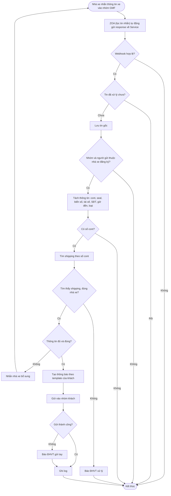
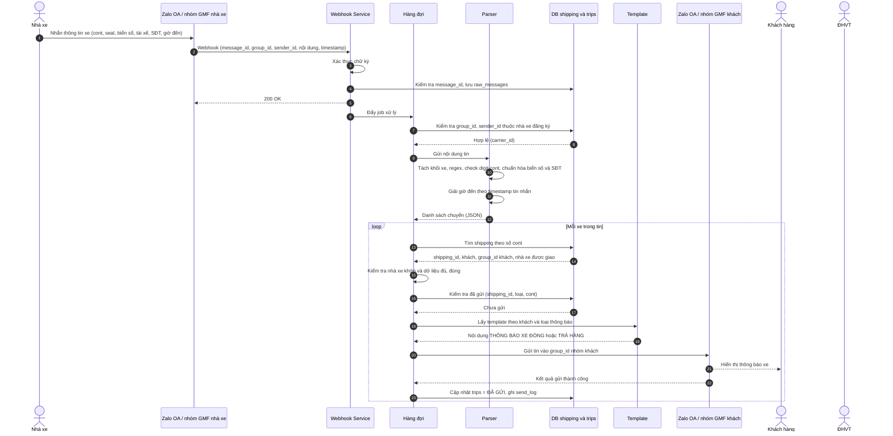
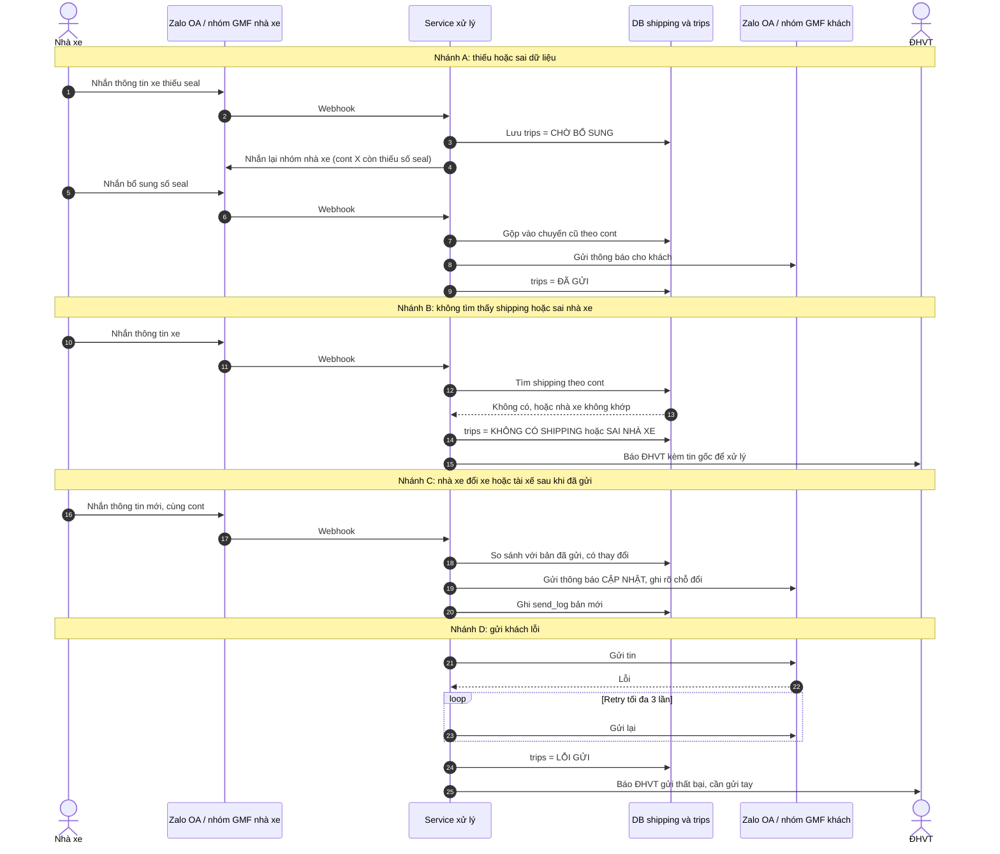
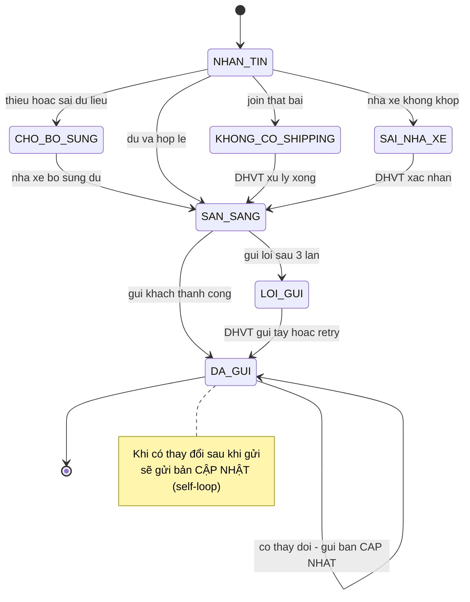

Mình vẽ theo luồng giai đoạn 1: nhà xe báo xe, bot join shipping theo số cont rồi gửi khách, còn lệnh đóng kết hợp để giai đoạn 2.

## 1. Sơ đồ luồng (flowchart)

## 2. Sơ đồ tuần tự (sequence)

### 2a. Luồng chính, thông tin đủ và gửi khách thành công

### 2b. Các nhánh ngoại lệ

## 3. Sơ đồ trạng thái chuyến (tham khảo)

