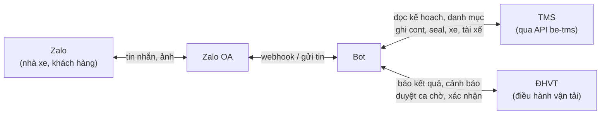
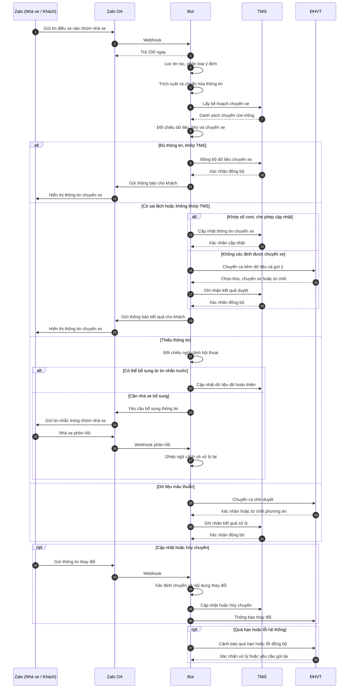
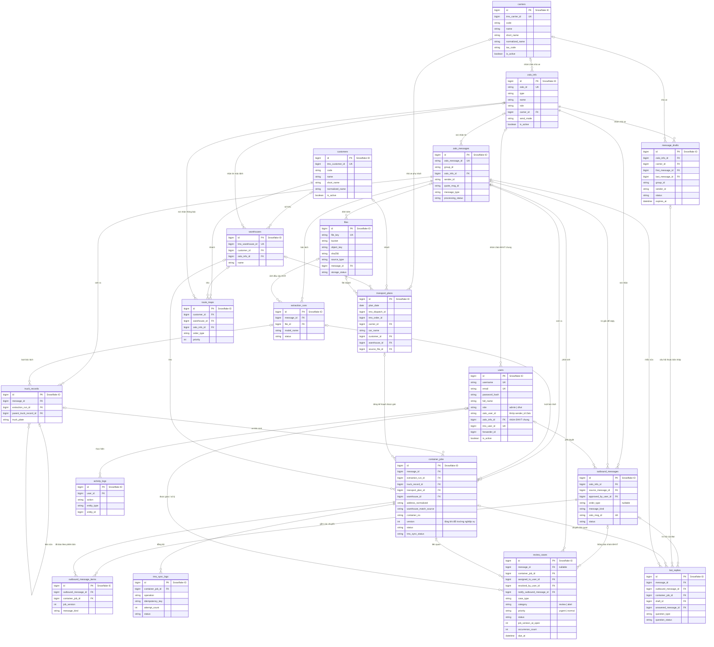

## 1. Flow Diagram

## 2. Sequence Diagram

## 3. Database

### 3.1 Entity-Relationship Diagram

**Quy ước Khóa chính (Snowflake ID) & Khóa đồng bộ TMS:**

- **Khóa chính nội bộ (`id`)**: Toàn bộ 19 bảng trong hệ thống Bot sử dụng **Snowflake ID 64-bit (`BigInteger`)** do tầng ứng dụng sinh tự động (không dùng `AUTO_INCREMENT`), đảm bảo duy nhất toàn cục, phân tán tốt và sắp xếp tăng dần theo thời gian.
- **Khóa đồng bộ từ TMS (`tms_*_id`)**: Lưu dưới dạng **`BigInteger` (8 bytes)** thay vì `String` để tối ưu dung lượng bộ nhớ và tốc độ tìm kiếm B-Tree Index (do trên TMS các khóa `customer_id`, `warehouse_id`, `carrier_id`, `user_id`, `dispatch_id`, `order_id` đều là số nguyên). Các mã hiển thị dạng chữ (nếu có) được tách riêng vào cột `code`.

**Quan hệ logic (không có khóa ngoại vật lý trong sơ đồ):**

- `zalo_messages.quote_msg_id` trỏ tới `zalo_messages.zalo_message_id` của tin được trích dẫn.
- `users.zalo_user_id` khớp với `zalo_messages.sender_id` để nhận diện nhân viên ĐHVT khi hỏi tra cứu Bot trên Zalo (chỉ đọc). Duyệt, sửa, từ chối chỉ thực hiện trên Web; nhóm Zalo ĐHVT chỉ nhận thông báo một chiều.
- Khi người dùng quote một tin của Bot: `zalo_messages.quote_msg_id` được đối chiếu với `outbound_messages.zalo_msg_id` (nơi duy nhất lưu ID tin Bot đã gửi); từ đó tra ra `bot_replies` (câu hỏi đang chờ), `outbound_message_items` (các chuyến đã báo) hoặc `review_cases` (tin thông báo ĐHVT).
- `container_jobs` được sửa tại chỗ: mỗi lần đổi trường nghiệp vụ thì `version` + 1, giá trị cũ → mới ghi vào `activity_logs.details`. Không tạo dòng `container_jobs` mới cho bản sửa.
- `activity_logs` tham chiếu mọi bảng qua cặp `entity_type` + `entity_id` (`BigInteger` Snowflake ID).
- Một Zalo có nhiều khách và một khách có nhiều Zalo: lưu bằng nhiều dòng trong `route_maps` (mỗi dòng là một cặp khách – nơi nhận).

### 3.2 Schema

Hệ thống quản lý tổng cộng **19 bảng dữ liệu** được phân chia theo 4 nhóm chức năng:

| STT | Tên bảng CSDL       | Nhóm chức năng       | Vai trò nghiệp vụ chính                                                              |
| :-: | :-------------------- | :---------------------- | :--------------------------------------------------------------------------------------- |
|  1  | `zalo_messages`     | Nghiệp vụ Runtime     | Lưu tin nhắn thô ban đầu nhận từ Webhook Zalo                                     |
|  2  | `zalo_info`         | Danh mục & Cấu hình  | Danh bạ nhóm Zalo (Nhóm Nhà xe, Nhóm Khách hàng, Nhóm ĐHVT chung)               |
|  3  | `users`             | Danh mục & Cấu hình  | Tài khoản nội bộ (ĐHVT, Admin) đăng nhập Web quản lý; nhận diện ĐHVT khi hỏi Bot trên Zalo |
|  4  | `carriers`          | Danh mục & Cấu hình  | Danh mục Nhà xe / Đội xe chuẩn đồng bộ từ phần mềm TMS                        |
|  5  | `customers`         | Danh mục & Cấu hình  | Danh mục Khách hàng chuẩn đồng bộ từ TMS (không chứa thông tin Zalo)          |
|  6  | `warehouses`        | Danh mục & Cấu hình  | Danh mục Kho đóng/trả hàng đồng bộ từ TMS                                       |
|  7  | `transport_plans`   | Kế hoạch Vận chuyển | Kế hoạch vận chuyển hằng ngày (Đồng bộ từ TMS hoặc Import từ Excel/CSV)      |
|  8  | `outbound_messages` | Nghiệp vụ Runtime     | Mọi tin Bot gửi ra Zalo (khách, nhà xe, nhóm ĐHVT); nơi duy nhất lưu `zalo_msg_id`                           |
|  9  | `truck_records`     | Nghiệp vụ Runtime     | Thông tin lượt xe (Đầu kéo, Lái xe, SĐT)                                         |
| 10 | `container_jobs`    | Nghiệp vụ Runtime     | Thực thể trung tâm quản lý từng công việc container                              |
| 11 | `extraction_runs`   | Nghiệp vụ Runtime     | Nhật ký các phiên bóc tách dữ liệu (AI, Regex, OCR)                              |
| 12 | `bot_replies`       | Nghiệp vụ Runtime     | Theo dõi câu hỏi Bot đặt cho nhà xe và trạng thái trả lời                                       |
| 13 | `review_cases`      | Nghiệp vụ Runtime     | Hàng đợi ca cần ĐHVT duyệt và cảnh báo hệ thống (xử lý trên Web)                       |
| 14 | `tms_sync_logs`     | Nghiệp vụ Runtime     | Nhật ký gọi API đồng bộ dữ liệu sang phần mềm TMS                              |
| 15 | `route_maps`        | Danh mục & Cấu hình  | Ma trận định tuyến: Khách hàng + Kho + Loại lệnh ➔ Zalo nhận tin               |
| 16 | `activity_logs`     | Nghiệp vụ Runtime     | Nhật ký kiểm toán (Audit Trail) thao tác người dùng & hệ thống                 |
| 17 | `files`             | Lưu trữ               | Lưu thông tin file và đường dẫn (MinIO)                                           |
| 18 | `message_drafts`   | Nghiệp vụ Runtime     | Bản nháp gom tin rời rạc theo (nhóm, người gửi), có hạn chờ debounce             |
| 19 | `outbound_message_items` | Nghiệp vụ Runtime | Chuyến nào, phiên bản nào đã được báo trong tin gửi đi (chống gửi trùng) |

---

#### BẢNG 1: `zalo_messages`

> **Ý nghĩa**: Lưu trữ tin nhắn thô ban đầu.

| Tên trường         | Kiểu dữ liệu   | Ràng buộc                                                | Mặc định    | Ý nghĩa & Quy tắc nghiệp vụ                                                                                       |
| :-------------------- | :---------------- | :--------------------------------------------------------- | :------------- | :--------------------------------------------------------------------------------------------------------------------- |
| `id`                | `BigInteger`    | **PK**, Snowflake ID                                 |                | Khóa chính Snowflake 64-bit định danh dòng tin nội bộ hệ thống                                                |
| `zalo_message_id`   | `String(128)`   | **Unique**, Not Null, **Index**                |                | ID tin nhắn từ máy chủ Zalo (dùng để khử trùng lặp Deduplication)                                            |
| `group_id`          | `String(128)`   | Not Null, **Index**                                  |                | ID nhóm Zalo nơi phát sinh tin nhắn (hoặc `direct_<uid>` nếu tin riêng). Giữ nguyên giá trị Zalo gửi về |
| `zalo_info_id`      | `BigInteger`    | **FK** (`zalo_info.id`), Nullable, **Index** | `NULL`       | Nhóm hoặc tài khoản đã đăng ký nhận tin này; `NULL` nếu nhóm/tài khoản chưa có trong `zalo_info`  |
| `sender_id`         | `String(128)`   | Not Null, **Index**                                  |                | ID tài khoản người dùng Zalo của người gửi (tài xế, nhà xe, hoặc nhân viên ĐHVT)                       |
| `sender_name`       | `String(255)`   | Nullable                                                   | `NULL`       | Tên hiển thị Zalo của người gửi tại thời điểm nhận tin                                                     |
| `quote_msg_id`      | `String(128)`   | Nullable, **Index**                                  | `NULL`       | ID tin Zalo được trích dẫn. Đối chiếu với `zalo_messages.zalo_message_id` (tin người dùng) hoặc `outbound_messages.zalo_msg_id` (tin của Bot) |
| `message_type`      | `String(32)`    | Not Null                                                   | `'text'`     | Loại tin nhắn: `'text'` (văn bản), `'image'` (hình ảnh lệnh điều xe), `'file'` (tệp đính kèm)       |
| `message_text`      | `Text`          | Nullable                                                   | `NULL`       | Nội dung văn bản nguyên bản của tin nhắn (giữ nguyên ký tự `\n`, icon)                                    |
| `raw_payload`       | `JSON`          | Not Null                                                   |                | Toàn bộ cấu trúc JSON thô máy chủ Zalo đẩy về (để debug / audit)                                           |
| `processing_status` | `String(32)`    | Not Null, **Index**                                  | `'RECEIVED'` | Trạng thái chuẩn hóa Enum: `RECEIVED`, `QUEUED`, `PROCESSING`, `PROCESSED`, `NEEDS_REVIEW`, `IGNORED_NON_TEXT`, `IGNORED_CHAT`, `FAILED`, `CANCELLED` |
| `received_at`       | `DateTime(UTC)` | Not Null                                                   | `utc_now`    | Thời điểm máy chủ Bot tiếp nhận tin nhắn từ mạng                                                             |
| `zalo_sent_at`      | `DateTime(UTC)` | Nullable                                                   | `NULL`       | Thời điểm người dùng ấn nút gửi tin trên ứng dụng Zalo (timestamp Zalo)                                    |
| `last_error`        | `Text`          | Nullable                                                   | `NULL`       | Chi tiết lỗi xử lý cuối cùng (nếu gặp lỗi)                                                                    |
| `created_at`        | `DateTime(UTC)` | Not Null                                                   | `utc_now`    | Thời gian tạo bản ghi trong cơ sở dữ liệu                                                                       |

> File đính kèm (ảnh, tài liệu) lưu ở bảng `files` qua `files.message_id`, một tin có thể có nhiều file.

---

#### BẢNG 2: `zalo_info`

> **Ý nghĩa**: Danh bạ Zalo quản lý các nhóm/tài khoản Zalo (Nhóm Nhà xe, Nhóm Khách hàng, Nhóm ĐHVT nội bộ chung). Đồng thời quản lý chế độ gửi tin (Tự động / Chờ duyệt trên Web). Nhóm ĐHVT chỉ nhận thông báo một chiều từ Bot.

| Tên trường  | Kiểu dữ liệu   | Ràng buộc                                               | Mặc định    | Ý nghĩa & Quy tắc nghiệp vụ                                                                                                               |
| :------------- | :---------------- | :-------------------------------------------------------- | :------------- | :--------------------------------------------------------------------------------------------------------------------------------------------- |
| `id`         | `BigInteger`    | **PK**, Snowflake ID                                |                | Khóa chính Snowflake 64-bit nội bộ                                                                                                         |
| `zalo_id`    | `String(128)`   | **Unique**, Not Null, **Index**               |                | ID nhóm hoặc ID tài khoản trên nền tảng Zalo (VD: `'6469608867469758994'`)                                                            |
| `type`       | `String(16)`    | Not Null                                                  | `'group'`    | Kiểu: `'group'` (nhóm Zalo), `'user'` (tài khoản cá nhân)                                                                            |
| `name`       | `String(255)`   | Nullable                                                  | `NULL`       | Tên nhóm hoặc tên hiển thị tài khoản                                                                                                   |
| `role`       | `String(32)`    | Not Null                                                  | `'customer'` | Vai trò: `'customer'` (khách hàng nhận tin), `'car'` (nhà xe báo về), `'dhvt'` (nhóm ĐHVT chung nội bộ)                       |
| `carrier_id` | `BigInteger`    | **FK** (`carriers.id`), Nullable, **Index** | `NULL`       | Nhà xe sở hữu nhóm Zalo này. Chỉ dùng khi `role = 'car'`, giúp xác định tin nhắn đến từ nhà xe nào trong bảng `carriers` |
| `send_mode`  | `String(32)`    | Not Null                                                  | `'auto'`     | Cơ chế phát hành tin tới nơi nhận: `'auto'` (bắn thẳng), `'pending'` (chờ ĐHVT duyệt). Chỉ có nghĩa khi là nơi nhận      |
| `is_active`  | `Boolean`       | Not Null                                                  | `True`       | Cờ kích hoạt hoạt động                                                                                                                   |
| `expires_at` | `DateTime(UTC)` | Nullable                                                  | `NULL`       | Hạn hoạt động (nếu có dự án theo mùa vụ)                                                                                             |
| `created_at` | `DateTime(UTC)` | Not Null                                                  | `utc_now`    | Thời điểm đăng ký vào hệ thống                                                                                                        |

> Quy tắc kiểm tra ở tầng ứng dụng: `role = 'car'` thì phải có `carrier_id`; `route_maps.zalo_info_id` chỉ được trỏ tới dòng có `role = 'customer'`. Các nhân viên ĐHVT sinh hoạt chung trong nhóm `zalo_info` có `role = 'dhvt'`.

---

#### BẢNG 3: `users`

> **Ý nghĩa**: Quản lý tài khoản nhân viên nội bộ (ĐHVT và Admin) để đăng nhập vào Web quản lý (Dashboard) và nhận diện nhân viên ĐHVT khi hỏi tra cứu Bot trên Zalo (chỉ đọc, không duyệt qua Zalo).

| Tên trường     | Kiểu dữ liệu   | Ràng buộc                                                | Mặc định | Ý nghĩa & Quy tắc nghiệp vụ                                                                                                                |
| :---------------- | :---------------- | :--------------------------------------------------------- | :---------- | :---------------------------------------------------------------------------------------------------------------------------------------------- |
| `id`            | `BigInteger`    | **PK**, Snowflake ID                                 |             | Khóa chính Snowflake 64-bit định danh nhân viên/người dùng nội bộ                                                                    |
| `username`      | `String(64)`    | **Unique**, Not Null, **Index**                |             | Tên đăng nhập vào hệ thống Web quản lý                                                                                                 |
| `email`         | `String(255)`   | **Unique**, Nullable                                 | `NULL`    | Địa chỉ email công ty của nhân viên                                                                                                      |
| `password_hash` | `String(255)`   | Not Null                                                   |             | Mật khẩu đã mã hóa một chiều (Bcrypt / Argon2)                                                                                          |
| `full_name`     | `String(255)`   | Not Null                                                   |             | Họ và tên đầy đủ của nhân viên ĐHVT / Admin                                                                                          |
| `role`          | `String(32)`    | Not Null, **Index**                                  | `'dhvt'`  | Phân quyền hệ thống: `'admin'` (Quản trị toàn quyền), `'dhvt'` (Nhân viên Điều hành vận tải)                                 |
| `zalo_user_id`  | `String(128)`   | Nullable, **Index**                                        | `NULL`    | ID tài khoản Zalo cá nhân của nhân viên (khớp `zalo_messages.sender_id` để Bot nhận diện ĐHVT khi hỏi tra cứu trên Zalo) |
| `zalo_info_id`  | `BigInteger`    | **FK** (`zalo_info.id`), Nullable, **Index** | `NULL`    | Nhóm Zalo ĐHVT chung mà nhân viên này tham gia (Quan hệ Nhiều `users` thuộc Một nhóm `zalo_info` có `role = 'dhvt'`)          |
| `tms_user_id`   | `BigInteger`    | **Unique**, Nullable, **Index**                | `NULL`    | ID tài khoản người dùng tương ứng trên phần mềm TMS (kiểu số nguyên `BigInteger` từ TMS)                                       |
| `forwarder_id`  | `BigInteger`    | Nullable, **Index**                                  | `NULL`    | ID đơn vị Forwarder trên phần mềm TMS mà tài khoản này phụ trách                                                                    |
| `is_active`     | `Boolean`       | Not Null                                                   | `True`    | Trạng thái hoạt động của tài khoản (`False` = Khóa đăng nhập Web và ngừng nhận diện trên Zalo)                |
| `last_login_at` | `DateTime(UTC)` | Nullable                                                   | `NULL`    | Thời điểm đăng nhập Web quản lý gần nhất                                                                                              |
| `created_at`    | `DateTime(UTC)` | Not Null                                                   | `utc_now` | Thời điểm tạo tài khoản                                                                                                                   |
| `updated_at`    | `DateTime(UTC)` | Nullable                                                   | `NULL`    | Thời điểm cập nhật thông tin tài khoản gần nhất                                                                                       |

---

#### BẢNG 4: `carriers`

> **Ý nghĩa**: Danh mục Nhà xe / Đội xe chuẩn đồng bộ từ phần mềm TMS (`GET /carriers`). Dùng để định danh nhà xe bằng khóa số nguyên thay vì so khớp chuỗi tên rời rạc.

| Tên trường       | Kiểu dữ liệu   | Ràng buộc                                 | Mặc định | Ý nghĩa & Quy tắc nghiệp vụ                                                                                     |
| :------------------ | :---------------- | :------------------------------------------ | :---------- | :------------------------------------------------------------------------------------------------------------------- |
| `id`              | `BigInteger`    | **PK**, Snowflake ID                  |             | Khóa chính Snowflake 64-bit của nhà xe trong hệ thống Bot                                                      |
| `tms_carrier_id`  | `BigInteger`    | **Unique**, Nullable, **Index** | `NULL`    | ID nhà xe gốc trên hệ thống TMS (`carrier_id` kiểu số nguyên 8-byte để truy vấn nhanh)                  |
| `code`            | `String(64)`    | Nullable, **Index**                   | `NULL`    | Mã chữ của nhà xe trên hệ thống TMS (nếu có)                                                                |
| `name`            | `String(255)`   | Not Null                                    |             | Tên đầy đủ pháp nhân của nhà xe                                                                             |
| `short_name`      | `String(255)`   | Nullable, **Index**                   | `NULL`    | Tên viết tắt / Tên đội xe thường dùng trong bảng kế hoạch (VD: `'Phương Anh HP'`, `'Tuấn Hưng'`) |
| `normalized_name` | `String(255)`   | Not Null, **Index**                   |             | Tên nhà xe đã xóa dấu, viết thường, chuẩn hóa khoảng trắng phục vụ tìm kiếm                         |
| `tax_code`        | `String(64)`    | Nullable                                    | `NULL`    | Mã số thuế của nhà xe                                                                                           |
| `is_active`       | `Boolean`       | Not Null                                    | `True`    | Cờ kích hoạt (`True`: Đang hợp tác; `False`: Ngừng sử dụng, khớp `status = 1/0` từ TMS)             |
| `synced_at`       | `DateTime(UTC)` | Nullable                                    | `NULL`    | Thời điểm đồng bộ từ hệ thống TMS gần nhất                                                                |
| `created_at`      | `DateTime(UTC)` | Not Null                                    | `utc_now` | Thời điểm tạo bản ghi                                                                                           |

---

#### BẢNG 5: `customers`

> **Ý nghĩa**: Danh mục khách hàng (công ty / pháp nhân) đồng bộ từ TMS (`GET /customers/get-dropdown`). Thông tin Zalo của khách nằm ở `zalo_info`; liên kết gửi tin qua `route_maps`.

| Tên trường       | Kiểu dữ liệu   | Ràng buộc                                 | Mặc định | Ý nghĩa & Quy tắc nghiệp vụ                                                             |
| :------------------ | :---------------- | :------------------------------------------ | :---------- | :------------------------------------------------------------------------------------------- |
| `id`              | `BigInteger`    | **PK**, Snowflake ID                  |             | Khóa chính Snowflake 64-bit khách hàng nội bộ                                          |
| `tms_customer_id` | `BigInteger`    | **Unique**, Nullable, **Index** | `NULL`    | ID khách hàng gốc trên hệ thống TMS (`customer_id` kiểu số nguyên `BigInteger`) |
| `code`            | `String(64)`    | Nullable, **Index**                   | `NULL`    | Mã chữ khách hàng trên TMS (VD: `'KH_LOGITEM'`, `'KH_DC'` nếu có)                 |
| `name`            | `String(255)`   | Not Null                                    |             | Tên đầy đủ của khách hàng (VD: `'Công ty TNHH Logitem Việt Nam'`)                |
| `short_name`      | `String(255)`   | Nullable, **Index**                   | `NULL`    | Tên viết tắt của khách hàng trên TMS                                                  |
| `normalized_name` | `String(255)`   | Not Null, **Index**                   |             | Tên đã xóa dấu, viết thường, chuẩn hóa khoảng trắng để tìm kiếm              |
| `tax_code`        | `String(64)`    | Nullable                                    | `NULL`    | Mã số thuế khách hàng                                                                   |
| `is_active`       | `Boolean`       | Not Null                                    | `True`    | Cờ kích hoạt (`True`: Đang giao dịch; `False`: Tạm ngưng)                         |
| `synced_at`       | `DateTime(UTC)` | Nullable                                    | `NULL`    | Thời điểm đồng bộ từ hệ thống TMS gần nhất                                        |

---

#### BẢNG 6: `warehouses`

> **Ý nghĩa**: Danh mục kho đóng/trả hàng từ TMS chi tiết (`GET /warehouses`).

| Tên trường        | Kiểu dữ liệu    | Ràng buộc                                                | Mặc định | Ý nghĩa & Quy tắc nghiệp vụ                                                                                          |
| :------------------- | :----------------- | :--------------------------------------------------------- | :---------- | :------------------------------------------------------------------------------------------------------------------------ |
| `id`               | `BigInteger`     | **PK**, Snowflake ID                                 |             | Khóa chính Snowflake 64-bit của kho hàng                                                                              |
| `tms_warehouse_id` | `BigInteger`     | **Unique**, Nullable, **Index**                | `NULL`    | ID định danh kho gốc trên phần mềm TMS (`warehouse_id` kiểu số nguyên `BigInteger`)                          |
| `customer_id`      | `BigInteger`     | **FK** (`customers.id`), Nullable, **Index** | `NULL`    | Khách hàng sở hữu hoặc thuê kho riêng này (nếu là kho chung nhiều khách thì phân định qua `route_maps`) |
| `zalo_info_id`     | `BigInteger`     | **FK** (`zalo_info.id`), Nullable, **Index** | `NULL`    | Nhóm/tài khoản Zalo nhận thông báo mặc định của kho (dùng khi không có luật riêng trong `route_maps`)    |
| `name`             | `String(255)`    | Not Null                                                   |             | Tên chuẩn của kho (VD: `'Kho Logitem Tân Quang'`)                                                                   |
| `normalized_name`  | `String(255)`    | Not Null, **Index**                                  |             | Tên kho chuẩn hóa không dấu dùng cho tìm kiếm                                                                     |
| `address`          | `Text`           | Nullable                                                   | `NULL`    | Địa chỉ cụ thể của kho bãi                                                                                         |
| `latitude`         | `Numeric(10, 7)` | Nullable                                                   | `NULL`    | Vĩ độ tọa độ GPS của kho                                                                                           |
| `longitude`        | `Numeric(10, 7)` | Nullable                                                   | `NULL`    | Kinh độ tọa độ GPS của kho                                                                                          |
| `is_active`        | `Boolean`        | Not Null                                                   | `True`    | Trạng thái kho đang hoạt động                                                                                       |
| `synced_at`        | `DateTime(UTC)`  | Nullable                                                   | `NULL`    | Lần đồng bộ thông tin kho gần nhất                                                                                 |

---

#### BẢNG 7: `transport_plans`

> **Ý nghĩa**: Kế hoạch vận chuyển điều vận hằng ngày, kéo trực tiếp từ API TMS (`GET /dispatch/confirmed` + `GET /transport-plan/my-orders`) hoặc import từ file Excel/CSV.

| Tên trường           | Kiểu dữ liệu    | Ràng buộc                                                 | Mặc định | Ý nghĩa & Quy tắc nghiệp vụ                                                                                               |
| :---------------------- | :----------------- | :---------------------------------------------------------- | :---------- | :----------------------------------------------------------------------------------------------------------------------------- |
| `id`                  | `BigInteger`     | **PK**, Snowflake ID                                  |             | Khóa chính Snowflake 64-bit bản ghi kế hoạch                                                                              |
| `plan_date`           | `Date`           | Not Null, **Index**                                   |             | Ngày kế hoạch vận chuyển (Định dạng `YYYY-MM-DD`)                                                                    |
| `tms_dispatch_id`     | `BigInteger`     | Nullable, **Index**                                   | `NULL`    | ID chuyến xe gốc trên TMS (`dispatch.id` kiểu số nguyên `BigInteger` để cập nhật ngược thông tin xe/tài xế) |
| `tms_order_id`        | `BigInteger`     | Nullable, **Index**                                   | `NULL`    | ID lệnh đóng/trả gốc trên TMS (`loading_order.id` hoặc `return_order.id` kiểu `BigInteger`)                      |
| `route_name`          | `String(255)`    | Nullable                                                    | `NULL`    | Tên cung đường vận chuyển (VD: `'Hải Phòng - Hưng Yên'`)                                                           |
| `order_type`          | `String(16)`     | Nullable                                                    | `NULL`    | Phân loại lệnh: `'dong'` (Đóng hàng) hoặc `'tra'` (Trả hàng)                                                      |
| `container_no`        | `String(16)`     | Nullable, **Index**                                   | `NULL`    | Số container kế hoạch dự kiến đóng/trả                                                                                 |
| `seal_no`             | `String(64)`     | Nullable                                                    | `NULL`    | Số chì niêm phong tương ứng                                                                                              |
| `container_size`      | `String(16)`     | Nullable                                                    | `NULL`    | Size cont dự kiến: `'20'`, `'40'`, `'45'`                                                                              |
| `cargo_weight`        | `Numeric(10, 2)` | Nullable                                                    | `NULL`    | Tải trọng cả vỏ container (đơn vị: Tấn)                                                                                |
| `required_time`       | `String(64)`     | Nullable                                                    | `NULL`    | Giờ yêu cầu xe có mặt tại kho (VD: `'7h'`, `'9h'`)                                                                   |
| `customer_name`       | `String(255)`    | Nullable, **Index**                                   | `NULL`    | Tên khách hàng theo kế hoạch                                                                                              |
| `customer_id`         | `BigInteger`     | **FK** (`customers.id`), Nullable, **Index**  | `NULL`    | ID khách hàng chuẩn trong bảng `customers`                                                                               |
| `cargo_type`          | `String(255)`    | Nullable                                                    | `NULL`    | Loại mặt hàng vận chuyển (VD: `Nguy hiểm, thực phẩm, ...`)                                                           |
| `empty_depot`         | `String(255)`    | Nullable                                                    | `NULL`    | Bãi nâng/hạ vỏ rỗng                                                                                                       |
| `full_depot`          | `String(255)`    | Nullable                                                    | `NULL`    | Bãi nâng/hạ hàng (VD: `'PTSC'`, `'Nam Hải'`)                                                                          |
| `estimated_drop_time` | `String(64)`     | Nullable                                                    | `NULL`    | Giờ dự kiến hạ hàng tại bãi/kho                                                                                         |
| `carrier_id`          | `BigInteger`     | **FK** (`carriers.id`), Nullable, **Index**   | `NULL`    | ID nhà xe phụ trách chuyến này (liên kết trực tiếp với `carriers.id` và khớp `zalo_info.carrier_id`)           |
| `car_name`            | `String(255)`    | Nullable, **Index**                                   | `NULL`    | Tên đội xe / Nhà xe hiển thị trong file kế hoạch (VD: `'Phương Anh HP'`)                                           |
| `number_truck`        | `String(64)`     | Nullable                                                    | `NULL`    | Biển số xe được dự kiến điều (VD: `'29C-445.41'`)                                                                   |
| `delivery_address`    | `Text`           | Nullable                                                    | `NULL`    | Địa chỉ chi tiết điểm đóng hoặc trả hàng                                                                            |
| `warehouse_id`        | `BigInteger`     | **FK** (`warehouses.id`), Nullable, **Index** | `NULL`    | Kho chuẩn ứng với dòng kế hoạch. Nơi nhận thông báo lấy qua `route_maps` hoặc `warehouses.zalo_info_id`        |
| `source_file_id`      | `BigInteger`     | **FK** (`files.id`), Nullable                       | `NULL`    | File Excel/CSV đã import ra dòng kế hoạch này (`NULL` nếu kéo trực tiếp từ API TMS)                               |
| `operator_staff`      | `String(100)`    | Nullable                                                    | `NULL`    | Cán bộ điều vận/giao nhận phụ trách theo dõi                                                                          |
| `notes`               | `Text`           | Nullable                                                    | `NULL`    | Ghi chú điều hành                                                                                                          |
| `extra_fee_notes`     | `Text`           | Nullable                                                    | `NULL`    | Ghi chú các chi phí phát sinh (lưu kho, cắm điện, cầu đường)                                                       |
| `created_at`          | `DateTime(UTC)`  | Not Null                                                    | `utc_now` | Thời điểm import hoặc đồng bộ từ TMS                                                                                   |
| `updated_at`          | `DateTime(UTC)`  | Nullable                                                    | `NULL`    | Thời điểm chỉnh sửa kế hoạch gần nhất                                                                                 |

> Chỉ mục khuyến nghị: (`plan_date`, `carrier_id`) và (`plan_date`, `container_no`), giúp truy vấn tức thời theo số container hoặc theo nhà xe phụ trách.

---

#### BẢNG 8: `outbound_messages`

> **Ý nghĩa**: Mọi tin Bot gửi ra Zalo (khách hàng, nhà xe, nhóm ĐHVT), mỗi tin một dòng. Đây là **nơi duy nhất** lưu `zalo_msg_id` của tin Bot đã gửi. Tin thông báo khách gom nhiều chuyến thì các chuyến được liên kết qua bảng `outbound_message_items`.

| Tên trường            | Kiểu dữ liệu    | Ràng buộc                                                | Mặc định    | Ý nghĩa & Quy tắc nghiệp vụ                                                                                         |
| :-------------------- | :-------------- | :------------------------------------------------------- | :---------- | :------------------------------------------------------------------------------------------------------------------ |
| `id`                  | `BigInteger`    | **PK**, Snowflake ID                                     |             | Khóa chính Snowflake 64-bit của tin gửi đi                                                                           |
| `zalo_info_id`        | `BigInteger`    | **FK** (`zalo_info.id`), Not Null, **Index**             |             | Nhóm hoặc tài khoản Zalo nhận tin (khách, nhà xe hoặc nhóm ĐHVT)                                                     |
| `source_message_id`   | `BigInteger`    | **FK** (`zalo_messages.id`), Nullable, **Index**         | `NULL`      | Tin gốc (của nhà xe, khách hoặc ĐHVT) mà Bot reply vào; `NULL` với tin Bot chủ động gửi                              |
| `order_type`          | `String(16)`    | Nullable                                                 | `NULL`      | `'dong'` hoặc `'tra'` cho tin thông báo khách; `NULL` với `answer`, `ask`, `carrier_confirm`, `dhvt_notify`          |
| `message_kind`        | `String(32)`    | Not Null                                                 | `'initial'` | `'initial'` (báo lần đầu), `'driver_change'` (đổi xe/tài xế), `'cancel'` (hủy), `'answer'` (trả lời câu hỏi), `'ask'` (hỏi nhà xe bổ sung), `'carrier_confirm'` (xác nhận cho nhà xe), `'dhvt_notify'` (thông báo nhóm ĐHVT) |
| `content`             | `Text`          | Not Null                                                 |             | Nội dung văn bản gửi đi (render theo template hoặc form mẫu)                                                         |
| `zalo_msg_id`         | `String(128)`   | **Unique**, Nullable                                     | `NULL`      | ID tin trên Zalo sau khi gửi thành công. Dùng để quote khi đổi xe/hủy chuyến và để khớp khi người dùng quote tin Bot |
| `approved_by_user_id` | `BigInteger`    | **FK** (`users.id`), Nullable, **Index**                 | `NULL`      | Nhân viên ĐHVT / Admin duyệt trên Web (`NULL` nếu gửi tự động)                                                       |
| `approved_at`         | `DateTime(UTC)` | Nullable                                                 | `NULL`      | Thời điểm duyệt trên Web                                                                                             |
| `status`              | `String(32)`    | Not Null, **Index**                                      | `'PENDING_APPROVAL'` | Trạng thái chuẩn hóa Enum: `'PENDING_APPROVAL'` (chờ ĐHVT duyệt trên Web), `'PENDING_SEND'` (sẵn sàng gửi), `'SENT'`, `'FAILED'`, `'CANCELLED'`, `'IGNORED_DUPLICATE'`   |
| `attempt_count`       | `Integer`       | Not Null                                                 | `0`         | Số lần đã thử gửi qua cổng Zalo                                                                                      |
| `last_error`          | `Text`          | Nullable                                                 | `NULL`      | Chi tiết lỗi gửi tin nếu thất bại                                                                                    |
| `created_at`          | `DateTime(UTC)` | Not Null                                                 | `utc_now`   | Thời điểm tạo bản tin                                                                                                |
| `sent_at`             | `DateTime(UTC)` | Nullable                                                 | `NULL`      | Thời điểm gửi thành công                                                                                             |

> Duyệt tin chờ gửi khách (`status = 'PENDING_APPROVAL'`) chỉ thực hiện trên Web. Nhóm Zalo ĐHVT nhận thông báo (`message_kind = 'dhvt_notify'`) và Bot không nhận lệnh duyệt từ nhóm này.
---

#### BẢNG 9: `truck_records`

> **Ý nghĩa**: Thông tin xe vận chuyển được trích xuất (Biển số xe đầu kéo, Thông tin bác tài).

| Tên trường              | Kiểu dữ liệu   | Ràng buộc                                                    | Mặc định | Ý nghĩa & Quy tắc nghiệp vụ                                                                       |
| :------------------------- | :---------------- | :------------------------------------------------------------- | :---------- | :----------------------------------------------------------------------------------------------------- |
| `id`                     | `BigInteger`    | **PK**, Snowflake ID                                     |             | Khóa chính Snowflake 64-bit của lượt xe                                                           |
| `message_id`             | `BigInteger`    | **FK** (`zalo_messages.id`), Not Null, **Index** |             | Tin nhắn sinh ra lượt xe này                                                                       |
| `extraction_run_id`      | `BigInteger`    | **FK** (`extraction_runs.id`), Nullable                | `NULL`    | Phiên bóc tách sinh ra lượt xe này                                                               |
| `parent_truck_record_id` | `BigInteger`    | **FK** (`truck_records.id`), Nullable                  | `NULL`    | Bản ghi xe cũ nếu đây là tin cập nhật/sửa thông tin xe                                       |
| `truck_plate`            | `String(32)`    | Nullable, **Index**                                      | `NULL`    | Biển số xe đầu kéo đã chuẩn hóa (VD: `15C-283.94`)                                          |
| `driver_name`            | `String(255)`   | Nullable                                                       | `NULL`    | Họ tên tài xế (đã chuẩn hóa Title Case, bỏ tiền tố "Lái xe", "bác")                       |
| `driver_phone`           | `String(32)`    | Nullable                                                       | `NULL`    | Số điện thoại tài xế, **lưu số thật** (10 chữ số bắt đầu bằng `0`). Chỉ che (`0903xxxx59`) khi hiển thị trên Web, ghi log hoặc gửi LLM đám mây |
| `created_at`             | `DateTime(UTC)` | Not Null                                                       | `utc_now` | Thời gian ghi nhận lượt xe                                                                         |
| `updated_at`             | `DateTime(UTC)` | Not Null                                                       | `utc_now` | Thời gian ghi nhận lượt cập nhật xe                                                              |

---

#### BẢNG 10: `container_jobs`

> **Ý nghĩa**: Bảng trung tâm quản lý từng Container cụ thể được bóc tách từ tin nhắn điều xe.

| Tên trường              | Kiểu dữ liệu   | Ràng buộc                                                      | Mặc định       | Ý nghĩa & Quy tắc nghiệp vụ                                                                                          |
| :------------------------- | :---------------- | :--------------------------------------------------------------- | :---------------- | :------------------------------------------------------------------------------------------------------------------------ |
| `id`                     | `BigInteger`    | **PK**, Snowflake ID                                       |                   | Khóa chính Snowflake 64-bit định danh việc container                                                                 |
| `message_id`             | `BigInteger`    | **FK** (`zalo_messages.id`), Not Null, **Index**   |                   | Tin nhắn đầu tiên sinh ra container này (các tin cập nhật về sau ghi ở `activity_logs`) |
| `extraction_run_id`      | `BigInteger`    | **FK** (`extraction_runs.id`), Nullable                  | `NULL`          | Lượt bóc tách sinh ra bản ghi này (chạy lại bóc tách sẽ sinh bản mới)                                        |
| `truck_record_id`        | `BigInteger`    | **FK** (`truck_records.id`), Nullable, **Index**   | `NULL`          | Xe chịu trách nhiệm kéo container này                                                                                |
| `transport_plan_id`      | `BigInteger`    | **FK** (`transport_plans.id`), Nullable, **Index** | `NULL`          | Dòng kế hoạch vận chuyển được gán cho container này (kết quả cuối của bước đối chiếu)                  |
| `container_no`           | `String(16)`    | Nullable, **Index**                                        | `NULL`          | Số Container gồm 4 chữ cái + 7 chữ số (VD: `TGCU2203372`)                                                         |
| `container_size`         | `String(16)`    | Nullable                                                         | `NULL`          | Kích thước vỏ cont: `'20'`, `'40'`, `'45'`                                                                      |
| `seal_no`                | `String(64)`    | Nullable                                                         | `NULL`          | Số chì / seal hải quan (VD: `23338253`)                                                                              |
| `order_type`             | `String(16)`    | Nullable                                                         | `NULL`          | Loại lệnh: `'dong'` (đóng hàng/hạ bãi), `'tra'` (trả hàng/mở cont/nhập)                                    |
| `warehouse_id`           | `BigInteger`    | **FK** (`warehouses.id`), Nullable, **Index**      | `NULL`          | ID kho chuẩn sau khi match qua bảng kế hoạch                                                                          |
| `address_normalized`     | `String(255)`   | Nullable, **Index**                                        | `NULL`          | Địa chỉ nhà xe viết đã chuẩn hóa (bỏ dấu, viết thường). Khóa tra cứu thói quen từng nhà xe khi map kho |
| `warehouse_match_source` | `String(16)`    | Nullable                                                         | `NULL`          | Cách xác định kho: `'plan_cont'` (lấy từ kế hoạch theo cont), `'habit'` (thói quen nhà xe), `'fuzzy'`, `'vector'`, `'llm'` hoặc `'human'` (ĐHVT chọn) |
| `estimated_at`           | `DateTime(UTC)` | Nullable                                                         | `NULL`          | Giờ hẹn có mặt tại kho (bóc tách từ tin nhắn hoặc kế hoạch)                                                   |
| `note`                   | `Text`          | Nullable                                                         | `NULL`          | Ghi chú phát sinh của container                                                                                        |
| `version`                | `Integer`       | Not Null                                                         | `1`             | Phiên bản nghiệp vụ của chuyến. Tăng `+1` khi đổi biển số, tài xế, SĐT, seal, kho, số cont, giờ hẹn hoặc khi hủy; **không** tăng khi chỉ đổi `tms_sync_status`, `updated_at`, `extraction_run_id` |
| `status`                 | `String(32)`    | Not Null, **Index**                                        | `'PENDING'`     | Trạng thái thẩm định: `'PENDING'`, `'VALID'`, `'NEEDS_REVIEW'`, `'REJECTED'`, `'CANCELLED'`                |
| `tms_sync_status`        | `String(32)`    | Not Null                                                         | `'NOT_STARTED'` | Trạng thái đồng bộ sang TMS: `'NOT_STARTED'`, `'PENDING'`, `'SYNCED'`, `'FAILED'`, `'NEEDS_REVIEW'`       |
| `created_at`             | `DateTime(UTC)` | Not Null                                                         | `utc_now`       | Thời gian tạo bản ghi                                                                                                  |
| `updated_at`             | `DateTime(UTC)` | Not Null                                                         | `utc_now`       | Thời gian cập nhật bản ghi gần nhất                                                                                 |

> Chỉ mục khuyến nghị: (`address_normalized`, `warehouse_id`), phục vụ tra cứu thói quen map kho theo nhà xe khi dòng kế hoạch chưa có sẵn số container.

> Quy tắc sửa tại chỗ (hướng A): khi nhà xe đổi xe, tài xế, seal hoặc ĐHVT sửa dữ liệu, Bot cập nhật trực tiếp dòng `container_jobs`, tăng `version` và ghi giá trị cũ → mới vào `activity_logs.details`. `version` là khóa chống gửi trùng tin khách (`outbound_message_items`) và là căn cứ kiểm tra "dữ liệu có đổi kể từ lúc mở ca" (`review_cases.job_version_at_open`).

---

#### BẢNG 11: `extraction_runs`

> **Ý nghĩa**: Lịch sử từng lượt bóc tách dữ liệu từ tin nhắn bằng Regex + Rules, LLM, AI, OCR.

| Tên trường      | Kiểu dữ liệu   | Ràng buộc                                   | Mặc định | Ý nghĩa & Quy tắc nghiệp vụ                                                     |
| :----------------- | :---------------- | :-------------------------------------------- | :---------- | :----------------------------------------------------------------------------------- |
| `id`             | `BigInteger`    | **PK**, Snowflake ID                    |             | Khóa chính Snowflake 64-bit định danh phiên bóc tách                          |
| `message_id`     | `BigInteger`    | **FK** (`zalo_messages.id`), Not Null |             | Liên kết tới tin nhắn gốc cần bóc tách                                       |
| `file_id`        | `BigInteger`    | **FK** (`files.id`), Nullable         | `NULL`    | File ảnh đầu vào khi chạy OCR                                                   |
| `model_name`     | `String(128)`   | Not Null                                      |             | Tên cơ chế bóc tách: `'regex_v1'`, `'paddleocr_v2'`, `'gemini-2.0-flash'` |
| `prompt_version` | `String(64)`    | Not Null                                      |             | Phiên bản prompt hoặc cấu hình parser áp dụng (vd: `'v2.3_202610'`)         |
| `input_data`     | `JSON`          | Not Null                                      |             | Dữ liệu đầu vào đưa vào bộ bóc tách (text hoặc tham chiếu file)         |
| `output_data`    | `JSON`          | Nullable                                      | `NULL`    | Kết quả đầu ra có cấu trúc trích xuất được dạng JSON                    |
| `status`         | `String(32)`    | Not Null                                      |             | Kết quả chạy: `'success'`, `'failed'`, `'partial'`                          |
| `error_message`  | `Text`          | Nullable                                      | `NULL`    | Chi tiết lỗi nếu lượt chạy thất bại (timeout, parse error)                   |
| `started_at`     | `DateTime(UTC)` | Not Null                                      | `utc_now` | Thời điểm bắt đầu chạy giải thuật bóc tách                                |
| `finished_at`    | `DateTime(UTC)` | Nullable                                      | `NULL`    | Thời điểm hoàn tất lượt chạy (dùng đo độ trễ Latency ms)                |

---

#### BẢNG 12: `bot_replies`

> **Ý nghĩa**: Theo dõi các câu hỏi Bot đặt cho nhà xe (thiếu trường, số cont sai, chọn chuyến) cho tới khi nhà xe trả lời hoặc quá hạn. Nội dung và trạng thái gửi tin nằm ở `outbound_messages` (`message_kind = 'ask'`); bảng này chỉ giữ **trạng thái câu hỏi**.

| Tên trường            | Kiểu dữ liệu    | Ràng buộc                                                  | Mặc định        | Ý nghĩa & Quy tắc nghiệp vụ                                                                                 |
| :-------------------- | :-------------- | :--------------------------------------------------------- | :-------------- | :---------------------------------------------------------------------------------------------------------- |
| `id`                  | `BigInteger`    | **PK**, Snowflake ID                                       |                 | Khóa chính Snowflake 64-bit của câu hỏi                                                                      |
| `message_id`          | `BigInteger`    | **FK** (`zalo_messages.id`), Not Null, **Index**           |                 | Tin gốc của nhà xe làm phát sinh câu hỏi                                                                     |
| `outbound_message_id` | `BigInteger`    | **FK** (`outbound_messages.id`), Nullable, **Unique**      | `NULL`          | Tin Bot đã hỏi. `zalo_msg_id` lấy qua đây; `NULL` khi chưa gửi                                               |
| `container_job_id`    | `BigInteger`    | **FK** (`container_jobs.id`), Nullable, **Index**          | `NULL`          | Chuyến liên quan đến câu hỏi (nếu đã xác định)                                                               |
| `draft_id`            | `BigInteger`    | **FK** (`message_drafts.id`), Nullable, **Index**          | `NULL`          | Bản nháp mà câu hỏi thuộc về (nếu có)                                                                        |
| `question_type`       | `String(32)`    | Not Null                                                   |                 | `'select_trip'` (chọn chuyến), `'missing_fields'` (thiếu trường), `'invalid_cont'` (số cont sai)            |
| `context_data`        | `JSON`          | Nullable                                                   | `NULL`          | Danh sách lựa chọn hoặc các trường đang thiếu để ghép câu trả lời                                            |
| `question_status`     | `String(32)`    | Not Null, **Index**                                        | `'cho_tra_loi'` | `'cho_tra_loi'`, `'da_tra_loi'`, `'qua_han'`, `'huy'`. Trạng thái gửi tin xem ở `outbound_messages.status`   |
| `answered_message_id` | `BigInteger`    | **FK** (`zalo_messages.id`), Nullable                      | `NULL`          | Tin nhà xe trả lời câu hỏi                                                                                   |
| `answered_at`         | `DateTime(UTC)` | Nullable                                                   | `NULL`          | Thời điểm nhà xe trả lời                                                                                     |
| `fix_deadline`        | `DateTime(UTC)` | Not Null                                                   |                 | Hạn nhà xe phải trả lời (mặc định `created_at + 180 phút`); quá hạn thì `question_status = 'qua_han'` và tạo ca cho ĐHVT |
| `created_at`          | `DateTime(UTC)` | Not Null                                                   | `utc_now`       | Thời điểm tạo câu hỏi                                                                                        |

> Ghép câu trả lời: khi nhà xe quote một tin của Bot, lấy `zalo_messages.quote_msg_id` so với `outbound_messages.zalo_msg_id`, từ đó tìm `bot_replies` có `question_status = 'cho_tra_loi'`, gộp câu trả lời vào bản nháp hoặc chuyến rồi đặt `'da_tra_loi'`.
---

#### BẢNG 13: `review_cases`

> **Ý nghĩa**: Hàng đợi ca cần Điều hành vận tải (ĐHVT) can thiệp và cảnh báo hệ thống. ĐHVT duyệt, sửa, từ chối **trên Web**. Mọi ca đều được Bot thông báo một chiều vào nhóm Zalo ĐHVT theo form mẫu (kèm liên kết sang Web): ca `urgent` gửi ngay, ca `normal` gom 1 đến 2 phút.

| Tên trường                | Kiểu dữ liệu    | Ràng buộc                                                     | Mặc định    | Ý nghĩa & Quy tắc nghiệp vụ                                                                                           |
| :------------------------ | :-------------- | :------------------------------------------------------------ | :---------- | :-------------------------------------------------------------------------------------------------------------------- |
| `id`                      | `BigInteger`    | **PK**, Snowflake ID                                          |             | Khóa chính Snowflake 64-bit của ca                                                                                     |
| `message_id`              | `BigInteger`    | **FK** (`zalo_messages.id`), Nullable, **Index**              | `NULL`      | Tin nhắn phát sinh ca; `NULL` với cảnh báo hệ thống không xuất phát từ tin nhắn                                        |
| `container_job_id`        | `BigInteger`    | **FK** (`container_jobs.id`), Nullable, **Index**             | `NULL`      | Container liên quan (nếu có)                                                                                           |
| `case_type`               | `String(32)`    | Not Null, **Index**                                           |             | Xem bảng loại ca bên dưới                                                                                              |
| `category`                | `String(16)`    | Not Null, **Index**                                           | `'review'`  | `'review'` (ca cần quyết định) hoặc `'alert'` (cảnh báo hệ thống, chỉ cần đánh dấu đã xử lý)                          |
| `priority`                | `String(16)`    | Not Null, **Index**                                           | `'normal'`  | `'urgent'` (báo nhóm Zalo ĐHVT ngay) hoặc `'normal'` (gom 1 đến 2 phút). Hàng đợi Web sắp theo `priority`, `due_at`   |
| `reason`                  | `Text`          | Not Null                                                      |             | Lý do bằng tiếng Việt giải thích vì sao cần xử lý                                                                      |
| `details`                 | `JSON`          | Nullable                                                      | `NULL`      | Dữ liệu chi tiết (gợi ý của Bot, giá trị cũ → mới, danh sách dòng kế hoạch ứng viên)                                   |
| `job_version_at_open`     | `Integer`       | Nullable                                                      | `NULL`      | `container_jobs.version` lúc tạo ca; khác `version` hiện tại thì ca bị coi là dữ liệu đã đổi, yêu cầu tải lại           |
| `occurrence_count`        | `Integer`       | Not Null                                                      | `1`         | Số lần cùng ca (cùng cont, cùng `case_type`) phát sinh khi đang mở; gộp vào ca cũ thay vì tạo dòng mới                 |
| `status`                  | `String(32)`    | Not Null, **Index**                                           | `'pending'` | `'pending'`, `'approved'`, `'rejected'`, `'sync_failed'` (duyệt xong nhưng ghi TMS lỗi, chờ Gửi lại), `'resolved'` (đã xử lý cảnh báo) |
| `due_at`                  | `DateTime(UTC)` | Nullable, **Index**                                           | `NULL`      | Hạn xử lý; quá hạn thì nhắc lần 1, quá lần nhắc thứ hai thì báo admin                                                  |
| `escalation_level`        | `Integer`       | Not Null                                                      | `0`         | `0` chưa nhắc, `1` đã nhắc lần 1, `2` đã báo admin                                                                     |
| `last_reminded_at`        | `DateTime(UTC)` | Nullable                                                      | `NULL`      | Lần nhắc gần nhất, dùng để không nhắc lặp quá sớm                                                                      |
| `notified_at`             | `DateTime(UTC)` | Nullable                                                      | `NULL`      | Thời điểm Bot thông báo ca vào nhóm Zalo ĐHVT                                                                          |
| `notify_outbound_message_id` | `BigInteger` | **FK** (`outbound_messages.id`), Nullable                     | `NULL`      | Tin thông báo trong nhóm ĐHVT (`message_kind = 'dhvt_notify'`); `zalo_msg_id` lấy qua đây để reply "đã xử lý bởi ai"    |
| `assigned_to_user_id`     | `BigInteger`    | **FK** (`users.id`), Nullable, **Index**                      | `NULL`      | ĐHVT đang nhận xử lý (người khác thấy đang có người xử lý)                                                             |
| `resolved_by_user_id`     | `BigInteger`    | **FK** (`users.id`), Nullable, **Index**                      | `NULL`      | ĐHVT / Admin đã duyệt, từ chối hoặc đóng ca trên Web                                                                   |
| `resolution`              | `JSON`          | Nullable                                                      | `NULL`      | Kết quả ĐHVT chọn hoặc sửa                                                                                             |
| `created_at`              | `DateTime(UTC)` | Not Null                                                      | `utc_now`   | Thời điểm phát sinh ca                                                                                                 |
| `resolved_at`             | `DateTime(UTC)` | Nullable                                                      | `NULL`      | Thời điểm xử lý xong                                                                                                   |

**Các loại ca (`case_type`):**

| Giá trị                   | `category` | Tình huống                                                                |
| :------------------------ | :--------- | :------------------------------------------------------------------------ |
| `missing_fields`          | review     | Thiếu trường bắt buộc, không đủ dữ liệu để render hoặc ghi TMS            |
| `invalid_iso`             | review     | Số container sai chuẩn ISO 6346 mà nhà xe không sửa                       |
| `unknown_carrier`         | review     | Không xác định được nhà xe                                                |
| `group_mismatch`          | review     | Nhóm lạ có thực thể nghiệp vụ, hoặc không xác định được nơi nhận tin khách |
| `low_confidence`          | review     | AI trả kết quả độ tin cậy thấp                                            |
| `plan_not_found`          | review     | Không thấy số cont trong kế hoạch và không gán được dòng trống            |
| `multiple_plans`          | review     | Cont khớp nhiều dòng kế hoạch hoặc thuộc nhà xe khác                      |
| `seal_mismatch`           | review     | Lệch seal hoặc trường kế hoạch giữa tin nhắn và dữ liệu hiện có           |
| `cancel_request`          | review     | Nhà xe đề nghị hủy chuyến                                                 |
| `customer_change_request` | review     | Khách đề nghị đổi giờ, đổi xe hoặc hủy                                    |
| `reply_overdue`           | review     | Nhà xe quá hạn trả lời câu hỏi của Bot (`bot_replies.fix_deadline`)       |
| `tms_sync_failed`         | alert      | Ghi TMS lỗi sau 3 lần thử lại                                             |
| `zalo_send_failed`        | alert      | Gửi Zalo lỗi sau 3 lần thử lại                                            |
| `plan_sync_failed`        | alert      | Kéo kế hoạch hoặc danh mục từ TMS lỗi                                     |
| `queue_backlog`           | alert      | Hàng đợi xử lý tồn đọng                                                   |
---

#### BẢNG 14: `tms_sync_logs`

> **Ý nghĩa**: Nhật ký mọi lần gọi API ghi dữ liệu sang `be-tms`, mỗi lần thử một dòng. Quy ước thống nhất: mọi giá trị trạng thái và tên thao tác viết chữ thường, dạng `snake_case`.

| Tên trường         | Kiểu dữ liệu    | Ràng buộc                                                      | Mặc định  | Ý nghĩa & Quy tắc nghiệp vụ                                                                              |
| :----------------- | :-------------- | :------------------------------------------------------------- | :-------- | :------------------------------------------------------------------------------------------------------- |
| `id`               | `BigInteger`    | **PK**, Snowflake ID                                           |           | Khóa chính Snowflake 64-bit nhật ký đồng bộ                                                               |
| `container_job_id` | `BigInteger`    | **FK** (`container_jobs.id`), Not Null, **Index**              |           | Container được đồng bộ                                                                                    |
| `operation`        | `String(64)`    | Not Null                                                       |           | `'create_trip'`, `'update_driver'`, `'cancel_trip'`                                                       |
| `idempotency_key`  | `String(128)`   | Not Null, **Index**                                            |           | Khóa idempotency gửi kèm TMS; các lần thử lại và nút Gửi lại dùng lại đúng khóa này                       |
| `attempt_count`    | `Integer`       | Not Null                                                       | `1`       | Thứ tự lần thử trong cùng `idempotency_key` (tối đa 3 lần tự động)                                        |
| `request_data`     | `JSON`          | Nullable                                                       | `NULL`    | Payload gửi sang TMS                                                                                      |
| `response_data`    | `JSON`          | Nullable                                                       | `NULL`    | Dữ liệu TMS phản hồi                                                                                      |
| `http_status`      | `Integer`       | Nullable                                                       | `NULL`    | Mã HTTP (`200`, `201`, `422`, `500`...)                                                                   |
| `status`           | `String(32)`    | Not Null                                                       |           | `'success'`, `'failed'`, `'retrying'` (kết quả của từng lần thử)                                          |
| `error_message`    | `Text`          | Nullable                                                       | `NULL`    | Chi tiết lỗi nếu không gọi được TMS                                                                       |
| `created_at`       | `DateTime(UTC)` | Not Null                                                       | `utc_now` | Thời điểm gọi API                                                                                         |

> Quan hệ trạng thái: lần thử `success` gần nhất ứng với `container_jobs.tms_sync_status = 'synced'`; hết 3 lần mà vẫn `failed` thì đặt `container_jobs.tms_sync_status = 'failed'` và tạo ca `tms_sync_failed`.
---

#### BẢNG 15: `route_maps`

> **Ý nghĩa**: Ma trận định tuyến thông báo tự động (cặp Khách hàng + Kho + Loại lệnh ➔ gửi vào Zalo nào). Đồng thời là bảng nối nhiều–nhiều giữa `customers` và `zalo_info`: một khách có nhiều nhóm thì có nhiều dòng; một tài khoản Zalo phụ trách nhiều khách thì cũng có nhiều dòng.

| Tên trường    | Kiểu dữ liệu   | Ràng buộc                                                | Mặc định | Ý nghĩa & Quy tắc nghiệp vụ                                                       |
| :--------------- | :---------------- | :--------------------------------------------------------- | :---------- | :------------------------------------------------------------------------------------- |
| `id`           | `BigInteger`    | **PK**, Snowflake ID                                 |             | Khóa chính Snowflake 64-bit ma trận định tuyến                                   |
| `customer_id`  | `BigInteger`    | **FK** (`customers.id`), Not Null, **Index** |             | Khách hàng áp dụng                                                                 |
| `warehouse_id` | `BigInteger`    | **FK** (`warehouses.id`), Nullable                 | `NULL`    | Kho áp dụng (`NULL` = Áp dụng cho mọi kho của khách này)                     |
| `order_type`   | `String(16)`    | Nullable                                                   | `NULL`    | Loại lệnh áp dụng: `'dong'`, `'tra'`, hoặc `NULL` (cả hai)                 |
| `zalo_info_id` | `BigInteger`    | **FK** (`zalo_info.id`), Not Null, **Index** |             | Nhóm hoặc tài khoản Zalo tiếp nhận thông báo (phải có `role = 'customer'`) |
| `priority`     | `Integer`       | Not Null                                                   | `1`       | Thứ tự ưu tiên (ưu tiên cao xử lý trước khi có nhiều rule)                 |
| `is_active`    | `Boolean`       | Not Null                                                   | `True`    | Cờ kích hoạt quy tắc định tuyến                                                 |
| `created_at`   | `DateTime(UTC)` | Not Null                                                   | `utc_now` | Ngày tạo quy tắc                                                                    |

> Thứ tự chọn nơi nhận: luật cụ thể nhất trong `route_maps` trước, nếu không có thì dùng `warehouses.zalo_info_id`, nếu vẫn không có thì tạo ca `review_cases` loại `group_mismatch` và không tự gửi.
>
> Lưu ý: MySQL cho phép nhiều dòng `NULL` trong khóa duy nhất, nên không dựa vào `UNIQUE` để chặn hai luật mặc định trùng nhau (`warehouse_id` hoặc `order_type` là `NULL`); cần kiểm tra ở tầng ứng dụng.

---

#### BẢNG 16: `activity_logs`

> **Ý nghĩa**: Bảng Audit Trail lưu vết toàn bộ hoạt động của người dùng (`users`) và tiến trình tự động của Bot phục vụ tra cứu bảo mật.

| Tên trường   | Kiểu dữ liệu   | Ràng buộc                                            | Mặc định | Ý nghĩa & Quy tắc nghiệp vụ                                                                                |
| :-------------- | :---------------- | :----------------------------------------------------- | :---------- | :-------------------------------------------------------------------------------------------------------------- |
| `id`          | `BigInteger`    | **PK**, Snowflake ID                             |             | Khóa chính Snowflake 64-bit nhật ký hoạt động                                                            |
| `user_id`     | `BigInteger`    | **FK** (`users.id`), Nullable, **Index** | `NULL`    | ID người thao tác trong bảng `users` (`NULL` nếu do tiến trình tự động `'SYSTEM_WORKER'` chạy) |
| `action`      | `String(64)`    | Not Null                                               |             | Hành động: `'APPROVE_REVIEW'`, `'REJECT_MESSAGE'`, `'IMPORT_PLAN'`, `'LOGIN'`                        |
| `entity_type` | `String(64)`    | Not Null                                               |             | Thực thể bị tác động: `'review_case'`, `'outbound_message'`, `'plan'`, `'user'`                   |
| `entity_id`   | `BigInteger`    | Nullable, **Index**                              | `NULL`    | Khóa chính Snowflake ID (`BigInteger`) của thực thể bị tác động                                      |
| `details`     | `JSON`          | Nullable                                               | `NULL`    | Chi tiết thay đổi trước và sau khi thực hiện thao tác                                                  |
| `created_at`  | `DateTime(UTC)` | Not Null                                               | `utc_now` | Thời điểm thực hiện hành động                                                                           |

---

#### BẢNG 17: `files`

> **Ý nghĩa**: Lưu thông tin về file và đường dẫn trong MinIO. Trong DB chỉ lưu `bucket` + `object_key`, không lưu URL; khi cần xem thì sinh URL tạm thời lúc đó.

| Tên trường      | Kiểu dữ liệu   | Ràng buộc                                                    | Mặc định   | Ý nghĩa & Quy tắc nghiệp vụ                                  |
| :----------------- | :---------------- | :------------------------------------------------------------- | :------------ | :---------------------------------------------------------------- |
| `id`             | `BigInteger`    | **PK**, Snowflake ID                                     |               | Khóa chính Snowflake 64-bit nội bộ                            |
| `file_key`       | `String(64)`    | **Unique**, Not Null                                     |               | Mã ổn định (UUID/ULID) dùng trong code và API               |
| `bucket`         | `String(63)`    | Not Null                                                       |               | Bucket MinIO                                                      |
| `object_key`     | `String(512)`   | Not Null; **Unique** (`bucket`, `object_key`)        |               | Đường dẫn trong bucket, vd `zalo/2026/10/28/{file_key}.jpg` |
| `original_name`  | `String(255)`   | Nullable                                                       | `NULL`      | Tên file gốc                                                    |
| `mime_type`      | `String(100)`   | Not Null                                                       |               | `image/jpeg`, `application/vnd...sheet`                       |
| `size_bytes`     | `BigInteger`    | Not Null                                                       |               | Dung lượng                                                      |
| `sha256`         | `CHAR(64)`      | Not Null, **Index**                                      |               | Phát hiện ảnh gửi trùng, kiểm tra toàn vẹn                |
| `source_type`    | `String(32)`    | Not Null                                                       |               | `zalo_attachment`, `plan_import`, `export`                  |
| `source_url`     | `Text`          | Nullable                                                       | `NULL`      | URL gốc từ Zalo, để tải lại nếu upload lỗi                |
| `message_id`     | `BigInteger`    | **FK** (`zalo_messages.id`), Nullable, **Index** | `NULL`      | Tin sinh ra file (một tin có thể nhiều ảnh)                  |
| `storage_status` | `String(16)`    | Not Null                                                       | `'pending'` | `pending`, `stored`, `failed`, `deleted`                  |
| `meta`           | `JSON`          | Nullable                                                       | `NULL`      | Rộng, cao, hướng xoay, số trang                               |
| `created_at`     | `DateTime(UTC)` | Not Null                                                       | `utc_now`   | Thời điểm ghi nhận                                            |
| `deleted_at`     | `DateTime(UTC)` | Nullable                                                       | `NULL`      | Xóa mềm khi hết hạn lưu                                      |

---

#### BẢNG 18: `message_drafts`

> **Ý nghĩa**: Bản nháp gom các tin rời rạc của cùng một người gửi trong một nhóm (mỗi mảnh chỉ có một phần thông tin xe). Có hạn chờ (debounce 1 đến 3 phút); đủ trường thì chốt sớm, hết hạn thì xử lý theo trạng thái đang có.

| Tên trường         | Kiểu dữ liệu    | Ràng buộc                                                | Mặc định  | Ý nghĩa & Quy tắc nghiệp vụ                                                                                 |
| :----------------- | :-------------- | :------------------------------------------------------- | :-------- | :---------------------------------------------------------------------------------------------------------- |
| `id`               | `BigInteger`    | **PK**, Snowflake ID                                     |           | Khóa chính Snowflake 64-bit của bản nháp                                                                     |
| `zalo_info_id`     | `BigInteger`    | **FK** (`zalo_info.id`), Not Null, **Index**             |           | Nhóm Zalo nhà xe nơi phát sinh bản nháp                                                                      |
| `carrier_id`       | `BigInteger`    | **FK** (`carriers.id`), Nullable, **Index**              | `NULL`    | Nhà xe của nhóm (lấy từ `zalo_info.carrier_id`)                                                              |
| `group_id`         | `String(128)`   | Not Null                                                 |           | ID nhóm Zalo (giữ nguyên giá trị webhook), cùng `sender_id` tạo khóa gom bản nháp                            |
| `sender_id`        | `String(128)`   | Not Null                                                 |           | ID người gửi Zalo                                                                                            |
| `status`           | `String(16)`    | Not Null, **Index**                                      | `'open'`  | `'open'` (đang gom), `'flushed'` (đã chuyển thành chuyến), `'waiting_reply'` (đã hỏi nhà xe, chờ trả lời), `'expired'` (hết hạn, bỏ), `'cancelled'` |
| `entities`         | `JSON`          | Not Null                                                 |           | Thực thể đã gộp theo từng xe: số cont, biển số, tài xế, SĐT, seal, giờ đến                                   |
| `first_message_id` | `BigInteger`    | **FK** (`zalo_messages.id`), Not Null                    |           | Tin đầu tiên mở bản nháp                                                                                     |
| `last_message_id`  | `BigInteger`    | **FK** (`zalo_messages.id`), Not Null                    |           | Tin gần nhất được gộp vào                                                                                    |
| `message_count`    | `Integer`       | Not Null                                                 | `1`       | Số tin đã gộp                                                                                                |
| `expires_at`       | `DateTime(UTC)` | Not Null, **Index**                                      |           | Hạn debounce; bộ hẹn giờ quét các bản nháp `open` có `expires_at <= now`                                     |
| `flushed_at`       | `DateTime(UTC)` | Nullable                                                 | `NULL`    | Thời điểm chốt hoặc đóng bản nháp                                                                            |
| `created_at`       | `DateTime(UTC)` | Not Null                                                 | `utc_now` | Thời điểm mở bản nháp                                                                                        |
| `updated_at`       | `DateTime(UTC)` | Not Null                                                 | `utc_now` | Lần gộp tin gần nhất                                                                                         |

> Chỉ mục khuyến nghị: (`group_id`, `sender_id`, `status`). Tại một thời điểm chỉ có một bản nháp `open` cho mỗi (`group_id`, `sender_id`); MySQL không hỗ trợ unique có điều kiện nên kiểm tra ở tầng ứng dụng (khóa dòng khi gộp). Khi tin mới có thực thể cùng loại nhưng khác giá trị (ví dụ hai biển số khác nhau) thì đóng bản nháp cũ và mở bản nháp mới.

---

#### BẢNG 19: `outbound_message_items`

> **Ý nghĩa**: Bảng nối giữa tin thông báo gửi khách và các chuyến được báo trong tin đó, kèm **phiên bản** đã báo. Là khóa chống gửi trùng: một chuyến ở một phiên bản chỉ được báo một lần cho mỗi loại tin.

| Tên trường            | Kiểu dữ liệu    | Ràng buộc                                                 | Mặc định  | Ý nghĩa & Quy tắc nghiệp vụ                                                                       |
| :-------------------- | :-------------- | :-------------------------------------------------------- | :-------- | :------------------------------------------------------------------------------------------------ |
| `id`                  | `BigInteger`    | **PK**, Snowflake ID                                      |           | Khóa chính Snowflake 64-bit                                                                        |
| `outbound_message_id` | `BigInteger`    | **FK** (`outbound_messages.id`), Not Null, **Index**      |           | Tin gửi đi chứa chuyến này                                                                         |
| `container_job_id`    | `BigInteger`    | **FK** (`container_jobs.id`), Not Null, **Index**         |           | Chuyến được báo                                                                                    |
| `job_version`         | `Integer`       | Not Null                                                  |           | `container_jobs.version` tại thời điểm báo                                                         |
| `message_kind`        | `String(32)`    | Not Null                                                  |           | Sao từ `outbound_messages.message_kind`; chỉ dùng `'initial'`, `'driver_change'`, `'cancel'`       |
| `created_at`          | `DateTime(UTC)` | Not Null                                                  | `utc_now` | Thời điểm ghi nhận                                                                                 |

> Ràng buộc duy nhất: **UNIQUE** (`container_job_id`, `job_version`, `message_kind`). Hai worker cùng xử lý một chuyến sẽ có một bên vi phạm khóa và dừng, không gửi trùng.
> Chỉ tạo dòng cho tin thông báo khách (`initial`, `driver_change`, `cancel`). Tin xác nhận cho nhà xe (`carrier_confirm`) không tạo dòng ở đây vì nhà xe có thể nhắn lặp và vẫn cần được xác nhận lại; tin này truy theo `outbound_messages.source_message_id`.
> Tra "khách quote tin này là các chuyến nào": `zalo_messages.quote_msg_id` ➔ `outbound_messages.zalo_msg_id` ➔ các dòng của bảng này.

---

### Bổ sung kế hoạch nội bộ khi chưa kết nối TMS

`transport_plans` bổ sung `carrier_id` (BIGINT FK carriers, index), `driver_name` (VARCHAR 128), `driver_phone` (VARCHAR 16), `version` (INT, mặc định 1), `tms_sync_status` (VARCHAR 32, mặc định NOT_STARTED). Cập nhật nội bộ đặt PENDING, không đồng nghĩa TMS đã nhận. API cập nhật sử dụng version để chống ghi đè.
