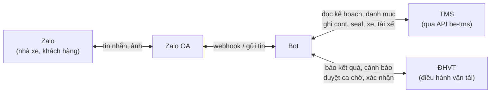
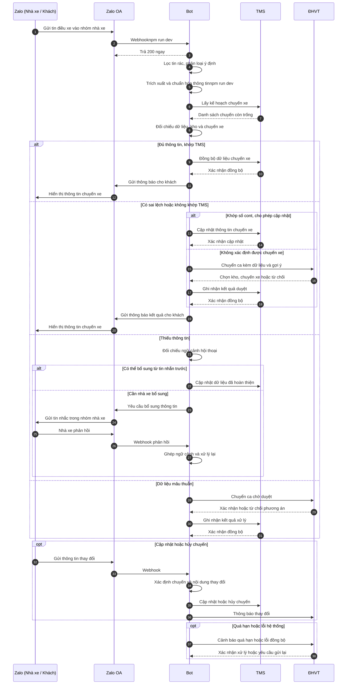
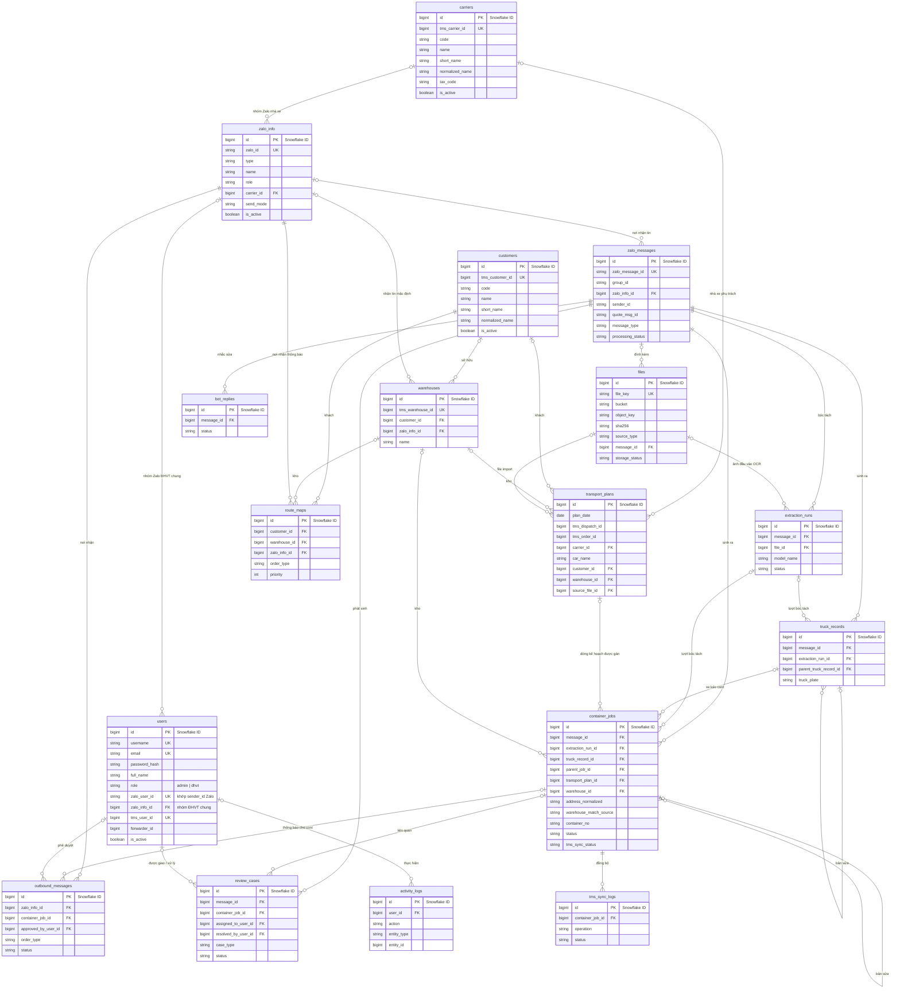

## 1. Flow Diagram

## 2. Sequence Diagram

## 3. Database

### 3.1 Entity-Relationship Diagram

**Quy ước Khóa chính (Snowflake ID) & Khóa đồng bộ TMS:**

- **Khóa chính nội bộ (`id`)**: Toàn bộ 17 bảng trong hệ thống Bot sử dụng **Snowflake ID 64-bit (`BigInteger`)** do tầng ứng dụng sinh tự động (không dùng `AUTO_INCREMENT`), đảm bảo duy nhất toàn cục, phân tán tốt và sắp xếp tăng dần theo thời gian.
- **Khóa đồng bộ từ TMS (`tms_*_id`)**: Lưu dưới dạng **`BigInteger` (8 bytes)** thay vì `String` để tối ưu dung lượng bộ nhớ và tốc độ tìm kiếm B-Tree Index (do trên TMS các khóa `customer_id`, `warehouse_id`, `carrier_id`, `user_id`, `dispatch_id`, `order_id` đều là số nguyên). Các mã hiển thị dạng chữ (nếu có) được tách riêng vào cột `code`.

**Quan hệ logic (không có khóa ngoại vật lý trong sơ đồ):**

- `zalo_messages.quote_msg_id` trỏ tới `zalo_messages.zalo_message_id` của tin được trích dẫn.
- `users.zalo_user_id` khớp với `zalo_messages.sender_id` để nhận diện chính xác nhân viên ĐHVT nào vừa quote duyệt tin trong nhóm Zalo ĐHVT chung.
- `activity_logs` tham chiếu mọi bảng qua cặp `entity_type` + `entity_id` (`BigInteger` Snowflake ID).
- Một Zalo có nhiều khách và một khách có nhiều Zalo: lưu bằng nhiều dòng trong `route_maps` (mỗi dòng là một cặp khách – nơi nhận).

### 3.2 Schema

Hệ thống quản lý tổng cộng **17 bảng dữ liệu** được phân chia theo 4 nhóm chức năng:

| STT | Tên bảng CSDL       | Nhóm chức năng       | Vai trò nghiệp vụ chính                                                              |
| :-: | :-------------------- | :---------------------- | :--------------------------------------------------------------------------------------- |
|  1  | `zalo_messages`     | Nghiệp vụ Runtime     | Lưu tin nhắn thô ban đầu nhận từ Webhook Zalo                                     |
|  2  | `zalo_info`         | Danh mục & Cấu hình  | Danh bạ nhóm Zalo (Nhóm Nhà xe, Nhóm Khách hàng, Nhóm ĐHVT chung)               |
|  3  | `users`             | Danh mục & Cấu hình  | Tài khoản nội bộ (ĐHVT, Admin) đăng nhập Web quản lý và duyệt tin trên Zalo |
|  4  | `carriers`          | Danh mục & Cấu hình  | Danh mục Nhà xe / Đội xe chuẩn đồng bộ từ phần mềm TMS                        |
|  5  | `customers`         | Danh mục & Cấu hình  | Danh mục Khách hàng chuẩn đồng bộ từ TMS (không chứa thông tin Zalo)          |
|  6  | `warehouses`        | Danh mục & Cấu hình  | Danh mục Kho đóng/trả hàng đồng bộ từ TMS                                       |
|  7  | `transport_plans`   | Kế hoạch Vận chuyển | Kế hoạch vận chuyển hằng ngày (Đồng bộ từ TMS hoặc Import từ Excel/CSV)      |
|  8  | `outbound_messages` | Nghiệp vụ Runtime     | Bản tin thông báo chuyến xe gửi ra Zalo của khách hàng                           |
|  9  | `truck_records`     | Nghiệp vụ Runtime     | Thông tin lượt xe (Đầu kéo, Lái xe, SĐT)                                         |
| 10 | `container_jobs`    | Nghiệp vụ Runtime     | Thực thể trung tâm quản lý từng công việc container                              |
| 11 | `extraction_runs`   | Nghiệp vụ Runtime     | Nhật ký các phiên bóc tách dữ liệu (AI, Regex, OCR)                              |
| 12 | `bot_replies`       | Nghiệp vụ Runtime     | Theo dõi tin Bot nhắc tài xế/nhà xe sửa lỗi                                       |
| 13 | `review_cases`      | Nghiệp vụ Runtime     | Hàng đợi các ca cần Điều hành vận tải (ĐHVT) duyệt tay                       |
| 14 | `tms_sync_logs`     | Nghiệp vụ Runtime     | Nhật ký gọi API đồng bộ dữ liệu sang phần mềm TMS                              |
| 15 | `route_maps`        | Danh mục & Cấu hình  | Ma trận định tuyến: Khách hàng + Kho + Loại lệnh ➔ Zalo nhận tin               |
| 16 | `activity_logs`     | Nghiệp vụ Runtime     | Nhật ký kiểm toán (Audit Trail) thao tác người dùng & hệ thống                 |
| 17 | `files`             | Lưu trữ               | Lưu thông tin file và đường dẫn (MinIO)                                           |

---

#### BẢNG 1: `zalo_messages`

> **Ý nghĩa**: Lưu trữ tin nhắn thô ban đầu.

| Tên trường         | Kiểu dữ liệu   | Ràng buộc                                                | Mặc định    | Ý nghĩa & Quy tắc nghiệp vụ                                                                                       |
| :-------------------- | :---------------- | :--------------------------------------------------------- | :------------- | :--------------------------------------------------------------------------------------------------------------------- |
| `id`                | `BigInteger`    | **PK**, Snowflake ID                                 |                | Khóa chính Snowflake 64-bit định danh dòng tin nội bộ hệ thống                                                |
| `zalo_message_id`   | `String(128)`   | **Unique**, Not Null, **Index**                |                | ID tin nhắn từ máy chủ Zalo (dùng để khử trùng lặp Deduplication)                                            |
| `group_id`          | `String(128)`   | Not Null, **Index**                                  |                | ID nhóm Zalo nơi phát sinh tin nhắn (hoặc `direct_<uid>` nếu tin riêng). Giữ nguyên giá trị Zalo gửi về |
| `zalo_info_id`      | `BigInteger`    | **FK** (`zalo_info.id`), Nullable, **Index** | `NULL`       | Nhóm hoặc tài khoản đã đăng ký nhận tin này; `NULL` nếu nhóm/tài khoản chưa có trong `zalo_info`  |
| `sender_id`         | `String(128)`   | Not Null, **Index**                                  |                | ID tài khoản người dùng Zalo của người gửi (tài xế, nhà xe, hoặc nhân viên ĐHVT)                       |
| `sender_name`       | `String(255)`   | Nullable                                                   | `NULL`       | Tên hiển thị Zalo của người gửi tại thời điểm nhận tin                                                     |
| `quote_msg_id`      | `String(128)`   | Nullable, **Index**                                  | `NULL`       | ID tin nhắn Zalo được trích dẫn (dùng khi ĐHVT quote duyệt "ok" hoặc sửa)                                   |
| `message_type`      | `String(32)`    | Not Null                                                   | `'text'`     | Loại tin nhắn: `'text'` (văn bản), `'image'` (hình ảnh lệnh điều xe), `'file'` (tệp đính kèm)       |
| `message_text`      | `Text`          | Nullable                                                   | `NULL`       | Nội dung văn bản nguyên bản của tin nhắn (giữ nguyên ký tự `\n`, icon)                                    |
| `raw_payload`       | `JSON`          | Not Null                                                   |                | Toàn bộ cấu trúc JSON thô máy chủ Zalo đẩy về (để debug / audit)                                           |
| `processing_status` | `String(32)`    | Not Null, **Index**                                  | `'received'` | Trạng thái: `received`, `processing`, `processed`, `needs_review`, `ignored`, `duplicate`, `cancelled` |
| `received_at`       | `DateTime(UTC)` | Not Null                                                   | `utc_now`    | Thời điểm máy chủ Bot tiếp nhận tin nhắn từ mạng                                                             |
| `zalo_sent_at`      | `DateTime(UTC)` | Nullable                                                   | `NULL`       | Thời điểm người dùng ấn nút gửi tin trên ứng dụng Zalo (timestamp Zalo)                                    |
| `last_error`        | `Text`          | Nullable                                                   | `NULL`       | Chi tiết lỗi xử lý cuối cùng (nếu gặp lỗi)                                                                    |
| `created_at`        | `DateTime(UTC)` | Not Null                                                   | `utc_now`    | Thời gian tạo bản ghi trong cơ sở dữ liệu                                                                       |

> File đính kèm (ảnh, tài liệu) lưu ở bảng `files` qua `files.message_id`, một tin có thể có nhiều file.

---

#### BẢNG 2: `zalo_info`

> **Ý nghĩa**: Danh bạ Zalo quản lý các nhóm/tài khoản Zalo (Nhóm Nhà xe, Nhóm Khách hàng, Nhóm ĐHVT nội bộ chung). Đồng thời quản lý chế độ gửi tin (Tự động / Chờ duyệt).

| Tên trường  | Kiểu dữ liệu   | Ràng buộc                                               | Mặc định    | Ý nghĩa & Quy tắc nghiệp vụ                                                                                                               |
| :------------- | :---------------- | :-------------------------------------------------------- | :------------- | :--------------------------------------------------------------------------------------------------------------------------------------------- |
| `id`         | `BigInteger`    | **PK**, Snowflake ID                                |                | Khóa chính Snowflake 64-bit nội bộ                                                                                                         |
| `zalo_id`    | `String(128)`   | **Unique**, Not Null, **Index**               |                | ID nhóm hoặc ID tài khoản trên nền tảng Zalo (VD: `'6469608867469758994'`)                                                            |
| `type`       | `String(16)`    | Not Null                                                  | `'group'`    | Kiểu: `'group'` (nhóm Zalo), `'user'` (tài khoản cá nhân)                                                                            |
| `name`       | `String(255)`   | Nullable                                                  | `NULL`       | Tên nhóm hoặc tên hiển thị tài khoản                                                                                                   |
| `role`       | `String(32)`    | Not Null                                                  | `'customer'` | Vai trò: `'customer'` (khách hàng nhận tin), `'car'` (nhà xe báo về), `'dhvt'` (nhóm ĐHVT chung nội bộ)                       |
| `carrier_id` | `BigInteger`    | **FK** (`carriers.id`), Nullable, **Index** | `NULL`       | Nhà xe sở hữu nhóm Zalo này. Chỉ dùng khi `role = 'car'`, giúp xác định tin nhắn đến từ nhà xe nào trong bảng `carriers` |
| `send_mode`  | `String(32)`    | Not Null                                                  | `'auto'`     | Cơ chế phát hành tin tới nơi nhận: `'auto'` (bắn thẳng), `'pending'` (chờ ĐHVT duyệt). Chỉ có nghĩa khi là nơi nhận      |
| `is_active`  | `Boolean`       | Not Null                                                  | `True`       | Cờ kích hoạt hoạt động                                                                                                                   |
| `expires_at` | `DateTime(UTC)` | Nullable                                                  | `NULL`       | Hạn hoạt động (nếu có dự án theo mùa vụ)                                                                                             |
| `created_at` | `DateTime(UTC)` | Not Null                                                  | `utc_now`    | Thời điểm đăng ký vào hệ thống                                                                                                        |

> Quy tắc kiểm tra ở tầng ứng dụng: `role = 'car'` thì phải có `carrier_id`; `route_maps.zalo_info_id` chỉ được trỏ tới dòng có `role = 'customer'`. Các nhân viên ĐHVT sinh hoạt chung trong nhóm `zalo_info` có `role = 'dhvt'`.

---

#### BẢNG 3: `users`

> **Ý nghĩa**: Quản lý tài khoản nhân viên nội bộ (ĐHVT và Admin) để đăng nhập vào Web quản lý (Dashboard) và định danh người duyệt lệnh trên nhóm Zalo ĐHVT chung.

| Tên trường     | Kiểu dữ liệu   | Ràng buộc                                                | Mặc định | Ý nghĩa & Quy tắc nghiệp vụ                                                                                                                |
| :---------------- | :---------------- | :--------------------------------------------------------- | :---------- | :---------------------------------------------------------------------------------------------------------------------------------------------- |
| `id`            | `BigInteger`    | **PK**, Snowflake ID                                 |             | Khóa chính Snowflake 64-bit định danh nhân viên/người dùng nội bộ                                                                    |
| `username`      | `String(64)`    | **Unique**, Not Null, **Index**                |             | Tên đăng nhập vào hệ thống Web quản lý                                                                                                 |
| `email`         | `String(255)`   | **Unique**, Nullable                                 | `NULL`    | Địa chỉ email công ty của nhân viên                                                                                                      |
| `password_hash` | `String(255)`   | Not Null                                                   |             | Mật khẩu đã mã hóa một chiều (Bcrypt / Argon2)                                                                                          |
| `full_name`     | `String(255)`   | Not Null                                                   |             | Họ và tên đầy đủ của nhân viên ĐHVT / Admin                                                                                          |
| `role`          | `String(32)`    | Not Null, **Index**                                  | `'dhvt'`  | Phân quyền hệ thống: `'admin'` (Quản trị toàn quyền), `'dhvt'` (Nhân viên Điều hành vận tải)                                 |
| `zalo_user_id`  | `String(128)`   | **Unique**, Nullable, **Index**                | `NULL`    | ID tài khoản Zalo cá nhân của nhân viên (khớp với `zalo_messages.sender_id` khi nhân viên quote duyệt `'ok'` trong nhóm ĐHVT) |
| `zalo_info_id`  | `BigInteger`    | **FK** (`zalo_info.id`), Nullable, **Index** | `NULL`    | Nhóm Zalo ĐHVT chung mà nhân viên này tham gia (Quan hệ Nhiều `users` thuộc Một nhóm `zalo_info` có `role = 'dhvt'`)          |
| `tms_user_id`   | `BigInteger`    | **Unique**, Nullable, **Index**                | `NULL`    | ID tài khoản người dùng tương ứng trên phần mềm TMS (kiểu số nguyên `BigInteger` từ TMS)                                       |
| `forwarder_id`  | `BigInteger`    | Nullable, **Index**                                  | `NULL`    | ID đơn vị Forwarder trên phần mềm TMS mà tài khoản này phụ trách                                                                    |
| `is_active`     | `Boolean`       | Not Null                                                   | `True`    | Trạng thái hoạt động của tài khoản (`False` = Khóa đăng nhập và ngừng quyền duyệt trên Zalo)                                 |
| `last_login_at` | `DateTime(UTC)` | Nullable                                                   | `NULL`    | Thời điểm đăng nhập Web quản lý gần nhất                                                                                              |
| `created_at`    | `DateTime(UTC)` | Not Null                                                   | `utc_now` | Thời điểm tạo tài khoản                                                                                                                   |
| `updated_at`    | `DateTime(UTC)` | Nullable                                                   | `NULL`    | Thời điểm cập nhật thông tin tài khoản gần nhất                                                                                       |

---

#### BẢNG 4: `carriers`

> **Ý nghĩa**: Danh mục Nhà xe / Đội xe chuẩn đồng bộ từ phần mềm TMS (`GET /carriers`). Dùng để định danh nhà xe bằng khóa số nguyên thay vì so khớp chuỗi tên rời rạc.

| Tên trường       | Kiểu dữ liệu   | Ràng buộc                                 | Mặc định | Ý nghĩa & Quy tắc nghiệp vụ                                                                                     |
| :------------------ | :---------------- | :------------------------------------------ | :---------- | :------------------------------------------------------------------------------------------------------------------- |
| `id`              | `BigInteger`    | **PK**, Snowflake ID                  |             | Khóa chính Snowflake 64-bit của nhà xe trong hệ thống Bot                                                      |
| `tms_carrier_id`  | `BigInteger`    | **Unique**, Nullable, **Index** | `NULL`    | ID nhà xe gốc trên hệ thống TMS (`carrier_id` kiểu số nguyên 8-byte để truy vấn nhanh)                  |
| `code`            | `String(64)`    | Nullable, **Index**                   | `NULL`    | Mã chữ của nhà xe trên hệ thống TMS (nếu có)                                                                |
| `name`            | `String(255)`   | Not Null                                    |             | Tên đầy đủ pháp nhân của nhà xe                                                                             |
| `short_name`      | `String(255)`   | Nullable, **Index**                   | `NULL`    | Tên viết tắt / Tên đội xe thường dùng trong bảng kế hoạch (VD: `'Phương Anh HP'`, `'Tuấn Hưng'`) |
| `normalized_name` | `String(255)`   | Not Null, **Index**                   |             | Tên nhà xe đã xóa dấu, viết thường, chuẩn hóa khoảng trắng phục vụ tìm kiếm                         |
| `tax_code`        | `String(64)`    | Nullable                                    | `NULL`    | Mã số thuế của nhà xe                                                                                           |
| `is_active`       | `Boolean`       | Not Null                                    | `True`    | Cờ kích hoạt (`True`: Đang hợp tác; `False`: Ngừng sử dụng, khớp `status = 1/0` từ TMS)             |
| `synced_at`       | `DateTime(UTC)` | Nullable                                    | `NULL`    | Thời điểm đồng bộ từ hệ thống TMS gần nhất                                                                |
| `created_at`      | `DateTime(UTC)` | Not Null                                    | `utc_now` | Thời điểm tạo bản ghi                                                                                           |

---

#### BẢNG 5: `customers`

> **Ý nghĩa**: Danh mục khách hàng (công ty / pháp nhân) đồng bộ từ TMS (`GET /customers/get-dropdown`). Thông tin Zalo của khách nằm ở `zalo_info`; liên kết gửi tin qua `route_maps`.

| Tên trường       | Kiểu dữ liệu   | Ràng buộc                                 | Mặc định | Ý nghĩa & Quy tắc nghiệp vụ                                                             |
| :------------------ | :---------------- | :------------------------------------------ | :---------- | :------------------------------------------------------------------------------------------- |
| `id`              | `BigInteger`    | **PK**, Snowflake ID                  |             | Khóa chính Snowflake 64-bit khách hàng nội bộ                                          |
| `tms_customer_id` | `BigInteger`    | **Unique**, Nullable, **Index** | `NULL`    | ID khách hàng gốc trên hệ thống TMS (`customer_id` kiểu số nguyên `BigInteger`) |
| `code`            | `String(64)`    | Nullable, **Index**                   | `NULL`    | Mã chữ khách hàng trên TMS (VD: `'KH_LOGITEM'`, `'KH_DC'` nếu có)                 |
| `name`            | `String(255)`   | Not Null                                    |             | Tên đầy đủ của khách hàng (VD: `'Công ty TNHH Logitem Việt Nam'`)                |
| `short_name`      | `String(255)`   | Nullable, **Index**                   | `NULL`    | Tên viết tắt của khách hàng trên TMS                                                  |
| `normalized_name` | `String(255)`   | Not Null, **Index**                   |             | Tên đã xóa dấu, viết thường, chuẩn hóa khoảng trắng để tìm kiếm              |
| `tax_code`        | `String(64)`    | Nullable                                    | `NULL`    | Mã số thuế khách hàng                                                                   |
| `is_active`       | `Boolean`       | Not Null                                    | `True`    | Cờ kích hoạt (`True`: Đang giao dịch; `False`: Tạm ngưng)                         |
| `synced_at`       | `DateTime(UTC)` | Nullable                                    | `NULL`    | Thời điểm đồng bộ từ hệ thống TMS gần nhất                                        |

---

#### BẢNG 6: `warehouses`

> **Ý nghĩa**: Danh mục kho đóng/trả hàng từ TMS chi tiết (`GET /warehouses`).

| Tên trường        | Kiểu dữ liệu    | Ràng buộc                                                | Mặc định | Ý nghĩa & Quy tắc nghiệp vụ                                                                                          |
| :------------------- | :----------------- | :--------------------------------------------------------- | :---------- | :------------------------------------------------------------------------------------------------------------------------ |
| `id`               | `BigInteger`     | **PK**, Snowflake ID                                 |             | Khóa chính Snowflake 64-bit của kho hàng                                                                              |
| `tms_warehouse_id` | `BigInteger`     | **Unique**, Nullable, **Index**                | `NULL`    | ID định danh kho gốc trên phần mềm TMS (`warehouse_id` kiểu số nguyên `BigInteger`)                          |
| `customer_id`      | `BigInteger`     | **FK** (`customers.id`), Nullable, **Index** | `NULL`    | Khách hàng sở hữu hoặc thuê kho riêng này (nếu là kho chung nhiều khách thì phân định qua `route_maps`) |
| `zalo_info_id`     | `BigInteger`     | **FK** (`zalo_info.id`), Nullable, **Index** | `NULL`    | Nhóm/tài khoản Zalo nhận thông báo mặc định của kho (dùng khi không có luật riêng trong `route_maps`)    |
| `name`             | `String(255)`    | Not Null                                                   |             | Tên chuẩn của kho (VD: `'Kho Logitem Tân Quang'`)                                                                   |
| `normalized_name`  | `String(255)`    | Not Null, **Index**                                  |             | Tên kho chuẩn hóa không dấu dùng cho tìm kiếm                                                                     |
| `address`          | `Text`           | Nullable                                                   | `NULL`    | Địa chỉ cụ thể của kho bãi                                                                                         |
| `latitude`         | `Numeric(10, 7)` | Nullable                                                   | `NULL`    | Vĩ độ tọa độ GPS của kho                                                                                           |
| `longitude`        | `Numeric(10, 7)` | Nullable                                                   | `NULL`    | Kinh độ tọa độ GPS của kho                                                                                          |
| `is_active`        | `Boolean`        | Not Null                                                   | `True`    | Trạng thái kho đang hoạt động                                                                                       |
| `synced_at`        | `DateTime(UTC)`  | Nullable                                                   | `NULL`    | Lần đồng bộ thông tin kho gần nhất                                                                                 |

---

#### BẢNG 7: `transport_plans`

> **Ý nghĩa**: Kế hoạch vận chuyển điều vận hằng ngày, kéo trực tiếp từ API TMS (`GET /dispatch/confirmed` + `GET /transport-plan/my-orders`) hoặc import từ file Excel/CSV.

| Tên trường           | Kiểu dữ liệu    | Ràng buộc                                                 | Mặc định | Ý nghĩa & Quy tắc nghiệp vụ                                                                                               |
| :---------------------- | :----------------- | :---------------------------------------------------------- | :---------- | :----------------------------------------------------------------------------------------------------------------------------- |
| `id`                  | `BigInteger`     | **PK**, Snowflake ID                                  |             | Khóa chính Snowflake 64-bit bản ghi kế hoạch                                                                              |
| `plan_date`           | `Date`           | Not Null, **Index**                                   |             | Ngày kế hoạch vận chuyển (Định dạng `YYYY-MM-DD`)                                                                    |
| `tms_dispatch_id`     | `BigInteger`     | Nullable, **Index**                                   | `NULL`    | ID chuyến xe gốc trên TMS (`dispatch.id` kiểu số nguyên `BigInteger` để cập nhật ngược thông tin xe/tài xế) |
| `tms_order_id`        | `BigInteger`     | Nullable, **Index**                                   | `NULL`    | ID lệnh đóng/trả gốc trên TMS (`loading_order.id` hoặc `return_order.id` kiểu `BigInteger`)                      |
| `route_name`          | `String(255)`    | Nullable                                                    | `NULL`    | Tên cung đường vận chuyển (VD: `'Hải Phòng - Hưng Yên'`)                                                           |
| `order_type`          | `String(16)`     | Nullable                                                    | `NULL`    | Phân loại lệnh: `'dong'` (Đóng hàng) hoặc `'tra'` (Trả hàng)                                                      |
| `container_no`        | `String(16)`     | Nullable, **Index**                                   | `NULL`    | Số container kế hoạch dự kiến đóng/trả                                                                                 |
| `seal_no`             | `String(64)`     | Nullable                                                    | `NULL`    | Số chì niêm phong tương ứng                                                                                              |
| `container_size`      | `String(16)`     | Nullable                                                    | `NULL`    | Size cont dự kiến: `'20'`, `'40'`, `'45'`                                                                              |
| `cargo_weight`        | `Numeric(10, 2)` | Nullable                                                    | `NULL`    | Tải trọng cả vỏ container (đơn vị: Tấn)                                                                                |
| `required_time`       | `String(64)`     | Nullable                                                    | `NULL`    | Giờ yêu cầu xe có mặt tại kho (VD: `'7h'`, `'9h'`)                                                                   |
| `customer_name`       | `String(255)`    | Nullable, **Index**                                   | `NULL`    | Tên khách hàng theo kế hoạch                                                                                              |
| `customer_id`         | `BigInteger`     | **FK** (`customers.id`), Nullable, **Index**  | `NULL`    | ID khách hàng chuẩn trong bảng `customers`                                                                               |
| `cargo_type`          | `String(255)`    | Nullable                                                    | `NULL`    | Loại mặt hàng vận chuyển (VD: `Nguy hiểm, thực phẩm, ...`)                                                           |
| `empty_depot`         | `String(255)`    | Nullable                                                    | `NULL`    | Bãi nâng/hạ vỏ rỗng                                                                                                       |
| `full_depot`          | `String(255)`    | Nullable                                                    | `NULL`    | Bãi nâng/hạ hàng (VD: `'PTSC'`, `'Nam Hải'`)                                                                          |
| `estimated_drop_time` | `String(64)`     | Nullable                                                    | `NULL`    | Giờ dự kiến hạ hàng tại bãi/kho                                                                                         |
| `carrier_id`          | `BigInteger`     | **FK** (`carriers.id`), Nullable, **Index**   | `NULL`    | ID nhà xe phụ trách chuyến này (liên kết trực tiếp với `carriers.id` và khớp `zalo_info.carrier_id`)           |
| `car_name`            | `String(255)`    | Nullable, **Index**                                   | `NULL`    | Tên đội xe / Nhà xe hiển thị trong file kế hoạch (VD: `'Phương Anh HP'`)                                           |
| `number_truck`        | `String(64)`     | Nullable                                                    | `NULL`    | Biển số xe được dự kiến điều (VD: `'29C-445.41'`)                                                                   |
| `delivery_address`    | `Text`           | Nullable                                                    | `NULL`    | Địa chỉ chi tiết điểm đóng hoặc trả hàng                                                                            |
| `warehouse_id`        | `BigInteger`     | **FK** (`warehouses.id`), Nullable, **Index** | `NULL`    | Kho chuẩn ứng với dòng kế hoạch. Nơi nhận thông báo lấy qua `route_maps` hoặc `warehouses.zalo_info_id`        |
| `source_file_id`      | `BigInteger`     | **FK** (`files.id`), Nullable                       | `NULL`    | File Excel/CSV đã import ra dòng kế hoạch này (`NULL` nếu kéo trực tiếp từ API TMS)                               |
| `operator_staff`      | `String(100)`    | Nullable                                                    | `NULL`    | Cán bộ điều vận/giao nhận phụ trách theo dõi                                                                          |
| `notes`               | `Text`           | Nullable                                                    | `NULL`    | Ghi chú điều hành                                                                                                          |
| `extra_fee_notes`     | `Text`           | Nullable                                                    | `NULL`    | Ghi chú các chi phí phát sinh (lưu kho, cắm điện, cầu đường)                                                       |
| `created_at`          | `DateTime(UTC)`  | Not Null                                                    | `utc_now` | Thời điểm import hoặc đồng bộ từ TMS                                                                                   |
| `updated_at`          | `DateTime(UTC)`  | Nullable                                                    | `NULL`    | Thời điểm chỉnh sửa kế hoạch gần nhất                                                                                 |

> Chỉ mục khuyến nghị: (`plan_date`, `carrier_id`) và (`plan_date`, `container_no`), giúp truy vấn tức thời theo số container hoặc theo nhà xe phụ trách.

---

#### BẢNG 8: `outbound_messages`

> **Ý nghĩa**: Lưu trữ các bản tin thông báo chuyến xe hoàn chỉnh gửi tới Zalo của khách hàng.

| Tên trường           | Kiểu dữ liệu   | Ràng buộc                                                     | Mặc định     | Ý nghĩa & Quy tắc nghiệp vụ                                                                    |
| :---------------------- | :---------------- | :-------------------------------------------------------------- | :-------------- | :-------------------------------------------------------------------------------------------------- |
| `id`                  | `BigInteger`    | **PK**, Snowflake ID                                      |                 | Khóa chính Snowflake 64-bit của tin gửi đi                                                     |
| `zalo_info_id`        | `BigInteger`    | **FK** (`zalo_info.id`), Not Null, **Index**      |                 | Nhóm hoặc tài khoản Zalo khách hàng nhận tin                                                 |
| `container_job_id`    | `BigInteger`    | **FK** (`container_jobs.id`), Nullable, **Index** | `NULL`        | Công việc container được thông báo trong bản tin này                                       |
| `order_type`          | `String(16)`    | Not Null                                                        |                 | Loại mẫu thông báo: `'dong'` (Đóng hàng) hoặc `'tra'` (Trả hàng)                      |
| `message_kind`        | `String(32)`    | Not Null                                                        | `'initial'`   | Phân loại tin: `'initial'` (Tin báo lần đầu), `'driver_change'` (Tin đổi xe/tài xế)   |
| `content`             | `Text`          | Not Null                                                        |                 | Nội dung văn bản tiếng Việt hoàn chỉnh gửi khách (render theo template)                    |
| `review_zalo_msg_id`  | `String(128)`   | **Unique**, Nullable                                      | `NULL`        | ID tin nhắn nháp gửi vào nhóm ĐHVT nội bộ để quote `'ok'`                               |
| `approved_by_user_id` | `BigInteger`    | **FK** (`users.id`), Nullable, **Index**          | `NULL`        | Tài khoản nhân viên ĐHVT / Admin đã duyệt phát hành (`NULL` nếu nhóm tự động gửi) |
| `approved_at`         | `DateTime(UTC)` | Nullable                                                        | `NULL`        | Thời điểm tin được phê duyệt                                                                |
| `status`              | `String(32)`    | Not Null, **Index**                                       | `'cho_duyet'` | Trạng thái gửi: `'cho_duyet'`, `'da_gui'`, `'that_bai'`, `'huy'`                         |
| `attempt_count`       | `Integer`       | Not Null                                                        | `0`           | Số lần đã thử gửi qua cổng Zalo Dispatcher                                                   |
| `last_error`          | `Text`          | Nullable                                                        | `NULL`        | Chi tiết lỗi gửi tin nếu thất bại                                                             |
| `created_at`          | `DateTime(UTC)` | Not Null                                                        | `utc_now`     | Thời điểm tạo bản tin                                                                          |
| `sent_at`             | `DateTime(UTC)` | Nullable                                                        | `NULL`        | Thời điểm gửi tin thành công tới khách hàng                                                |

---

#### BẢNG 9: `truck_records`

> **Ý nghĩa**: Thông tin xe vận chuyển được trích xuất (Biển số xe đầu kéo, Thông tin bác tài).

| Tên trường              | Kiểu dữ liệu   | Ràng buộc                                                    | Mặc định | Ý nghĩa & Quy tắc nghiệp vụ                                                                       |
| :------------------------- | :---------------- | :------------------------------------------------------------- | :---------- | :----------------------------------------------------------------------------------------------------- |
| `id`                     | `BigInteger`    | **PK**, Snowflake ID                                     |             | Khóa chính Snowflake 64-bit của lượt xe                                                           |
| `message_id`             | `BigInteger`    | **FK** (`zalo_messages.id`), Not Null, **Index** |             | Tin nhắn sinh ra lượt xe này                                                                       |
| `extraction_run_id`      | `BigInteger`    | **FK** (`extraction_runs.id`), Nullable                | `NULL`    | Phiên bóc tách sinh ra lượt xe này                                                               |
| `parent_truck_record_id` | `BigInteger`    | **FK** (`truck_records.id`), Nullable                  | `NULL`    | Bản ghi xe cũ nếu đây là tin cập nhật/sửa thông tin xe                                       |
| `truck_plate`            | `String(32)`    | Nullable, **Index**                                      | `NULL`    | Biển số xe đầu kéo đã chuẩn hóa (VD: `15C-283.94`)                                          |
| `driver_name`            | `String(255)`   | Nullable                                                       | `NULL`    | Họ tên tài xế (đã chuẩn hóa Title Case, bỏ tiền tố "Lái xe", "bác")                       |
| `driver_phone`           | `String(32)`    | Nullable                                                       | `NULL`    | Số điện thoại tài xế (chuẩn 10 chữ số bắt đầu bằng `0`, bảo mật mask 3 đầu 3 cuối) |
| `created_at`             | `DateTime(UTC)` | Not Null                                                       | `utc_now` | Thời gian ghi nhận lượt xe                                                                         |
| `updated_at`             | `DateTime(UTC)` | Not Null                                                       | `utc_now` | Thời gian ghi nhận lượt cập nhật xe                                                              |

---

#### BẢNG 10: `container_jobs`

> **Ý nghĩa**: Bảng trung tâm quản lý từng Container cụ thể được bóc tách từ tin nhắn điều xe.

| Tên trường              | Kiểu dữ liệu   | Ràng buộc                                                      | Mặc định       | Ý nghĩa & Quy tắc nghiệp vụ                                                                                          |
| :------------------------- | :---------------- | :--------------------------------------------------------------- | :---------------- | :------------------------------------------------------------------------------------------------------------------------ |
| `id`                     | `BigInteger`    | **PK**, Snowflake ID                                       |                   | Khóa chính Snowflake 64-bit định danh việc container                                                                 |
| `message_id`             | `BigInteger`    | **FK** (`zalo_messages.id`), Not Null, **Index**   |                   | Tin nhắn gốc sinh ra container này                                                                                     |
| `extraction_run_id`      | `BigInteger`    | **FK** (`extraction_runs.id`), Nullable                  | `NULL`          | Lượt bóc tách sinh ra bản ghi này (chạy lại bóc tách sẽ sinh bản mới)                                        |
| `truck_record_id`        | `BigInteger`    | **FK** (`truck_records.id`), Nullable, **Index**   | `NULL`          | Xe chịu trách nhiệm kéo container này                                                                                |
| `parent_job_id`          | `BigInteger`    | **FK** (`container_jobs.id`), Nullable                   | `NULL`          | Bản ghi cha nếu đây là tin cập nhật/sửa thông tin cont cũ                                                       |
| `transport_plan_id`      | `BigInteger`    | **FK** (`transport_plans.id`), Nullable, **Index** | `NULL`          | Dòng kế hoạch vận chuyển được gán cho container này (kết quả cuối của bước đối chiếu)                  |
| `container_no`           | `String(16)`    | Nullable, **Index**                                        | `NULL`          | Số Container gồm 4 chữ cái + 7 chữ số (VD: `TGCU2203372`)                                                         |
| `container_size`         | `String(16)`    | Nullable                                                         | `NULL`          | Kích thước vỏ cont: `'20'`, `'40'`, `'45'`                                                                      |
| `seal_no`                | `String(64)`    | Nullable                                                         | `NULL`          | Số chì / seal hải quan (VD: `23338253`)                                                                              |
| `order_type`             | `String(16)`    | Nullable                                                         | `NULL`          | Loại lệnh: `'dong'` (đóng hàng/hạ bãi), `'tra'` (trả hàng/mở cont/nhập)                                    |
| `warehouse_id`           | `BigInteger`    | **FK** (`warehouses.id`), Nullable, **Index**      | `NULL`          | ID kho chuẩn sau khi match qua bảng kế hoạch                                                                          |
| `address_normalized`     | `String(255)`   | Nullable, **Index**                                        | `NULL`          | Địa chỉ nhà xe viết đã chuẩn hóa (bỏ dấu, viết thường). Khóa tra cứu thói quen từng nhà xe khi map kho |
| `warehouse_match_source` | `String(16)`    | Nullable                                                         | `NULL`          | Cách xác định kho: `'plan_cont'`, `'gp1'`, `'gp2'`, `'gp3'`, `'gp4'` hoặc `'human'` (ĐHVT chọn)        |
| `estimated_at`           | `DateTime(UTC)` | Nullable                                                         | `NULL`          | Giờ hẹn có mặt tại kho (bóc tách từ tin nhắn hoặc kế hoạch)                                                   |
| `note`                   | `Text`          | Nullable                                                         | `NULL`          | Ghi chú phát sinh của container                                                                                        |
| `status`                 | `String(32)`    | Not Null, **Index**                                        | `'pending'`     | Trạng thái thẩm định: `'pending'`, `'valid'`, `'needs_review'`, `'rejected'`, `'cancelled'`                |
| `tms_sync_status`        | `String(32)`    | Not Null                                                         | `'not_started'` | Trạng thái đồng bộ sang TMS: `'not_started'`, `'synced'`, `'failed'`                                           |
| `created_at`             | `DateTime(UTC)` | Not Null                                                         | `utc_now`       | Thời gian tạo bản ghi                                                                                                  |
| `updated_at`             | `DateTime(UTC)` | Not Null                                                         | `utc_now`       | Thời gian cập nhật bản ghi gần nhất                                                                                 |

> Chỉ mục khuyến nghị: (`address_normalized`, `warehouse_id`), phục vụ tra cứu thói quen map kho theo nhà xe khi dòng kế hoạch chưa có sẵn số container.

---

#### BẢNG 11: `extraction_runs`

> **Ý nghĩa**: Lịch sử từng lượt bóc tách dữ liệu từ tin nhắn bằng Regex + Rules, LLM, AI, OCR.

| Tên trường      | Kiểu dữ liệu   | Ràng buộc                                   | Mặc định | Ý nghĩa & Quy tắc nghiệp vụ                                                     |
| :----------------- | :---------------- | :-------------------------------------------- | :---------- | :----------------------------------------------------------------------------------- |
| `id`             | `BigInteger`    | **PK**, Snowflake ID                    |             | Khóa chính Snowflake 64-bit định danh phiên bóc tách                          |
| `message_id`     | `BigInteger`    | **FK** (`zalo_messages.id`), Not Null |             | Liên kết tới tin nhắn gốc cần bóc tách                                       |
| `file_id`        | `BigInteger`    | **FK** (`files.id`), Nullable         | `NULL`    | File ảnh đầu vào khi chạy OCR                                                   |
| `model_name`     | `String(128)`   | Not Null                                      |             | Tên cơ chế bóc tách: `'regex_v1'`, `'paddleocr_v2'`, `'gemini-2.0-flash'` |
| `prompt_version` | `String(64)`    | Not Null                                      |             | Phiên bản prompt hoặc cấu hình parser áp dụng (vd: `'v2.3_202610'`)         |
| `input_data`     | `JSON`          | Not Null                                      |             | Dữ liệu đầu vào đưa vào bộ bóc tách (text hoặc tham chiếu file)         |
| `output_data`    | `JSON`          | Nullable                                      | `NULL`    | Kết quả đầu ra có cấu trúc trích xuất được dạng JSON                    |
| `status`         | `String(32)`    | Not Null                                      |             | Kết quả chạy: `'success'`, `'failed'`, `'partial'`                          |
| `error_message`  | `Text`          | Nullable                                      | `NULL`    | Chi tiết lỗi nếu lượt chạy thất bại (timeout, parse error)                   |
| `started_at`     | `DateTime(UTC)` | Not Null                                      | `utc_now` | Thời điểm bắt đầu chạy giải thuật bóc tách                                |
| `finished_at`    | `DateTime(UTC)` | Nullable                                      | `NULL`    | Thời điểm hoàn tất lượt chạy (dùng đo độ trễ Latency ms)                |

---

#### BẢNG 12: `bot_replies`

> **Ý nghĩa**: Theo dõi các tin nhắn cảnh báo thiếu thông tin do Bot tự động phản hồi lại lái xe/nhà xe (cấu hình gửi ngay hoặc sau n phút kể từ khi phát hiện lỗi).

| Tên trường    | Kiểu dữ liệu   | Ràng buộc                                                    | Mặc định   | Ý nghĩa & Quy tắc nghiệp vụ                                                                                         |
| :--------------- | :---------------- | :------------------------------------------------------------- | :------------ | :----------------------------------------------------------------------------------------------------------------------- |
| `id`           | `BigInteger`    | **PK**, Snowflake ID                                     |               | Khóa chính Snowflake 64-bit của tin nhắc lỗi                                                                        |
| `message_id`   | `BigInteger`    | **FK** (`zalo_messages.id`), Not Null, **Index** |               | Tin nhắn gốc bị thiếu trường                                                                                       |
| `zalo_id`      | `String(128)`   | Not Null                                                       |               | ID tài khoản hoặc nhóm Zalo nhận tin nhắc lỗi                                                                     |
| `zalo_msg_id`  | `String(128)`   | **Unique**, Nullable                                     | `NULL`      | ID tin nhắn phản hồi trên Zalo mà Bot vừa gửi                                                                     |
| `reply_text`   | `Text`          | Not Null                                                       |               | Nội dung Bot nhắn: chỉ rõ thiếu biển số, thiếu cont, sai chì,...                                                |
| `fix_deadline` | `DateTime(UTC)` | Not Null                                                       |               | Thời hạn tài xế phải phản hồi sửa tin (Mặc định = `created_at + 180 phút`)                                 |
| `status`       | `String(32)`    | Not Null                                                       | `'cho_sua'` | Trạng thái: `'cho_sua'` (Chờ sửa), `'da_sua'` (Đã sửa kịp hạn), `'qua_han'`, `'da_gui'`, `'that_bai'` |
| `sent_at`      | `DateTime(UTC)` | Nullable                                                       | `NULL`      | Thời điểm Bot gửi tin nhắc thành công qua Zalo                                                                    |
| `created_at`   | `DateTime(UTC)` | Not Null                                                       | `utc_now`   | Thời điểm tạo yêu cầu sửa                                                                                         |

---

#### BẢNG 13: `review_cases`

> **Ý nghĩa**: Hàng đợi các trường hợp bất thường cần nhân viên Điều Hành Vận Tải (ĐHVT) can thiệp, duyệt hoặc từ chối (trên Web hoặc qua nhóm Zalo ĐHVT chung).

| Tên trường           | Kiểu dữ liệu   | Ràng buộc                                                     | Mặc định   | Ý nghĩa & Quy tắc nghiệp vụ                                                                                             |
| :---------------------- | :---------------- | :-------------------------------------------------------------- | :------------ | :--------------------------------------------------------------------------------------------------------------------------- |
| `id`                  | `BigInteger`    | **PK**, Snowflake ID                                      |               | Khóa chính Snowflake 64-bit của ca duyệt                                                                                 |
| `message_id`          | `BigInteger`    | **FK** (`zalo_messages.id`), Not Null, **Index**  |               | Tin nhắn phát sinh lỗi                                                                                                    |
| `container_job_id`    | `BigInteger`    | **FK** (`container_jobs.id`), Nullable, **Index** | `NULL`      | Container cụ thể gặp lỗi (nếu có)                                                                                      |
| `case_type`           | `String(32)`    | Not Null                                                        |               | Phân loại lỗi: `'missing_fields'`, `'invalid_iso'`, `'unknown_carrier'`, `'group_mismatch'`, `'low_confidence'` |
| `reason`              | `Text`          | Not Null                                                        |               | Lý do bằng tiếng Việt giải thích vì sao cần duyệt thủ công                                                        |
| `details`             | `JSON`          | Nullable                                                        | `NULL`      | Dữ liệu chi tiết lỗi dạng JSON phục vụ hiển thị màn hình Review                                                   |
| `status`              | `String(32)`    | Not Null, **Index**                                       | `'pending'` | Trạng thái ca: `'pending'` (Chờ xử lý), `'approved'` (Đã duyệt), `'rejected'` (Từ chối)                      |
| `assigned_to_user_id` | `BigInteger`    | **FK** (`users.id`), Nullable, **Index**          | `NULL`      | Tài khoản nhân viên ĐHVT được phân công xử lý (`users.id`)                                                     |
| `resolved_by_user_id` | `BigInteger`    | **FK** (`users.id`), Nullable, **Index**          | `NULL`      | Tài khoản nhân viên ĐHVT / Admin đã duyệt hoặc từ chối (trên Web hoặc khớp qua `users.zalo_user_id`)         |
| `resolution`          | `JSON`          | Nullable                                                        | `NULL`      | Kết quả chỉnh sửa bổ sung thông tin của ĐHVT                                                                         |
| `created_at`          | `DateTime(UTC)` | Not Null                                                        | `utc_now`   | Thời điểm phát sinh ca nghi ngờ                                                                                         |
| `resolved_at`         | `DateTime(UTC)` | Nullable                                                        | `NULL`      | Thời điểm xử lý xong ca                                                                                                 |

---

#### BẢNG 14: `tms_sync_logs`

> **Ý nghĩa**: Nhật ký tích hợp ghi lại mọi cuộc gọi API đồng bộ dữ liệu container đã xử lý sang phần mềm nghiệp vụ `be-tms`.

| Tên trường        | Kiểu dữ liệu   | Ràng buộc                                                     | Mặc định | Ý nghĩa & Quy tắc nghiệp vụ                                          |
| :------------------- | :---------------- | :-------------------------------------------------------------- | :---------- | :------------------------------------------------------------------------ |
| `id`               | `BigInteger`    | **PK**, Snowflake ID                                      |             | Khóa chính Snowflake 64-bit nhật ký đồng bộ                        |
| `container_job_id` | `BigInteger`    | **FK** (`container_jobs.id`), Not Null, **Index** |             | Container được đồng bộ                                              |
| `operation`        | `String(64)`    | Not Null                                                        |             | Tên thao tác: `'CREATE_TRIP'`, `'UPDATE_DRIVER'`, `'CANCEL_TRIP'` |
| `request_data`     | `JSON`          | Nullable                                                        | `NULL`    | Payload gửi đi sang máy chủ TMS                                       |
| `response_data`    | `JSON`          | Nullable                                                        | `NULL`    | Dữ liệu phản hồi từ máy chủ TMS                                    |
| `http_status`      | `Integer`       | Nullable                                                        | `NULL`    | Mã phản hồi HTTP (VD: `200`, `201`, `422`, `500`)              |
| `status`           | `String(32)`    | Not Null                                                        |             | Kết quả: `'SUCCESS'`, `'FAILED'`, `'RETRYING'`                    |
| `error_message`    | `Text`          | Nullable                                                        | `NULL`    | Chi tiết lỗi nếu không gọi được sang TMS                          |
| `created_at`       | `DateTime(UTC)` | Not Null                                                        | `utc_now` | Thời gian phát sinh lệnh gọi API                                      |

---

#### BẢNG 15: `route_maps`

> **Ý nghĩa**: Ma trận định tuyến thông báo tự động (cặp Khách hàng + Kho + Loại lệnh ➔ gửi vào Zalo nào). Đồng thời là bảng nối nhiều–nhiều giữa `customers` và `zalo_info`: một khách có nhiều nhóm thì có nhiều dòng; một tài khoản Zalo phụ trách nhiều khách thì cũng có nhiều dòng.

| Tên trường    | Kiểu dữ liệu   | Ràng buộc                                                | Mặc định | Ý nghĩa & Quy tắc nghiệp vụ                                                       |
| :--------------- | :---------------- | :--------------------------------------------------------- | :---------- | :------------------------------------------------------------------------------------- |
| `id`           | `BigInteger`    | **PK**, Snowflake ID                                 |             | Khóa chính Snowflake 64-bit ma trận định tuyến                                   |
| `customer_id`  | `BigInteger`    | **FK** (`customers.id`), Not Null, **Index** |             | Khách hàng áp dụng                                                                 |
| `warehouse_id` | `BigInteger`    | **FK** (`warehouses.id`), Nullable                 | `NULL`    | Kho áp dụng (`NULL` = Áp dụng cho mọi kho của khách này)                     |
| `order_type`   | `String(16)`    | Nullable                                                   | `NULL`    | Loại lệnh áp dụng: `'dong'`, `'tra'`, hoặc `NULL` (cả hai)                 |
| `zalo_info_id` | `BigInteger`    | **FK** (`zalo_info.id`), Not Null, **Index** |             | Nhóm hoặc tài khoản Zalo tiếp nhận thông báo (phải có `role = 'customer'`) |
| `priority`     | `Integer`       | Not Null                                                   | `1`       | Thứ tự ưu tiên (ưu tiên cao xử lý trước khi có nhiều rule)                 |
| `is_active`    | `Boolean`       | Not Null                                                   | `True`    | Cờ kích hoạt quy tắc định tuyến                                                 |
| `created_at`   | `DateTime(UTC)` | Not Null                                                   | `utc_now` | Ngày tạo quy tắc                                                                    |

> Thứ tự chọn nơi nhận: luật cụ thể nhất trong `route_maps` trước, nếu không có thì dùng `warehouses.zalo_info_id`, nếu vẫn không có thì tạo ca `review_cases` loại `group_mismatch` và không tự gửi.
>
> Lưu ý: MySQL cho phép nhiều dòng `NULL` trong khóa duy nhất, nên không dựa vào `UNIQUE` để chặn hai luật mặc định trùng nhau (`warehouse_id` hoặc `order_type` là `NULL`); cần kiểm tra ở tầng ứng dụng.

---

#### BẢNG 16: `activity_logs`

> **Ý nghĩa**: Bảng Audit Trail lưu vết toàn bộ hoạt động của người dùng (`users`) và tiến trình tự động của Bot phục vụ tra cứu bảo mật.

| Tên trường   | Kiểu dữ liệu   | Ràng buộc                                            | Mặc định | Ý nghĩa & Quy tắc nghiệp vụ                                                                                |
| :-------------- | :---------------- | :----------------------------------------------------- | :---------- | :-------------------------------------------------------------------------------------------------------------- |
| `id`          | `BigInteger`    | **PK**, Snowflake ID                             |             | Khóa chính Snowflake 64-bit nhật ký hoạt động                                                            |
| `user_id`     | `BigInteger`    | **FK** (`users.id`), Nullable, **Index** | `NULL`    | ID người thao tác trong bảng `users` (`NULL` nếu do tiến trình tự động `'SYSTEM_WORKER'` chạy) |
| `action`      | `String(64)`    | Not Null                                               |             | Hành động: `'APPROVE_REVIEW'`, `'REJECT_MESSAGE'`, `'IMPORT_PLAN'`, `'LOGIN'`                        |
| `entity_type` | `String(64)`    | Not Null                                               |             | Thực thể bị tác động: `'review_case'`, `'outbound_message'`, `'plan'`, `'user'`                   |
| `entity_id`   | `BigInteger`    | Nullable, **Index**                              | `NULL`    | Khóa chính Snowflake ID (`BigInteger`) của thực thể bị tác động                                      |
| `details`     | `JSON`          | Nullable                                               | `NULL`    | Chi tiết thay đổi trước và sau khi thực hiện thao tác                                                  |
| `created_at`  | `DateTime(UTC)` | Not Null                                               | `utc_now` | Thời điểm thực hiện hành động                                                                           |

---

#### BẢNG 17: `files`

> **Ý nghĩa**: Lưu thông tin về file và đường dẫn trong MinIO. Trong DB chỉ lưu `bucket` + `object_key`, không lưu URL; khi cần xem thì sinh URL tạm thời lúc đó.

| Tên trường      | Kiểu dữ liệu   | Ràng buộc                                                    | Mặc định   | Ý nghĩa & Quy tắc nghiệp vụ                                  |
| :----------------- | :---------------- | :------------------------------------------------------------- | :------------ | :---------------------------------------------------------------- |
| `id`             | `BigInteger`    | **PK**, Snowflake ID                                     |               | Khóa chính Snowflake 64-bit nội bộ                            |
| `file_key`       | `String(64)`    | **Unique**, Not Null                                     |               | Mã ổn định (UUID/ULID) dùng trong code và API               |
| `bucket`         | `String(63)`    | Not Null                                                       |               | Bucket MinIO                                                      |
| `object_key`     | `String(512)`   | Not Null; **Unique** (`bucket`, `object_key`)        |               | Đường dẫn trong bucket, vd `zalo/2026/10/28/{file_key}.jpg` |
| `original_name`  | `String(255)`   | Nullable                                                       | `NULL`      | Tên file gốc                                                    |
| `mime_type`      | `String(100)`   | Not Null                                                       |               | `image/jpeg`, `application/vnd...sheet`                       |
| `size_bytes`     | `BigInteger`    | Not Null                                                       |               | Dung lượng                                                      |
| `sha256`         | `CHAR(64)`      | Not Null, **Index**                                      |               | Phát hiện ảnh gửi trùng, kiểm tra toàn vẹn                |
| `source_type`    | `String(32)`    | Not Null                                                       |               | `zalo_attachment`, `plan_import`, `export`                  |
| `source_url`     | `Text`          | Nullable                                                       | `NULL`      | URL gốc từ Zalo, để tải lại nếu upload lỗi                |
| `message_id`     | `BigInteger`    | **FK** (`zalo_messages.id`), Nullable, **Index** | `NULL`      | Tin sinh ra file (một tin có thể nhiều ảnh)                  |
| `storage_status` | `String(16)`    | Not Null                                                       | `'pending'` | `pending`, `stored`, `failed`, `deleted`                  |
| `meta`           | `JSON`          | Nullable                                                       | `NULL`      | Rộng, cao, hướng xoay, số trang                               |
| `created_at`     | `DateTime(UTC)` | Not Null                                                       | `utc_now`   | Thời điểm ghi nhận                                            |
| `deleted_at`     | `DateTime(UTC)` | Nullable                                                       | `NULL`      | Xóa mềm khi hết hạn lưu                                      |

---