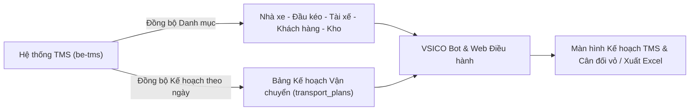
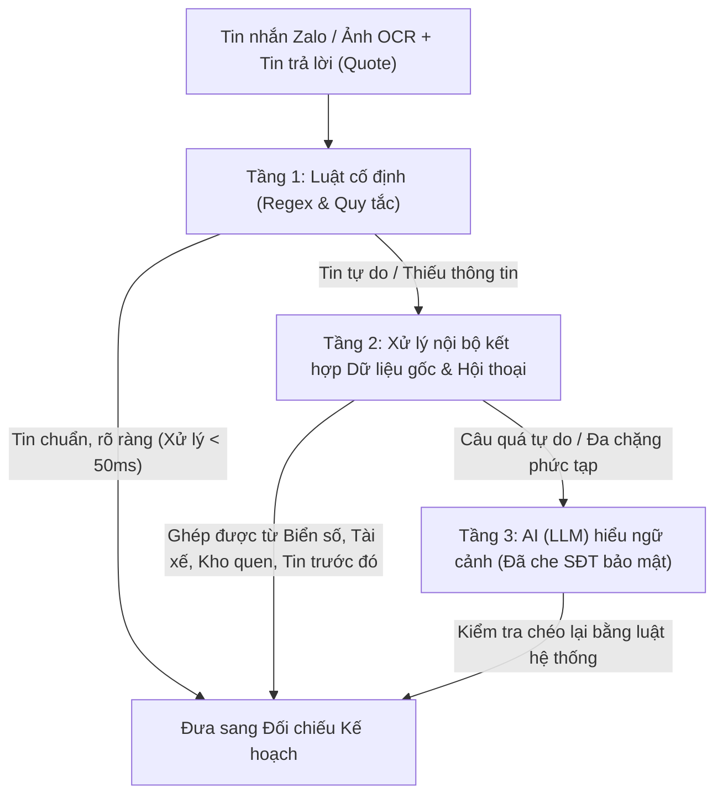
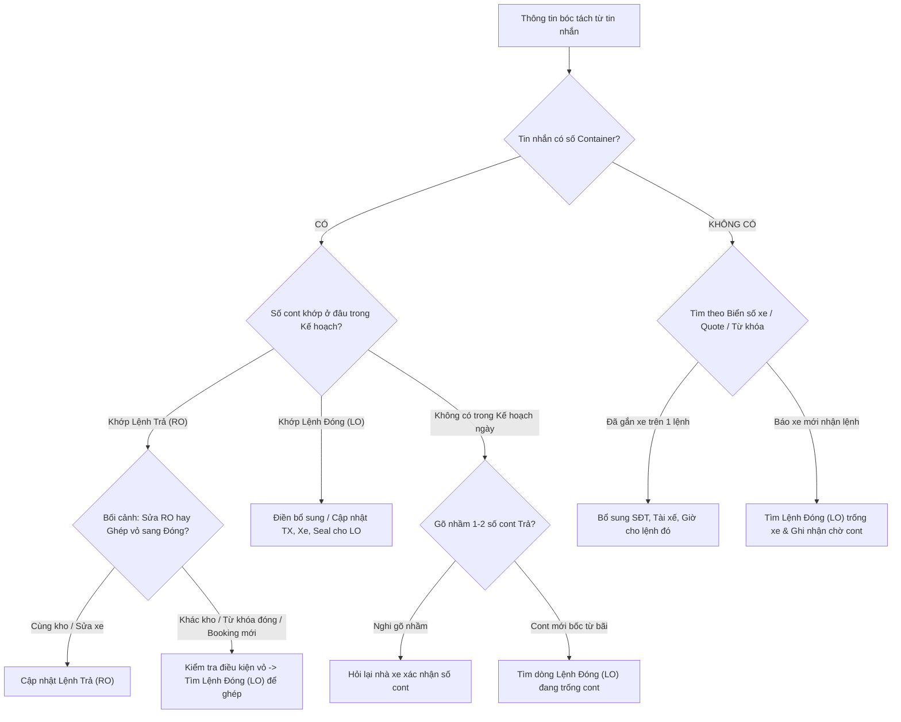
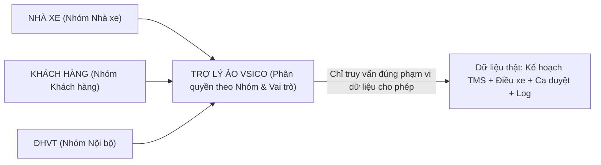
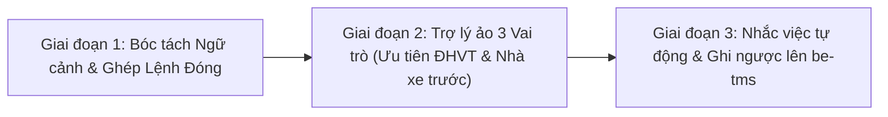

# BÁO CÁO ĐỊNH HƯỚNG PHÁT TRIỂN TIẾP THEO: HỆ THỐNG TỰ ĐỘNG HÓA ĐIỀU HÀNH VẬN TẢI VSICO

> Tài liệu trình bày nối tiếp từ báo cáo **Hệ thống Tự động hóa Điều hành Vận tải VSICO (Phần 1)**. Thiết kế theo dạng từng **Slide trực quan** (tổng quan, ít chữ, ưu tiên sơ đồ và ví dụ thực tế) để mọi bộ phận đều dễ nắm bắt.

---

## SLIDE 01 • TỔNG QUAN CHUYỂN GIAO TỪ GIAI ĐOẠN 1 SANG GIAI ĐOẠN 2

### Bước tiến cốt lõi của hệ thống

| Đã hoàn thành (Nền tảng Giai đoạn 1) | Trọng tâm phát triển tiếp theo (Giai đoạn 2) |
| :--- | :--- |
| Nhận tin chuẩn F1/F2/F3 và ảnh OCR | **Hiểu tin nhắn tự do, viết tắt, nhiều nhịp** qua ngữ cảnh hội thoại |
| Khớp chủ yếu theo **Số Container có sẵn** (Lệnh trả) | **Xử lý được Lệnh đóng chưa có cont & Ghép vỏ kết hợp** |
| Nhập kế hoạch bằng file Excel thủ công | **Kết nối trực tiếp API TMS** (Kế hoạch ngày, Nhà xe, Đầu kéo, Tài xế, Kho) |
| Bot chủ yếu thu thập tin một chiều | **Trợ lý ảo Vận tải 2 chiều** phục vụ Nhà xe, Khách hàng và ĐHVT |

---

## SLIDE 02 • KẾT QUẢ MỚI ĐẠT ĐƯỢC: KẾT NỐI DỮ LIỆU THẬT TỪ TMS

### Đã tự động đồng bộ từ hệ thống `be-tms` về Bot & Dashboard Web

### Phát hiện thực tế từ bộ dữ liệu ngày 09/11/2026 (Miền Bắc - 225 lệnh)

| Loại lệnh trên kế hoạch | Số lượng | Đặc điểm dữ liệu thực tế | Bài toán đặt ra cho Bot |
| :--- | :---: | :--- | :--- |
| **Lệnh Trả (RO - Hàng nhập)** | **137 lệnh** | **100% đã có sẵn số Container & Số Seal** | Dễ đối chiếu: chỉ cần khớp theo số Container để kiểm tra lỗi và cập nhật xe. |
| **Lệnh Đóng (LO - Hàng xuất)** | **88 lệnh** | **0% có số Container** (chỉ có Booking, Khách, Kho, Giờ hẹn, Size cont) | **Điểm khó mới**: Nhà xe báo xe trước khi có cont, hoặc lấy chính vỏ lệnh trả ghép sang lệnh đóng. |

---

## SLIDE 03 • BÀI TOÁN KHÓ NHẤT CẦN GIẢI: LỆNH ĐÓNG & TIN NHẮN TỰ DO

### Vì sao Bot cũ chưa xử lý hết thực tế ngoài nhóm Zalo?

* **Không có số Container làm "chìa khóa"**: Lệnh đóng đầu ngày chưa có số cont nên không thể tìm trực tiếp theo cont.
* **Tin nhắn "người với người tự hiểu"**: Nhà xe nhắn ngắn, viết tắt, tách thành nhiều tin rời:
  * *"Mai con 15C qua chỗ cũ lấy hàng nhé, tài Hùng 090..., chì báo sau"*
  * *"Xe 29C trả xong cont GAOU... rồi quay đầu đóng Hòa Phát 13h"*
* **Một Booking có nhiều chuyến gần giống nhau**: Cùng khách hàng, cùng kho, chỉ khác mỗi **giờ hẹn** (VD: 05:00, 07:00, 11:00).

**Nguyên tắc mới của Bot:**
> **Đủ căn cứ mới tự điền — Mơ hồ thì hỏi lại nhà xe — Xung đột thì chuyển ĐHVT bấm duyệt trên Web.** (Tuyệt đối không tự đoán bừa).

---

## SLIDE 04 • CÁCH BOT MỚI ĐỌC HIỂU TIN NHẮN (KIẾN TRÚC 3 TẦNG THÔNG MINH)

Thay vì phụ thuộc 100% vào AI bên ngoài (chậm và tốn chi phí), hệ thống xử lý theo hình phễu 3 tầng:

### Điểm mới giúp hiểu đúng ngay cả khi nhà xe viết tắt
1. **Tận dụng kho dữ liệu Danh mục đã kéo từ TMS**: Nhắn 4 số cuối biển số vẫn nhận ra xe thuộc nhà xe nào; nhắn tên riêng tài xế tự đối chiếu ra SĐT; đối chiếu kho từ danh sách lệnh chạy trong ngày.
2. **Đọc ngữ cảnh cuộc trò chuyện**: Đọc tin nhà xe đang **Quote (trả lời)**, tin ĐHVT vừa giao ngay phía trên, và **ghi nhớ bản nháp** nếu nhà xe báo xe trước rồi 30 phút sau mới nhắn số cont + số chì.
3. **Bắt cụm từ nghiệp vụ thực tế**: Hiểu *"chì báo sau"* là chưa có seal (không nhận nhầm chữ thành mã seal); hiểu *"trả xong quay đầu đóng"* là chuyến kết hợp 2 chặng.

---

## SLIDE 05 • CÁCH BOT TÌM ĐÚNG DÒNG KẾ HOẠCH (TRẢ - ĐÓNG - GHÉP VỎ)

### Sơ đồ phân loại đơn giản mọi tình huống từ Nhà xe

### Khi không có số Container, Bot dựa vào đâu để chọn đúng Lệnh Đóng?

| Nhóm tiêu chí | Cách Bot đối chiếu thực tế |
| :--- | :--- |
| **1. Điều kiện loại trừ bắt buộc** | Đúng nhà xe phụ trách, đúng cỡ cont (`20'` hay `40'`), lệnh chưa hủy, giờ đóng phải sau giờ trả (nếu ghép vỏ), vỏ không bị gắn cờ cấm ghép (`chỉ định hạ rỗng` / `bên khác đã xin`). |
| **2. Dấu hiệu nhận diện chính xác** | Tin được Quote lại, mã lệnh (`LO...`), số Booking (kể cả 3 số cuối), tên Kho / Điểm đóng, tên Khách hàng, khung **Giờ hẹn** (`05:00` vs `07:00` vs `11:00`). |
| **3. Tự học thói quen nhà xe** | Khi nhà xe nhắn tên kho kiểu quen miệng mà Bot chưa rõ, ĐHVT chọn 1 lần trên Web -> hệ thống tự lưu làm từ điển riêng cho nhà xe đó để lần sau tự nhận ra. |

---

## SLIDE 06 • QUY TẮC CẬP NHẬT BẢNG KẾ HOẠCH AN TOÀN (3 MỨC QUYẾT ĐỊNH)

| Mức độ rõ ràng | Bot hành động gì? | Cập nhật vào Bảng Kế hoạch? |
| :--- | :--- | :--- |
| **1. Rõ ràng tuyệt đối** | Tự động khớp lệnh và ghi nhận thông tin | **Điền mới** vào các ô còn trống (Biển số, Tài xế, SĐT, Cont, Seal, Giờ). Nếu sửa thông tin khi **chưa gửi khách** -> tự cập nhật kèm lưu lịch sử cũ -> mới. |
| **2. Còn phân vân (2-3 khả năng)** | Tự động hỏi lại 1 câu ngắn trên nhóm Nhà xe | **Lưu Bản nháp**, chờ nhà xe xác nhận đúng chuyến mới ghi chính thức. *(VD: "Xe 15C chạy chuyến Yamaha 5h hay 7h ạ?")* |
| **3. Mâu thuẫn hoặc Đã báo khách** | Đẩy ca lên Web cho ĐHVT kèm Top gợi ý | **Không tự ghi đè.** ĐHVT kiểm tra sự thay đổi và bấm xác nhận 1 chạm trên Web. |

---

## SLIDE 07 • NÂNG CẤP LỚN TIẾP THEO: TRỢ LÝ ẢO VẬN TẢI CHO 3 VAI TRÒ

Biến Bot từ công cụ **nhận tin thụ động** thành **Trợ lý tra cứu & điều phối trực tiếp trên Zalo**, dựa hoàn toàn trên dữ liệu thật của TMS và hệ thống Bot.

### Quyền hạn & Chức năng thiết thực của từng vai trò

| Vai trò | Họ có thể làm gì với Trợ lý ảo? | Giới hạn an toàn |
| :--- | :--- | :--- |
| **1. Nhà xe** | - Hỏi lịch hôm nay / ngày mai bên mình chạy mấy chuyến. - Hỏi chuyến nào còn **thiếu biển số / thiếu cont / thiếu chì**. - Tra chi tiết địa chỉ kho, giờ hẹn theo biển số xe hoặc mã lệnh. - Nhắn đổi đầu kéo / đổi tài xế -> Bot kiểm tra và **xác nhận 2 bước**. | Chỉ xem và thao tác trên chuyến thuộc nhà xe mình. |
| **2. Khách hàng** | - Hỏi hôm nay / mai có bao nhiêu chuyến, cont nào đã có xe. - Tra thông tin biển số xe, tên và SĐT tài xế, giờ hẹn dự kiến. - Nhắn yêu cầu đổi giờ / đổi kho / hủy chuyến & hỏi tiến độ duyệt. | Chỉ xem đúng khách hàng & kho đã phân tuyến (`RouteMap`). Không bao giờ lộ hàng khách khác. |
| **3. Điều hành Vận tải (ĐHVT)** | - Hỏi 1 câu ra toàn cảnh: *"Hôm nay có gì cần xử lý gấp?"* - Phát hiện nhanh: **Xe bị gán trùng lịch, Cân đối vỏ thiếu/thừa, Cảnh báo hạ rỗng, Tin gửi khách lỗi**. - Hỏi lý do tại sao một ca cần duyệt và ảnh hưởng nếu hủy chuyến. | **Chỉ đọc & tổng hợp trên Zalo.** Lệnh duyệt, sửa, hủy bắt buộc bấm trên Web để đảm bảo kiểm toán. |

---

## SLIDE 08 • VÍ DỤ HỘI THOẠI THỰC TẾ KHI HỆ THỐNG HOẠT ĐỘNG

### Kịch bản 1: Nhà xe tự hỏi & đổi xe (Giảm việc ĐHVT nhắn đi nhắn lại)
* **Nhà xe:** *"Anh còn chuyến nào mai chưa báo xe không em?"*
* **Bot:** *"Ngày 10/11 anh còn 2 lệnh đóng chưa có xe: (1) LO2447 - Yamaha Kim Anh 05:00 (40'); (2) LO2448 - Yamaha Kim Anh 07:00 (40')."*
* **Nhà xe:** *"Cho xe 15C-066.95 tài Hùng chạy chuyến 5h nhé, cont lấy sau."*
* **Bot:** *"Đã ghi nhận xe 15C-066.95 - tài xế Hùng vào lệnh LO2447 (05:00). Khi nào có số cont và chì anh nhắn lại giúp em nhé."*

### Kịch bản 2: ĐHVT nắm việc trong 5 giây (Không cần mở nhiều màn hình)
* **ĐHVT:** *"Hôm nay có vấn đề gì cần anh xử lý không?"*
* **Bot:** *"Tổng hợp ngày 09/11: 225 lệnh (137 trả, 88 đóng) | Còn 12 lệnh đóng chưa có xe | Phát hiện 2 trường hợp cần chú ý: (1) Ca #402: Nhà xe báo lệch số chì cont GAOU...; (2) Xe 29C-445.41 đang trùng giờ 2 chuyến buổi sáng. Chi tiết xử lý tại Web: .../reviews"*

---

## SLIDE 09 • PHẠM VI THỰC TẾ: LÀM NGAY VS GIAI ĐOẠN SAU

Để báo cáo trung thực và triển khai chắc chắn, hệ thống phân tách rõ theo dữ liệu thực tế hiện có:

| Triển khai ngay (Đủ 100% dữ liệu từ TMS & Bot) | Để Giai đoạn sau (Khi TMS mở thêm dữ liệu) |
| :--- | :--- |
| - Bóc tách 3 tầng + Hiểu bối cảnh Lệnh đóng / Ghép vỏ - Cập nhật dữ liệu xe/tài/cont vào Kế hoạch nội bộ - Trợ lý ảo hỏi đáp kế hoạch, thiếu thông tin, đổi xe 2 bước - Cảnh báo trùng xe, lệch chì, cân đối vỏ & tóm tắt cho ĐHVT - Chủ động nhắc nhà xe trước giờ đóng nếu vẫn thiếu xe/cont | - Theo dõi vị trí xe chạy thực tế trên đường (cần dữ liệu GPS) - Báo trạng thái đã vào cổng cảng / đã hạ hàng xong (cần API sự kiện TMS) - Tra cứu ảnh biên bản giao nhận / chứng từ POD - Tự động ghi ngược dữ liệu từ Bot lên `be-tms` (khi TMS mở API ghi) |

---

## SLIDE 10 • LỘ TRÌNH TRIỂN KHAI ĐỀ XUẤT (3 BƯỚC CUỐN CHIẾU)

### Thứ tự thực hiện và Tiêu chí nghiệm thu

1. **Bước 1 — Hoàn thiện Bộ não Bóc tách & Đối chiếu Lệnh đóng/trả**:
   * Xử lý được tin thiếu cont, tin nhiều nhịp, chuyến kết hợp `RO -> LO` và tự học tên kho quen của nhà xe.
   * **Thước đo an toàn**: Tỷ lệ Bot tự ghép nhầm khách hàng / nhầm kho phải bằng **0%**.
2. **Bước 2 — Kích hoạt Trợ lý ảo Vận tải (Chạy thử nhóm Nội bộ -> Nhà xe -> Khách hàng)**:
   * ĐHVT dùng trước để kiểm chứng số liệu thật hàng ngày; sau đó mở cho 2-3 nhóm nhà xe quen dùng thử nghiệm song song (Pilot) rồi mới mở rộng sang nhóm khách hàng.
3. **Bước 3 — Tự động nhắc thiếu tin & Đồng bộ 2 chiều lên TMS**:
   * Bot chủ động nhắc trước giờ hẹn nếu chuyến thiếu xe/cont và đẩy ngược dữ liệu sạch trực tiếp về phần mềm `be-tms`.
