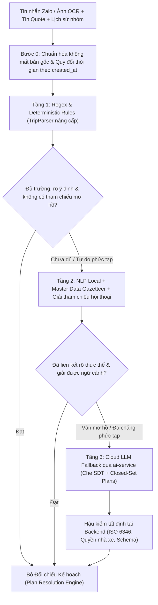
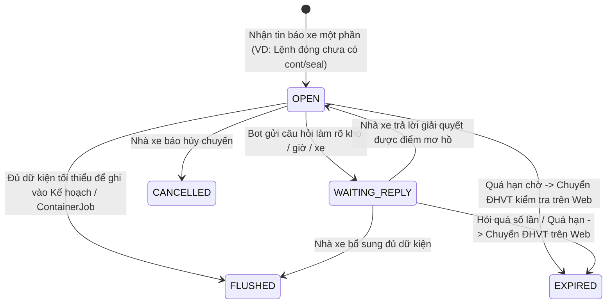

# KẾ HOẠCH THIẾT KẾ & TRIỂN KHAI: BÓC TÁCH ĐA TẦNG (REGEX - NLP LOCAL - LLM), ĐỐI CHIẾU LỆNH ĐÓNG/TRẢ VÀ CẬP NHẬT BẢNG KẾ HOẠCH (`transport_plans`)

Tài liệu này đặc tả chi tiết kiến trúc nâng cấp toàn diện cho hệ thống **VSICO Zalo Bot** nhằm giải quyết bài toán phức tạp nhất trong vận hành thực tế: hiểu đúng ngữ cảnh hội thoại của nhà xe, bóc tách thực thể đa tầng ưu tiên xử lý nội bộ (Local-first), đối chiếu chính xác vào bảng kế hoạch vận chuyển (`transport_plans`) cho cả **Lệnh Trả (`RO`)**, **Lệnh Đóng (`LO`)** và **Lệnh Kết Hợp (`RO -> LO`)**, đồng thời kiểm soát chặt chẽ việc điền khuyết và cập nhật dữ liệu lên kế hoạch.

---

## 1. Mục tiêu và Nguyên tắc Thiết kế Cốt lõi

### 1.1. Sáu câu hỏi đầu ra bắt buộc cho mỗi cụm Xe / Container
Với mỗi tin nhắn (hoặc chuỗi tin nhắn) từ nhà xe, hệ thống không chỉ dừng lại ở việc tách từ mà phải trả lời tường minh 6 câu hỏi nghiệp vụ kèm bằng chứng (`evidence`):

1. **Ý định (`Intent`)**: Tin này là báo chuyến mới (`CREATE`), bổ sung thông tin còn thiếu (`SUPPLEMENT`), sửa/đổi thông tin đã báo (`UPDATE`), báo hủy (`CANCEL`), hỏi thông tin (`QUERY`) hay giao tiếp thông thường (`IGNORE_CHAT`)? (Lưu ý: một tin có thể chứa nhiều ý định trên các chặng khác nhau).
2. **Loại chặng (`Leg / Order Type`)**: Đang nói về **Lệnh Trả (`tra` / `RO`)**, **Lệnh Đóng (`dong` / `LO`)**, hay **Cả hai trong chuyến kết hợp (`COMBINED_RO_LO`)**?
3. **Liên kết Kế hoạch (`Target Plan Resolution`)**: Khớp với dòng `transport_plans.id` nào (hoặc danh sách ứng viên `candidate_plan_ids` nào)?
4. **Nguồn gốc từng trường dữ liệu (`Field Provenance`)**: Trường nào lấy trực tiếp từ tin nhắn hiện tại (`current_message`), trường nào lấy từ ảnh (`ocr`), từ tin trích dẫn (`quoted_message`), từ bản nháp hội thoại (`draft`), từ danh mục gốc (`master_catalog`: `vehicles`, `drivers`, `warehouses`), hay kế thừa từ dòng kế hoạch (`plan_inherited`)?
5. **Mâu thuẫn và Độ chắc chắn (`Conflicts & Confidence`)**: Có vi phạm điều kiện loại trừ hay lệch dữ liệu cố định của kế hoạch không? Có tham chiếu nào chưa giải được (như *"chỗ cũ"*, *"xe trên"*) không?
6. **Quyết định điều phối (`Resolution Action`)**: Đủ căn cứ để tự động cập nhật kế hoạch (`AUTO_APPLY`), cần bot hỏi lại nhà xe trên Zalo (`ASK_CARRIER`), hay phải chuyển ĐHVT xử lý trên Web (`ESCALATE_DHVT_WEB`)?

### 1.2. Năm nguyên tắc bất biến
1. **Không tự đoán khi mơ hồ**: Những câu mà ngay cả người điều phối đọc cũng phải hỏi lại (ví dụ nhà xe nhắn *"mai xe 15C qua chỗ cũ"* khi nhà xe đó có 2 kho thường đi trong kế hoạch), bot bắt buộc phải hỏi lại hoặc tạo ca chờ duyệt, tuyệt đối không tự ghép bừa.
2. **Kiến trúc thác nước 3 tầng (`Regex + Rule` -> `NLP Local` -> `Cloud LLM Fallback`)**: Tin nhắn chuẩn, rõ ràng được xử lý dứt điểm ở tầng Local trong vài mili-giây; chỉ những tin có cấu trúc tự do phức tạp hoặc tham chiếu ngữ cảnh sâu mới gọi xuống tầng sau.
3. **AI/NLP chỉ đề xuất, Backend quyết định**: Mọi kết quả từ NLP Local hay LLM đều phải qua bộ kiểm tra tất định của Backend (kiểm tra chữ số ISO 6346 Modulo 11, đối chiếu quyền nhà xe `carrier_id`, kiểm tra ràng buộc thời gian/cỡ cont/cảnh báo vỏ).
4. **Thời gian tương đối tính theo thời điểm gửi tin**: Mọi từ chỉ thời gian tương đối (*"hôm nay"*, *"mai"*, *"chiều nay"*, *"sáng mai"*) phải quy đổi dựa trên mốc thời gian tạo tin nhắn gốc (`zalo_messages.created_at` theo múi giờ `Asia/Ho_Chi_Minh`), không tính theo thời điểm worker xử lý hàng đợi.
5. **Mọi thao tác duyệt của ĐHVT thực hiện trên Web**: Bot chỉ hỏi lại nhà xe trên nhóm nhà xe khi cần làm rõ thông tin đầu vào; mọi quyết định duyệt ca mâu thuẫn hoặc chọn dòng kế hoạch của ĐHVT đều thực hiện trên giao diện Web quản lý (`/reviews`, `/plans`).

---

## 2. Khai thác Hệ thống Danh mục (`Master Data`) để Tăng Độ Chính Xác

Hệ thống đã đồng bộ đầy đủ dữ liệu từ phần mềm TMS về MySQL. Bộ bóc tách và đối chiếu phải tận dụng trực tiếp 6 bảng danh mục này làm tri thức nền (Knowledge Base):

| Bảng dữ liệu | Các cột trọng tâm | Vai trò trong Bóc tách (NLP Local) & Đối chiếu Kế hoạch |
| :--- | :--- | :--- |
| `carriers` & `zalo_groups` | `id`, `tms_carrier_id`, `name`, `short_name`, `zalo_group_id` | Xác định ngay tin nhắn đến từ nhóm Zalo của nhà xe nào (`carrier_id`), dùng làm bộ lọc phạm vi kế hoạch và lịch sử thói quen. |
| `vehicles` | `plate_no`, `carrier_id`, `vehicle_type`, `driver_hint_name`, `is_active` | 1. Nhận diện biển số viết tắt (ví dụ nhà xe chỉ nhắn 4-5 số cuối `"447.22"` -> tra trong danh sách xe của đúng `carrier_id` ra `"29C-447.22"`).<br/>2. Kiểm tra xe báo có thuộc đội xe của nhà xe gửi tin hay không.<br/>3. Gợi ý tài xế mặc định (`driver_hint_name`) khi tin thiếu tên tài xế. |
| `drivers` | `full_name`, `normalized_name`, `phone`, `carrier_id`, `identity_card` | 1. Xây từ điển tên riêng tài xế theo từng nhà xe để NLP Local tách chính xác tên người khỏi tên kho/địa danh.<br/>2. Khi nhà xe chỉ nhắn tên tài xế + biển số (thiếu SĐT), tra cứu `drivers` thuộc cùng `carrier_id`: nếu có duy nhất 1 tài xế khớp tên thì gợi ý SĐT (`source = "master_driver_catalog"`).<br/>3. Khi nhà xe chỉ nhắn SĐT, tra ngược ra tên chuẩn của tài xế. |
| `customers` & `customer_aliases` | `id`, `tms_customer_id`, `name`, `normalized_name`, `alias` | Nhận diện tên chủ hàng viết tắt hoặc tên gọi dân dã (ví dụ `"Uni"` -> `UNILEVER`, `"TTC"` -> `TTC - BIÊN HÒA`). |
| `warehouses` & `warehouse_aliases` | `id`, `tms_warehouse_id`, `customer_id`, `name`, `address`, `alias` | Xây dựng bộ `Gazetteer` (từ điển địa danh/kho) chạy nội bộ để bắt các cụm từ chỉ địa điểm trong tin nhắn tự do và ánh xạ về `warehouse_id`. |
| `transport_plans` | `tms_order_id`, `order_code`, `booking_no`, `bill_of_lading_no`, `order_type`, `container_no`, `container_size`, `container_warning`, `required_time`, `province_id`, `ward_name`, `warehouse_name`, `points_json` | Tập ứng viên đóng (`Closed-Set Candidates`) theo khung ngày kế hoạch để đối chiếu lệnh trả, lệnh đóng và chuyến kết hợp. |

---

## 3. Kiến trúc Chi tiết Pipeline Bóc tách 3 Tầng (`Local-First Extraction`)



### 3.1. Bước 0: Tiền xử lý và Chuẩn hóa bảo toàn bản gốc (`Text Normalizer`)
* Lưu nguyên vẹn `raw_text` để hiển thị bằng chứng (`evidence`) và audit.
* Tạo bản văn bản chuẩn hóa phục vụ phân tích nhưng **giữ nguyên dấu câu phân cách** (dấu chấm phẩy `;`, dấu gạch chéo `/`, xuống dòng `\n`, dấu gạch ngang `-`) vì đây là ranh giới quan trọng để tách nhiều xe hoặc nhiều chặng.
* Chuẩn hóa bảng mã tiếng Việt về Unicode dựng sẵn (`NFC`), sửa các lỗi dính chữ phổ biến (*"cont40"*, *"txHùng"*, *"chì2399"*).
* **Quy đổi thời gian tương đối**: Dựa vào `message.created_at`:
  * *"hôm nay"*, *"nay"* -> `date(message.created_at)`
  * *"mai"*, *"ngày mai"*, *"sáng mai"*, *"chiều mai"* -> `date(message.created_at) + 1 day`
  * *"mốt"*, *"ngày kia"* -> `date(message.created_at) + 2 days`
  * Nếu tin nhắn gửi vào khung giờ đêm (`18:00 - 23:59`) mà không ghi ngày, hệ thống xét song song cửa sổ 2 ngày: `[date(created_at), date(created_at) + 1 day]`.

### 3.2. Tầng 1: Regex và Luật Tất Định (`Deterministic Rule Engine`)
Mở rộng `backend/src/parsing/trip_parser.py` để bắt toàn bộ thực thể có quy luật hình thái cố định:

1. **Số Container**:
   * Bắt mẫu chuẩn 4 chữ + 7 số (`[A-Z]{3}[UJZ]\d{7}`) và kiểm tra chữ số kiểm tra Modulo 11 (ISO 6346).
   * Bắt riêng mẫu nghi lỗi (`Malformed Container`: 4 chữ + 5/6/8 số, hoặc nhầm `O` <-> `0`, `I` <-> `1`, `B` <-> `8`) -> gắn nhãn `status = "invalid_checksum_or_length"` kèm danh sách gợi ý từ bảng `transport_plans`, **tuyệt đối không tự động sửa ngầm rồi coi là đúng**.
2. **Biển số Đầu kéo & Rơ-moóc**:
   * Phân biệt rõ đầu kéo (`15C`, `29H`, `50H`...) và rơ-moóc (`15R`, `29R`, `RM`...).
   * Hỗ trợ bắt biển số rút gọn 4–5 số cuối khi đi sau từ khóa (`"xe 447.22"`, `"con 31525"`) và đối chiếu với bảng `vehicles` của đúng nhà xe.
3. **Số điện thoại, Kích cỡ Cont, Số Booking / Mã lệnh**:
   * Bắt SĐT 10 số chuẩn Việt Nam.
   * Bắt cỡ/loại cont (`20DC`, `40HC`, `45`, `20'`, `40'`).
   * Bắt mã lệnh TMS (`RO\d{3,6}`, `LO\d{3,6}`) và số Booking / Vận đơn (bao gồm cả mẫu viết tắt *"bk 332"*, *"book 0492"*).
4. **Từ điển Cụm Trạng thái & Quan hệ Chặng (`Phrase Rules`)**:
   * **Cụm hoãn thông tin (Negative/Deferred Markers)**: *"chì báo sau"*, *"seal báo sau"*, *"cont báo sau"*, *"chưa có số cont"*, *"lấy vỏ báo sau"* -> Gắn `seal_status = "DEFERRED"` hoặc `container_status = "DEFERRED"` (ngăn lỗi bắt nhầm chữ *"báo sau"* làm mã seal).
   * **Cụm chuyển tiếp đa chặng (Multi-leg Connectors)**: *"trả xong quay đầu đóng"*, *"hạ xong đóng tiếp"*, *"kết hợp đóng"*, *"trả ... rồi qua ..."* -> Đánh dấu `is_combined_trip = True` và tách câu tại vị trí từ nối thành 2 mệnh đề (`Leg 1: RETURN`, `Leg 2: LOAD`).

### 3.3. Tầng 2: NLP Local & Giải Tham Chiếu Hội Thoại (`Local NLP & Context Engine`)
Xây dựng module mới `backend/src/parsing/local_nlp_extractor.py` chạy hoàn toàn trên máy chủ nội bộ, không phụ thuộc mạng ngoài:

1. **Bộ nhận diện Thực thể Danh mục (`Master Data Gazetteer & Fuzzy Token Matcher`)**:
   * Nạp vào bộ nhớ đệm (in-memory trie / token index, tự làm mới khi đồng bộ TMS) toàn bộ tên và bí danh của:
     * Tài xế (`drivers.full_name` theo `carrier_id`).
     * Khách hàng (`customers.name`, `customer_aliases.alias`).
     * Kho, Phường/Xã, Tỉnh (`warehouses.name`, `warehouse_aliases.alias`, `transport_plans.warehouse_name`, `ward_name`, `province_name` của các kế hoạch trong khung ngày).
   * Nhờ đó, câu *"Mai con 15C-066.95 qua Kim Anh 5h nhé, tài Hùng"* được tách chính xác:
     * `plate_number`: `15C-066.95`
     * `warehouse_hint`: `Kim Anh` (khớp token `YAMAHA KIM ANH SÓC SƠN`)
     * `required_time`: `05:00`
     * `driver_name`: `Hùng` (khớp danh mục `drivers` của nhà xe)
2. **Phân đoạn Đa xe & Liên kết Thực thể (`Clause Graph & Entity Linking`)**:
   * Tách tin nhắn thành các mệnh đề theo cấu trúc câu và khoảng cách vị trí token (`Token Proximity`).
   * Quy tắc liên kết:
     * Một biển số xe đi kèm nhiều số cont trong cùng 1 mệnh đề -> Tạo N bản ghi cont cùng chia sẻ thông tin xe + tài xế đó.
     * Nhiều biển số xe trong 1 tin: mỗi xe chỉ nhận tài xế/SĐT/cont nằm trong phạm vi mệnh đề của xe đó. Nếu có 2 xe nhưng chỉ có 1 tên tài xế nằm lửng lơ không rõ thuộc xe nào -> gắn `driver_link_status = "ambiguous"`, không tự gán cho cả 2 xe.
3. **Giải Tham chiếu Hội thoại (`Coreference Resolution`)**:
   * Khi phát hiện các từ chỉ định như *"xe này"*, *"xe trên"*, *"cont đó"*, *"chỗ cũ"*, *"kho cũ"*, *"như hôm qua"*:
     * **Tham chiếu `"xe trên"` / `"xe này"` / `"cont đó"`**: Tra cứu theo thứ tự: (1) Tin nhắn được `quote`, (2) Bản nháp `message_drafts` đang mở của người gửi, (3) Tin nhắn gần nhất trong vòng 30 phút của cùng người gửi. Chỉ tự điền khi tìm thấy **duy nhất 1 thực thể tương ứng**; nếu tin trước có 2 xe thì đánh dấu `unresolved` để hỏi lại.
     * **Tham chiếu `"chỗ cũ"` / `"kho cũ"`**:
       * Kiểm tra xem trong cuộc hội thoại (tin ĐHVT vừa nhắn hoặc tin được quote) có vừa nhắc tới một kho cụ thể không.
       * Nếu không, tra lịch sử các kho nhà xe đó từng chạy (`habit`), **nhưng chỉ dùng để xếp hạng các dòng kế hoạch đang mở trong ngày**, tuyệt đối không tự chốt kho gần nhất nếu không kiểm tra kế hoạch hoặc khi nhà xe có nhiều hơn 1 kho quen.

### 3.4. Tầng 3: Cloud LLM Fallback có Kiểm soát (`ai-service`)
Chỉ gọi sang `ai-service` (`POST /api/v1/extract`) khi kết quả sau Tầng 2 vẫn còn:
* Ý định chưa rõ ràng hoặc cấu trúc câu quá tự do không tách được ranh giới giữa các xe/chặng.
* Có địa điểm hoặc tham chiếu mà từ điển nội bộ chưa bắt được.

**Cơ chế kiểm soát an toàn khi gọi LLM**:
1. **Che SĐT (`PII Masking`)**: Toàn bộ SĐT được thay bằng token `0903xxxx59` trước khi rời khỏi `backend`.
2. **Đóng khung Kế hoạch Ứng viên (`Scoped Candidate Plans`)**: Backend chỉ gửi danh sách kế hoạch ứng viên đã lọc theo nhà xe / khung ngày (bao gồm cả dòng `RO` và dòng `LO` trống cont), kèm các trường nhận diện: `plan_id`, `order_code`, `booking_no`, `order_type`, `container_no`, `container_size`, `customer_name`, `warehouse_name`, `ward_name`, `province_name`, `required_time`.
3. **Schema đầu ra bắt buộc có Bằng chứng (`Structured Output with Evidence`)**:

```json
{
  "intent": "PARSE_TRUCK_INFO",
  "is_multi_vehicle": false,
  "items": [
    {
      "leg_sequence": 1,
      "order_type": "LOAD",
      "is_combined_from_return": false,
      "plate_number": "15C-066.95",
      "driver_name": "Hùng",
      "driver_phone": "0903xxxx59",
      "container_no": null,
      "container_status": "DEFERRED",
      "seal_no": null,
      "seal_status": "DEFERRED",
      "warehouse_hint": "chỗ cũ",
      "warehouse_status": "UNRESOLVED_REFERENCE",
      "plan_date": "2026-11-10",
      "eta": "07:00",
      "suggested_plan_id": null,
      "evidence": {
        "plate_number": "con 15C-066.95",
        "plan_date": "Mai",
        "warehouse_hint": "qua chỗ cũ lấy hàng",
        "seal_no": "chì báo sau"
      },
      "unresolved_fields": ["warehouse_id", "container_no", "seal_no"],
      "confidence": 0.78
    }
  ]
}
```

---

## 4. Quản lý Hội thoại, Bản nháp (`message_drafts`) và Cơ chế Hỏi lại Nhà xe

### 4.1. Gom tin rời và Quản lý Đa bản nháp song song
Nhà xe thường nhắn rải rác nhiều tin (tin 1 báo biển số + giờ đóng, 20 phút sau vào bãi bốc vỏ xong mới nhắn tin 2 báo số cont + số chì). Bảng `message_drafts` được vận hành theo quy tắc:

* **Khóa phân biệt bản nháp**: Không gom mù quáng mọi tin của cùng `sender_id` vào một cục. Mỗi bản nháp gắn với `(group_id, sender_id, draft_key)` trong đó `draft_key` là `plate_number` hoặc `container_no` hoặc `target_plan_id`.
* **Liên kết tin bổ sung (`SUPPLEMENT`) vào bản nháp**:
  1. Nếu nhà xe **Quote** đúng câu hỏi của bot hoặc tin báo xe trước đó -> Nối trực tiếp vào bản nháp gắn với `zalo_message_id` đó.
  2. Nếu nhà xe nhắn kèm biển số xe (`"15C-066.95 cont GAOU... chì 123"`) -> Tìm bản nháp đang mở (`status IN ('OPEN', 'WAITING_REPLY')`) của đúng biển số `15C-066.95`.
  3. Nếu nhà xe chỉ nhắn trống không `"GAOU7821312 chì 225542"` (không quote, không ghi biển số):
     * Nếu người gửi đó đang có **duy nhất 1 bản nháp đang chờ cont/seal** trong cửa sổ 60 phút -> Ghép vào bản nháp đó.
     * Nếu người gửi đang có **nhiều hơn 1 bản nháp chờ cont** -> Bot hỏi lại ngắn gọn: *"Anh/chị cho em xin số cont GAOU7821312 này lắp vào xe nào (15C-066.95 hay 29C-447.22) ạ?"*

### 4.2. Trạng thái Vòng đời Bản nháp (`message_drafts.status`)



---

## 5. Bộ Đối Chiếu Kế Hoạch Vận Chuyển (`Plan Resolution Engine`)

Sau khi có kết quả bóc tách từ 3 tầng, Backend chạy `PlanResolutionEngine` để tìm dòng `transport_plans` tương ứng.

### 5.1. Bước 1: Kiểm tra Cập nhật Chuyến đang mở trước khi Ghép mới
Trước khi coi tin nhắn là báo lệnh mới, hệ thống kiểm tra theo thứ tự ưu tiên:
1. **Quote trực tiếp**: Tin nhắn đang quote lại một tin báo xe cũ hoặc câu hỏi của bot đã gắn sẵn `transport_plan_id` / `container_job_id`.
2. **Trùng số Container trên chuyến đang mở**: Số cont khớp với một dòng kế hoạch đã được chính nhà xe này báo trước đó.
3. **Trùng Biển số xe trên dòng kế hoạch đang chờ bổ sung**: Biển số xe khớp với một dòng `LO` đã ghi nhận xe ở Pha 1 và đang chờ bổ sung số cont/seal.
4. **Từ khóa sửa đổi tường minh**: Có các cụm *"đổi xe"*, *"thay tài"*, *"sửa lại sđt"*, *"đổi sang cont..."*, *"chì đúng là..."*.

Nếu phát hiện cùng một số cont vừa có khả năng là **Cập nhật Lệnh Trả (`RO`)**, vừa có khả năng là **Báo Lệnh Đóng Kết Hợp (`RO -> LO`)**, hệ thống **giữ cả hai giả thuyết (`Hypothesis_Update_RO` và `Hypothesis_Combine_LO`)** để đưa vào bước đối chiếu địa điểm, thời gian và nội dung bên dưới, không mặc định lấy bản ghi mới nhất.

---

### 5.2. Bước 2: Luồng Đối chiếu Lệnh Trả (`RO`)
Khi tin nhắn có số container khớp với dòng `order_type = 'tra'` và bối cảnh không phải là báo chặng đóng tiếp theo:
1. **Kiểm tra quyền nhà xe**:
   * Nếu `plan.carrier_id` đã gán và khác `group.carrier_id` -> Chặn tự động, tạo ca `CARRIER_MISMATCH` cho ĐHVT.
   * Nếu `plan.carrier_id IS NULL` (trên TMS chưa gán nhà xe) -> Cho phép nhà xe hợp lệ nhận và ghi nhận `carrier_id` từ nhóm Zalo.
2. **Xử lý khi trùng nhiều dòng `RO`**: Lọc tiếp theo khung ngày (`plan_date`), trạng thái chưa hoàn thành, khách hàng, kho, giờ hẹn và quote. Nếu vẫn còn $> 1$ dòng -> Hỏi nhà xe hoặc chuyển ĐHVT.
3. **Đối chiếu các trường cố định của kế hoạch trả**:
   * Kế hoạch trả đã có sẵn `customer_id`, `warehouse_id`, `container_size`, `seal_no` gốc.
   * Nếu tin nhà xe báo lệch `seal_no` hoặc lệch `customer`/`warehouse`: phân biệt xem nhà xe gõ nhầm hay hãng tàu đổi chì thực tế -> Tạo cảnh báo / ca duyệt `PLAN_FIELD_CONFLICT`, không tự động ghi đè `seal_no` gốc khi chưa được ĐHVT duyệt.

---

### 5.3. Bước 3: Luồng Đối chiếu Lệnh Đóng (`LO`) và Chuyến Kết Hợp (`RO -> LO`)

#### Trường hợp A (`TH1` & `TH4`): Số Cont đã có sẵn trên dòng Kế hoạch Đóng (`LO`)
* Tìm các dòng `LO` mang số cont đó trong khung ngày của nhà xe.
* Nếu số cont đó đồng thời nằm ở cả dòng `RO` (chặng trả sáng) và dòng `LO` (chặng đóng chiều):
  * Đối chiếu địa điểm kho, khách hàng, giờ hẹn, số seal mới, trạng thái từng chặng và nội dung quote để xác định tin đang cập nhật `RO`, cập nhật `LO` hay cập nhật cả hai chặng (ví dụ đổi đầu kéo cho cả chuyến đi trả lẫn quay đầu đóng).

#### Trường hợp B (`TH3`): Số Cont trùng với Lệnh Trả (`RO`), nhưng các dòng Lệnh Đóng (`LO`) chưa có Cont (Ứng viên Chuyến Kết Hợp)
Đây là tình huống nhà xe lấy chính vỏ container vừa trả hàng nhập xong để đi đóng hàng xuất:
1. **Phân biệt `Update RO` với `Ghép vỏ sang LO`**:
   * Chỉ xét ghép sang `LO` khi có ít nhất một trong các bằng chứng:
     * Tin nhắn có cấu trúc 2 chặng (*"trả ... xong quay đầu đóng ..."*, *"kết hợp đóng..."*).
     * Địa điểm kho / khách hàng trong tin khác hẳn kho của dòng `RO` và khớp với một kho có lệnh đóng `LO`.
     * Có nhắc tới `booking_no`, mã lệnh `LO...`, hoặc báo số chì mới kèm từ khóa đóng/xuất.
2. **Kiểm tra điều kiện vỏ của dòng `RO` (`Container Warning Check`)**:
   * Kiểm tra cột `RO.container_warning` và `RO.container_ownership`:
     * Nếu `container_warning == 'empty_drop'` (*Chỉ định hạ rỗng*), `'other_requested'` (*Bên khác đã xin*) hoặc `'soc'` (`container_ownership == 2`): **Chặn tự động ghép vỏ**, cảnh báo ngay cho nhà xe và tạo ca `CONTAINER_NOT_MATCHABLE` cho ĐHVT.
3. **Tìm và xếp hạng các dòng `LO` trống cont** theo Ma trận mục 5.4.
   * Nếu một tin nhắn báo gộp cả 2 chặng (*"Xe 15C trả Unilever cont GAOU... kết hợp đóng Hòa Phát"*): hệ thống tạo **2 tác vụ độc lập**:
     * Tác vụ 1: Điền/cập nhật xe & tài xế vào dòng `RO` (*Unilever*).
     * Tác vụ 2: Ghép `container_no` (`GAOU...`) + xe & tài xế vào dòng `LO` (*Hòa Phát*).

#### Trường hợp C (`TH5`): Tin có Số Cont nhưng KHÔNG có trong Kế hoạch ngày đó
Không mặc định kết luận ngay là lệnh đóng riêng, mà kiểm tra tuần tự:
1. **Kiểm tra chuẩn ISO 6346 và So khớp gần đúng (`Near-Miss Check`)**:
   * Tính khoảng cách chỉnh sửa (`Levenshtein distance <= 2`) với toàn bộ `container_no` của các dòng `RO` trong khung ngày.
   * Nếu khớp gần đúng 1 số cont `RO` VÀ địa điểm/khách hàng trong tin lại trùng với chính dòng `RO` đó -> Kết luận **nghi gõ nhầm số cont trả**, bot hỏi lại nhà xe xác nhận số cont đúng, không tự sửa cont và không đẩy sang lệnh đóng.
2. **Kiểm tra lệch ngày kế hoạch**: Tra rộng ra $\pm 2$ ngày xem số cont đó có thuộc kế hoạch ngày hôm trước hoặc ngày mai không.
3. **Xếp hạng vào các dòng Lệnh Đóng (`LO`) trống cont**:
   * Khi số cont hợp lệ ISO 6346 (vỏ mới bốc từ depot/bãi cảng) và bối cảnh ủng hộ lệnh đóng -> Chạy bộ lọc & chấm điểm trên tập `LO` đang trống `container_no`.
   * Nếu không tìm được dòng `LO` nào khớp -> Tạo ca `NO_MATCHING_PLAN` cho ĐHVT trên Web, tuyệt đối không tự sinh dòng kế hoạch mới.

#### Trường hợp D (`TH6`): Tin nhắn CHƯA CÓ Số Container
Nhà xe báo xe và tài xế nhận lệnh đóng trước khi lấy vỏ (*"Mai xe 15C-066.95 Hùng 090... đóng Yamaha Kim Anh 5h, chì báo sau"*):
1. Kiểm tra xem biển số `15C-066.95` đã gắn vào dòng kế hoạch hay bản nháp nào đang mở chưa (lưu ý một xe có thể chạy nhiều chuyến trong ngày hoặc qua ngày, nên phải kiểm tra kèm khung giờ, địa điểm và quote).
2. Nếu là báo xe mới cho lệnh đóng: chạy bộ lọc & chấm điểm trên các dòng `LO` còn trống xe và trống cont.
3. **Ghi nhận Pha 1 (Đã có xe, chờ Cont/Seal)**:
   * Nếu đạt mức `AUTO_APPLY`: Ghi `planned_truck_plate`, `driver_name`, `driver_phone`, `carrier_id` vào dòng `LO`, đồng thời mở bản nháp liên kết `transport_plan_id` đó ở trạng thái chờ bổ sung `container_no` và `seal_no`. Chưa phát hành thông báo gửi khách nếu quy định khách hàng yêu cầu phải có đủ số cont/seal.

---

### 5.4. Ma trận Điều kiện Loại trừ (`Hard Filters`) và Điểm Xếp hạng Ứng viên `LO` (`Candidate Scoring`)

Không bao giờ cộng điểm để một ứng viên thắng nếu vi phạm điều kiện loại trừ.

#### A. Năm Điều kiện Loại trừ Bắt buộc (`Hard Exclusions`)
Một dòng kế hoạch `LO` bị loại ngay khỏi tập ứng viên nếu rơi vào bất kỳ điều kiện nào sau đây:
1. **Sai Nhà xe (`Carrier Mismatch`)**: Dòng `LO` đã được gán cứng `carrier_id` cho một nhà xe khác với nhà xe của nhóm gửi tin.
2. **Trạng thái Kế hoạch đã đóng/hủy**: Dòng `LO` đã hủy hoặc đã hoàn thành phát hành đầy đủ cho một xe/cont khác.
3. **Lệch Kích cỡ Container (`Size Mismatch`)**: Tin nhắn (hoặc vỏ lấy từ dòng `RO` kết hợp) là cont `20'` nhưng dòng `LO` yêu cầu `40'` (hoặc ngược lại).
4. **Vi phạm Trình tự Thời gian Khả thi (`Impossible Timeline`)**: Trong chuyến kết hợp `RO -> LO`, giờ yêu cầu đóng của `LO` sớm hơn giờ trả của `RO` cộng thời gian làm hàng/di chuyển tối thiểu.
5. **Mâu thuẫn Địa điểm / Khách hàng Rõ ràng**: Tin nhắn chỉ định rõ tên Khách hàng A hoặc Kho X (đã xác thực duy nhất), nhưng dòng `LO` lại thuộc Khách hàng B / Kho Y hoàn toàn khác.

#### B. Bảng Tiêu chí Chấm điểm Xếp hạng Ứng viên (`Evidence Scoring`)
Với các dòng `LO` vượt qua vòng lọc cứng, hệ thống tính điểm tương thích dựa trên bằng chứng:

| Nhóm tín hiệu | Chi tiết đối chiếu trên `transport_plans` | Trọng số chuẩn (`0.0 - 1.0`) | Ghi chú kiểm soát |
| :--- | :--- | :--- | :--- |
| **1. Liên kết Quote / Bản nháp** | Tin quote hoặc câu trả lời gắn trực tiếp với `transport_plan_id` | `0.95` | Vẫn phải kiểm tra không mâu thuẫn biển số/khách |
| **2. Mã lệnh / Số Booking** | Khớp `order_code` (`LO2447`) hoặc `booking_no` (gồm cả khớp đuôi 3-4 số kèm từ khóa `bk`) | `0.90` | Lưu ý 1 `booking_no` có thể gồm nhiều dòng `LO` cùng khách/khác giờ |
| **3. Địa điểm Kho / Điểm đóng** | Khớp `warehouse_id`, `warehouse_name`, `delivery_address`, `ward_name` hoặc các điểm trong `points_json` | `0.80` | Nếu chỉ khớp qua `habit` ("chỗ cũ") thì tối đa `0.45` (bắt buộc hỏi lại nếu chưa có tín hiệu khác) |
| **4. Khách hàng (`Customer`)** | Khớp `customer_id` hoặc `customer_name` / `customer_aliases` | `0.70` | Kết hợp với Kho và Giờ để tách các lệnh cùng khách |
| **5. Khung Ngày & Giờ hẹn** | Khớp `plan_date` và khớp chính xác `required_time` (`05:00`, `07:00`, `11:00`) | `0.75` | Tín hiệu quyết định để tách 3 dòng `LO` cùng kho cùng booking nhưng khác giờ |
| **6. Khả năng Ghép tuyến (`Pairing`)** | Chuyến kết hợp từ `RO`: cùng Phường/KCN (`ward_name`), cùng Tỉnh (`province_id`), cùng Cảng (`full_depot`), khớp `container_grade` | `0.60` | Hỗ trợ xếp hạng khi nhà xe báo kết hợp |

#### C. Quy tắc Ba Mức Quyết Định (`Decision Thresholds & Margin`)
Gọi $S_1$ là điểm tổng hợp chuẩn hóa của ứng viên cao nhất, $S_2$ là điểm của ứng viên đứng thứ hai, và $\Delta = S_1 - S_2$ là khoảng cách dẫn điểm:

| Mức quyết định | Điều kiện kích hoạt | Hành động của Hệ thống |
| :--- | :--- | :--- |
| **1. Tự động ghép (`AUTO_APPLY`)** | - Chỉ có duy nhất 1 ứng viên hợp lệ (hoặc $S_1 \ge T_{\text{high}}$ và $\Delta \ge M_{\text{safe}}$).<br/>- Có bằng chứng trực tiếp từ tin hiện tại/quote (không chỉ dựa vào thói quen `"chỗ cũ"`).<br/>- Không có bất kỳ cảnh báo mâu thuẫn nào. | Ghi nhận vào dòng `transport_plans` (hoặc bản nháp gắn với dòng đó), lưu đầy đủ `evidence` và `match_reason`. |
| **2. Hỏi lại nhà xe (`ASK_CARRIER`)** | - Có 2–3 ứng viên điểm sát nhau ($\Delta < M_{\text{safe}}$, ví dụ cùng kho `YAMAHA KIM ANH` có ca `05:00` và `07:00` mà nhà xe chưa ghi giờ).<br/>- Hoặc chỉ có 1 ứng viên nhưng bằng chứng yếu (suy từ `"chỗ cũ"`).<br/>- Hoặc thiếu trường bắt buộc dễ hỏi (số cont, số chì, giờ). | Lưu `message_drafts` (`status = 'WAITING_REPLY'`), gửi câu hỏi ngắn gọn có đánh số/lựa chọn cụ thể trong nhóm nhà xe. |
| **3. Chuyển ĐHVT trên Web (`ESCALATE_DHVT_WEB`)** | - Không có ứng viên nào ($N = 0$) hoặc quá nhiều ứng viên ($> 3$).<br/>- Sai nhà xe, nghi sai số cont, vỏ bị cấm ghép (`empty_drop`), hoặc mâu thuẫn với dữ liệu đã chốt trên kế hoạch.<br/>- Nhà xe đã trả lời câu hỏi của bot nhưng vẫn không phân biệt được. | Tạo `review_cases` trên Web kèm danh sách `candidate_plans`, bảng điểm chi tiết từng ứng viên và lý do loại trừ. |

---

## 6. Cơ chế Cập nhật và Đồng bộ Dữ liệu vào Bảng Kế Hoạch (`transport_plans`)

Mọi thay đổi từ tin nhắn nhà xe sau khi vượt qua `PlanResolutionEngine` đều phải đi qua bộ cập nhật an toàn `PlanMutationService` (nâng cấp từ `backend/src/handlers/plan_sync_service.py`).

### 6.1. Phân loại Quyền Cập nhật theo Từng Trường trên `transport_plans`

| Nhóm trường | Tên cột trên `transport_plans` | Khi cột trên Kế hoạch đang TRỐNG (`NULL`/`""`) | Khi cột trên Kế hoạch ĐÃ CÓ DỮ LIỆU và Tin mới trùng khớp | Khi cột trên Kế hoạch ĐÃ CÓ DỮ LIỆU nhưng Tin mới KHÁC |
| :--- | :--- | :--- | :--- | :--- |
| **1. Trường Điều xe Động** | `planned_truck_plate`, `driver_name`, `driver_phone`, `eta` | **`FILL`**: Tự động điền mới, tăng `version`, đặt `tms_sync_status = 'PENDING'`. | **`NOOP`**: Không ghi lặp, không tăng `version`. | - Nếu chuyến **chưa gửi khách** (`outbound_status != 'SENT'`) và tin có ý định cập nhật rõ ràng: **`AUTO_UPDATE`** (lưu lịch sử `old -> new`).<br/>- Nếu chuyến **đã gửi khách**: Tạo ca **`REVIEW_CHANGE_AFTER_SENT`** để ĐHVT duyệt trước khi gửi tin đính chính cho khách. |
| **2. Trường Định danh Vỏ & Chì (Lệnh Đóng `LO`)** | `container_no`, `seal_no` | **`FILL`**: Tự động điền khi nhà xe báo cont/seal hợp lệ ISO 6346 cho dòng `LO` đang trống. | **`NOOP`** | - Nếu chưa gửi khách và cùng nhà xe báo sửa lại cont/chì vừa bốc: **`AUTO_UPDATE`** (kiểm tra lại ISO 6346 và xung đột cont).<br/>- Nếu đã gửi khách: Tạo ca **`REVIEW_CHANGE_AFTER_SENT`**. |
| **3. Trường Định danh Vỏ & Chì (Lệnh Trả `RO`)** | `container_no`, `seal_no` | **`FILL`** (hiếm gặp vì `RO` đã có sẵn từ TMS). | **`NOOP`** | **`CONFLICT_REVIEW`**: Trên lệnh trả, `container_no` và `seal_no` là dữ liệu gốc từ vận đơn hãng tàu. Nếu nhà xe báo lệch `seal_no`, tuyệt đối không tự ghi đè mà tạo ca `PLAN_FIELD_CONFLICT` để ĐHVT kiểm tra. |
| **4. Trường Nhà xe Phụ trách** | `carrier_id`, `carrier_name`, `fleet_partner` | **`FILL`**: Nếu dòng kế hoạch trên TMS chưa gán nhà xe (`carrier_id IS NULL`), tự động gán `carrier_id` của nhóm nhà xe hợp lệ vừa nhận lệnh. | **`NOOP`** | **`CONFLICT_REVIEW`**: Không cho phép nhóm của Nhà xe B tự ghi đè lên dòng kế hoạch đã giao cho Nhà xe A. |
| **5. Trường Cố định từ TMS** | `order_type`, `customer_id`, `warehouse_id`, `container_size`, `booking_no`, `bill_of_lading_no`, `delivery_term` | Chỉ điền `customer_id`/`warehouse_id` nếu lúc đồng bộ TMS bị khuyết ID danh mục. | **`NOOP`** | **`CONFLICT_REVIEW`**: Báo lệch kế hoạch cho ĐHVT, bot không bao giờ tự ý sửa loại lệnh, khách hàng, kho hay cỡ cont gốc của kế hoạch. |

### 6.2. Quy trình Giao dịch (`Transaction`), Phiên bản (`Optimistic Locking`) và Audit Log
Khi thực hiện `FILL` hoặc `AUTO_UPDATE` lên một hoặc hai dòng `transport_plans` (trong trường hợp chuyến kết hợp `RO -> LO`):

1. **Khóa bản ghi chống xung đột đồng thời**:
   * Sử dụng `SELECT ... FOR UPDATE` trên dòng `transport_plans` trong cùng transaction với `container_jobs`.
   * Tăng `plan.version = plan.version + 1`.
2. **Quản lý trạng thái đồng bộ TMS trung thực**:
   * Đặt `plan.tms_sync_status = 'PENDING'` và `job.tms_sync_status = 'PENDING'`.
   * Tuyệt đối không gán `SYNCED` khi chưa có lời gọi API ghi ngược lên `be-tms` thành công.
3. **Lưu vết Bằng chứng & Lịch sử Thay đổi (`activity_logs` & `extraction_runs`)**:
   * Mỗi lần điền khuyết hoặc cập nhật đều ghi một bản ghi `activity_logs` với `entity_type = "transport_plan"`, `entity_id = str(plan.id)`, `action = "PLAN_VEHICLE_FILLED" | "PLAN_VEHICLE_UPDATED" | "PLAN_COMBINED_LINKED"`, trong đó `details` lưu rõ:
     ```json
     {
       "message_id": "73829103849201",
       "extraction_tier": "TIER_2_LOCAL_NLP",
       "match_case": "TH3_COMBINED_RO_TO_LO",
       "source_return_plan_id": "73829000111222",
       "filled_fields": ["container_no", "planned_truck_plate", "driver_name", "driver_phone"],
       "updated_fields": [
         {"field": "required_time", "old": "07:00", "new": "07:30"}
       ],
       "evidence": {
         "container_no": "GAOU7821312",
         "warehouse_hint": "đóng Hòa Phát VSIP"
       },
       "confidence": 0.91
     }
     ```
4. **Cơ chế học từ điển tự động sau khi ĐHVT duyệt trên Web (`Feedback Loop`)**:
   * Khi một ca `ESCALATE_DHVT_WEB` được ĐHVT chốt chọn dòng `transport_plans` trên màn hình `/reviews`:
     * Hệ thống gọi chính `PlanMutationService` với cờ `allow_plan_override = True` và `actor_id = str(current_user.id)`.
     * Nếu nguyên nhân chuyển duyệt là do cụm địa chỉ viết tắt (`warehouse_hint`) chưa khớp, hệ thống gợi ý hoặc tự lưu `(warehouse_id, alias = warehouse_hint, carrier_id)` vào bảng `warehouse_aliases` để Tầng 2 (`NLP Local`) tự bắt trúng ở những lần tiếp theo.

---

## 7. Lộ trình Triển khai Kỹ thuật (5 Giai đoạn)

### Giai đoạn 1: Chuẩn hóa Dữ liệu Kiểm thử Thực tế & Hợp đồng Schema (1 - 2 ngày)
* **Mục tiêu**: Có bộ dữ liệu chuẩn (Golden Dataset) và schema đầu ra thống nhất trước khi sửa thuật toán.
* **Hạng mục công việc**:
  1. Thu thập 50–100 mẫu tin nhắn thực tế từ các nhóm Zalo nhà xe (đã ẩn SĐT), bao phủ đủ 8 nhóm tình huống: (1) Lệnh trả chuẩn, (2) Lệnh đóng đã có cont, (3) Lệnh đóng báo xe trước chưa có cont, (4) Chuyến kết hợp `RO -> LO`, (5) Tin bổ sung nhiều nhịp / có chữ *"chì báo sau"*, (6) Tin đổi xe/đổi tài xế, (7) Tin gõ sai 1 ký tự số cont, (8) Tin mơ hồ kiểu *"qua chỗ cũ"* hoặc trùng nhiều slot `LO`.
  2. Cập nhật Pydantic schema tại `backend/src/domain/models.py` và `ai-service/app/schemas/extract.py`: bổ sung `leg_sequence`, `is_combined_from_return`, `container_status`, `seal_status`, `field_evidences`, `unresolved_fields`, `suggested_plan_id`.

### Giai đoạn 2: Xây dựng Tầng 1 (`Regex + Rule`) & Tầng 2 (`NLP Local + Master Data Gazetteer + Bản nháp`) (2 - 3 ngày)
* **Mục tiêu**: Giải quyết tối đa các mẫu tin ngay trên máy chủ nội bộ mà không cần gọi LLM; quản lý tốt bản nháp nhiều tin rời.
* **Hạng mục công việc**:
  1. Nâng cấp `backend/src/parsing/trip_parser.py`:
     * Quy đổi ngày tương đối theo `message.created_at`.
     * Bắt cụm hoãn thông tin (*"chì báo sau"*, *"cont báo sau"*) và cụm nối 2 chặng (*"trả xong đóng tiếp"*, *"quay đầu"*).
     * Tách riêng danh sách số cont hợp lệ ISO 6346 và số cont nghi sai checksum/độ dài.
  2. Tạo mới `backend/src/parsing/local_nlp_extractor.py`:
     * Xây dựng `MasterDataGazetteer` nạp từ `vehicles`, `drivers`, `customers`, `customer_aliases`, `warehouses`, `warehouse_aliases` và các kho/phường/booking trong `transport_plans` của khung ngày.
     * Cài đặt thuật toán tách mệnh đề đa xe/đa chặng và liên kết thực thể (`Entity Linking`).
     * Cài đặt bộ giải tham chiếu hội thoại (`quote`, `message_drafts`, lịch sử cùng người gửi).
  3. Hoàn thiện quản lý `message_drafts` tại `backend/src/handlers/carrier_flow_service.py`: hỗ trợ nhiều bản nháp song song theo biển số xe / cont / quote và cơ chế hỏi lại khi thiếu trường.

### Giai đoạn 3: Xây dựng `PlanResolutionEngine` (Đối chiếu `RO` / `LO` / Kết hợp) & `PlanMutationService` (2 - 3 ngày)
* **Mục tiêu**: Đối chiếu chính xác vào bảng `transport_plans` và cập nhật an toàn có kiểm soát phiên bản.
* **Hạng mục công việc**:
  1. Tạo mới `backend/src/handlers/plan_resolution_engine.py`:
     * Cài đặt 6 nhánh đối chiếu (`TH1` -> `TH6`), giữ song song 2 giả thuyết khi cont trùng `RO` (`Update RO` vs `Combine LO`).
     * Cài đặt kiểm tra `container_warning` (`empty_drop`, `other_requested`, `soc`) khi xét ghép vỏ từ `RO` sang `LO`.
     * Cài đặt kiểm tra Near-Miss Container (`Levenshtein <= 2`) chống gõ nhầm cont trả.
     * Cài đặt 5 Hard Filters + Bảng chấm điểm 6 nhóm tín hiệu + Quy tắc 3 mức quyết định (`AUTO_APPLY`, `ASK_CARRIER`, `ESCALATE_DHVT_WEB`).
  2. Nâng cấp `backend/src/handlers/plan_sync_service.py`:
     * Áp dụng ma trận quyền cập nhật 5 nhóm cột trên `transport_plans` (`FILL`, `NOOP`, `AUTO_UPDATE`, `CONFLICT_REVIEW`).
     * Hỗ trợ cập nhật đồng thời 2 dòng kế hoạch (`RO` + `LO`) cho 1 tin nhắn báo chuyến kết hợp.
     * Ghi nhận chi tiết `activity_logs` kèm `extraction_tier`, `evidence`, `old -> new`.

### Giai đoạn 4: Nâng cấp Tầng 3 (`Cloud LLM Fallback`) & Giao diện Duyệt ĐHVT trên Web (1 - 2 ngày)
* **Mục tiêu**: Tối ưu tầng dự phòng LLM và cung cấp giao diện chọn ứng viên 1 chạm cho ĐHVT.
* **Hạng mục công việc**:
  1. Sửa `CarrierFlowService.load_active_plans_for_ai` (`backend/src/handlers/carrier_flow_service.py`): nạp cả các dòng `LO` chưa gán `carrier_id` trong khung ngày, truyền đủ `order_code`, `booking_no`, `warehouse_name`, `ward_name`, `required_time`, `container_size`.
  2. Cập nhật prompt và schema tại `ai-service/app/analyze/prompts.py` để LLM chỉ đóng vai trò giải nghĩa câu khó và đề xuất `suggested_plan_id` trong tập đóng.
  3. Trên trang `/reviews` (`frontend/src/app/reviews/`): hiển thị danh sách **Top ứng viên kế hoạch (`candidate_plans`)** kèm điểm khớp và bằng chứng để ĐHVT bấm chọn 1 dòng, tự động cập nhật `transport_plans` và lưu alias kho mới.

### Giai đoạn 5: Chế độ Chạy thử (`Shadow / Suggestion Mode`), Đo lường và Tự động hóa (Liên tục)
* **Mục tiêu**: Kiểm chứng chất lượng thực tế trước khi bật tự động ghép cho các ca khó.
* **Chỉ số đo lường bắt buộc (`KPIs`)**:
  1. **Tỷ lệ xử lý nội bộ (`Local Resolution Rate`)**: Tỷ lệ % tin nhắn được giải quyết xong ở Tầng 1 + Tầng 2 mà không cần gọi Cloud LLM (mục tiêu $\ge 75\%$).
  2. **Độ chính xác trích xuất & liên kết thực thể (`Entity Linking F1`)**: Đo riêng việc gán đúng cặp `Xe - Tài xế - SĐT - Cont - Chặng`.
  3. **Tỷ lệ Tự ghép sai Kế hoạch (`False Auto-Match Rate`)**: Chỉ số quan trọng số 1 — mục tiêu **$= 0\%$** đối với việc ghép nhầm khách hàng hoặc nhầm kho (thà hỏi lại nhà xe hoặc đẩy lên Web còn hơn ghép nhầm).
  4. **Độ chính xác Top-1 / Top-3 Ứng viên (`Candidate Recall@1`, `Recall@3`)**: Khi đẩy lên Web `/reviews`, dòng kế hoạch đúng có nằm trong Top 3 gợi ý của bot cho ĐHVT chọn hay không (mục tiêu $\ge 95\%$).
