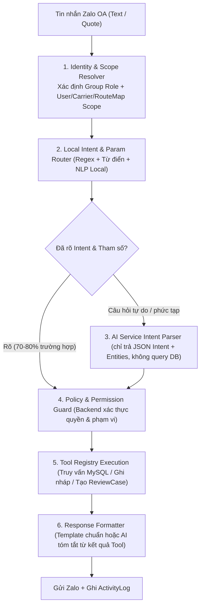

# KẾ HOẠCH PHÁT TRIỂN TRỢ LÝ ẢO VẬN TẢI (TRANSPORT OPERATIONS AI ASSISTANT) — PHASE 1 DỰA TRÊN DỮ LIỆU THỰC TẾ

Tài liệu này hoạch định kiến trúc, danh mục chức năng, quy tắc phân quyền và lộ trình triển khai **Trợ lý ảo Vận tải (Phase 1)** cho hệ thống **VSICO Zalo Bot**, phục vụ 3 nhóm người dùng (**Khách hàng**, **Nhà xe**, **Điều hành vận tải - ĐHVT**).

Nguyên tắc xuyên suốt: **Mọi tính năng đều bám sát đúng cấu trúc dữ liệu thực tế hiện có trong MySQL và các API đã xác minh của hệ thống TMS**. Không thiết kế các tính năng phụ thuộc vào dữ liệu chưa tồn tại (GPS realtime, chứng từ POD, hay trạng thái bãi chưa có nguồn cấp), bảo đảm triển khai xong là người dùng sử dụng được ngay, số liệu chính xác, không suy diễn.

---

## 1. Kiểm kê Nền tảng Dữ liệu Hiện có & Phạm vi Phase 1

### 1.1. Dữ liệu thực tế đang có trong hệ thống (`backend` + `MySQL`)

| Nhóm dữ liệu | Bảng MySQL / Nguồn thực tế | Các trường cốt lõi phục vụ Trợ lý ảo |
| :--- | :--- | :--- |
| **Kế hoạch vận chuyển TMS** | `transport_plans` | `tms_order_id`, `order_code` (`RO...`/`LO...`), `order_type` (`tra`/`dong`), `plan_date`, `region`, `forwarder_name`, `customer_id`, `customer_name`, `warehouse_id`, `warehouse_name`, `province_id`, `province_name`, `ward_name`, `delivery_address`, `route_name`, `points_json`, `booking_no`, `bill_of_lading_no`, `container_no`, `seal_no`, `container_size`, `container_type`, `container_grade`, `container_ownership`, `delivery_term`, `container_warning` (`normal`, `over_combined`, `empty_drop`, `other_requested`, `soc`), `container_status_message`, `cargo_type`, `cargo_weight`, `vessel_voyage`, `full_depot`, `empty_depot`, `required_time`, `eta`, `carrier_id`, `carrier_name`, `planned_truck_plate`, `driver_name`, `driver_phone`, `dispatch_state`, `tms_sync_status`, `version`, `group_id`. |
| **Danh mục gốc (Master Data)** | `carriers`, `customers`, `warehouses`, `vehicles`, `drivers`, `customer_aliases`, `warehouse_aliases` | Định danh nhà xe, danh sách đầu kéo (`plate_no`, `driver_hint_name`), tài xế (`full_name`, `phone`), khách hàng, kho/cảng/depot và từ điển bí danh địa chỉ/khách hàng. |
| **Điều xe & Hội thoại thực thi** | `zalo_messages`, `truck_records`, `container_jobs`, `message_drafts`, `bot_replies` | Tin nhắn gốc/quote, thông tin xe/tài xế nhà xe đã báo, trạng thái kiểm tra (`validation_status`, `routing_status`, `tms_sync_status`), bản nháp chờ bổ sung, lịch sử bot nhắc lỗi. |
| **Phân quyền & Tuyến Zalo** | `zalo_groups`, `users`, `route_maps` | Vai trò nhóm (`SOURCE`/`CARRIER`, `DESTINATION`/`CUSTOMER`, `DHVT`), liên kết `carrier_id` của nhóm nhà xe, liên kết tài khoản nhân viên `users.zalo_user_id`, phạm vi tuyến khách-kho (`route_maps`). |
| **Duyệt ca, Phát hành & Log** | `review_cases`, `outbound_messages`, `outbound_message_items`, `tms_sync_logs`, `extraction_runs`, `activity_logs` | Danh sách ca chờ ĐHVT duyệt (`reason`, `details`, `status`), lịch sử tin đã/chưa gửi khách (`SENT`/`FAILED`/`PENDING_APPROVAL`), nhật ký đồng bộ TMS, chỉ số xử lý AI (`extractor_type`, `model_name`, `latency_ms`), audit toàn bộ thay đổi. |

### 1.2. Ranh giới Thực tế của Phase 1 (Làm được ngay vs Tạm hoãn Phase 2)

| Phạm vi | Tình trạng dữ liệu | Quyết định cho Phase 1 |
| :--- | :--- | :--- |
| **Tra cứu kế hoạch, lịch trả/đóng, cân đối vỏ, thông tin xe/tài xế/cont/seal/booking/vận đơn** | **Đầy đủ 100%** trong `transport_plans` + `container_jobs` | **Triển khai đầy đủ ngay ở Phase 1.** |
| **Nhà xe bổ sung cont/seal, đổi xe/tài xế qua hội thoại xác nhận** | **Đầy đủ** trong `transport_plans`, `vehicles`, `drivers`, `message_drafts` | **Triển khai đầy đủ ở Phase 1** (cập nhật kế hoạch nội bộ `tms_sync_status = 'PENDING'`, giữ xác nhận 2 bước chống ghi nhầm). |
| **Khách hàng tra cứu chuyến theo ngày, tìm cont/xe, gửi yêu cầu đổi giờ/kho/hủy & hỏi tiến độ ca yêu cầu** | **Đầy đủ** trong `transport_plans`, `container_jobs`, `route_maps`, `review_cases` | **Triển khai đầy đủ ở Phase 1**, khóa chặt phạm vi theo `route_maps` và `group_id`. |
| **ĐHVT tổng hợp vận hành ngày, phát hiện ngoại lệ dữ liệu & phân tích hiệu quả Bot** | **Đầy đủ** từ `transport_plans`, `review_cases`, `outbound_messages`, `tms_sync_logs`, `extraction_runs`, `activity_logs` | **Triển khai đầy đủ ở Phase 1** theo cơ chế chỉ đọc trên Zalo + gắn link thao tác trên Web. |
| **Vị trí GPS realtime ("xe đang chạy tới km nào") & ETA dự báo theo giao thông** | **Chưa có nguồn GPS** | **Không làm ở Phase 1.** Khi khách hỏi giờ đến, chỉ trả `required_time` / `eta` theo kế hoạch + giờ nhà xe báo (kèm ghi chú rõ đây là *giờ dự kiến theo kế hoạch*). |
| **Chứng từ giao hàng / POD / Ảnh biên bản có ký nhận** | **Chưa có module quản lý POD** (`files` hiện lưu ảnh tin nhắn Zalo) | **Hoãn sang Phase 2** khi TMS có API chứng từ POD chính thức. |
| **Đọc trực tiếp sự kiện bãi/cảng realtime ("đã vào cổng/đã hạ rỗng") từ TMS** | **Chưa có API sự kiện thực tế trên TMS** | **Phase 1 chỉ dùng trạng thái đã có** (Chưa có xe / Đã báo xe / Đã có cont-seal / Đã gửi thông báo / Chờ duyệt / Đã hủy). Nếu cần mốc tiến độ đơn giản do nhà xe tự báo (*"đã đến kho"*), sẽ thiết kế thêm ghi nhận vào `activity_logs` dưới dạng tùy chọn mở rộng ở Mục 6. |

---

## 2. Kiến trúc Hợp nhất: Một `Tool Registry` Phục vụ Cả 3 Vai trò

Không xây dựng 3 chatbot tách rời, cũng không viết logic xử lý riêng cho từng câu hỏi. Mọi tin nhắn hỏi đáp và lệnh thao tác hội thoại đều đi qua một đường ống thống nhất (nâng cấp trực tiếp từ `backend/src/handlers/conversation_service.py`):



**Nguyên tắc bảo mật & phân quyền bắt buộc**:
* **NLP/LLM không bao giờ trực tiếp sinh SQL hoặc tự quyết định quyền truy cập.** Backend luôn tự ép bộ lọc phạm vi (`customer_scope`, `carrier_scope`, `dhvt_user`) dựa trên danh tính đã xác thực ở Bước 1.
* **Khách hàng**: Không để lộ sự tồn tại của container thuộc khách hàng khác (`_CUSTOMER_LOOKUP_NOT_FOUND_TEXT` đồng nhất giữa "không tồn tại" và "ngoài phạm vi").
* **Nhà xe**: Chỉ xem và cập nhật được các chuyến thuộc `carrier_id` của nhóm (hoặc các dòng được phép nhận theo chính sách ĐHVT).
* **ĐHVT**: Tuyệt đối chỉ đọc và tổng hợp trên Zalo; mọi từ khóa yêu cầu *"duyệt"*, *"xóa"*, *"cho gửi"*, *"sửa trực tiếp"* đều bị từ chối và trả về Deep Link dẫn thẳng tới trang Web (`/reviews/{id}`, `/plans`).

---

## 3. Danh mục Chức năng Chi tiết Phase 1 theo 3 Vai trò

Tổng cộng **36 nhóm chức năng thực chất** (Khách hàng: 10, Nhà xe: 12, ĐHVT: 14), toàn bộ đều chạy trên dữ liệu thật hiện có.

### 3.1. Vai trò 1: Nhóm Khách hàng (`CUSTOMER` / `DESTINATION`) — 10 Chức năng

Mục tiêu: Khách hàng tự tra được lịch giao nhận, thông tin xe/tài xế/cont và gửi/theo dõi yêu cầu thay đổi mà không phải nhắn hỏi ĐHVT.

| Mã | Nhóm chức năng | Ví dụ câu hỏi thực tế | Tool Backend | Bảng & Dữ liệu thật sử dụng | Xử lý & Đầu ra thực tế |
| :--- | :--- | :--- | :--- | :--- | :--- |
| **C01** | **Tra cứu trạng thái container / chuyến cụ thể** | *"Cont GAOU7821312 xe nào chở?"*, *"Cont này có lịch chưa?"* | `customer_get_trip_detail` | `transport_plans`, `container_jobs`, `truck_records`, `outbound_messages` | Kiểm tra cont thuộc `route_maps`/`group_id` của khách. Trả: Loại lệnh (`Đóng`/`Trả`), Kho, Giờ hẹn (`required_time`), Biển số xe, Tài xế, SĐT, Seal (nếu có), Trạng thái điều xe (Chưa có xe / Đã điều xe / Đã gửi thông báo). |
| **C02** | **Danh sách chuyến theo ngày (`hôm nay`, `mai`, `DD/MM`)** | *"Hôm nay bên tôi có những chuyến nào?"*, *"Ngày mai mấy xe giao?"* | `customer_list_trips_by_date` | `transport_plans`, `customers`, `warehouses` | Lọc theo `plan_date` và phạm vi khách-kho. Liệt kê gọn: `STT | Cont/Booking | Kho | Giờ hẹn | Xe/Tài xế | Trạng thái`. |
| **C03** | **Lọc chuyến theo trạng thái có xe / chưa có xe** | *"Cont nào đã có xe rồi, cont nào chưa?"* | `customer_list_trips_by_status` | `transport_plans` (`planned_truck_plate`, `container_no`) | Phân nhóm rõ: *Đã xếp xe (`N` chuyến)* và *Đang chờ điều xe (`M` chuyến)*. |
| **C04** | **Tra cứu thông tin xe & tài xế phụ trách** | *"Cho xin số tài xế xe 29C-445.41"*, *"Xe này chở cont gì?"* | `customer_get_vehicle_driver` | `transport_plans`, `container_jobs`, `truck_records` | Tìm theo biển số trong phạm vi khách. Trả đúng tên tài xế, SĐT và cont được gán (không lộ thông tin chuyến khách khác dù cùng đầu kéo). |
| **C05** | **Hỏi lịch giao nhận theo Kho / Tuyến / Booking / Vận đơn** | *"Kho Tân Quang mai mấy giờ xe vào?"*, *"Booking B26110332 có mấy xe?"* | `customer_query_schedule` | `transport_plans` (`warehouse_name`, `booking_no`, `bill_of_lading_no`, `required_time`, `eta`) | Trả danh sách chuyến khớp kho/booking/BL kèm `required_time` và `eta` kế hoạch (nói rõ đây là *giờ hẹn dự kiến theo kế hoạch*). |
| **C06** | **Thống kê tóm tắt tiến độ điều xe của khách** | *"Tổng hợp lịch hôm nay bên chị"*, *"Hôm nay tổng bao nhiêu cont?"* | `customer_get_summary` | `transport_plans` (đếm theo `order_type`, `container_size`, trạng thái có xe/chưa có xe) | Trả bản tóm tắt số lượng: Tổng cont (`20'`/`40'`), Đã có xe, Chưa có xe, Đã báo tin xác nhận. |
| **C07** | **Tra cứu chuyến có thay đổi thông tin (đổi xe / đổi giờ)** | *"Hôm nay có chuyến nào đổi xe không?"* | `customer_get_trip_changes` | `activity_logs` (`PLAN_VEHICLE_UPDATED`), `outbound_messages` (`message_kind = 'update'`) | Chỉ hiển thị các thay đổi đã được ĐHVT duyệt hoặc đã phát hành thông báo sang nhóm khách. |
| **C08** | **Gửi yêu cầu đổi giờ / đổi kho / hủy chuyến** | *"Xin dời giờ đóng cont này sang 14h"*, *"Hủy chuyến LO2447"* | `customer_create_change_request` | `review_cases` (`CUSTOMER_CHANGE_REQUEST`), `transport_plans`, `activity_logs` | Tạo `ReviewCase` gắn `transport_plan_id` / `container_no`, đặt `priority = 'HIGH'` nếu là hủy, thông báo lại mã ca `#ID` cho khách và cảnh báo ngay nhóm ĐHVT. |
| **C09** | **Hỏi tiến độ xử lý yêu cầu đã gửi** | *"Yêu cầu đổi giờ lúc nãy xong chưa?"*, *"Ca #123 duyệt chưa?"* | `customer_get_request_status` | `review_cases` (lọc theo `details.group_id` = nhóm hiện tại) | Trả trạng thái hiện tại (`PENDING` / `APPROVED` / `REJECTED`), ghi chú xử lý của ĐHVT nếu đã xong. |
| **C10** | **Hướng dẫn cú pháp tra cứu cho khách hàng** | *"Bot làm được gì?"*, *"Hướng dẫn tra cứu"* | `get_role_help` | Tĩnh theo vai trò | Liệt kê ngắn gọn các câu lệnh mẫu khách có thể nhắn. |

---

### 3.2. Vai trò 2: Nhóm Nhà xe (`CARRIER` / `SOURCE`) — 12 Chức năng

Mục tiêu: Giảm tối đa việc nhà xe nhắn hỏi ĐHVT và cho phép nhà xe tự bổ sung, sửa xe/tài xế có kiểm soát qua hội thoại.

| Mã | Nhóm chức năng | Ví dụ câu hỏi / yêu cầu | Tool Backend | Bảng & Dữ liệu thật sử dụng | Xử lý & Đầu ra thực tế |
| :--- | :--- | :--- | :--- | :--- | :--- |
| **N01** | **Xem kế hoạch của nhà xe theo ngày** | *"Hôm nay bên anh có mấy chuyến?"*, *"Lịch ngày mai thế nào?"* | `carrier_list_plans_by_date` | `transport_plans` (`carrier_id`, `plan_date`) | Trả tổng số lệnh (`tra`/`dong`) và danh sách rút gọn (Mã lệnh/Cont, Khách, Kho, Giờ YC, Xe đã gán). |
| **N02** | **Liệt kê các chuyến còn thiếu thông tin** | *"Anh còn chuyến nào chưa báo xe?"*, *"Lệnh nào đang thiếu cont/chì?"* | `carrier_list_incomplete_plans` | `transport_plans` (`planned_truck_plate IS NULL` hoặc `container_no IS NULL` / `seal_no IS NULL`), `message_drafts` (`OPEN`/`WAITING_REPLY`) | Giúp nhà xe nhìn ngay phần việc còn thiếu để nhắn bổ sung một lần. |
| **N03** | **Tra chi tiết một lệnh / container / booking** | *"Cont GAOU7821312 đóng hay trả, đi kho nào?"*, *"LO2447 mấy giờ?"* | `carrier_get_order_detail` | `transport_plans`, `points_json`, `warehouses` | Trả đầy đủ thông tin kho, địa chỉ chi tiết (`points_json` nếu nhiều điểm), loại hàng, tải trọng, tàu/chuyến, cảng, giờ YC, booking/BL. |
| **N04** | **Tra lịch trình theo biển số xe** | *"Xe 15C-066.95 hôm nay chạy chuyến nào?"* | `carrier_get_vehicle_schedule` | `transport_plans`, `container_jobs`, `vehicles` | Hỗ trợ tìm cả theo 4-5 số cuối biển số thông qua bảng `vehicles` của đúng nhà xe. |
| **N05** | **Kiểm tra tin báo xe đã được Bot ghi nhận chưa** | *"Cont này lúc nãy anh báo nhận được chưa?"* | `carrier_check_submission_status` | `zalo_messages`, `container_jobs`, `transport_plans`, `review_cases` | Trả rõ: Đã khớp kế hoạch & hợp lệ / Đang chờ bổ sung thiếu / Đang chờ ĐHVT kiểm tra lỗi. |
| **N06** | **Bổ sung số container, seal, SĐT còn thiếu** | *"Cont MSCU1234567 chì 22554258"*, *"Xe 15C tài 0903..."* | `carrier_supplement_trip` | `message_drafts`, `container_jobs`, `transport_plans`, `drivers` | Kiểm tra ISO 6346, đối chiếu `drivers` nếu thiếu SĐT/tên, điền vào các trường đang trống trên `transport_plans` (`FILL`). |
| **N07** | **Đổi đầu kéo / đổi tài xế qua xác nhận 2 bước** | *"Xe 15C-066.95 hỏng, đổi sang 29C-447.22 tài Nam"* | `carrier_request_vehicle_update` | `transport_plans`, `vehicles`, `drivers`, `message_drafts`, `outbound_messages`, `review_cases` | **Bước 1**: Kiểm tra xe mới có trùng lịch hay không; hỏi lại xác nhận ngắn gọn kèm số cont/mã lệnh.<br/>**Bước 2**: Khi nhà xe xác nhận `"Đúng"`: nếu chưa gửi khách -> cập nhật `transport_plans` (`AUTO_UPDATE`, `tms_sync_status='PENDING'`); nếu đã gửi khách -> tạo `ReviewCase` cho ĐHVT duyệt phát hành đính chính. |
| **N08** | **Sửa lỗi vừa nhắn sai (trong ngữ cảnh gần nhất)** | *"Biển lúc nãy gõ nhầm là 29C-445.41 nhé"* | `carrier_fix_recent_submission` | `zalo_messages` (30 phút gần nhất), `container_jobs`, `bot_replies`, `transport_plans` | Tìm bản ghi vừa tạo gần nhất của chính `sender_id` hoặc tin được `quote`, đối chiếu quyền sửa rồi cập nhật lại (hoặc hỏi chọn nếu người đó vừa báo nhiều xe). |
| **N09** | **Xem danh sách các đề xuất/lỗi đang chờ xử lý** | *"Còn yêu cầu đổi xe nào chưa xong không?"* | `carrier_list_pending_cases` | `review_cases` (lọc theo `carrier_id` / `group_id`), `bot_replies` (`PENDING`) | Liệt kê các ca đổi xe, ca lệch seal hoặc tin nhắc lỗi còn hạn. |
| **N10** | **Gửi yêu cầu trả lệnh / báo hủy chuyến / sự cố xe** | *"Xe hỏng dọc đường, hủy chuyến RO2846"* | `carrier_report_issue_or_cancel` | `review_cases` (`CARRIER_CANCEL_OR_ISSUE`), `activity_logs` | Ghi nhận ngay lý do sự cố/hủy, không tự xóa kế hoạch trên DB mà đẩy `ReviewCase` ưu tiên `HIGH` lên ĐHVT kèm thông báo cảnh báo vào nhóm ĐHVT. |
| **N11** | **Thống kê nhanh sản lượng chuyến của nhà xe** | *"Hôm nay bên anh chạy mấy cont 20, mấy cont 40?"* | `carrier_get_summary` | `transport_plans` (nhóm theo `order_type`, `container_size`, đã báo xe/chưa) | Tổng hợp số liệu trung thực từ DB. |
| **N12** | **Tra cứu quy chuẩn tin nhắn báo xe & thông tin bắt buộc** | *"Báo lệnh đóng cần nhắn những gì?"* | `get_role_help` | Tĩnh theo quy tắc nghiệp vụ VSICO | Hướng dẫn mẫu tin F1/F3 và các trường bắt buộc (Biển số, Tài xế, SĐT 10 số, Cont ISO 6346 / Booking, Giờ hẹn). |

---

### 3.3. Vai trò 3: Nhóm Điều hành Vận tải (`DHVT` - Nội bộ, Chỉ đọc trên Zalo) — 14 Chức năng

Mục tiêu: ĐHVT hỏi 1 câu trên nhóm nội bộ là nắm ngay bức tranh toàn ngày, ngoại lệ cần xử lý, nguyên nhân các ca chờ duyệt và hiệu quả vận hành của Bot, sau đó bấm Deep Link lên Web quyết định.

| Mã | Phân nhóm | Ví dụ câu hỏi ĐHVT | Tool Backend | Bảng & Dữ liệu thật sử dụng |
| :--- | :--- | :--- | :--- | :--- |
| **O01** | Giám sát | *"Hôm nay có bao nhiêu chuyến, cân đối vỏ thế nào?"* | `dhvt_get_daily_overview` | `transport_plans` + `build_master_plan_summary` (tổng trả/đóng theo `20'`/`40'`, số vỏ ghép được, đã có xe/chưa có xe). |
| **O02** | Giám sát | *"Còn bao nhiêu chuyến chưa có xe hoặc thiếu cont?"* | `dhvt_get_unassigned_plans` | `transport_plans` (`planned_truck_plate IS NULL` hoặc `container_no IS NULL`, có thể lọc theo ngày / miền / tỉnh / khách). |
| **O03** | Giám sát | *"Cont GAOU7821312 hiện thế nào?"* / *"Mã LO2447?"* | `dhvt_get_order_or_cont_detail` | `transport_plans`, `container_jobs`, `truck_records`, `review_cases`, `outbound_messages`, `tms_sync_logs`. |
| **O04** | Giám sát | *"Xe 29C-445.41 đang chạy những chuyến nào?"* | `dhvt_get_vehicle_trips` | `transport_plans`, `truck_records`, `container_jobs` (trả tất cả chuyến trong ngày để ĐHVT tự nhìn lịch). |
| **O05** | Giám sát | *"Hôm nay khách Unilever có mấy cont? Nhà xe A chạy mấy chuyến?"* | `dhvt_get_entity_stats` | `transport_plans` lọc theo `customer_id` hoặc `carrier_id` hoặc `forwarder_name`. |
| **O06** | Ngoại lệ | *"Hôm nay có xe nào bị phân công trùng chuyến không?"* | `dhvt_detect_duplicate_vehicles` | `transport_plans` + `container_jobs`: gom nhóm theo `(plan_date, compact_plate)` có $\ge 2$ lệnh chồng khung giờ hoặc khác chuyến mà chưa phải cặp kết hợp `RO -> LO`. |
| **O07** | Ngoại lệ | *"Có những vỏ nào bị cảnh báo hạ rỗng / quá SL kết hợp?"* | `dhvt_get_container_warnings` | `transport_plans` (`container_warning IN ('empty_drop', 'over_combined', 'other_requested', 'soc')`). |
| **O08** | Ngoại lệ | *"Có cont nào chưa khớp kế hoạch hoặc nhà xe báo sai không?"* | `dhvt_get_validation_failures` | `container_jobs` (`validation_status != 'VALID'`) + `review_cases` (`NO_MATCHING_PLAN`, `CARRIER_MISMATCH`, `PLAN_FIELD_CONFLICT`). |
| **O09** | Ngoại lệ | *"Có tin gửi khách nào thất bại hoặc đơn nào chưa đồng bộ TMS?"* | `dhvt_get_delivery_and_sync_errors` | `outbound_messages` (`status = 'FAILED'`) + `transport_plans` (`tms_sync_status IN ('PENDING', 'FAILED')`) + `tms_sync_logs`. |
| **O10** | Quyết định | *"Hôm nay có gì cần anh xử lý gấp?"* / *"Có bao nhiêu ca chờ duyệt?"* | `dhvt_get_priority_digest` | Tổng hợp thông minh: số ca `PENDING` ưu tiên `HIGH`, `outbound_messages` `FAILED`, ca quá hạn phản hồi `bot_replies`, kèm gợi ý việc ưu tiên làm trước & link Web `/reviews`. |
| **O11** | Quyết định | *"Tại sao ca #123 cần duyệt?"* | `dhvt_explain_review_case` | `review_cases.reason`, `review_cases.details`, `extraction_runs`, `zalo_messages`: giải thích tường minh dữ liệu nhà xe báo vs dữ liệu kế hoạch đang lệch ở điểm nào, kèm Top ứng viên. |
| **O12** | Quyết định | *"Nếu hủy lệnh LO2447 hoặc cont GAOU... thì ảnh hưởng gì?"* | `dhvt_analyze_change_impact` | Kiểm tra trên DB thật: lệnh đó đã gán xe chưa, có đang ghép vỏ kết hợp với một lệnh `RO`/`LO` khác không, đã gửi `OutboundMessage` cho khách chưa, đã đồng bộ TMS chưa. |
| **O13** | Quyết định | *"Chuyến này đã đổi những gì rồi? Bot đã làm gì?"* | `dhvt_get_audit_timeline` | `activity_logs`, `bot_replies`, `extraction_runs`: dựng dòng thời gian ai sửa gì, cũ -> mới, bot đã hỏi nhà xe lúc mấy giờ. |
| **O14** | Hiệu quả Bot | *"Hôm nay Bot tự xử lý được bao nhiêu tin? Tỷ lệ dùng LLM?"* | `dhvt_get_bot_performance` | `zalo_messages`, `extraction_runs` (`extractor_type`: rule/local_nlp/llm, `latency_ms`, `error_message`), `review_cases` (tỷ lệ tự động vs leo thang ĐHVT, top nhà xe hay báo thiếu). |

*(Lưu ý: Khi ĐHVT nhắn "Duyệt ca #123", "Cho gửi tin này", "Hủy lệnh..." -> Tiếp tục giữ chặt rule hiện tại ở `_handle_dhvt_group_message`: từ chối thực thi trên Zalo và gửi Deep Link sang Web).*

---

## 4. Điểm Quan Trọng Cần Xử Lý Trong Dữ Liệu Thực Tế Để Trợ Lý Ảo Chạy Được

Qua kiểm tra trực tiếp dữ liệu `2026-11-09` vừa đồng bộ từ TMS (`225` dòng trên `transport_plans`), có **3 điểm thực tế bắt buộc phải cấu hình hoặc xử lý kèm trong Phase 1**:

1. **Nhiều dòng kế hoạch từ TMS có `carrier_id = NULL`**:
   * Hiện tại `_handle_carrier_group_qa` (`backend/src/handlers/conversation_service.py#L1246`) chỉ query `TransportPlan.carrier_id == group.carrier_id`. Nếu TMS chưa gán nhà xe trên kế hoạch, nhà xe hỏi *"Hôm nay bên anh có mấy chuyến?"* sẽ ra trống.
   * **Giải pháp Phase 1**:
     * Cần phân biệt rõ: ĐHVT phải gán nhà xe trên kế hoạch (hoặc đồng bộ từ `/dispatch/confirmed` khi điều phối TMS đã phân xe); với các nhóm nhà xe được phép xem lệnh mở chung hoặc lệnh theo `forwarder_id` (nếu nghiệp vụ cho phép), phải cấu hình rõ chính sách trong `zalo_groups` trước khi mở quyền query.
2. **Dữ liệu `group_id` mặc định `b0301d81c0ee29b070ff` cho môi trường test**:
   * Để kiểm thử vai trò **Khách hàng**, phải đảm bảo nhóm khách hàng test được khai báo trong `zalo_groups` (`group_role = 'DESTINATION'`) và có bản ghi `route_maps` trỏ tới `(customer_id, warehouse_id)` tương ứng hoặc `transport_plans.group_id` khớp đúng nhóm đó; nếu không, cơ chế bảo vệ chống dò chéo sẽ chặn trả lời.
3. **Bổ sung trạng thái nhận diện tin hỏi đáp vs tin báo xe ở nhóm Nhà xe**:
   * Hiện tại `_is_carrier_qa_message` (`conversation_service.py#L1186`) chỉ kiểm tra một vài từ khóa đơn giản và sẽ bỏ qua nếu tin chứa từ khóa điều xe. Cần chuyển sang bộ phân loại Intent rõ ràng để phân biệt:
     * Hỏi thông tin (`QUERY_*`) $\rightarrow$ Chạy Tool Assistant tra cứu ngay, không tạo `ContainerJob` rác.
     * Báo xe / Bổ sung / Đổi xe (`REPORT_DISPATCH` / `SUPPLEMENT` / `UPDATE`) $\rightarrow$ Chạy Pipeline Bóc tách 3 tầng & Đối chiếu Kế hoạch (đã thiết kế ở [PLAN_NLP_EXTRACTION_AND_PLAN_MATCHING.md](file:///home/vutienndat2302/Documents/vsico_zalo_bot/docs/PLAN_NLP_EXTRACTION_AND_PLAN_MATCHING.md)).
     * Tin vừa hỏi vừa báo (*"Cont này xe 15C-12345 chạy đúng không, nếu chưa có chì cho bổ sung chì 9988"*) $\rightarrow$ Tách ý định hoặc xử lý phần hỏi trước, giữ lại phần cập nhật có xác nhận.

---

## 5. Thiết kế Kỹ thuật Module Trợ lý Ảo (`backend/src/assistant/`)

Thay vì phình to file `conversation_service.py` (hiện đã dài > 1.300 dòng), tổ chức lại thành gói `backend/src/assistant/` theo Clean Architecture:

```text
backend/src/assistant/
├── __init__.py
├── schemas.py             # Pydantic Intent, ToolCall, ScopeContext, AssistantReply
├── scope_resolver.py      # Xác định Role (CUSTOMER / CARRIER / DHVT) & ràng buộc quyền DB
├── intent_router.py       # Tầng 1 Regex/Keyword -> Tầng 2 NLP Local -> Tầng 3 LLM Intent (tùy chọn)
├── tool_registry.py       # Đăng ký toàn bộ 36 tools kèm metadata (allowed_roles, description)
├── tools_customer.py      # C01 -> C10
├── tools_carrier.py       # N01 -> N12
├── tools_dhvt.py          # O01 -> O14
└── response_formatter.py  # Format kết quả tool thành tin nhắn Zalo ngắn gọn, dễ đọc trên điện thoại
```

### 5.1. Hợp đồng Đầu ra của `IntentRouter`
```json
{
  "intent": "DHVT_PRIORITY_DIGEST",
  "confidence": 0.94,
  "route_source": "local_rule",
  "entities": {
    "plan_date": "2026-11-09",
    "container_no": null,
    "plate_no": null,
    "order_code": null,
    "customer_name": null,
    "carrier_name": null,
    "case_id": null
  },
  "needs_clarification": false
}
```
* Với các câu hỏi chuẩn như nhập thẳng số cont, biển số xe, *"hôm nay mấy chuyến"*, *"ca chờ"*, *"thiếu xe"*: **Tầng Local xử lý xong trong $< 30\text{ms}$, không tốn quota LLM**.
* Chỉ khi câu hỏi tự nhiên dài, lắt léo (VD: *"Kiểm tra giúp anh xem hồi sáng nhà xe Tuấn Hưng báo con xe chạy Unilever có bị lệch số chì hay trùng chuyến nào không?"*) mới gọi sang `ai-service` để phân tích ra đúng `intent` + `entities`.

---

## 6. Lộ trình Triển khai Phase 1 (4 Sprint Ngắn, Gọn & Đo Được Ngay)

### Sprint 1: Tái cấu trúc Khung `Assistant` + Hoàn thiện Nhóm Lõi ĐHVT (`O01 -> O11`, `O13`) — (2 - 3 ngày)
* **Vì sao làm ĐHVT trước**: Dữ liệu thật ngày `2026-11-09` (`225` lệnh) đã nằm sẵn trong MySQL, tài khoản `users` gắn `zalo_user_id` đã có, ĐHVT test và dùng được ngay lập tức trên nhóm nội bộ hoặc Sandbox.
* **Đầu việc**:
  1. Dựng khung `backend/src/assistant/` (`scope_resolver.py`, `tool_registry.py`, `intent_router.py`).
  2. Triển khai bộ tool giám sát & ngoại lệ (`dhvt_get_daily_overview`, `dhvt_get_unassigned_plans`, `dhvt_detect_duplicate_vehicles`, `dhvt_get_container_warnings`, `dhvt_get_priority_digest`, `dhvt_explain_review_case`, `dhvt_analyze_change_impact`, `dhvt_get_delivery_and_sync_errors`).
  3. Giữ nguyên cơ chế chặn duyệt qua Zalo và gắn Deep Link Web.

### Sprint 2: Nâng cấp Toàn diện Trợ lý Nhóm Nhà xe (`N01 -> N12`) — (2 - 3 ngày)
* **Mục tiêu**: Biến nhóm Nhà xe thành kênh tự phục vụ giảm tải trực tiếp cho ĐHVT.
* **Đầu việc**:
  1. Tách rạch ròi giữa **Tin hỏi đáp (`N01–N05`, `N09`, `N11–N12`)** và **Tin báo/bổ sung/sửa (`N06–N08`, `N10`)**.
  2. Triển khai đầy đủ tra cứu lịch theo ngày/xe/mã lệnh/cont thiếu thông tin (`N01–N05`).
  3. Tích hợp xác nhận 2 bước khi nhà xe đổi đầu kéo/tài xế (`N07`) thông qua `message_drafts` (`status = 'WAITING_REPLY'`) và tra cứu danh mục `vehicles` + `drivers` của nhà xe.

### Sprint 3: Nâng cấp Trợ lý Nhóm Khách hàng (`C01 -> C10`) — (1 - 2 ngày)
* **Mục tiêu**: Khách hàng tra được danh sách theo ngày, lịch theo kho/booking, thống kê và trạng thái yêu cầu thay đổi trong đúng phạm vi `route_maps` / `group_id`.
* **Đầu việc**:
  1. Triển khai các tool `C02`, `C03`, `C05`, `C06`, `C07`, `C09` (bên cạnh `C01`, `C04`, `C08` đã có nền sẵn trong `conversation_service.py`).
  2. Kiểm thử chặt chẽ tính năng chống dò chéo dữ liệu giữa 2 nhóm khách hàng khác nhau.

### Sprint 4: Chỉ số Hiệu quả Bot (`O14`), Kết nối `ai-service` Intent & Bộ Test Hội thoại End-to-End — (1 - 2 ngày)
* **Đầu việc**:
  1. Triển khai `dhvt_get_bot_performance` thống kê từ `extraction_runs` và `activity_logs`.
  2. Bổ sung endpoint phân loại `Assistant Intent` gọn nhẹ trong `ai-service` làm lớp fallback cho câu hỏi tự nhiên phức tạp (che SĐT trước khi gửi).
  3. Hoàn thiện bộ kiểm thử tự động (`pytest`) cho tối thiểu 20 kịch bản hội thoại thực tế của cả 3 vai trò (đặc biệt các ca phân quyền, ca mơ hồ, ca đổi xe 2 bước, ca trùng biển số, và ca lỗi đồng bộ/gửi tin).

---

## 7. Gợi ý Mở rộng Nhỏ Nếu Cần Theo dõi Tiến độ Thực tế Chuyến Đi (Tùy chọn sau Sprint 4)

Nếu phía TMS chưa mở API trạng thái thực tế của chuyến (như xe đã đến kho, đang đóng hàng, đã rời kho), nhưng đội vận hành vẫn muốn khách hàng hỏi *"Xe tới kho chưa?"* mà có câu trả lời thực tế ngay trên Zalo, chỉ cần **1 mở rộng rất nhỏ ở Phase 1.5** không đụng vào bảng lớn:
* Cho phép nhà xe nhắn mốc tiến độ ngắn trong nhóm nhà xe (VD: *"Xe 15C-066.95 đã đến kho Kim Anh"* / *"Cont GAOU... đã hạ rỗng"*), lưu vào một bảng nhẹ `trip_events` (gồm `transport_plan_id`, `event_type`, `reported_by`, `reported_at`, `raw_message_id`) — khi đó khách hàng hỏi *"Xe đến kho chưa?"* sẽ đọc chính sự kiện mới nhất nhà xe đã báo kèm timestamp, thay vì chỉ trả giờ kế hoạch.
