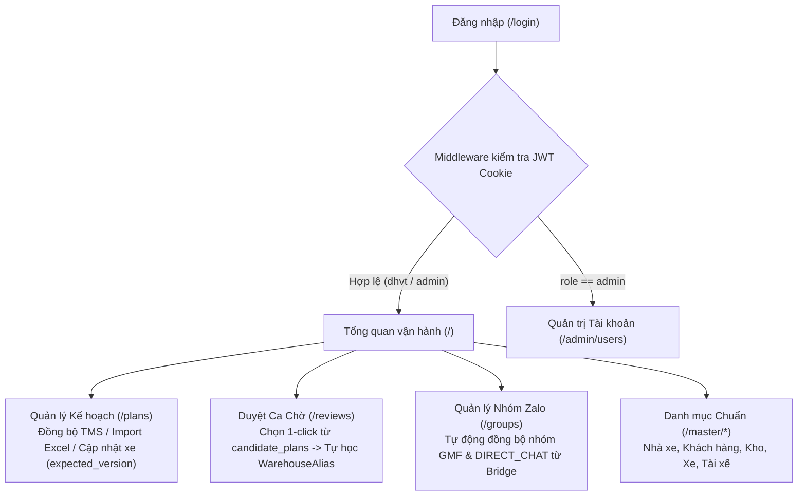

# Đặc tả Kỹ thuật Phân hệ Frontend Dashboard (`frontend` v1.0.0)

Phân hệ `frontend` là giao diện điều hành Web dành cho nhân viên Điều hành Vận tải (ĐHVT) và Quản trị viên (Admin), được xây dựng trên nền tảng **Next.js 16+ (App Router, Turbopack)**, **React 19**, **TypeScript 5**, **Tailwind CSS v4** và **Shadcn UI**.

---

## 1. Nguyên tắc Thiết kế Giao diện Điều hành

1. **Bảng dữ liệu là trung tâm**: Ưu tiên mật độ thông tin cao, rõ ràng, giúp ĐHVT xử lý hàng trăm chuyến xe trong khung giờ cao điểm sáng (07h00 – 09h00) mà không phải chuyển trang nhiều lần.
2. **Bố cục Master–Detail tại trang Duyệt ca (`/reviews`)**: Cột trái liệt kê danh sách ca chờ duyệt theo mức độ ưu tiên; cột phải hiển thị chi tiết thực thể bóc tách, tin nhắn gốc và **danh sách kế hoạch ứng viên gợi ý (`candidate_plans`)** cho phép chọn khớp bằng 1 cú nhấp chuột.
3. **Không dùng dữ liệu giả (Zero Fake Data)**: Toàn bộ dữ liệu hiển thị trên giao diện được lấy trực tiếp từ REST API của `backend` (`NEXT_PUBLIC_API_URL`). Khi danh sách trống, hiển thị trạng thái rỗng (`EmptyState`) rõ ràng.
4. **Kiểm soát xung đột đồng thời (`expected_version`)**: Khi cập nhật thông tin xe trong kế hoạch hoặc duyệt ca trên Web, Frontend luôn gửi kèm `expected_version` của bản ghi hiện tại để chống ghi đè khi nhiều ĐHVT cùng thao tác.

---

## 2. Cấu trúc Màn hình & Định tuyến (`src/app/`)

```text
frontend/src/
├── middleware.ts                     # Bảo vệ route theo JWT httpOnly cookie & phân quyền (admin / dhvt)
├── app/
│   ├── page.tsx                      # Tổng quan vận hành trong ngày (KPI, Biểu đồ, Cảnh báo nóng)
│   ├── login/page.tsx                # Đăng nhập hệ thống (Thiết lập httpOnly cookie)
│   ├── plans/page.tsx                # Quản lý Kế hoạch vận chuyển, Import Excel/CSV, Đồng bộ TMS, Gán xe
│   ├── messages/page.tsx             # Giám sát tin nhắn Zalo gốc, lịch sử bóc tách NLP/AI và thử lại
│   ├── results/page.tsx              # Tra cứu kết quả thực thi container_jobs, truck_records & nhật ký gửi
│   ├── reviews/page.tsx              # Xử lý Ca chờ duyệt (Master-Detail, chọn candidate_plans, học WarehouseAlias)
│   ├── groups/page.tsx               # Quản lý Nhóm Zalo (Đồng bộ trực tiếp từ OA/ZCA Bridge, hỗ trợ DIRECT_CHAT)
│   ├── sandbox/page.tsx              # Môi trường giả lập gửi tin nhắn Nhà xe / Khách hàng / ĐHVT
│   ├── master/
│   │   ├── carriers/page.tsx         # Danh mục Nhà xe đồng bộ từ TMS
│   │   ├── customers/page.tsx        # Danh mục Khách hàng & Bí danh (CustomerAliases)
│   │   ├── warehouses/page.tsx       # Danh mục Kho & Bí danh tự học (WarehouseAliases)
│   │   ├── vehicles/page.tsx         # Danh mục Đầu kéo / Rơ-moóc (Vehicles)
│   │   ├── drivers/page.tsx          # Danh mục Tài xế (Drivers)
│   │   └── transport-plans/page.tsx  # Quản trị dữ liệu gốc Kế hoạch vận chuyển
│   └── admin/
│       └── users/page.tsx            # Quản lý Tài khoản & Phân quyền nội bộ (Chỉ dành cho Admin)
├── components/                       # Thành phần giao diện dùng chung (Navbar, StatusBadge, Modal, UI primitives)
├── features/                         # Module hóa logic nghiệp vụ theo từng miền
├── lib/
│   └── api.ts                        # HTTP Client tập trung, xử lý lỗi 401/403/409 và kiểu dữ liệu Snowflake ID (string)
└── types/
    └── api.d.ts                      # Kiểu dữ liệu TypeScript đồng bộ từ OpenAPI Schema của Backend
```

---

## 3. Luồng Tương tác Chính trên Web Dashboard



---

## 4. Khởi chạy và Kiểm tra Chất lượng

```bash
cd frontend
npm install

# Kiểm tra ESLint
npm run lint

# Kiểm tra biên dịch Production Build (18/18 routes)
npm run build

# Khởi chạy máy chủ phát triển (Cổng 3001)
npm run dev
```
