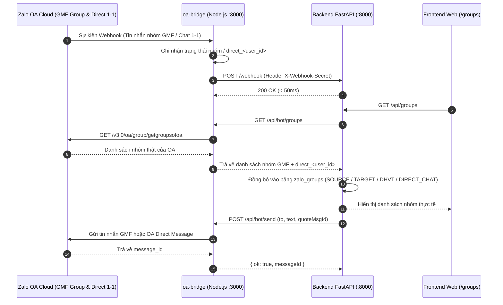

# Đặc tả Kỹ thuật Cầu nối Zalo Official Account (`oa-bridge` v1.0.0)

Module `oa-bridge` là dịch vụ cầu nối viết bằng **Node.js (ESM)**, đóng vai trò trung gian giao tiếp hai chiều giữa nền tảng **Zalo Official Account (OA)** — bao gồm cả nhóm chat GMF (Group Message Feature) và hội thoại cá nhân 1-1 (`direct_<user_id>`) — với phân hệ `backend` FastAPI.

---

## 1. Kiến trúc & Chức năng Chính

1. **Tiếp nhận Webhook từ Zalo OA (`POST /webhook/zalo-oa`)**:
   - Nhận sự kiện thời gian thực từ máy chủ Zalo OA (tin nhắn văn bản, hình ảnh, trích dẫn/quote tin nhắn trong nhóm GMF hoặc chat cá nhân 1-1).
   - Tự động lưu trữ danh sách nhóm GMF và các cuộc trò chuyện cá nhân (`direct_<user_id>`) đang hoạt động.
   - Chuẩn hóa payload về định dạng chuẩn của hệ thống và chuyển tiếp tức thời sang `POST /webhook` của `backend` kèm header bảo mật `X-Webhook-Secret`.
2. **Đồng bộ Danh sách Nhóm Thực tế (`GET /api/bot/groups`)**:
   - Kết nối trực tiếp tới Zalo OA GMF API (`https://openapi.zalo.me/v3.0/oa/group/getgroupsofoa`) để lấy danh sách nhóm thật của OA (tên nhóm, `group_id`, `total_member`, `group_link`, `status`).
   - Kết hợp cùng danh sách hội thoại cá nhân (`type: "oa_direct"`, `group_id: "direct_<userId>"`) và trả về cho `backend` khi `GET /api/groups` gọi đồng bộ tự động (`sync_live_groups_from_bridge`).
3. **Chi tiết Thành viên Nhóm (`GET /api/bot/groups/:groupId`)**:
   - Truy vấn thông tin chi tiết nhóm và danh sách thành viên để hiển thị trên màn hình Quản lý Nhóm Zalo (`/groups`) của Frontend Dashboard.
4. **Phát hành Tin nhắn (`POST /api/bot/send`)**:
   - Nhận lệnh gửi tin từ `ZaloOutboundThrottler` của `backend` và tự động phân nhánh gửi vào nhóm GMF hoặc gửi tin nhắn trực tiếp 1-1 (`direct_<user_id>`) qua Zalo OA OpenAPI.

---

## 2. Sơ đồ Luồng Hoạt động



---

## 3. Danh sách Endpoint của `oa-bridge`

| Phương thức & Đường dẫn | Mô tả chức năng |
| :--- | :--- |
| `GET /health` | Kiểm tra trạng thái kết nối và cấu hình Zalo OA Access Token. |
| `POST /webhook/zalo-oa` | Cổng nhận sự kiện Webhook từ Zalo Developer Console. |
| `GET /api/bot/groups` | Trả về toàn bộ nhóm GMF thực tế của OA và các hội thoại `direct_<user_id>`. |
| `GET /api/bot/groups/:groupId` | Trả về thông tin chi tiết và danh sách thành viên của một nhóm cụ thể. |
| `POST /api/bot/send` | Gửi tin nhắn văn bản (kèm trích dẫn nếu có) vào nhóm GMF hoặc hội thoại `direct_<user_id>`. |
| `POST /api/token/refresh` | Làm mới `ZALO_OA_ACCESS_TOKEN` bằng `ZALO_OA_REFRESH_TOKEN`. |

---

## 4. Khởi chạy Dịch vụ

Cấu hình các biến `ZALO_OA_APP_ID`, `ZALO_OA_SECRET_KEY`, `ZALO_OA_ACCESS_TOKEN`, `ZALO_OA_REFRESH_TOKEN`, `ZALO_BRIDGE_PORT=3000` và `BACKEND_WEBHOOK_URL=http://localhost:8000/webhook` tại tệp `.env` ở thư mục gốc dự án:

```bash
cd oa-bridge
npm install
npm start
```
