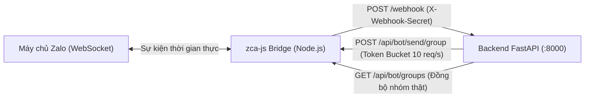

# Đặc tả Kỹ thuật Cầu nối Zalo WebSocket (`zca-js` v1.5.0)

Module `zca-js` là dịch vụ cầu nối Zalo sử dụng **Node.js (ESM)**, cung cấp khả năng lắng nghe sự kiện tin nhắn nhóm theo thời gian thực qua kết nối WebSocket và cung cấp máy chủ HTTP REST nội bộ tương thích hoàn toàn với chuẩn giao tiếp của `oa-bridge` và `backend`.

---

## 1. Vai trò trong Hệ thống

Hệ thống VSICO Zalo Bot thiết kế tầng giao tiếp Zalo trừu tượng hóa tại `backend/src/infrastructure/zalo_client.py`, cho phép chuyển đổi linh hoạt hoặc vận hành song song giữa hai cơ chế cầu nối:
- **[`oa-bridge` (`../oa-bridge/OA_BRIDGE.md`)](../oa-bridge/OA_BRIDGE.md)**: Tích hợp chính thức qua Zalo Official Account OpenAPI v3.0 (hỗ trợ nhóm GMF và chat cá nhân `direct_<user_id>`).
- **`zca-js` (Tài liệu này)**: Kết nối trực tiếp qua giao thức WebSocket bằng thư viện `zca-js` cho các kịch bản nhóm Zalo tiêu chuẩn chưa kích hoạt GMF.

Cả hai dịch vụ đều cung cấp chung hợp đồng REST API nội bộ (`/api/bot/status`, `/api/bot/groups`, `/api/bot/groups/:groupId/info`, `/api/bot/send/group`, `/api/bot/send/user`) và đẩy sự kiện về `POST /webhook` của `backend`.

---

## 2. Kiến trúc Luồng Dữ liệu



---

## 3. Hợp đồng API Nội bộ

| Phương thức & Đường dẫn | Mô tả chức năng |
| :--- | :--- |
| `GET /health`, `/api/health`, `/api/bot/status` | Kiểm tra trạng thái phiên đăng nhập WebSocket (`ready`, `listenerRunning`). |
| `GET /api/bot/groups` | Lấy danh sách toàn bộ nhóm Zalo thực tế mà tài khoản Bot đang tham gia để đồng bộ sang bảng `zalo_groups` của Backend. |
| `GET /api/bot/groups/:groupId/info` | Truy vấn tên nhóm, tổng số thành viên và danh sách thành viên (`members`) theo `groupId`. |
| `GET /api/bot/groups/:groupId/messages` | Lấy lịch sử tin nhắn trong nhóm hoặc lọc theo `userId`. |
| `GET /api/bot/users`, `GET /api/bot/users/:userId` | Truy vấn danh sách bạn bè/người dùng Zalo hoặc chi tiết một `userId`. |
| `POST /api/bot/send/group`, `POST /api/bot/send/user` | Phát hành tin nhắn văn bản hoặc trích dẫn (`quoteMsgId`) vào nhóm Zalo đích hoặc gửi 1-1. |
| `GET /api/bot/realtime/messages`, `POST /api/bot/realtime/clear` | Đọc hoặc xóa bộ nhớ đệm tin nhắn realtime. |
| `GET /api/bot/friends/pending`, `POST /api/bot/friends/accept`, `request` | Quản lý lời mời kết bạn trên tài khoản Zalo WebSocket. |

---

## 4. Quy tắc Bảo mật & Vận hành

1. **Không commit thông tin phiên đăng nhập**: Tuyệt đối không đưa các tệp `credentials.json`, `cookies.json` hoặc ảnh `qr.png` vào kho lưu trữ Git.
2. **Tập trung biến môi trường**: Toàn bộ cấu hình cổng (`ZCA_SERVER_PORT`), đường dẫn Webhook (`BACKEND_WEBHOOK_URL`) và khóa bí mật (`ZALO_SECRET_KEY`) đều được đọc từ tệp `.env` duy nhất tại thư mục gốc của dự án.

```bash
cd zca-js
npm install
npm run bot
```
